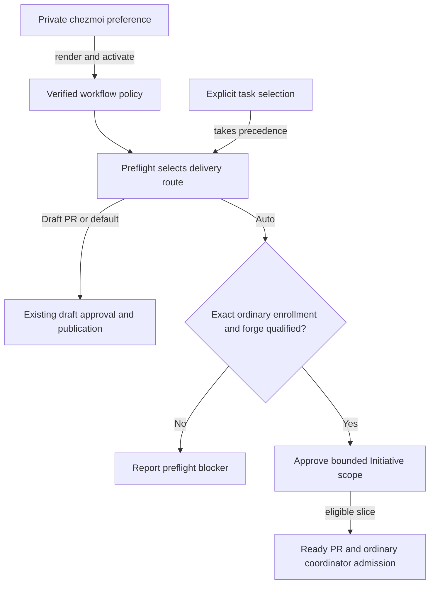

# Delivery preference

## Outcome and ownership

New operator-facing Initiative delivery offers **Draft PR** and **Auto**. Draft
PR is the shared default. A private chezmoi preference can select Auto. The
existing policy renderer owns preference distribution. DBSCTR preflight owns
resolution and approval binding. The coordinator owns qualified PR delivery.
The Initiative queue owns selection, scheduling, repair limits, and the bounded
grant for the exact approved manifest revision and selected slices.

The user can accept a draft, choose Draft PR explicitly, or select Auto and
approve the qualified Initiative run once. Auto publishes ready PRs and submits
each eligible slice to the ordinary coordinator path. Ordinary review,
protection, exact-candidate CI, and forge qualification still apply. Existing
review exceptions remain separately authorized. These behaviors extend the
[policy owner](../../specs/dotfiles_ai_distribution/features/workflow-storage-policy.md)
and the [coordinator contract](../../specs/dbsctr_v3_lifecycle/features/integration-coordinator.md).

## Configuration and resolution

The managed private `chezmoi.toml` accepts the optional string
`data.dotfiles_ai.workspaces.delivery_preference`. The exact values are
`"draft_pr"` and `"auto"`. Omission selects Draft PR for new operator-facing
Initiative delivery. Preserve the existing handling of absent workspace
configuration. An unknown value, wrong type, or unqualified installed generation
must fail validation with a diagnostic before selecting a delivery path.

```toml
[data.dotfiles_ai.workspaces]
schema_version = 1
delivery_preference = "auto"
```

Add the key to the existing `workflow-policy` renderer and validation contract.
The managed private policy carries an explicit value when supplied. Keep the
existing generated shape for omitted values. Apply the same source-generation,
ownership, and activation checks to this field as to the rest of that policy.
Document the optional value in `config.example.toml`. The renderer and lifecycle
reader must be qualified together before the option becomes available.

| Case | Resolution |
| --- | --- |
| Resume or reconcile a registered cycle or admitted obligation | Use its recorded delivery mode and grant. Recheck applicable authority through the existing lifecycle and coordinator. |
| Explicit task override | Use the existing CLI route and its authorization checks. A task can select Draft PR even when the personal preference is Auto. |
| New operator-facing Initiative delivery with no task override | Read the explicit preference from the activated policy. Use Draft PR when the preference is absent. |
| Auto selected | Qualify the exact repository, target, forge and ordinary coordinator path at preflight. Report the effective mode and exact approval scope. |
| Auto selected and qualification fails | Return a concrete blocker before registration or publication. An explicit Draft PR choice is available where the forge and policy qualify that separate path. |
| Delivery outside the preference flow | Retain the existing CLI route and its mode resolution. |

Explicit CLI values `inherit`, `off`, `draft_pr`, `pr`, `ordinary`, and
`admin` retain their current meanings. An explicit `inherit` keeps its
existing policy resolution. A launch entry point must distinguish an explicit
mode from an omitted selection where the new preference applies. The
operator-facing Auto name selects ordinary delivery and Initiative continuation.
The current internal `draft_pr` launch intent can remain the compatible
transport for an ordinary coordinator enrollment. Record and test the effective
PR state and coordinator enrollment independently of that transport name.

## Authority and compatibility

The preference selects a path. Native identity, activated exact-repository and
target enrollment, forge capabilities, the approved Initiative scope, and
existing source and merge gates authorize effects. Auto preflight must confirm
this route can publish, admit and qualify the selected work. An unqualified
forge, inactive enrollment, missing credential, or stale policy produces an
actionable blocker. Switching routes requires an explicit Draft PR choice or
the separately enrolled administrator review-exception path.

Bind the effective selection to fresh preflight and to the new run's approved
scope. Before approval, a change that alters the resolved launch invalidates
that preview. After approval, a personal preference change governs subsequent
selections. Use the existing custody and reconciliation rules for in-flight
effects. Changes to authorization or native policy follow the existing
fail-closed authority rules.

The managed policy digest covers rendered content, and existing publication and
coordinator checks also compare that digest with stored birth and grant records.
Qualify a versioned authority identity that is stable across preference-only
changes while still checking the activated document and preserving existing
release and enrollment bindings. Retain every original approval and digest.
For a legacy record, establish the match using its original digest and verified
policy lineage. Require current authority or use the existing reconciliation
path if lineage cannot be established. Test compatibility for existing policy
documents, activated generations, and readers that validate the document shape.
The legacy and new forms must both preserve native review protections.

Implementation should extend `executable_workflow-policy` and the existing
chezmoi template path, then resolve the preference at the operator-facing
preflight entry point in `executable_dbsctrctl`. Reuse the existing
`integration_delivery_mode`, `integration_birth_enrollment` and source
publication checks. Reuse ordinary coordinator admission whenever native parity
is qualified. The queue owns its grant and exact repair scope. The adapter owns
native forge semantics. The existing policy owner and merge path serve this
slice.

## Acceptance

| Given | When | Then |
| --- | --- | --- |
| A new operator-facing Initiative delivery with no preference or explicit mode | The operator approves a qualified draft launch | Its PR is draft and has no coordinated merge obligation. A preference read alone has no publication effect. |
| A private Auto preference and a qualified ordinary target | The operator approves the exact run | Eligible slices publish ready PRs and use ordinary coordinator admission. The operator receives the effective selection and scope in preflight. |
| A private Auto preference and inactive enrollment or unqualified forge capabilities | The operator attempts preflight | Preflight identifies the missing capability or enrollment. It creates no cycle or remote effect. |
| A private Auto preference and an explicit Draft PR task selection | The operator approves a qualified launch | That task uses Draft PR with the existing authorization rules. |
| An existing legacy explicit mode or approved launch | The new managed generation reads or resumes it | Its meaning, stored digest, and approval verify under the compatible reader. |
| An approved or admitted run with unchanged authority | The personal default changes and the managed policy is re-rendered and activated | Its bound mode, original digest and qualification remain valid. New selections use the new default. |
| An approved or admitted run | Repo enrollment, native authority, or release evidence changes | Existing fail-closed authority and reconciliation rules apply. |
| A malformed preference or a mismatched managed generation | The system resolves policy | It reports the configuration error and creates no launch authority. |

Build proves the TOML-to-policy rendering and activation behavior, absent and
malformed values, CLI precedence, preflight mode and digest binding, historical
approval readability, and the inactive-policy cases through the existing
workflow-policy and lifecycle fixtures. Extend `tests/test_integration_policy.py`,
`tests/test_integration_lifecycle.py`, `tests/test_integration_guidance.py`,
and the affected Initiative launch tests. Use paired native Forgejo and GitHub
qualification evidence for ready and draft release paths when those adapters
become available. Keep rollout evidence under the existing managed distribution
authority.

## Visual Evidence

| Concern | Applicability |
| --- | --- |
| Boundary | required: ownership and authority flowchart below |
| Interaction | required: selection and approval flowchart below, with ordered text equivalent |
| State | required: resolution and acceptance tables above |
| Data/trust | required: private input, verified policy, approval and effect boundaries in the flowchart |
| Schema | not_applicable: one scalar preference with the exact values specified above. The existing policy and grant contracts own persistence. |
| Dependency/deployment | required: existing renderer, lifecycle and coordinator dependency chain in the flowchart |
| Quantitative | not_applicable: delivery selection depends on policy and evidence, with no numeric forecast. |

**Review question** Which component controls the preference, which controls
approval, and when can Auto submit a slice?



**Text Equivalent.** The distribution maintainer renders private chezmoi
preference into the existing verified workflow policy. At preflight an explicit
task selection takes precedence. Draft PR uses the existing draft approval
and publication path. Auto requires exact ordinary enrollment and a qualified
forge. Failed qualification reports a preflight blocker before effects. After
the operator approves the bounded scope, the queue can publish eligible slices
as ready PRs and submit them to the ordinary coordinator. Previously recorded
approval and custody follow the resolution table.

**Canonical sources and owners.** The [storage policy](../../specs/dotfiles_ai_distribution/features/workflow-storage-policy.md)
and its renderer own preference distribution. Lifecycle preflight owns
selection and approval binding. The Initiative queue owns advancement and the
coordinator owns admission. Update this visual, text equivalent, and decision
tables together when the ownership, approval sequence, qualification rules,
or compatibility behavior changes.
