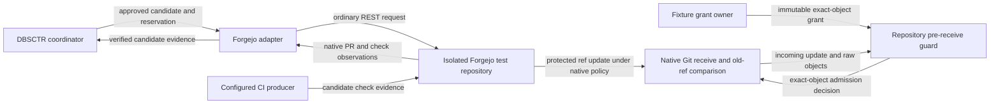
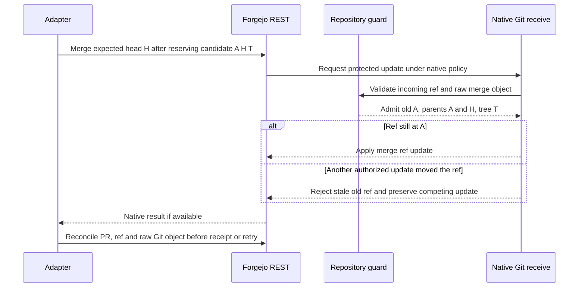

# Forgejo delivery parity

## Scope and qualification decision

Forgejo should support the same DBSCTR delivery outcomes as GitHub. For an
explicitly enrolled repository, DBSCTR must be able to publish or recover the
correct PR, evaluate trusted CI for the exact candidate, and complete an authorized
protected merge. The existing coordinator owns slice order, policy, CI repair,
recovery and tally. This adapter supplies native operations and evidence to that
coordinator. Forgejo keeps its ordinary merge-commit strategy and proves the
source correspondence required by the shared delivery contract.

The installed Forgejo workflow supports local-only cycles. The selected Forgejo
v15 API supports PR and status operations and an expected-head merge request.
Its public merge request has no expected-base field. The ordinary outdated-branch
rule relies on behind-state refreshed asynchronously. Exact current-base
enforcement was separately qualified in one fixture using the existing
repository-scoped pre-receive guard and native Git ref comparison. That proof
covers the tested ordinary REST path and synthetic grants under its stated
installation assumptions. [Forgejo support and prior qualification](../../specs/dbsctr_v3_lifecycle/features/forgejo-support.md).

The next native qualification uses that guard and a separately authorized
isolated test repository on the Pi. Discovery adds no repository, hook, role,
credential, service or consumer configuration. Reuse the existing guard contract
and harness. Preserve generated native protection hooks, the fixture boundary and
historical evidence. Before the test, bind the exact test repository, roles,
version, executable digest, target ref, permitted operations and preservation
or cleanup plan in the approved qualification scope. Consumer repositories and
shared server settings are outside that scope.

Forgejo 15.0.10 is the initial qualification target. The adapter must use the
qualified v15 contract to publish, observe CI and exercise protected integration
without requiring an upgrade. Accept a different server version for mutations
after confirming its relevant capabilities and qualifying the same boundaries.
The [existing local-only route](../../specs/dbsctr_v3_lifecycle/features/forgejo-local-registration.md)
and GitHub behavior remain compatibility requirements.

Consumer activation is a separate capability gap. It requires an approved
repository, target and merge policy, bound HTTPS Git and API identities,
independent proof of effective protections on the ordinary merge identity,
attested CI producer and real suite, and a durable owner for the guarded server
path. That owner must prove guard coverage and loaded health for the supported
writers, and define and test assignment, expiry and revocation of production
grants. A synthetic admission grant or fixture test result carries no consumer
merge authority. Report the exact missing capability and retain work when these
proofs are unavailable. [Engineering Profile](../../specs/dbsctr_v3_lifecycle/PROFILE.md).

## Provider contract

### Publish and recover the PR

- Resolve the approved provider, origin, repository, effective HTTPS Git and API
  accounts, owned source ref and protected target. Reuse the existing native
  credential boundary. Bind every native operation to this identity and its
  approved delivery obligation. Keep credentials, private repository identifiers
  and raw runtime evidence in private custody.
- Push only the owned feature ref through the approved transport. Read all
  relevant PR pages for the exact source owner, repository, ref and target.
  Reuse one exact open match, stop on ambiguity, and retain terminal history.
  Verify native PR identity, URLs, refs, current head and desired readiness after
  create or reuse. Observe an uncertain write before retrying it.
- Draft mode creates or reuses a native draft. Use the qualified instance title
  representation and verify the returned draft state. Store the intended title
  and exact provider-added prefix separately. Auto follows the shared delivery
  policy and creates a ready PR when it needs a new one. When promoting an adopted
  draft requires a title edit, use a qualified conditional operation or
  equivalent concurrency control, preserve the title, and re-read native
  readiness and exact source. If a pending title edit cannot be protected
  against a concurrent edit, report the missing capability and keep the draft.

### Evaluate exact trusted CI

- Obtain the complete effective required-check policy and its configured
  producer, workflow or job definition, approved event, toolchain and applicability.
  Bind accepted evidence to the native run or equivalent trusted receipt, current
  attempt, exact tested object and its approved head, base, tree and source
  projection. Match the shared delivery obligation and generation. A base or head
  change requires fresh evaluation and appropriate new evidence.
- Paginate PRs, status contexts and selected runs within the qualified API
  contract and configured bounds. An aggregate success from a partial result,
  a page-local total, missing records, unfinished pagination and ambiguous
  attempts are insufficient. A correctly named context from an untrusted
  producer is insufficient. Every applicable required obligation needs qualified
  success and evidence that the selected work ran. Skipped, neutral, cancelled,
  timed-out and ambiguous outcomes cannot satisfy a required check.
- Normalize provenance, current state and failure facts for the existing
  coordinator. Trust the configured project validation authority. Dagger
  evidence is eligible when the declared producer and exact candidate bindings
  meet that contract. It creates no separate queue or permission to satisfy
  native checks through another channel.

### Observe and reconcile CI on v15

Required v15 telemetry is the PR and observed head/base, named required
contexts, the native run identifier and safe link when available, state,
conclusion, available native timestamps, last successful observation, and
elapsed time in the observed state. Include the first evidenced failing or
unresolved context, or state when attribution is unavailable. Associate the
observation with the coordinator obligation and current revision so reporting
or a retry cannot attach an older run to a new candidate.

For red CI, hand the bounded failure facts to the existing repair path only for
an authorized candidate revision. Report queued, running without progress,
failed, stale and unavailable observations distinctly. For a stuck run, show
what the instance returned, the missing evidence, and the corresponding recovery
action. Examples include inspecting a queued run's selected runner, waiting on
an active check, examining an explicit failed job, or dispatching fresh CI after
an authorized revision when the project supports that operation. Poll within the
coordinator's bounds and observe native state before dispatching again.

Detailed jobs, logs, cancellation and rerun are capability-dependent. v16 adds
Actions log and cancellation APIs and corrects how skipped jobs are reported.
v17 adds a rerun API and richer run telemetry. On v15, a success-like native job
state alone cannot prove that work ran when skip status is ambiguous. Report
unavailable detail explicitly and use qualified check execution evidence for
green. A newer endpoint can enrich the report after its semantics are qualified.
[Forgejo v16 Actions changes](https://forgejo.org/2026-07-release-v16-0/#actions-related-api-additions),
[Forgejo v17 Actions changes](https://forgejo.org/2026-10-release-v17-0/#forgejo-actions-api-improvements).

### Integrate through the protected path

Before requesting a merge, reobserve native readiness, effective policy,
ordinary actor eligibility and exact target base `A` and PR head `H`. Keep any
privileged policy inspection separate from the ordinary merge identity. Verify
qualified CI, review and delivery authority for the same candidate and raw tree
`T`. Reuse the coordinator's reservation and reconciliation. Submit the
reserved immediate REST merge with expected head `H` through the guarded
target. Keep native branch protection enforced. Admin bypass, direct
protected-ref pushes and weakening required checks are outside the protected path.

The existing fixture guard checks the incoming target update against the
immutable grant for repository, ref, `A`, `H` and `T`. It inspects the raw Git
objects and permits only the expected old ref and merge with ordered parents
`[A, H]` and tree `T`. Native Git atomically compares the old ref during the
update. The protocol must continue to reject a competing change even if it
arrives after guard validation and before the original request updates the ref.
A client lock, re-read, native expected head or timing stress result alone
cannot supply this guarantee. [Existing guard contract](../../specs/dbsctr_v3_lifecycle/features/forgejo-support.md#fixture-only-pre-receive-guard-contract),
[Forgejo branch protection](https://forgejo.org/docs/v15.0/user/repository/protection/).

Confirm the exact native PR delivery and inspect the landed raw Git object,
ordered parents and tree. Verify the landed object on the approved target,
source correspondence and the coordinator's candidate binding before accepting
delivery. The v15 commit REST representation's nested tree field is insufficient
for that verification. After a timeout or lost response, record an uncertain
mutation and observe native PR, ref and object state. Only a supported,
reconciled outcome may permit a fresh attempt. Keep the existing receipt and
retirement rules. [Shared adapter contract](../../specs/dbsctr_v3_lifecycle/features/integration-runtime-adapters.md),
[Forgejo v15 Git commit conversion](https://codeberg.org/forgejo/forgejo/src/tag/v15.0.10/services/convert/git_commit.go#L174).

## Evidence and acceptance

| Risk | Required demonstration |
| --- | --- |
| Wrong repository, ref, or actor | Show exact account and origin binding, denial for another account or target, complete PR enumeration, open versus terminal history, retry adoption and conservative treatment of ambiguous responses. |
| Draft title or readiness drift | Exercise configured prefix and verified draft creation, a ready creation for Auto, preserved title on qualified promotion, concurrent edit or changed head/base refusal and a lost response. |
| False green | Cover success on page one with failure on a later page, page clamping or incomplete pagination, missing and empty contexts, producer or definition mismatch, stale attempted run, head or base drift, skipped work and exact trusted success. Replay these cases on v15 inputs where telemetry is absent. |
| Unhelpful CI wait | Feed queued, unchanged running, red, superseded, and temporarily unavailable v15 observations. Check elapsed time, attributable context, bounded diagnostics, and reconciliation before retry. Exercise the same normalized outcomes through GitHub regression coverage. |
| Unsafe protected change | Use the existing guard harness for positive and negative grants. In the isolated fixture, test the ordinary REST actor, stale head, missing required check, failed required check, absent or mismatched grant, contested base and native merge readback. Force a competing legal update after guard validation and assert conflict on the old request and preservation of the competing ref. Verify that native protection hooks were preserved. |
| Unknown merge outcome | Lose the response after request submission. Prove that native readback identifies the exact merged object or retains uncertainty, prevents duplicate mutation and blocks receipts and retirement until reconciled. |
| Premature enablement | Omit verified guard health or principal/producer authority and assert unavailable mutation, preserved work and a clear capability report. Run existing Forgejo local-only and GitHub tests. |

The controlled Pi fixture run must retain exact version and selected-role evidence,
installed guard digest and policy snapshots, the ordered race setup and observed
native responses, and raw refs, commits and trees. An ordinary-role denial or
an unavailable observation needs its own expected result. A fixture pass is
evidence only for that runtime and route. Consumer activation later needs
separate deployment and operating evidence.

Use the [Engineering Profile](../../specs/dbsctr_v3_lifecycle/PROFILE.md) and
the [existing Forgejo acceptance authority](../../specs/dbsctr_v3_lifecycle/features/forgejo-support.md#existing-authorities-and-future-acceptance)
for the affected Python/Security closure. Run the configured affected tests,
compilation, distribution or rendered configuration checks as applicable, and
the existing publication and instruction checks on the exact source candidate.
The affected kernel gates, Review/Integrate and Maintain/Retire apply. Source
delivery has no independent release artifact or installation. The separate
approved live fixture qualification requires Deploy and Operate evidence for
its scope. All implementation and runtime evidence is pending.

## Visual Evidence

| Concern | Decision |
| --- | --- |
| Boundary | required: context flowchart |
| Interaction | required: sequence diagram |
| State | required: transition table |
| Data/trust | required: directional data flow in the context flowchart |
| Schema | not_applicable: the adapter uses the existing provider identity, coordinator evidence and fixture grant contracts |
| Dependency/deployment | required: scoped runtime dependencies in the context flowchart |
| Quantitative | not_applicable: no threshold or comparative measurement changed |

### Context and trust

**Review question.** Who has authority over each decision in an isolated
Forgejo qualification?

**Text Equivalent.** The shared coordinator sends only its approved candidate
and reservation to the adapter. The adapter acts as an ordinary actor on the
isolated Forgejo repository and checks its native PR and status observations
before returning candidate evidence. The configured producer supplies check
evidence for that candidate. The fixture grant owner supplies the repository
guard with an immutable exact-object grant. Forgejo's native protection remains
in the path. Native Git provides the incoming update and raw objects to the
guard and receives its admission decision. Git compares the old ref on accepted
updates. The diagram describes the fixture topology.

**Canonical source.** This provider contract and the
[existing fixture guard contract](../../specs/dbsctr_v3_lifecycle/features/forgejo-support.md#fixture-only-pre-receive-guard-contract).
**Owner.** DBSCTR lifecycle maintainer. Update with changes to actor authority,
CI identity, guard placement, storage boundaries or protected-ref write paths.

### Exact protected merge

**Review question.** How does a stale base lose the write even after the
repository guard has accepted the exact candidate?

**Text Equivalent.** The adapter reserves the candidate consisting of old base
`A`, head `H` and tree `T` and uses the native expected-head request. The
native path applies branch protection, and the repository guard admits only old
value `A` and a merge with parents `[A, H]` and tree `T`. The native ref update
applies if the actual old value is still `A`. If a competing legal update
already moved the ref, Git rejects the stale request and preserves that update.
The adapter uses native reconciliation and raw Git evidence before accepting the
receipt or retrying, including after a lost response.

**Canonical source.** The protection contract above and the
[existing controlled fixture qualification](../../specs/dbsctr_v3_lifecycle/features/forgejo-support.md#completed-fixture-guard-qualification).
**Owner.** DBSCTR lifecycle maintainer. Update with changes to merge strategy,
guard ordering, native ref semantics or readback.

### Provider outcomes

**Review question.** Which native facts allow the adapter to change the active
candidate or record protected delivery?

| Current situation | Guard or observation | Result |
| --- | --- | --- |
| PR selection pending | Exactly one open match or a verified create | Bind the selected native PR and continue. |
| CI pending | Complete evidence for current candidate and all applicable checks successful | Candidate may proceed through the remaining integration guards. |
| CI red or incomplete | Known failure, new candidate, pending check or missing authority | Provide precise state to the coordinator for repair, wait or a scoped blocker. Keep the candidate unmerged. |
| Candidate ready | Ordinary actor and exact authority available | Reserve and submit through the qualified protected path. |
| Merge submitted | Definitive conflict, stale head or changed base | Preserve work and require fresh native candidate evaluation. |
| Merge submitted | Timeout or uncertain result | Reconcile native PR, ref and object state before considering a retry. |
| Merge submitted or reconciled | Exact landed object and source correspondence proved | Accept verified delivery through the existing receipt path. |

**Text Equivalent.** Verify an open PR before candidate evaluation. Complete
exact CI can advance the candidate, while failure, pending or missing
authority yields a distinct coordinator observation and keeps work unmerged.
Only the reserved, approved ordinary path can submit a merge. A stale or
conflicting result returns to candidate evaluation. An uncertain result is
observed before reconsidering a write. Accept delivery only on proof of the
exact landed object and source correspondence.

**Canonical source.** This provider contract and the
[shared integration runtime contract](../../specs/dbsctr_v3_lifecycle/features/integration-runtime-adapters.md).
**Owner.** DBSCTR lifecycle maintainer. Update with changes to normalized
outcomes, eligibility, retry behavior or completion evidence.
