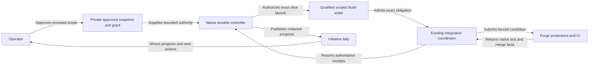
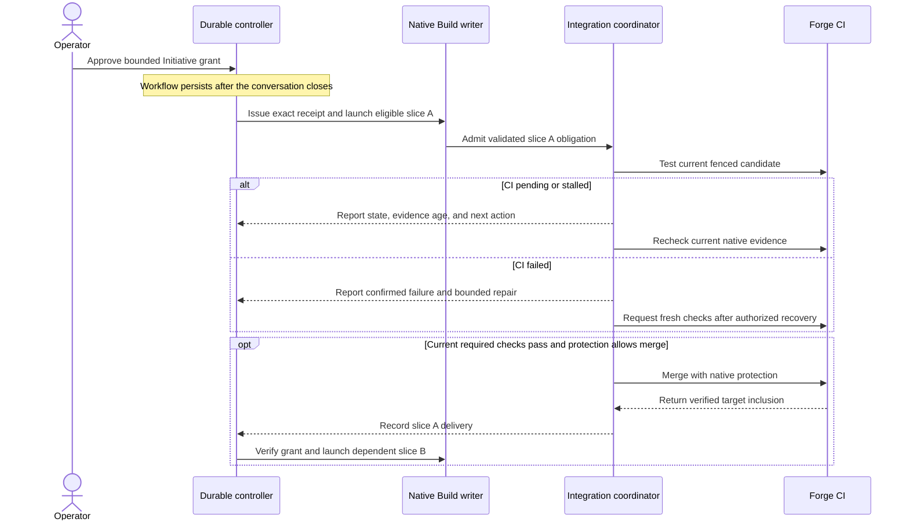

# Initiative Auto and progress

## Outcome and scope

An operator approves one closed set of Discovery slices for automatic delivery. DBSCTR implements each eligible slice, follows the approved dependencies, and verifies delivery through the repository’s required CI and merge protections. The workflow continues when the originating conversation closes. The operator can open an active or completed Initiative to see what happened, what is still running, and what would unblock it.

The personal `Auto` preference selects this mode. Authority comes from the explicit approval of an exact Initiative and its scope. Draft PR is the delivery default. Other modes continue to use the existing per-slice launch review. Auto is an additive authority path for enrolled repositories and requires implementation and qualification before use. [Initiative Discovery contract](../../specs/dbsctr_v3_lifecycle/features/initiative-discovery.md)

## One bounded grant

Auto start presents the repository and target branch, the canonical Initiative digest, selected slice IDs, their approved dependencies, and the operation and repair limits in a single review. The persisted approval binds the approving identity to that scope and to the versioned artifact and policy inputs used for the decision. Capture the effective mode, qualified controller and implementation writer identities, applicable CI and repair policy, and the conditions under which approval expires or is revoked. The approval can cover all slices in a reviewed plan or an explicitly selected subset whose dependencies are delivered or covered. Approval and enrollment are auditable separately.

Keep the approved normative snapshot and execution records separate. The digest must cover material requirements, acceptance evidence, boundaries, dependency and release conditions, repository target, and authoritative artifact references. Keep status, retries, ticket links, and delivery evidence in the execution record. The same grant must survive its own progress. Verify the approved snapshot’s digest and compare the current slice and its dependency closure against the snapshot before each launch and before each next external mutation. Fresh base or head evidence alone can be reconciled under the same grant when the change stays inside its approved contract. A change to the selected requirements, acceptance conditions, artifact meaning, dependency graph, or approved mutation rights returns affected work to Discovery. Independent work can continue only where evidence confirms that its scope and dependencies still match the snapshot. A replacement scope requires its own approval.

The current per-slice receipt reads the committed manifest and requires the slice to be marked ready and its dependencies delivered. Extend receipt issuance for Auto to verify the committed approved snapshot and derive eligibility from verified prerequisite delivery records. A reviewed slice can wait for an approved prerequisite without changing the snapshot. Preserve the existing manual receipt path.

At activation, issue a fresh Initiative receipt and exact launch plan for the current slice under its inherited Auto authority. Preserve checks for a clean isolated checkout, selected upstream, current base, required Build/review gates, and deterministic affected validation. Record which grant authorized this exact launch. The controller acts as its own authenticated identity and records the operator identity as the source of authorization. The controller must durably acknowledge admitted work so delivery state survives closing the chat, restarts, and replay. A local preference, a previously approved neighboring slice, or an unrelated integration obligation cannot authorize implementation.

## Continue across slices

Select eligible slices from the approved dependency graph. Verify each prerequisite’s expected change in the target and any additional release condition required by the plan before starting dependent work. Start with serial implementation per target and continue through eligible work in the approved order. When approval changes or expires, stop new mutations in the affected scope and reconcile any external action whose outcome remains uncertain.

Run verified source implementation through a separately qualified native writer and durable controller. The controller owns scheduling and recovery from persisted state. The writer owns the scoped source change and Build workflow in the isolated checkout. A chat-based Build session can establish intent and display progress. Native durability must cover implementation of a slice that has never been started as well as reconciliation of an admitted PR. Confirm both capabilities under provider-specific rollout gates.

Reuse the existing [integration coordinator](../../specs/dbsctr_v3_lifecycle/features/integration-coordinator.md) for integration admission, ticket ordering, the fenced candidate slot, and verified protected merge. Persist the admission receipt and exact obligation before treating a slice as handed off. Confirm trusted required CI for the current candidate against the current target and confirm that the forge applied its native protection and included the resulting change. A repeated event must resolve to the same slice, activation, and obligation. On uncertain admission or merge outcome, recover authoritative evidence before retrying or advancing a dependent.

## Reconcile CI

| Native evidence | Auto behavior | Operator sees |
| --- | --- | --- |
| Trusted required checks passed for the current tested candidate | Use the existing protected merge path and verify inclusion and the delivery receipt. Refresh the candidate and evidence when native rules require a newer base. | The tested revision, required check result, and merge result or outstanding protection. |
| A required check conclusively failed | Classify the cause and use the [runtime adapter’s inherited repair contract](../../specs/dbsctr_v3_lifecycle/features/integration-runtime-adapters.md#inherited-routine-repair) for bounded, intent-preserving repair. For infrastructure failures, restart the same source only after evidence of a concrete correction and a safe retry. Recheck the repaired or refreshed candidate. Escalate exhausted limits or repairs that need new authority. | The failing check, recorded cause, applicable repair limit and attempts, and the repair underway or next action. |
| Required evidence is still pending, queued, running, or missing | Observe the provider’s wakeups and durably recheck when they are late or missed. Apply the enrolled policy’s no-progress threshold to flag a stall. Reconcile the latest runner or provider evidence, retain the integration fence, and resume when progress returns. | The last known activity and age, runner queue or check state, what is missing, and a next step specific to the observed cause. |
| Provider unavailable, event duplicated, or native mutation outcome unknown | Re-read the authoritative native state with the existing replay and quiescence guards. Persist the uncertainty, retain fencing, and wait for safe recovery before repeating a mutation. | Evidence availability, last verified state, effects that remain unknown, and the next check or recovery action. |

Stalled is a diagnostic on a waiting slice. It neither supplies a failed CI result nor consumes a repair attempt. Detect queue and evidence problems separately from check failures. Examples include no compatible runner picked up the job, a required check failed to appear, a provider read failed, or a candidate is waiting behind an existing obligation. When available, report the actual condition and owner with a specific action, such as restoring the expected runner label or correcting the required check’s configuration. When evidence is incomplete, identify the missing observation. Keep an in-flight candidate fenced until its worker and native effects have been reconciled. The [existing supervised CI watch and repair](../../specs/dbsctr_v3_lifecycle/features/workflow-integration-ci.md#bounded-watch-and-repair) stays available under its own authority.

Dagger results may be qualified as required CI evidence through the provider’s native checks path. Any local or shadow run can contribute diagnostics. Its result only counts toward merge when the qualified required check attests to the exact tested candidate.

## Progress and recovery

Derive the human tally and its machine-readable projection from persisted execution evidence. Use the approved selected slice set as the denominator. Show a delivered count, elapsed time when available, and a count by state. Include all selected slices, including those waiting on a dependency and those affected by a blocked upstream slice. A status read should work from a fresh session and identify when its provider evidence was last refreshed.

Give each slice one primary state, its dependencies, current reason, and next action. Show candidate head, base, tested revision, and PR or run links when known. For waiting or stalled CI, record admission or queue position when available, check and run attempt, the last native progress, elapsed time, any provider read error, and the recovery action and owner if identified. Preserve the distinction between timestamp freshness and actual runner progress. Store private evidence and credentials within their existing ownership boundaries. Carry only approved redacted diagnostic fields into forge-visible output.

### Slice state transitions

Review question — What event changes the tally for an approved slice?

| State | Enter when | Leave when |
| --- | --- | --- |
| Waiting on dependencies | One or more approved prerequisites lack verified delivery. | All prerequisites pass, or an unresolved prerequisite requires intervention. |
| Ready | Approved dependencies pass and the slice can wait for its execution slot. | A fresh launch is authorized, or a known decision or capability blocks launch. |
| Implementing | The current controller activation and scoped launch are recorded. | Integration admission is acknowledged, or a gate or authority blocks continuation. |
| Awaiting CI or integration | An existing obligation has been admitted and is queued, running, pending merge, or awaiting authoritative evidence. | A confirmed failure starts reconciliation, verified inclusion completes delivery, or a proven issue blocks progress. |
| Reconciling | A known CI failure, stale candidate, or uncertain effect is under bounded recovery. | Fresh checks are pending, verified inclusion completes delivery, or authorized recovery is exhausted. |
| Delivered | Native protection, expected inclusion, and the delivery receipt are verified. | Terminal for this execution. |
| Blocked | A known capability, protection, prerequisite, operational problem, or exhausted repair requires action. | Evidence verifies the blocker was resolved within scope, or a revised approval is needed. |
| Discovery reopened | Authorized intent or scope is materially unclear or changed. | A newly reviewed scope is approved. The previous execution retains its history. |
| Cancelled | Cancellation is recorded and outstanding mutation effects are reconciled. | Terminal for this execution. |

**Text Equivalent.** A slice becomes ready after its dependencies finish. The recorded launch changes it to implementing. Acknowledged admission moves it to the integration wait. Failure or uncertainty can move it into bounded reconciliation. Verified inclusion and delivery evidence make it delivered. A known operational or policy problem blocks work until evidence supports recovery. Material scope change reopens Discovery and requires a new approval. Cancellation is terminal once outstanding effects are known. The tally counts each selected slice once. A stall adds a diagnostic to the current state.

Canonical source is this state contract, with underlying provider facts owned by the integration coordinator. The Initiative execution owner updates the table and projection in the same change as any state or transition.

## Existing capability and qualification

- Initiative Discovery already preserves a reviewed artifact, computes an Initiative digest, identifies ready slices, and creates exact launch plans. Build must add persisted Initiative-level authorization and status without weakening the existing launch protections.
- The existing GitHub integration coordinator can reconcile admitted work beyond the conversation. Demonstrate that its installed instance meets the required admission, repair, runner, and safe merge contracts for the selected repository. Apply the provider qualification separately to Forgejo. Provider admission alone establishes integration capability for an existing PR.
- Native execution of later implementation slices after chat closure is a distinct capability. Qualify the writer and controller together for private artifact access, checkout, scoped source updates, Build and review evidence, protected forge mutations, identity, and recovery. The mechanism is a Build decision. Auto remains unavailable for a repository until both implementation and protected integration are qualified there.
- Agree the enrolled expiry or revocation policy, stall thresholds, wakeups, and status retention before activation. Validate the selected Dagger-to-native-check path and actual runner capacity where Dagger owns a required CI check.

## Acceptance and validation

| Scenario | Evidence required before enabling Auto |
| --- | --- |
| One approval, several slices | A disposable enrolled repository delivers at least two slices with a dependency between them and a single recorded approval. Close the originating conversation before the second launch, restart the controller, and verify the second launch and status from a new session. |
| Authority boundary | Changed digest, out-of-scope slice, missing artifact, expired or revoked grant, mismatched writer, missing qualification, and changed acceptance criteria each fail closed before the next mutation. Progress and ticket receipt updates leave valid approval intact. |
| Scope shift | Change one approved dependency or material acceptance criterion mid-run. Its dependent branch returns to reviewed Discovery while independent eligible work continues when safe. |
| Verified merge | A green run for an old head, wrong base, or untrusted producer cannot deliver. A green required run for the exact candidate results in verified inclusion. An unsatisfied native protection holds the slice. Resuming after a lost merge acknowledgement records delivery once. |
| Red CI | Exercise an eligible test failure, a same-source infrastructure recovery after concrete repair, a repeated failure at the repair limit, and a proposed repair outside scope. Verify fresh checks after repair, a durable reason, and preserved original evidence. |
| Stalled CI | Exercise a queued runner, a missing check, a lost wakeup, and provider read failure. Show distinct actionable telemetry, preserve the candidate fence, and resume after restored evidence. |
| Tally and replay | Compare the human and machine tally after duplicate events, interrupted admission, a dependency wait, blocked work, and completed delivery. Verify a stable denominator, no double count or repeated mutation, and no private evidence leaking into forge-visible output. |

Run the same externally visible scenarios on each qualified provider. Exercise race and interruption cases with controlled fixtures, then verify checkout, private access, CI and forge protections on disposable enrolled repositories using the installed adapters. Verify the actual Dagger path where selected.

## Visual Evidence

| Concern | Plan |
| --- | --- |
| Boundary | required: actor and ownership flowchart |
| Interaction | required: cross-slice sequence diagram |
| State | required: slice state transition table above |
| Data/trust | required: directional grant, evidence, and telemetry flowchart |
| Schema | not_applicable: logical authority inputs and state projection are contracted here. A physical schema is a Build decision. |
| Dependency/deployment | required: writer, controller, coordinator, and provider dependency flowchart |
| Quantitative | not_applicable: no measured threshold or performance comparison is asserted. |

### Ownership and evidence flow

Review question — Which identity owns each decision and where does evidence cross an ownership boundary?

**Text Equivalent.** The operator approves a private reviewed snapshot. The grant bounds the durable controller’s authority for each exact launch. The scoped writer owns implementation and submits each exact obligation to the integration coordinator. The integration coordinator owns the fenced candidate and uses native forge protections and CI. It returns authoritative receipts to the controller. The controller projects redacted progress and next actions for the operator, and the private authority remains within its existing boundary.

Canonical sources are this grant and controller contract and the linked integration coordinator contract. The Initiative execution owner updates the diagram when identity, authority, topology, or evidence moves between components.

### Continuation and CI evidence

Review question — Can a later slice make progress after the operator leaves, including when the first candidate needs recovery?

**Text Equivalent.** One approval authorizes the durable workflow beyond the conversation. The controller issues the exact launch for slice A. The qualified writer validates the slice and admits its obligation to the coordinator. The coordinator obtains current candidate CI. Waiting or stalled CI is reported and rechecked. A confirmed failure uses bounded recovery and fresh checks. Once the current candidate passes its required protections and native inclusion is verified, the delivery is recorded. The controller rechecks the same grant before launching eligible slice B.

Canonical sources are this slice and CI contract and the linked runtime adapter contract. The Initiative execution owner updates the diagram when launch, recovery, or delivery ordering changes. Review the diagrams on the target forge as part of provider qualification.
