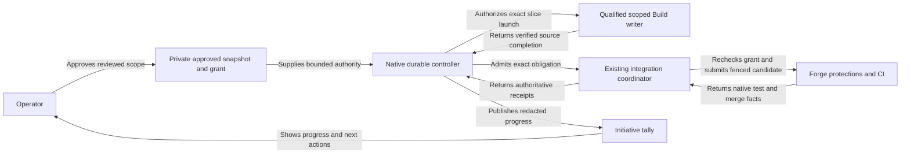
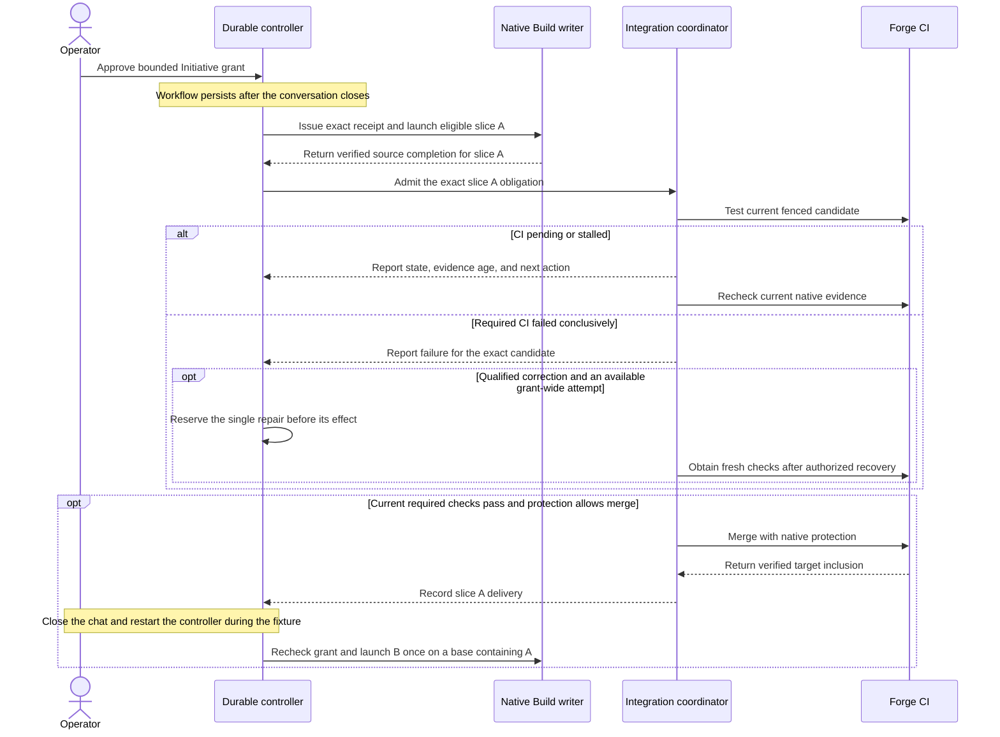

# Initiative Auto and progress

## Outcome and scope

An operator approves one closed set of Discovery slices for automatic delivery. DBSCTR implements each eligible slice, follows the approved dependencies, and verifies delivery through the repository’s required CI and merge protections. The workflow continues when the originating conversation closes. The operator can open an active or completed Initiative to see what happened, what is still running, and what would unblock it.

The personal `Auto` preference selects this mode. Authority comes from the explicit approval of an exact Initiative and its scope. Draft PR is the delivery default. Other modes continue to use the existing per-slice launch review. Auto is an additive authority path for enrolled repositories and requires implementation and qualification before use. [Initiative Discovery contract](../../specs/dbsctr_v3_lifecycle/features/initiative-discovery.md)

## One bounded grant

Auto start presents the repository and target branch, the canonical Initiative digest, selected slice IDs, their approved dependencies, and the operation and repair limits in a single review. The persisted approval binds the approving identity to that scope and to the versioned artifact and policy inputs used for the decision. Capture the effective mode, qualified controller and implementation writer identities, applicable CI and repair policy, and the conditions under which approval expires or is revoked. The approval can cover all slices in a reviewed plan or an explicitly selected subset whose dependencies are delivered or covered. Approval and enrollment are auditable separately.

Keep the approved normative snapshot and execution records separate. The digest must cover material requirements, acceptance evidence, boundaries, dependency and release conditions, repository target, and authoritative artifact references. Keep status, retries, ticket links, and delivery evidence in the execution record. The same grant must survive its own progress. Verify the approved snapshot’s digest and compare the current slice and its dependency closure against the snapshot before each launch and before each next external mutation. Fresh base or head evidence alone can be reconciled under the same grant when the change stays inside its approved contract. A change to the selected requirements, acceptance conditions, artifact meaning, dependency graph, or approved mutation rights returns affected work to Discovery. Independent work can continue only where evidence confirms that its scope and dependencies still match the snapshot. A replacement scope requires its own approval.

The current per-slice receipt reads the committed manifest and requires the slice to be marked ready and its dependencies delivered. Extend receipt issuance for Auto to verify the committed approved snapshot and derive eligibility from verified prerequisite delivery records. A reviewed slice can wait for an approved prerequisite without changing the snapshot. Preserve the existing manual receipt path.

At activation, issue a fresh Initiative receipt and exact launch plan for the current slice under its inherited Auto authority. Preserve checks for a clean isolated checkout, selected upstream, current base, required Build/review gates, and deterministic affected validation. Record which grant authorized this exact launch. The controller acts as its own authenticated identity and records the operator identity as the source of authorization. The controller must durably acknowledge admitted work so delivery state survives closing the chat, restarts, and replay. A local preference, a previously approved neighboring slice, or an unrelated integration obligation cannot authorize implementation.

## Continue across slices

Select eligible slices from the approved dependency graph. Verify each prerequisite’s expected change in the target and any additional release condition required by the plan before starting dependent work. Start with serial implementation per target and continue through eligible work in the approved order. When approval changes or expires, stop new mutations in the affected scope and reconcile any external action whose outcome remains uncertain.

Run verified source implementation through a separately qualified native writer and durable controller. The controller owns scheduling and recovery from persisted state. The writer owns the scoped source change and Build workflow in the isolated checkout. A chat-based Build session can establish intent and display progress. Native durability must cover implementation of a slice that has never been started as well as reconciliation of an admitted PR. Confirm both capabilities under provider-specific rollout gates.

Reuse the existing [integration coordinator](../../specs/dbsctr_v3_lifecycle/features/integration-coordinator.md) for integration admission, ticket ordering, the fenced candidate slot, and verified protected merge. Persist the admission receipt and exact obligation before treating a slice as handed off. Confirm trusted required CI for the current candidate against the current target and confirm that the forge applied its native protection and included the resulting change. A repeated event must resolve to the same slice, activation, and obligation. On uncertain admission or merge outcome, recover authoritative evidence before retrying or advancing a dependent.

### Continuation source delivery

Build the versioned Initiative grant and per-slice activation in the existing coordinator's private custody. Keep the approved material snapshot immutable and store progress separately. The fresh-slice launch verifies the authorized writer, repository, target, dependency delivery and current material scope. Its launch reservation survives restart and binds the native session identity before the first Build request when the writer exposes separate allocation and dispatch. An uncertain allocation or dispatch remains reserved until authoritative observations prove a unique binding or establish that the request had no effect.

Exercise restart, replay, dependency inclusion, scope drift, expiry and revocation through controlled writer and forge interfaces. GitHub continues to use its existing exact per-slice and follow-up approval routes, including explicit Draft PR. Auto activation requires an installed two-slice demonstration with the originating conversation closed and the controller restarted before the second launch.

### Managed controller and writer composition

Connect the merged grant, journal, writer and managed Begin components in one private runtime entry point. Start presents and records the exact approved scope. Resume opens the same private journal and rechecks its current authority before any new effect. Give the writer only an opaque activation reference. Bind it to the exact reserved native session and accepted first Build request before fresh cycle registration. A caller-supplied session ID is insufficient.

Use the shared Initiative controller and qualified OpenCode v2 writer for the first installed demonstration on one separately approved, disposable, private Forgejo repository. Bind the original grant to the exact provider, origin, repository, target ref, enrolled actor, effective protections, CI producer and definition, controller, writer, selected slices, and expiry. Grant only launch, admission and protected merge, with a repair limit of zero. GitHub uses its existing managed launch, ordinary protected rebase delivery, and delivery receipt format. Its installed qualification follows the same acceptance contract on a separately enrolled GitHub target.

The Forgejo writer uses the typed Initiative receipt and native local-only Cycle Record. It completes the existing Build gates in its scoped Worktrunk checkout and records the exact completed source head, tree and owned commits through local completion. The durable controller verifies that proof against the registered activation, current grant and completed Build record. The proof identifies the source the controller may hand off through its separate publication and integration boundary under the original grant. The writer receives only its opaque activation reference. The same Initiative journal owns eligibility, order, reservations and restart recovery across both providers.

Use a fixture-scoped ordinary actor for feature publication and merge. Qualify the independent CI producer and any required independent reviewer. Preserve native credentials in their existing authenticated owners and bind their public identities and the loaded guard in the private preflight. Requalify the installed controller and writer fingerprints after source changes.

| Forgejo handoff | Evidence and required behavior |
| --- | --- |
| Publish and admit | Recheck the original grant and the approved material before native effects. Push the exact completed head to its owned feature ref with ordinary fast-forward rules. Create or read back one ready pull request through the qualified Forgejo adapter, pinning repository identity, source and target refs, head, observed base and native PR identity. Retain one durable admission tied to the activation, original grant and exact source proof. |
| Evaluate the candidate | Verify the current base and qualified linear source series, raw head, tree and tested object. The fixture tests that exact head. Require each configured native status and its independent execution receipt for the approved producer, definition and current attempt. Missing, stale or red evidence holds delivery. |
| Reserve and merge | Recheck the grant, native review, effective protections, exact candidate and loaded repository guard before submitting a merge request. Durably claim one ordinary merge submission. Bind the server grant to repository, target ref, current base, head, tested tree, actor and native PR ID, with expiry within original authority. Require the guard and native Git ref comparison to enforce the tested base across submission. Use one immediate guarded merge, and retain the source ref and repository history. |
| Confirm delivery or reconcile | A delivery receipt binds the activation and reservation to the independently observed native PR merge commit, ordered parents `[base, head]`, tested tree and verified inclusion on the protected ref. The Forgejo receipt preserves the source commits attached by its merge commit. An uncertain push, PR or merge retains its exact effect fence for native readback. A revoked, expired or drifted grant permits readback of an unresolved effect and blocks new mutations. |

Source acceptance exercises both the controlled writer and Forgejo handoff. Verify private custody, exact identity, repeated wakeups, grant revocation, changed candidate or producer, withheld protection, and lost responses. Assert that ordinary publication and merge retain branches and protections. Keep credential custody with the existing authenticated owners and keep grants, raw observations and runtime paths in the private journal. The controlled tests also exercise existing GitHub delivery and Forgejo local-only registration and completion.

The installed acceptance step first lands synthetic slice A through required CI and ordinary protected merge and retains verified inclusion. Close the originating conversation and restart the independent controller with the same grant and journal, while the qualified OpenCode process remains available. Confirm that the previously unstarted dependent slice B launches exactly once in its own checkout on a base containing A. Verify B’s protected landing and both receipts from a fresh session. Source delivery, this installed fixture qualification, and consumer activation have separate preflights and evidence. Slice 6 owns CI recovery and the tally. Slice 7 owns cross-provider Auto qualification.

### Linux Forgejo comparison credentials

The managed Forgejo recipe can explicitly select a systemd service credential
for comparison reads on Linux. The credential binds the enrolled HTTPS origin,
repository, account, read role and expiry. The existing Git credential helper
returns it only for the authorized `get` request. Ambiguous, missing, expired or
misbound credentials produce redacted refusal. Exact reference validation stays
in the transport. Historical Keychain records and recipe digests remain valid.

The controller owns credential access. OpenCode and the Build process receive
only their existing scoped activation. Live qualification must prove that the
worker has no access to the credential through its filesystem, environment,
inherited descriptors or host process view. Run source evidence in a
credential-free environment with inert envelopes. Qualify the actual read-only
service role and worker isolation on the selected Linux host before protected
restart testing.

## Reconcile CI

### One repair across the selected slices

A newly approved and qualified Auto grant defaults to one shared repair attempt across the selected slice set. The controller can use it for one in-scope source fix or one verified infrastructure retry. The approval shows the enabled repair classes, writable scope, cumulative limit, and enrolled qualification and CI policy. An explicit zero-repair grant can report problems and deliver green work. Existing grants, recipes, and receipts keep their stored limits, digests, and behavior. The installed continuation fixture uses zero repair.

Before offering a repair class, qualify it for the provider and enrolled target. A grant requesting an unavailable class fails preflight with the missing capability. The operator can explicitly approve a qualified subset or zero-repair mode. Prefer the existing immutable enrollment and qualification bindings. Forgejo receipt qualification establishes CI evidence custody. Qualify the native rerun and writer capabilities separately before offering either class. Keep provider protections and required checks unchanged for this slice.

The trusted controller can reserve repair only for a current obligation with a conclusively failed required check. Match the durable failed predecessor and generation. Require qualified native and execution evidence for the exact repository, target, head, base, tested object, plan, producer, definition, invocation, and latest attempt. Untrusted, missing, ambiguous, superseded, and advisory red evidence leave the repair budget untouched.

Use a durable compare-and-set reservation keyed by the immutable Initiative grant. Bind the winner to the slice and activation, obligation and predecessor generation, exact failure and correction, approved class, and provider authority. Record it before any patch, publication, or CI request. A successful reservation spends the attempt across candidate changes, slices, crashes, and uncertain responses. A rejected proposal before reservation spends nothing. A repeated request reconciles the original reservation. Recheck the original grant, expiry, revocation, material scope, effective protections, exact candidate, and provider qualification at the final effect guard. Changed or expired authority permits only readback of unresolved effects. Keep the failed predecessor and the target fence until mutation outcomes are known.

### Choosing a CI action

| Native evidence | Auto behavior | Operator sees |
| --- | --- | --- |
| Trusted required checks passed for the current tested candidate | Use the existing protected merge path and verify inclusion and the delivery receipt. | The tested revision, required check result, and either the merge result or the outstanding protection. |
| A unique intent-preserving source fix is available for a required failure | Use the [inherited routine repair contract](../../specs/dbsctr_v3_lifecycle/features/integration-runtime-adapters.md#inherited-routine-repair). Prove ownership of the published prefix and the retained authority. Bind the exact writable change, run fresh affected gates, and use ordinary publication and candidate checks. Reopen Discovery for affected work if the correction is ambiguous or changes approved behavior. | The failing check, cause, shared repair budget, scoped fix, and fresh gates and CI. |
| A required run failed from infrastructure and a concrete verified correction permits retry | Use the provider's qualified same-source fresh-check route. Bind the corrective evidence and replacement invocation to the exact failed predecessor. Preserve source and original failure evidence and require a fresh authenticated attempt. A missing native retry capability holds the work. | The diagnosis, verified correction, and new attempt or missing capability. |
| Source or base drift makes evidence stale | Reobserve the candidate. Refresh it and run current checks only when qualified and covered by the original effects. Refresh alone spends no repair. A terminal failure still needs the repair gate for a source correction or rerun. | Which evidence became stale and which current revision needs checks. |
| Required evidence is queued, running, pending, missing, or unavailable | Preserve the candidate and fences. Use native wakeups or the enrolled bounded fallback schedule to recheck. At the no-progress threshold, diagnose a stall only when the observation supports it. | The known check or queue state, last successful observation, last native progress, read outcome, what is missing, and the next recheck or recovery action. |
| An event is repeated or a mutation response is uncertain | Read authoritative native state with the existing replay and quiescence guards. Keep the effect fenced until evidence establishes the outcome. | The last verified state, unknown effect, and next safe action. |
| Repair is unsupported, outside scope, or already spent | Hold the affected work and explain the exact blocker. A new effect requires exact authority. Independent eligible work can continue after the current target slot is safely released. Dependencies stay blocked until verified protected inclusion. | The reason the slice is held and the action needed to proceed. |

Enroll finite positive values for the no-progress threshold, normal recheck cadence, maximum unavailable-read backoff, and diagnostic retention before activation. Test the configuration with controlled clocks. Record native progress time, last successful observation, latest read outcome, and next recheck independently. Repeated observations of the same state do not reset progress age. A stale observation or read outage differs from a runner that has made no evidenced progress. A stall adds a diagnostic to the waiting state. Elapsed time alone proves neither red CI nor repair eligibility. Diagnostic retention preserves approval, failure, reservation, and delivery evidence under the existing custody rules. The [supervised CI watch and repair](../../specs/dbsctr_v3_lifecycle/features/workflow-integration-ci.md#bounded-watch-and-repair) retains its own authority and settings.

Dagger results may be qualified as required CI evidence through the provider’s native checks path. Local and shadow runs can contribute diagnostics. Only a qualified required check for the exact tested candidate can count toward merge.

## Progress and recovery

Use one read-only projection of the approved selected slice set and persisted evidence for the private human tally and versioned machine output. Show the selected total, delivered count, state counts, shared repair limit and used and remaining amounts, and elapsed time when available. Every selected slice has exactly one primary state, current dependency status, reason, and next action. Include waiting dependencies and blocked upstream work in the denominator.

Show the last verified evidence age, current candidate, failing or pending check, attempt, and allowlisted PR or run links when known. A waiting slice can carry a stall diagnostic with the verified runner or queue condition, last progress, most recent read outcome, owner if identified, and next recheck or recovery action. Leave unknown owner, queue position, attempt, or timing unavailable. Keep credentials, raw logs, local paths, session IDs, private cycle and user identifiers, and unsafe links outside shared output.

A fresh-session status request reads the existing anchored private journal in one snapshot. It creates no journal, obtains no provider credentials, and cannot invoke Resume, a recheck, or repair.

### Slice state transitions

Review question — What event changes the tally for an approved slice?

| State | Enter when | Leave when |
| --- | --- | --- |
| Waiting on dependencies | One or more approved prerequisites lack verified delivery. | All prerequisites pass, or an unresolved prerequisite requires intervention. |
| Ready | Approved dependencies pass and the slice can wait for its execution slot. | A fresh launch is authorized, or a known decision or capability blocks launch. |
| Implementing | The current controller activation and scoped launch are recorded. | Integration admission is acknowledged, or a gate or authority blocks continuation. |
| Awaiting CI or integration | An existing obligation has been admitted and is queued, running, pending merge, or awaiting authoritative evidence. | A confirmed failure can enter reconciliation, verified inclusion completes delivery, or a proven issue blocks progress. A stall only adds a diagnostic. |
| Reconciling | A known CI failure, stale candidate, or uncertain effect is under bounded recovery. A repair reserves the grant-wide attempt before the effect. | Fresh checks are pending, verified inclusion completes delivery, or a missing capability or spent limit holds the slice. |
| Delivered | Native protection, expected inclusion, and the delivery receipt are verified. | Terminal for this execution. |
| Blocked | A known capability, protection, prerequisite, operational problem, or exhausted repair requires action. | Evidence verifies the blocker was resolved within scope, or a revised approval is needed. |
| Discovery reopened | Authorized intent or scope is materially unclear or changed. | A newly reviewed scope is approved. The previous execution retains its history. |
| Cancelled | Cancellation is recorded and outstanding mutation effects are reconciled. | Terminal for this execution. |

**Text Equivalent.** A slice becomes ready after its dependencies finish. The recorded launch changes it to implementing. Acknowledged admission moves it to the integration wait. Failure or uncertainty can move it into bounded reconciliation. Verified inclusion and delivery evidence make it delivered. A known operational or policy problem blocks work until evidence supports recovery. Material scope change reopens Discovery and requires a new approval. Cancellation is terminal once outstanding effects are known. The tally counts each selected slice once. A stale candidate can be refreshed within existing authority without spending a repair. A repair for a confirmed failure reserves the one grant-wide attempt before any effect. A stall adds a diagnostic to the waiting state.

Canonical source is this state contract, with underlying provider facts owned by the integration coordinator. The Initiative execution owner updates the table and projection in the same change as any state or transition.

## Existing capability and qualification

- Initiative Discovery preserves a reviewed artifact, computes an Initiative digest, identifies ready slices, and creates exact launch plans. The managed controller persists Initiative-level authorization and execution evidence while using those launch protections.
- The existing GitHub coordinator can reconcile admitted work beyond the conversation. Forgejo supplies publication, CI assessment and guarded merge adapters, with separately qualified native fixture evidence for CI and guarded merge. Demonstrate each installed provider with its own enrolled repository and required controls. The first Forgejo restart demonstration combines those capabilities with native launch of a previously unstarted slice.
- Native execution of later implementation slices after chat closure is a distinct capability. Qualify the writer and controller together for private artifact access, checkout, scoped source updates, Build and review evidence, protected forge mutations, identity, and recovery. The mechanism is a Build decision. Auto remains unavailable for a repository until both implementation and protected integration are qualified there.
- Agree the enrolled expiry or revocation policy, stall thresholds, wakeups, and status retention before activation. Validate the selected Dagger-to-native-check path and actual runner capacity where Dagger owns a required CI check.

## Acceptance and validation

| Scenario | Evidence required before enabling Auto |
| --- | --- |
| One approval, several slices | A disposable enrolled repository delivers two dependent slices under one recorded approval. Close the originating conversation, restart the controller on the same journal and grant, and verify one first-time launch of the second slice and both protected deliveries from a fresh session. |
| Authority boundary | Changed digest, out-of-scope slice, missing artifact, expired or revoked grant, mismatched writer, missing qualification, and changed acceptance criteria each fail closed before the next mutation. Progress and ticket receipts leave a valid approval intact. |
| Scope shift | Change an approved dependency or acceptance criterion mid-run. The affected work returns to Discovery. Independent eligible work continues after the existing target slot settles and its own scope still matches. |
| Verified merge | Old head, wrong base, advisory failure, untrusted producer, and unmet protection do not authorize delivery. Required green for the exact candidate and verified native protection produce one independently verified inclusion receipt, including after a lost merge acknowledgement. |
| Shared repair budget | Concurrent eligible slices proposing source repair and infrastructure retry yield exactly one reservation. Another head, invocation, or controller process cannot reopen the budget. A zero-repair fixture can still report and deliver green work. |
| Qualified source fix | One fenced child retains the predecessor prefix, changes only approved scope, runs fresh affected gates and required CI, and delivers once. A material change returns affected work to Discovery. |
| Qualified infrastructure retry | In a separate one-attempt fixture grant, verified diagnosis and correction produce exactly one new invocation for unchanged source. Missing correction, qualification, or provider capability leaves the candidate fenced and produces no mutation. |
| Stalled, stale, or untrusted evidence | Exercise queued and running checks without progress, missing context, provider read failure, a lost wakeup, stale head or base, and a wrong producer. Verify distinct reasons and safe rechecks with no budget spend or false release. |
| Revocation, timeout, and replay | Expiry or revocation before an effect blocks the mutation. An uncertain response after an effect reconciles the spent reservation without a second write. An independent eligible slice can continue only after the target slot safely settles. |
| Read-only status and historical records | Compare text and JSON after restart with duplicate events, interrupted admission, a dependency wait, blocked work, and delivery. Preserve the denominator and budget. Missing older telemetry is unavailable. Verify no writes, provider or writer calls, private data leakage, or changes to manual and local-only behavior. |

Run controlled source tests on native Linux and qualify installed behavior on separately approved protected targets with the actual CI and writer paths. Source acceptance does not activate a worker or change credentials. The final qualification slice covers both providers. Verify the actual Dagger path where the enrolled target selects it.

## Visual Evidence

| Concern | Plan |
| --- | --- |
| Boundary | required: actor and ownership flowchart |
| Interaction | required: cross-slice sequence diagram |
| State | required: slice state transition table above |
| Data/trust | required: directional grant, evidence, and telemetry flowchart |
| Schema | not_applicable: logical authority inputs and state projection are contracted here. A physical schema is a Build decision. |
| Dependency/deployment | required: writer, controller, coordinator, and provider dependency flowchart |
| Quantitative | not_applicable: no measured threshold or performance comparison is asserted. |

### Ownership and evidence flow

Review question — Which identity owns each decision and where does evidence cross an ownership boundary?

**Text Equivalent.** The operator approves a private reviewed snapshot. The grant bounds the durable controller’s authority for each exact launch. The scoped writer owns implementation and returns verified source completion. The controller admits the exact obligation. The integration coordinator owns the fenced candidate, rechecks the grant before each new protected effect, and uses native forge protections and CI. It returns authoritative receipts to the controller. The controller projects redacted progress and next actions for the operator, and the private authority remains within its existing boundary.

Canonical sources are this grant and controller contract and the linked integration coordinator contract. The Initiative execution owner updates the diagram when identity, authority, topology, or evidence moves between components.

### Continuation and CI evidence

Review question — Can a later slice make progress after the operator leaves, including when the first candidate needs recovery?

**Text Equivalent.** One approval authorizes the durable workflow beyond the conversation. The controller issues the exact launch for slice A. The qualified writer returns verified source completion, and the controller admits the obligation. The coordinator obtains current candidate CI. The coordinator reports and rechecks waiting or stalled CI. For a confirmed required failure, the controller can reserve one shared attempt for a qualified correction before its effect. The coordinator requires fresh checks before delivery. Once current protections pass and native inclusion is verified, the delivery is recorded. The fixture closes the chat and restarts the controller at this point. The restarted controller rechecks the same grant and launches dependent slice B once from a base containing A.

Canonical sources are this slice and CI contract and the linked runtime adapter contract. The Initiative execution owner updates the diagram when launch, recovery, or delivery ordering changes. Review the diagrams on the target forge as part of provider qualification.
