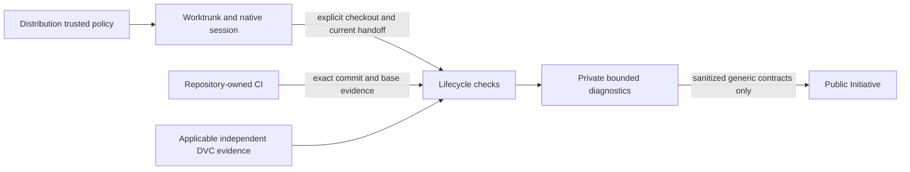

# DBSCTR Workflow Convergence

## Retirement recovery amendment

[Retirement recovery](RETIREMENT-RECOVERY.md) extends this existing Initiative
with approved record-only non-success closure, disposition-aware local archival
and manual removal, migration reachability tests, supported OpenCode journey and
one separately approved installed recovery. MANIFEST.json owns current states;
the original Discovery checkpoint below is historical, not a current delivery count.
New specification readiness does not qualify source, launch or live deletion.

**Original source slices delivered; added recovery work remains separately scoped.**
The original ten slices and operator-approved merge policy are integrated in
source. Added retirement/recovery slices retain their manifest states and separate
qualification. Source delivery does not certify installed activation, live gate
results, strict automatic retirement, or missing CI producer/watch/repair
capabilities. Preserve the qualified and unavailable boundaries in context
changelogs and the Build handoff.

## Authority and approved context map

Public coordinator: `Saltiola7/dotfiles-ai`. [MANIFEST.json](MANIFEST.json) owns
stable Initiative-local INT IDs, coverage, execution ownership and delivery DAG.
[DECISIONS.md](DECISIONS.md) records resolved Q-01–Q-13 and Build acceptance.
[BUILD-HANDOFF.md](BUILD-HANDOFF.md) owns exact source write closures and bootstrap.

| Existing context / home | Responsibility | Engineering Profile |
|---|---|---|
| `dbsctr_v3_lifecycle` / dotfiles-ai | Lifecycle, merge, preservation, CI evidence and telemetry | [PROFILE](../../specs/dbsctr_v3_lifecycle/PROFILE.md) |
| `dotfiles_ai_distribution` / dotfiles-ai | Portable TOML, native Worktrunk/DVC roots, coherent rendering and deployment | [PROFILE](../../specs/dotfiles_ai_distribution/PROFILE.md) |
| `opencode_control_plane` / dotfiles-ai | Current-session native handoff, canonical guidance and bounded tool evaluation | [PROFILE](../../specs/opencode_control_plane/PROFILE.md) |
| Repository-owned CI consumers / their own repositories | Generic dependency/check contracts; implementation/refactors remain with owners | Consumer-owned authority |

The user approved this map. The consumer row is an adjacent boundary, not a new
context or permission to change other repositories. Public artifacts contain no
private adopter identity, repository, content, branch, path, configuration, host
inventory or results. Native permissions/provider affinity remain authoritative.

## Six finalized context contracts

| Contract | Selected outcome |
|---|---|
| [Storage policy](../../specs/dotfiles_ai_distribution/features/workflow-storage-policy.md) | Native central root and collision refusal, separate repository DVC cache, one generated private policy, naming/override rules |
| [Preservation and retirement](../../specs/dbsctr_v3_lifecycle/features/workflow-preservation-retirement.md) | Bounded metadata inventory, declared-output consent/evidence, conservative directory retention, immediate eligible native cleanup |
| [Native handoff](../../specs/opencode_control_plane/features/workflow-native-handoff.md) | Safe primary fetch/fast-forward before current-only native session movement; supported authority-import bootstrap |
| [Integration and affected CI](../../specs/dbsctr_v3_lifecycle/features/workflow-integration-ci.md) | Minimal intent-driven PR review, ordered batch checkpoint, exact-head/base evidence and trusted repository-owned closure |
| [Regression feedback](../../specs/dbsctr_v3_lifecycle/features/workflow-regression-feedback.md) | Compatible flag-off rollback, attributable sanitized local feedback, bounded consented export; native Incident unavailable |
| [Agent guidance](../../specs/opencode_control_plane/features/workflow-agent-guidance.md) | Canonical Caveman/Ponytail once, minimal provider references, staged offline single-filter evaluation with activation off |

These define source contracts and failure behavior, not installed capabilities.
Conditional new-cycle precedence is reconciled in existing
[automatic delivery](../../specs/dbsctr_v3_lifecycle/features/automatic-delivery.md)
and native-workspace contracts for
[lifecycle](../../specs/dbsctr_v3_lifecycle/features/worktrunk-native-workspaces.md),
[distribution](../../specs/dotfiles_ai_distribution/features/native-workspaces.md)
and [OpenCode](../../specs/opencode_control_plane/features/native-workspaces.md).
Existing active cycles retain their original authority, failures and approvals.
Context README/CHANGELOG indexes and distribution
[Product Intent](../../specs/dotfiles_ai_distribution/PRODUCT.md) journeys 18–20
carry the same source-versus-activation boundary. No old slice is relabeled
delivered and no unfinished active-relocation work is revived.

## Source slices and dependency promotion

The CLI requires **every slice dependency delivered** before a slice can be
`ready` (`read_initiative_manifest`, lines 3603–3609 at the source baseline).
For future slices, specification readiness does not bypass dependencies. Record
real predecessor delivery, revalidate current authority and promote one eligible slice;
never fabricate delivered dependencies. Primary serializes shared CLI/skill/test
writers. Row order is a useful serial route; manifest edges are authoritative.

| Slice | Machine state | Depends on | Risk / source plan |
|---|---|---|---|
| `safety-inventory` | source delivered | None | elevated / CORE-SOURCE |
| `storage-config` | source delivered | safety-inventory | critical / DISTRIBUTION-SOURCE |
| `dvc-preservation` | source delivered | storage-config | critical / CORE-SOURCE |
| `native-handoff` | source delivered | storage-config | critical / CONTROL-PLANE-SOURCE |
| `merge-cleanup` | source delivered | dvc-preservation, native-handoff | critical / CORE-SOURCE |
| `integration-review` | source delivered | storage-config | critical / CORE-SOURCE |
| `ci-contracts` | source delivered | integration-review | critical / CORE-SOURCE |
| `regression-telemetry` | source delivered | storage-config | critical / CORE-SOURCE |
| `prompt-authority` | source delivered | safety-inventory | elevated / CONTROL-PLANE-SOURCE |
| `compression-evaluation` | source delivered | prompt-authority | elevated / CONTROL-PLANE-SOURCE |
| `operator-approved-merge-policy` | source delivered | integration-review, ci-contracts | critical / OPERATOR-MERGE |

Guidance uses existing read-only availability types; it does not require the
entire regression-feedback implementation or claim benefits from it. Initial P1
work is storage prevention, preservation cleanup and report-only reconciliation;
review/CI/feedback/guidance/evaluation remain separately bounded source slices.

## Delivery and activation boundary

Use the committed [CORE](CORE-SOURCE.plan.json),
[DISTRIBUTION](DISTRIBUTION-SOURCE.plan.json) and
[CONTROL-PLANE](CONTROL-PLANE-SOURCE.plan.json) plans. All six kernel gates,
Review/Integrate and Maintain/Retire are required. Release, Deploy and Operate are
reasoned `not_applicable` for these source-only draft PRs, not gate results or
exceptions. Later host activation requires its own exact plan/approval and live
gates; any legacy cleanup batch needs fresh bounded inventory/disposition approval.
Neither implies guest rollout or restart; the separately recorded eleventh slice
is source merge-policy guidance, not automatic runtime activation.

The first metadata-only source slice must import the **entire 25-document changed
Discovery closure** enumerated as its manifest artifacts, including all six
contracts, reconciled indexes/legacy specifications, Product Intent and three
plans. The current CLI rejects changed Discovery documents outside that receipt.
Parent Profiles retain their existing auto-allowed import treatment. This closure
is read-only authority, not permission to implement other contexts in the first
cycle. Later receipts reference their feature contracts, correct source plan and
handoff, using current main authority after the first source import merges.

Current registration requires task `HEAD == approved remote base` before import.
Preserve committed Discovery; allocate one code-only native Build checkout from
fresh default when required by that constraint. Do not reset unmerged authority,
register it as base, push a premature docs PR, duplicate data or copy environments
for phase changes. Reuse an existing checkout only when registration constraints
actually hold. Follow the exact bootstrap in BUILD-HANDOFF.

After compaction, re-read Git manifest and all referenced authority. Build obtains
a fresh receipt immediately before launch, runs exact preflight and presents
scope/risk/target/digest for plan-specific approval. Nothing here supplies that
approval or registers a cycle. Changed material plans return to Discovery.

## Preservation limits and non-goals

- New roots never move active checkouts. Shared DVC objects are immutable;
  mutable state remains independent. Targeted same-filesystem reflinks only;
  no full pull, silent copy/hardlink/symlink fallback or shared-cache GC.
- DVC 3.67.1 / dvc-data 3.18.2 cloud `{}` may conceal missing directory members.
  First release reports `remote_directory_closure_unverified` and retains such
  work/cache. No private DVC internals/custom backend verifier or remote payload
  integrity claim. Unsupported capability is defined retention, not missing design.
- Cleanup needs fresh ultimate-default merge, applicable independent data evidence,
  every artifact disposition and no known/unknown consumers. No arbitrary hold
  once fully eligible; no killing, hook bypass, bulk unknown-file commits,
  automatic abandonment, force/reset or active relocation. Emergency environment
  deletion is not the storage plan.
- Worktrunk hooks are not atomic fences. Parent-supervised native removal holds a
  cooperative reservation; local branch CAS is separate. Remote deletion uses
  already-configured GitHub after-merge behavior only with exact opt-in, final
  default and prior data preservation; no setting writes or ref-DELETE fallback.
- No universal CI runner/full-repository gate, consumer-refactor takeover,
  credential grants, mandatory-check waiver or speculative feature-flag service.
- No filter installs, proxy/data routing, paid model requests, default stacking,
  lifecycle-authority/opaque-state filtering or unsupported Incident mutation.

## Evidence and primary verification

[SOURCE-RECONCILIATION.md](SOURCE-RECONCILIATION.md) retains the public source
baseline `493fac03ea0b7959d38dc375f6e246995a41bfe1`. Primary verified upstream
unchanged at final reconciliation. Source facts—including the existing 24-hour
hold, ignored-data/process guards and sibling template—are not host results.
Pinned Worktrunk/DVC/native-interface and provider research lives in the contracts.
Existing [delivery](../dbsctr-delivery-lifecycle/README.md) and
[cycle-speed](../dbsctr-cycle-speed/README.md) histories remain intact; no DKS or
deferred concurrency work is relaunched.

Primary verifies `initiative-check`, exact receipt/import closure, Profile/plan
binding, configured publication authority over every new/imported file, links,
source/visual parity and eventual rendered diagrams. Build acceptance uses
affected repository-selected authorities and disposable fixtures. Missing evidence
remains unavailable, never zero/pass. No runtime, storage, cost or speed gain is
claimed. Specification readiness is not a passed gate.

## Visual Evidence

| Concern | Decision / review question |
|---|---|
| Boundary | required: ownership flow below; who supplies policy/evidence and who executes? |
| Interaction | required: preservation ordering below; what precedes removal? |
| State | required: transition table below; what is ready, retained or eligible? |
| Data/trust | required: ownership flow; what can enter public authority? |
| Schema | not_applicable: manifest and context schemas remain canonical; no duplicate runtime schema |
| Dependency/deployment | required: slice table and delivery boundary; what must be delivered before promotion? |
| Quantitative | not_applicable: ledger counts are not measured performance; no chart warranted |

**Text Equivalent:** Distribution renders trusted policy to native Worktrunk and
current-session control. Explicit checkout/handoff plus repository-owned exact
commit/base CI and applicable independent DVC evidence feed lifecycle checks.
Diagnostics stay private; only sanitized generic contracts enter public authority.
Scope: approved context boundary. Source: manifest INT-001–INT-004, INT-009–INT-011,
INT-034–INT-035; owner: Discovery primary; update on ownership/trust changes.

| Preservation interaction | Failure behavior |
|---|---|
| Verify final-default merge, applicable independent DVC evidence and all artifact dispositions | Retain unknown, unmerged or unpreserved work |
| Establish quiescence; fetch and fast-forward compatible clean primary | Retain on busy/unknown/diverged state; no reset |
| Move current live conversation natively only if needed, preserving identity | Retain on unavailable/failed route; no manufactured idle conversation |
| Hold parent reservation, recheck through native hook, remove with branch deletion off, observe result | Retain/report uncertainty; no hook-lock transfer or atomicity claim |
| Separately apply authorized exact-tip local branch CAS and eligible native remote after-merge policy | Changed/unsafe branch outcome retains; no force/remote DELETE fallback |

**Text Equivalent:** Preservation precedes quiescence and safe primary refresh,
which precede any current-live native handoff. Parent reservation and fresh hook
checks precede Worktrunk removal/result observation. Branch outcomes are distinct,
guarded and retain on uncertainty. Scope/source: preservation and native-handoff
contracts; owner: Discovery primary; update on ordering/guard changes.

| State | Legal outcome |
|---|---|
| Source slices delivered; runtime qualification capability-specific | Source availability does not approve launch or activation |
| New or materially changed slice | Fresh dependency checks, receipt, preflight and exact approval required |
| Unknown, dirty, active, busy, unmerged or unsupported preservation | Retain and report |
| Final-default/data/artifacts preserved and all guards satisfied | Authorized immediate native cleanup; no age-only eligibility |
| Changed evidence or unknown result | Reobserve/reconcile; preserve history and failed evidence |

**Text Equivalent:** Specification readiness and dependency promotion are separate
from runtime eligibility. Delivered source does not create missing operational
proof. New work requires fresh authority. Unsafe/unsupported states retain. Complete preservation
and fresh authorized guards permit cleanup; changes/unknown results require
reobservation. Source: manifest and preservation contract; owner: Discovery primary;
update on state/guard changes.

**Dependency Text Equivalent:** Inventory precedes storage and prompt authority.
Storage precedes DVC preservation, native handoff, integration review and regression
feedback. DVC and handoff precede cleanup. Review precedes CI; prompt authority
precedes compression evaluation. Source delivery precedes separately approved
activation/remediation. Source: manifest DAG and BUILD-HANDOFF; owner: Discovery
primary; update with dependency or deployment boundaries.
