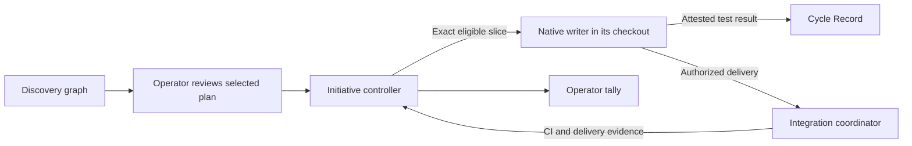

# Delegate DBSCTR slices from Discovery

Discovery proposal. The operator selected end-to-end delegation, durable
managed source, reusable worker test results, and one review of the selected
plan. No builder or grant is activated by this document.

The [same-repository marker test](CHILD-WRITER-READINESS.md#marker-test-routing-overlap-and-feedback)
verified concurrent work and result collection for two Herdr-launched
OpenCode Build sessions in separate Worktrunk worktrees. The operator chose
the [one-worker draft-PR proof](HERDR-LOCAL-WORKER.md), followed by the
[four-worker qualification](HERDR-FOUR-WORKERS.md). Four separately
approved top-level Build sessions completed cycles in one repository;
their drafts merged serially. Three Build intervals overlapped for
12.8 seconds and four focused test processes for 0.92 seconds. This
qualifies the supervised procedure; it is not a throughput benchmark.

## Production readiness

Use the ordinary OpenCode conversation: Discovery in Plan mode, then
DBSCTR in Build mode. No Discover-Coordinator agent is required.
At the end of Discovery the operator approves the complete selected plan
once, including slices that must wait for prerequisites. Bind that decision
to the reviewed plan; Build consumes it without asking the operator to paste
each slice's digest. A changed scope requires a new decision. Build uses
one named Herdr tab and Worktrunk checkout per top-level worker. The primary
announces the tab and branch for each slice and reads its result by session
ID. DBSCTR gate evidence and verified draft heads establish delivery.

1. **Merge managed instructions.** Refresh the planning draft #359 against
   current `main`. Preserve the newer Initiative manifest and README,
   reconcile the lifecycle changelog, and update the handoff and its
   instruction tests for same-repository work. Include an explicit shell
   workdir/branch check, optional timing, and resuming the original session
   and cycle after interruption. Verify dependencies or shared writes
   cause serialization and that operators can find the worker tabs.
   Run publication and instruction-contract checks and exact-candidate CI.
   Draft #373 has separate adapter regression coverage; it is useful but
   does not install the workflow or block the supervised instructions.
2. **Deploy the merged workflow to all managed hosts.** The distribution
   owner inventories the targets and previews the skills and their runtime
   dependencies on each host,
   preserves live sessions and local edits, applies only the approved
   delta, and verifies the installed files against that revision. Linux CI
   verifies source; it is not a receipt for the operator's macOS install.
3. **Accept the installed workflow.** From a fresh Plan/Build conversation
   on each target, plan disjoint work without a delegation reminder.
   Observe named tabs, distinct worktrees, matching sessions and Cycle
   Records, result collection and serial publication. Exercise interrupted
   readback without launching a duplicate. Record installed revision,
   outcome and rollback to the prior managed instructions. These are
   the Deploy and Operate checks for daily use.

**Batch authorization is a first-release requirement.** Before deployment,
the release needs the existing grant owner to cover draft-only batches,
the controller to admit disjoint same-target writers and reject conflicts,
and restart/revocation tests that prevent duplicate effects. Qualify
attributable gate evidence and the installed coordinator on the target.
Worktree selection is not write confinement. Defer native child ownership
to a later feasibility experiment; the first release uses top-level workers.

## The operator journey

Discovery shows what can run independently, what must wait, and why. The
operator reviews the selected work, delivery choices and limits once. Build
offers each ready slice to a top-level Build worker without another request
to delegate. The builder follows the normal DBSCTR cycle for that slice,
including its test and review gates, draft PR or other approved output, CI
feedback and bounded repair. A fresh session can read how many slices have
finished. A draft awaiting review is distinct from a verified merge.

The first Build slice can improve today's handoff before a writer has any new
permissions. It changes the managed Discovery and Build guidance to derive
the graph, match tasks to actual native capabilities, and present runnable
groups and reasons to serialize. An ordinary coding helper can edit and test
an owned set; the primary handles operations the helper cannot perform.
The handoff must distinguish that supported path from end-to-end slice
ownership, which depends on the qualified writer and grant below.

This extends [native helper delegation](../../specs/opencode_control_plane/features/native-helper-delegation.md)
for a **separately qualified writer role**. Research, Plan, docs writers and
ordinary coding helpers keep their contracts. A provider-specific coding
helper is not a qualified slice writer merely because it is named a builder.
Use the selected runtime's native agent mechanism and provider restrictions.
The original proposal preferred a dedicated subagent. A separate primary,
whether started fresh in a worktree or forked, must meet the same writer
checks. The marker test informs that choice; it does not qualify either
form to own a cycle.

## Ownership and dependencies

| Part | Owner and input | Outcome |
| --- | --- | --- |
| Plan and routing | Discovery and OpenCode Control Plane; read the reviewed Initiative | Recommend one writer, bounded helpers, or multiple forked sessions from dependencies and exclusive write ownership. |
| Writer and evidence | DBSCTR Lifecycle and the native runtime | Bind the writer to the approved slice and checkout. Admit its actual test results and its delivery handoff. |
| Approval and continuation | Existing [Initiative Auto](../dbsctr-auto-forge-parity/INITIATIVE-AUTO.md) work | Own the bounded grant, dependency eligibility, revocation, durable controller, and restart/replay. |
| CI, merge and progress | Existing [delivery preference](../dbsctr-auto-forge-parity/DELIVERY-PREFERENCE.md) and [integration coordinator](../../specs/dbsctr_v3_lifecycle/features/integration-coordinator.md) | Own draft versus Auto, trusted CI, the protected candidate, repair limits, inclusion and the tally. |

Keep the existing repository default of Draft PR. A qualified Auto enrollment
may select protected merge. Another supported local or forge delivery intent
must be named in the plan; inability to publish is a blocker, not permission
to silently substitute a different output.

There are two explicit coordination points with the Auto owner:

- Today's single-grant contract covers Auto; other modes use per-slice
  review. The desired ability to approve multiple **draft-only** slices once
  must be accepted by that same grant owner. It authorizes publication of
  drafts, never their merge. Do not implement a second approval mechanism.
- Auto initially serializes implementation per target. Discovery may show
  parallel opportunities immediately. Writers on the same target must still
  serialize until its controller qualifies concurrent disjoint writers;
  the integration coordinator retains its single candidate slot. Parallel
  research or separately authorized targets do not require that change.

## What the dependency graph must decide

For each selected slice, name its repository and target, prerequisite
delivery conditions, writable paths and shared resources, validation inputs,
writer/reviewer roles and delivery intent. Shared generators, fixtures,
services and migrations can conflict even when paths differ. Reject cycles
and missing owners. Order overlaps explicitly. A dependency waits for the
declared evidence, not a "done" message from another session.

One short task or one shared write set stays with one writer. For independent
work, recommend the runnable groups and show the blocking edge for each
deferred group. Recommend separate primary sessions only where a separate
checkout and owner are useful and the runtime supports them. A fork receives
the reviewed plan reference; conversation history, a pane or a changed shell
directory does not grant authority. Each writable slice has one live claim.
Repeated dispatch, cancellation and ambiguous worker handoff must reconcile
the old claim before another writer can mutate it.

## What counts as a gate result

The writer can perform the full authorized DBSCTR workflow for **its slice**.
Bind mutations and evidence to the private grant, authenticated writer,
cycle, repository, branch and actual registered checkout. Validate them at
the operation boundary; a shell command pattern or a prompt is not an access
boundary for a host process. Never confer broad forge credentials or
privileges on General. A worker cannot widen its plan, approve itself, admit
another cycle, bypass review, change branch protection or self-authorize a
merge. Independent review remains independent.

Accept a builder's test run once for an applicable gate when a trusted runner
attests the exact tested tree, relevant inputs and environment, command or
selection, exit result, and evidence digest, attributable to this slice and
writer. Retain failed and partial results. The primary can verify and use the
receipt without re-executing an identical run. Preserve
[input-bound reuse](../../specs/dbsctr_v3_lifecycle/features/workflow-evidence-bindings.md):
an unrelated commit need not invalidate the original test if all its declared
inputs still match under policy. An unsupported producer, changed test inputs,
stale candidate-specific proof or missing provenance cannot satisfy the gate.
Local evidence does not replace protected CI for the integration candidate.
Return confirmed CI failures to the owning builder; use the Auto owner's
repair and stop rules. No second CI poller or merge path belongs here.

## Qualification and release boundary

See the [worked handoff](BUILDER-HANDOFF.md) for the planning slice's
acceptance cases and its limit under current permissions.

1. Use synthetic tasks with one shared file, two independent write sets and
   one dependent. Verify default recommendations, single-writer exclusion,
   cycle rejection and a clear reason for every wait.
2. In an isolated enrolled fixture, accept the exact plan once. Verify a
   real child runs its gates and opens the authorized draft. Accept a valid
   test receipt without a second test invocation. Reject a copied receipt,
   wrong writer, wrong checkout, stale inputs and an attempt to write into
   the sibling's slice. Test both success and failure under actual native
   permissions rather than relying on an agent definition.
3. Fork independent sessions in the fixture. Interrupt a writer and restart
   the controller. Observe one claim and one admitted delivery per slice.
   A material change or revocation blocks new mutations. Distinguish draft
   delivered, waiting for CI, bounded repair, and verified inclusion using
   the existing tally. Only enable each path when its owner qualifies it.
4. Ship through managed source. Linux CI qualifies the source. macOS is an
   operator apply target for using DBSCTR in projects; it is not a host
   for developing dotfiles-ai itself and has no hosted CI lane. Verify the
   installed role on direct deployment without disrupting live sessions.

## Visual Evidence

Review question: who can turn a Discovery recommendation into a write?

**Text Equivalent.** Discovery recommends. The controller checks the
operator's grant and dependencies, then assigns each writable slice once.
The writer supplies test evidence to its cycle and delivery to the existing
coordinator. The controller derives progress from their receipts.

Boundary, interaction and data/trust: required, shown above. Dependency:
required, shown in the ownership table and ordering rules. State: reuse the
linked Auto transition table. Schema: not applicable to this proposal;
receipt and grant formats belong to their respective owners. Quantitative:
not applicable; no speedup is claimed. The two owning contexts update the
flow when grant, evidence or delivery ownership changes.
