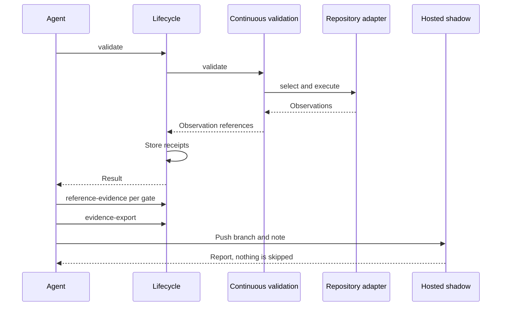

# Shift-left validation

Status: ready for build. The first slice can be receipted and launched; the
other two are captured behind it. Nothing here is implemented, installed,
activated or measured. This document does not publish live lifecycle gate
state.

## Why now

Validation waits twice. Locally, every kernel gate records its own execution:
in one recent cycle record, 43 pytest evidence executions were stored across
13 heads, and four distinct commits each recorded an affected run and then a
full-suite run. On the forge, the required workflow gives no early signal: each
of its four workers runs the same publication and instruction selections
before its partition, and the partition that owns each of those tests runs it
again. Historically the summary jobs waited 22 and 41 minutes after the last
worker to spend seconds verifying, so removing duplicate tests alone would not
have shortened that pull request.

The continuous-validation runner can validate immutable snapshots, but it
cannot help yet. Its repository adapter receives the changed-path set and
selects by trigger only, four of its five checks refuse every non-macOS host,
and its observations cannot be referenced by a gate.

## Context map

| Context | Home | Change |
|---|---|---|
| `continuous_validation` | Saltiola7/dotfiles-ai | Selection by changed path, an `affected` trigger, lanes that follow the hosted matrix, Dagger as an optional executor, managed `validate` and `applicability` actions, and `plan` and `run` commands that work without DBSCTR |
| `dbsctr_v3_lifecycle` | Saltiola7/dotfiles-ai | `validate`, execution receipts, `reference-evidence`, `evidence-plan` and `evidence-export` |
| `dotfiles_ai_distribution` | Saltiola7/dotfiles-ai | The report-only `validation-shadow` workflow and its comparison script |

The operator asked for this scope in the shift-left CI session on 2026-11-24:
validation should start inside DBSCTR as early as possible, Dagger should be
usable locally and optionally, the repository should define its checks once,
and the result should be shadow-piloted before any consumer repository changes.

## Related initiatives and drafts, deliberately not duplicated

- `dbsctr-cycle-speed` holds `validation-evidence-reuse`, the earlier captured
  statement of the same outcome, sequenced behind `performance-audit-workflow`.
  This Initiative delivers that outcome first; that manifest is reconciled by
  its own owner. `validation-execution-performance` keeps the removal of
  within-job duplicate execution in the required workflow, and
  `python-ci-baseline` keeps the retained-CI analyzer.
- `continuous-validation-shadow` owns the runner, checkpoints and session
  feedback. Its deferred statement on authoritative reuse of local evidence is
  advanced here only for receipts the lifecycle admits; admission by a forge
  stays deferred.
- `dbsctr-delivery-lifecycle` holds the deferred `dagger-delivery-adoption`
  slice, which owns the independent queue, the CI-to-agent repair loop and
  coordinator integration. It consumes the contracts defined here.
- The integration coordinator specified by `dbsctr-workflow-convergence` is
  the existing return path for hosted results. Its policy is disabled in this
  repository and its activation stays with that Initiative.
- `linux-ci-cutover` moved the hosted matrix to Linux; the adapter now follows
  it.
- Unmerged local drafts are carried, not rebased (INT-038). The gate-aware
  draft `CVS-GATES-004` supplies the purpose and cadence model. The
  VM-resident runner draft `CVS-RUNTIME-009` remains the delivery of the
  remote owner kind.

## Decisions

Validation moves earlier; commits and pushes do not move more often.

| Development boundary | What starts | Authority |
|---|---|---|
| Settled edits, before a commit | `dbsctrctl validate`: affected checks on an immutable snapshot; one receipt per result; failing test identities returned to the caller | Repository selection; no gate changes |
| A gate is due | `evidence-plan`, then `reference-evidence` for each admissible execution; `record-evidence` only for missing or stale work | Existing gate acceptance rules |
| Push and pull request | Required workflow unchanged; the hosted `affected` job gives an early result; `compare` reports reuse eligibility | GitHub Actions |
| Late hosted controls | CodeQL, Semgrep and dependency updates gate merge on their own schedule and never gate agent feedback | Existing delivery Initiative |

- One ownership table per repository. This repository has none today, so the
  adapter's component table becomes its only instance.
- The repository defines each check once. The enrolled runner, the lifecycle
  and a hosted runner call the same function; a repository that has no selector
  keeps working, and DBSCTR can help build one in that repository rather than
  keeping a second map.
- The lifecycle alone admits evidence. Continuous validation executes; it
  never passes a gate.
- A local execution can replace a hosted one only when the lane identity
  matches. The shadow measures how much that is before anything is skipped.

## Statements

| ID | Kind | Summary |
|---|---|---|
| INT-001 | requirement | `select` follows changed paths for `edit` and `affected`, including dependent checks. |
| INT-002 | requirement | `affected` is a new explicit trigger that includes expensive checks; the other triggers keep their meaning. |
| INT-003 | requirement | An unmapped path, or a change to workflows, the adapter, lockfiles, the manifest or shared test infrastructure, selects the broad or complete obligation. |
| INT-004 | constraint | One ownership table per repository; this repository's is the adapter's component table. |
| INT-005 | requirement | Selection is one function of snapshot, base and table, shared by runner, owner, `plan` and `run`. |
| INT-006 | requirement | Lanes follow the hosted matrix: instruction and full checks become Linux-native; the Swift check retires. |
| INT-007 | constraint | An unavailable lane is a classified result, never a substitution or a pass. |
| INT-008 | requirement | Dagger is optional: a configured pinned engine executes and anything else is an existing classified unavailable result; the backend already does this and it is pinned by regressions. |
| INT-009 | requirement | The managed owner implements `validate`. |
| INT-010 | requirement | The managed owner implements `applicability`. |
| INT-011 | constraint | Execution stays default-off with an enabled enrollment; no watcher, service or unopted feedback. |
| INT-012 | requirement | `plan` and `run` need only the checkout, Python and uv. |
| INT-013 | non-goal | No automatic test splitting, consumer selector rewrite, required-check change or unmeasured speed claim. |
| INT-014 | decision | Validation starts on settled edits; commits stay gate-driven and pushes stay delivery-driven. |
| INT-015 | risk | Path-aware selection can miss an affected test; fallback, the full hosted suite and the shadow keep misses visible. |
| INT-016 | risk | Early validation competes with foreground work; existing admission, checkpoint rule and opt-out apply. |
| INT-017 | requirement | `validate` stores receipts before any commit and changes no gate state. |
| INT-018 | requirement | `reference-evidence` records a gate's own reference to a passing execution. |
| INT-019 | constraint | A reference is admitted only under seven fail-closed rules. |
| INT-020 | decision | Under an evidence policy a reference inherits a binding only from an identical declaration. |
| INT-021 | constraint | Gate decisions, transition policy, command signatures, error strings and record schemas are unchanged. |
| INT-022 | requirement | `evidence-plan` reports reusable, missing and stale work; `validate` runs only what is missing or stale. |
| INT-023 | requirement | `evidence-export` writes the validation manifest for one committed head. |
| INT-024 | constraint | Receipts come only from executions the lifecycle requested; local evidence is as trustworthy as its account. |
| INT-025 | requirement | Unreferenced receipts are bounded; referenced ones are history; a reopening amendment bars earlier executions. |
| INT-026 | risk | A wrong reference could pass a gate on stale or narrower evidence; mitigated fail-closed. |
| INT-027 | requirement | A report-only `affected` job runs the selection on a hosted runner for each pull request. |
| INT-028 | requirement | A `compare` job reports `would_reuse`, `would_reuse_if_lane_equivalent` or `must_run` with a reason. |
| INT-029 | requirement | The report separates queue, worker, early-step and summary-tail time and counts repeated identities; nothing is estimated. |
| INT-030 | decision | The manifest travels as an untrusted Git note on the validated head. |
| INT-031 | constraint | The shadow changes no required conclusion, permission or artifact, uses no secret and writes nothing to the pull request. |
| INT-032 | constraint | Local execution replaces hosted execution only on a matching lane or a declared lane policy. |
| INT-033 | risk | The required workflow retains no lane identity, so strict reuse reports `lane_unverified` until it does. |
| INT-034 | risk | ARM64 workstation results cannot stand in for x86_64 hosted lanes; hosted savings are unknown until measured. |
| INT-035 | constraint | Late hosted controls gate merge, never agent feedback, and return through the existing coordinator. |
| INT-036 | constraint | The private consumer repository is not changed and keeps its own selector. |
| INT-037 | decision | Affected selection replaces local repetition only while the configured full CI stays authoritative. |
| INT-038 | decision | Unmerged drafts are reconciled, not rebased: the cadence model is carried, the macOS controller is retired. |
| INT-039 | idea | Deferred: authoritative hosted reuse through a trusted producer. |
| INT-040 | idea | Deferred: a self-hosted forge mirror, forge projects or a kanban board for planning and observability. |
| INT-041 | non-goal | No protection or enterprise-setting change, no automatic merge from a manifest, no automatic service, no concurrency activation, no change to the cycle-speed order. |

## Delivery order

1. `shift-left-affected-validation` (continuous_validation): the adapter, the
   runner protocol, the managed owner and the `plan` and `run` commands.
2. `execution-evidence-reuse` (dbsctr_v3_lifecycle): `validate`, receipts,
   references, plan and export.
3. `hosted-validation-shadow` (dotfiles_ai_distribution): the `affected` and
   `compare` jobs and the comparison script.

Delivery is serial in that order because each slice calls the one before it.
Read-only review of a later slice is parallel-safe; one primary writes.

## Validation strategy

1. Adapter: selection fixtures for affected, broad and full choices; one real
   sample that changes the validation adapter and its two test modules,
   recording the selected checks and the time to the first result, compared
   with one retained hosted pull request.
2. Lifecycle: one real cycle that validates before its first Gate Commit and
   references one receipt from at least two gates; a regression for every
   refusal rule; the number of executions saved is recorded, not assumed.
3. Hosted: the delivery pull request of the shadow with a manifest attached;
   the report is retained and read for queue time, summary tail and repeated
   identities before any further hosted slice is chosen.

Configured publication and instruction checks run over the exact artifact set
before any receipt, preflight or push. `initiative-check` runs after every
material manifest change. No receipt, launch approval or Cycle Record is
created by Discovery.

## Engineering Profile overrides

Risk: **elevated** for all three slices, because repository code executes,
gate-disposal decisions change and a new hosted workflow parses untrusted
input. Delivery intent: **merge**, as a draft pull request per slice that
merges after required CI and lifecycle gates. The base profiles under
`docs/specs/*/PROFILE.md` stand unchanged. Each slice's applicability plan is
committed beside this README; the continuous-validation and lifecycle slices
record the gate differences in their feature documents.

## Rollout and activation

- Source delivery changes nothing for anyone who has not opted in.
- Early validation needs an explicitly enrolled worktree, a private
  installation of the runner generation and, after merge, the delivered
  lifecycle helper.
- The shadow workflow runs on every pull request once merged and is
  report-only.
- Opting out is the existing enrollment stop; it cancels owned work and
  preserves observations.

## Deferred work

- Authoritative hosted reuse, including any replacement of a required check
  (INT-039).
- A self-hosted forge mirror, forge projects or a kanban board (INT-040). PM
  Kernel owns local tickets; mirroring a client repository needs the client's
  permission, and a mirror does not carry pull requests, checks or account
  attribution.
- Any change in the private consumer repository (INT-036).
- A return path for dependency-update results: no contract exists today, so
  they stay a merge-time control and a finding input.

## Risks and capability gaps

The statements carry the design risks. Observed on the reference Linux ARM64
workstation at Discovery and recorded, not repaired:

- The installed Dagger CLI is newer than the engine identity the backend pins
  (0.21.12 against 0.21.10).
- A container engine is installed but its socket is not enabled.
- Worktrunk is older than the hosted pin (0.80.0 against 0.81.0).
- The project manifest pins no import-ordering lint tool; a lint dependency
  group exists only on an unmerged branch.

## Visual Evidence

| Concern | Decision |
|---|---|
| Boundary | required: the context map above answers who owns selection, admission and hosted reporting |
| Interaction | required: sequence diagram below; when does each context act? |
| State | not_applicable: the manifest is the slice-state inventory |
| Data/trust | not_applicable: each feature document owns its trust boundary; no private data is published here |
| Schema | not_applicable: the feature documents own the record shapes |
| Dependency/deployment | required: the delivery order above; each slice calls the one before it |
| Quantitative | not_applicable: no measurement exists for this Initiative yet |

**Text Equivalent:** The agent asks the lifecycle to validate. The lifecycle
delegates to continuous validation, which asks the repository adapter to select
and execute. Observations return to the lifecycle, which alone stores receipts
and answers the agent. Each gate then references the same receipt instead of
running again. When the agent pushes, the hosted shadow reads the exported
manifest and reports what could have been reused; it skips nothing. Canonical
source: the decisions table and the three feature documents. Owner: the
Initiative Discovery primary. Update trigger: a change to delivery order or to
who admits evidence.

## Build handoff

Scope: three serial source slices as listed under delivery order.
Constraints: default-off, one ownership table per repository, lifecycle-only
evidence admission, required hosted workflow untouched, consumer repository
untouched. Affected artifacts: this README, the manifest, three applicability
plans and three feature documents; each Build cycle also reviews its context
README and CHANGELOG. Validation: the strategy above. Remaining risks: the
statements of kind `risk`, and the unverified availability of Git notes on the
hosting service, where the shadow degrades to `manifest_unavailable`.
Unresolved decisions, none blocking: whether the `affected` job should later
become a required early check, and where the required workflow should retain
lane identity. Recommended Build owner: the current primary in Build mode with
the Python and Security lenses for the lifecycle and hosted slices.
