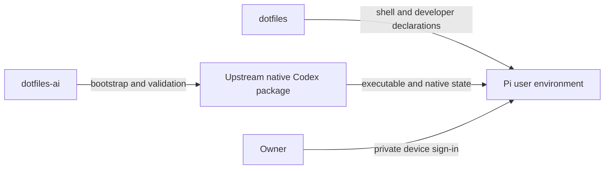

# Headless Linux native Codex bootstrap

## Domain and ownership

An opt-in `dotfiles_ai.headless_server.enabled` role supports Fedora ARM64
headless hosts, initially pi400. Dotfiles owns the shared shell, developer
packages and homelab service declarations. Dotfiles-ai owns a bounded native
Codex bootstrap and validation helper. Upstream owns the visible executable,
package selection and runtime state in the existing `~/.codex` home. This role
must not migrate credentials, copy the Mac's identity, replace native sessions,
activate unrelated AI services or take shell ownership from dotfiles.
Existing macOS, remote-user and Linux workstation routes retain their behavior.
The role is mutually exclusive with workstation/remote-user/central-state roles.

## Behavior and contracts

| Given | When | Required outcome |
|---|---|---|
| Missing CLI and safe owned home | Explicit bootstrap or first apply | Download official standalone installer over HTTPS; install stable ARM64 package; validate native selection |
| Healthy newer native installation | Repeated bootstrap/apply | Preserve binary, selection, credentials and sessions; no download or downgrade |
| Existing unknown executable or escaping symlink | Bootstrap | Refuse without overwriting or executing it |
| Unsafe home or malformed daemon settings | Bootstrap | Refuse; preserve original data |
| Existing daemon settings | Prepare policy | Preserve unrelated fields; disable automatic installation without restarting daemon |
| Existing authentication | Repeated apply | Keep auth files private and byte-identical; no login, credential reads or migration |
| Headless role selected | Full apply preview | Only bootstrap/helper targets; no shell, legacy wrapper/updater, desktop, private keys or workloads |
| Native explicit update | Owner runs `codex update` | Upstream changes local platform only; subsequent apply preserves healthy selection |

Public role defaults disabled. A separate local chezmoi config selects the role.
Native `CODEX_HOME=~/.codex` and `CODEX_INSTALL_DIR=~/.local/bin` preserve the Pi's
existing authenticated desktop SSH installation. Reuse `codex-project` native
home, selection and settings validation; never render the legacy `codex` wrapper
onto the upstream-owned symlink. Authentication remains an explicit owner device
login. No credentials belong in the public source or validation output.

The installer must fail before an unsupported architecture or conflicting role
can change runtime state. A missing home may be created owner-only, but a symlink
or unsafe existing home must be refused. Apply is missing-only, not an update.
Public upstream artifacts retain their own SHA-256 verification; installer script
is fetched to a temporary file for bounded execution, never a shell pipeline.

## Validation, deployment and recovery

Use isolated chezmoi rendering/managed-target tests, negative ownership/selection
fixtures, repeated bootstrap with a fake native package and forbidden downloader,
and existing macOS/Linux regression tests. Verify missing-install bootstrap in
an isolated home, preserving any real user credentials. On Pi, retain private
pre-change snapshots, preview ownership and apply twice, checking binary identity,
auth file digest without reading/logging contents, login-shell PATH, sandbox,
existing desktop connection and homelab service health. No implicit daemon restart.

Rollback removes only newly managed bootstrap targets or reapplies an earlier
source. Never delete `~/.codex`, installed releases, credentials or sessions.
Updates use official Codex maintenance; check current vendor support/security
notices during routine maintenance. SSD fault recovery requires offline evidence
and backup before repair; suspect retired RAID members are not provisioned.

## Visual Evidence

Boundary: required; the ownership flow below is canonical for this role.

Interaction: required; the ordered validation/deployment paragraph is canonical.
State: required; the Given/When/outcome table is canonical.
Data/trust: required; explicit public source/private runtime ownership above.
Schema: not_applicable; no runtime-state schema invented.
Dependency/deployment: not_applicable; no additional service or listener.
Quantitative: not_applicable; no performance or capacity claim.

Text Equivalent: dotfiles installs shared shell/developer declarations;
dotfiles-ai bootstraps and validates Codex without taking ownership of its native
executable. Upstream retains executable/state ownership and the owner performs
private authentication. Reapply preserves installed versions, auth and sessions.
Owner: dotfiles maintainer. Update this evidence when role ownership, bootstrap
transitions or deployment ordering change.
