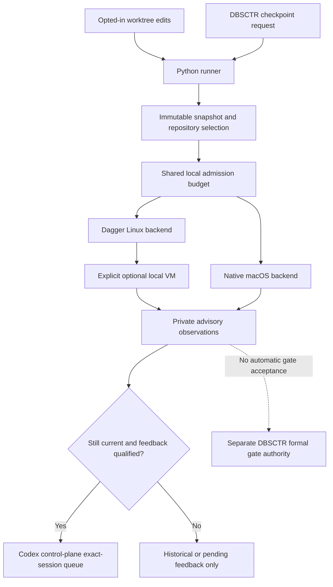

# Continuous Validation

**Status:** source implementation for an opt-in, local advisory shadow.
Installed execution backends and performance improvements require separate
qualification. Codex CLI 0.163.0 active delivery and idle wake have been exercised
in a synthetic open interactive session; that result does not qualify closed
noninteractive sessions, arbitrary versions, or a production task.

## Overview

`continuous_validation` owns a portable Python runner that evaluates immutable
worktree snapshots during development. Cheap affected checks run after edits
settle; expensive checks run when an explicit checkpoint request is submitted. One host-wide
admission budget coordinates all enrolled worktrees. Dagger executes Linux
checks; a native backend executes checks whose contract requires macOS.

The result is timely diagnostic evidence for the developer and the exact enrolled
agent session. A shadow observation cannot pass a formal DBSCTR gate, replace a
required forge check, authorize delivery, or alter a production environment.

The coordinating [shadow Initiative](../../initiatives/continuous-validation-shadow/README.md)
owns slice dependencies and launch readiness. This context owns the runner
contract; specification readiness is not source implementation or activation.

## Problem, Goals, and Non-goals

Parallel agents can repeat expensive checks, compete with foreground work, and
discover failures only after publishing a change. The experiment must determine
whether early affected execution and retained compute caches shorten the useful
feedback loop without making the host less responsive.

Goals are to author orchestration in Python, preserve repository-owned validation
semantics, avoid duplicate work for identical check inputs, cancel obsolete work,
return bounded failures to their originating session, and collect comparable
timing and resource evidence. The first slice is default-off and local only.

Non-goals are automatic gate acceptance, forge configuration changes, automatic
merges, releases or deployments, host runtime provisioning during ordinary checks, remote
provisioning, distributed scheduling, automatic test splitting, universal
cross-platform equivalence, or replacing the repository's affected selector.
An optional explicit local-engine setup can install its pinned private components
and start its dedicated VM. Remote engines and forge-triggered execution are
later delivery slices.

## Engineering Profile and Current Slice

The stable defaults are in [PROFILE.md](PROFILE.md).

| Field | Current slice |
|---|---|
| Risk | Elevated: executes repository checks and can submit diagnostic input to an existing agent session |
| Scope | Standalone runner protocol, local shadow scheduling, snapshots, observations, caching, and telemetry |
| Modules | Python, Security, and Cloud for the optional local runtime bootstrap; remote cloud resources remain deferred |
| Delivery | Feature branch and draft pull request after registered implementation and required checks |
| Activation | Separate opt-in installation, runtime qualification, and explicit worktree enrollment |
| Product Intent | Internal validation infrastructure; no independent browser or product interface |

## Boundary and Ownership

| Owner | Responsibility |
|---|---|
| `continuous_validation` | Snapshot/check identity, local admission, execution protocol, advisory observation lifecycle, cancellation, and comparable telemetry |
| Repository check adapter | Python check definitions, affected selection, fixtures, coverage semantics, platform requirements, and faithful execution of configured authorities |
| `dbsctr_v3_lifecycle` | Checkpoint requests, Cycle Records, formal gates, evidence admission, applicability, approvals, and delivery authority |
| `codex_control_plane` | Supported CLI capability probing, exact session enrollment, safe-boundary feedback transport, acknowledgment semantics, and runtime qualification |
| `dotfiles_ai_distribution` | Installation, feature configuration projection, service lifecycle, version pins, rollout, rollback, and uninstall |

The protocol remains reusable, but initial enrollment requires an open DBSCTR
task and its exact Codex CLI primary session. Terminal callers can inspect or
request checks only for that enrollment. General non-DBSCTR development remains
a later extension. Integrations do not duplicate the scheduler or create a
second gate ledger.

## Language and Entities

| Term | Meaning |
|---|---|
| Enrollment | Private, explicit permission to observe one exact worktree, use its approved adapter, and optionally return feedback to one exact session |
| Generation | Monotonically increasing local worktree event sequence; it detects supersession, not source equivalence |
| Snapshot | Immutable captured file bytes and metadata with a content digest, including selected dirty and untracked inputs |
| Check manifest | Canonical descriptors emitted by a repository-owned Python adapter, bound to its source digest |
| Selection | Exact check and test identifiers with a reason and conservative fallback disposition |
| Lane | Backend, OS, architecture, interpreter, tools, dependency identities, and execution assumptions required by a check |
| Observation | Immutable diagnostic result for a specific snapshot, selection, check manifest, and lane |
| Feedback | A bounded reference to current failed or unavailable observations, routed to the enrolled session |
| Qualification | Recorded evidence that the selected deployed components satisfy the activation contract |

## Configuration and Admission

The logical feature flag `continuous_validation.enabled` is the `enabled` field
of a private enrollment record and defaults to `false`. Distribution owns managed
installation; the source CLI creates one enrollment only with `--enable-shadow`.
Enabling the feature permits explicit enrollment; it does not enroll every repository,
start watchers automatically, or grant feedback permission for every session.
Enrollment is local and per worktree, is revocable, and is never committed.

Enrollment identifies the real worktree root, Git repository identity, approved
adapter path and digest, input allowlist, selected local engines, open DBSCTR task,
and exact Codex CLI primary-session UUID. Paths, host identities, session identifiers, and credentials remain
private. Moving a worktree, changing its identity or adapter, or changing feedback
target invalidates enrollment until explicitly reconciled.

The proposed initial configuration is one expensive job at a time across the
host, at most two running checks in total, a one-second edit debounce, and a
five-second maximum debounce window. These are configurable experiment defaults,
not measured performance targets or hard OS resource guarantees. A continuous
stream of edits cannot indefinitely postpone a checkpoint request. Cheap work
takes priority over queued expensive work; worktrees receive fair admission.

One shared admission authority accounts for native and Dagger work across all
runner processes. An unavailable or uncertain lease state stops new admission;
it must not create a second independent budget. Host pressure or an explicit
foreground-priority request pauses new expensive admissions and cancels
interruptible shadow work where supported. Unsupported pressure measurement is
reported as unavailable and uses serialized admission rather than claiming a
resource cap. Check-level subprocess limits remain explicit backend capabilities.

## Behavior

| Given | When | Then |
|---|---|---|
| The feature is disabled, or a worktree is not enrolled | Source files change | No runner execution or agent message occurs |
| An enrolled worktree has stable edits | The debounce expires | The adapter selects cheap affected checks against one immutable snapshot |
| A selection cannot establish affected scope | A cheap check is considered | The adapter returns a conservative broader selection or an explicit checkpoint-required disposition; it never silently omits unknown scope |
| An enrolled worktree reaches a DBSCTR checkpoint | The lifecycle integration submits a request | Required heavy checks become eligible under the shared budget, without changing any gate result |
| Two worktrees request expensive work | Only one expensive lease is available | One runs and the other queues fairly; neither bypasses the common budget |
| A running request is superseded by edits | A new generation is observed | Obsolete work is canceled where supported and its result cannot produce current feedback |
| An identical fresh execution identity has a retained result | A new request selects it | The runner reports explicit result reuse and original execution time; it does not claim a new execution |
| A check needs a different OS, architecture, interpreter, or tool identity | A result exists for another lane | The result is not reused for the required lane |
| A macOS contract is selected | A Linux engine is available | The native macOS lane runs it, or the result is unavailable; Linux success is not substituted |
| A current check fails | Qualified feedback is enabled for its enrolled session | A bounded diagnostic is queued for that exact session at its supported safe boundary |
| Feedback transport accepts a message | Consumption cannot be observed | Delivery remains accepted or unconfirmed, never recorded as consumed |
| A runner or engine becomes unavailable | A request cannot finish | The observation records unavailable or interrupted; no pass, fallback execution, or automatic success retry is fabricated |
| The operator disables the shadow | Work is queued or running | New admission stops, owned work is canceled safely, and private observations remain inspectable under retention policy |

## Interfaces

The standalone Python entry point is `continuous-validation`, sourced from
`dot_local/bin/executable_continuous-validation` and the managed
`continuous_validation` package. Source availability does not imply installation.
Distribution selects its managed location without creating a new installer owner.

| Operation | Contract |
|---|---|
| `enroll --worktree PATH --adapter RELATIVE --session-id UUID --cycle-id ID --base REF --enrollment FILE [--enable-shadow]` | Default off; explicit flag admits one validated linked worktree and open task. Optional `--python PATH`, `--adapter-config FILE` and `--state-dir PATH` select prepared local components and private artifacts. `--feedback-qualification FILE` additionally admits feedback only from a strict operator-supplied transport receipt. |
| `run --request FILE --json` | Evaluate one versioned request and return a terminal observation summary |
| `watch --enrollment FILE [--once] --json` | Observe only the enrolled worktree, debounce included edits and emit one result per request. `--once` returns one result and exits. |
| `checkpoint --request FILE --json` | Submit a checkpoint selection to the same admission authority |
| `status [--enrollment FILE] --json` | Without enrollment, return disabled without creating state. Otherwise inspect task availability, declared admission metadata and latest observations without running checks; persisted leases are not reported as live ownership proof. |
| `stop --enrollment FILE --json` | Disable this enrollment and request cancellation of its owned work; return disabled with `cancellation_requested`, not a claim that every process already terminated. Do not stop a shared engine. |
| `compare --experiment FILE --json` | Produce matched comparisons from retained observations without executing checks |

Requests, results, and events use closed schema version `1`; unknown fields and
unsupported versions fail validation. JSON files and line-delimited event output
are private runtime artifacts. Diagnostic logs use a separate stream. Exit `0`
means the requested checks passed or valid prior results were reused; `1` means
at least one check failed; `2` means invalid input, unavailable capability, or
incomplete execution. A complete empty selection returns `not_selected`, with no
claim that an entire suite passed. Every valid request reports per-check dispositions, so an
aggregate code cannot conceal unavailable or canceled checks.

Repository adapters are Python programs selected by enrollment. They exchange
versioned JSON descriptors and observations with the runner and may wrap existing
commands or Python Dagger functions. The adapter owns `describe`, `select`, and
`execute`; its emitted manifest declares stable check IDs, cheap or expensive
class, backend and lane requirements, input scope, outputs, deadlines, external
input policy, and selection fallback. Pipeline logic remains Python. The runner
contains no client-specific selectors or embedded repository adapters.

Adapter execution is repository code execution and requires enrollment. The
controller does not import arbitrary discovered Python modules into its own
process or execute definitions from an unenrolled checkout. Arguments are arrays;
shell expansion is used only when explicitly declared by the approved check.

### Closed protocol version 1

Enrollment and request files must be owned regular files with one link and mode
0600, outside public source. Private artifact roots are mode 0700 and reject
aliases or unsafe parent replacement. The runner does not copy credentials or
resolve private adapter configuration from repository discovery.

An enabled enrollment requires `schema_version: 1`, `enabled: true`,
`worktree`, repository-relative `adapter`, its `adapter_digest`, `repository_id`,
canonical `session_id` UUID, bounded `cycle_id`, `base`, and `state_dir`.
`adapter_python` defaults to the current interpreter. It may explicitly select a
prepared repository environment; the controller does not install its dependencies.
`adapter_config` defaults to an empty object and is copied only from an explicitly
selected private `--adapter-config` file. The adapter owns its closed
configuration schema. The controller binds its canonical digest but never emits
the configuration body in telemetry.

Optional enrollment fields are `mode` (only `shadow`), `max_running` (default 2),
`max_expensive` (default 1), `debounce_seconds` (default 1),
`max_debounce_seconds` (default 5), `admission_timeout_seconds` (default 30),
`load_limit`, `feedback_enabled` (default false), `feedback_qualification`, and
`feedback_qualification_receipt`.
Qualification has only `transport`, `codex_version`, and `qualified`; a true
configuration value does not itself prove a deployed transport passed its smoke.
The CLI accepts an owned private qualification receipt with exactly
`schema_version: 1`, `transport: "codex-queue"`, `codex_version: "0.163.0"`,
`active_delivery: true`, and `idle_wake: true`. It records the receipt with
`assertion: "operator_supplied"`; this is a caller assertion, not authenticated
identity or a new runtime smoke. Missing, unknown, false, or version-drifted
qualification cannot enable feedback. The dispatcher rechecks the installed CLI
version and freshness immediately before queue submission.
Disabled records require only version and boolean flag and cause no adapter,
state-directory, queue, or message side effects.

Requests contain `schema_version`, private enrollment-file path `enrollment`,
`trigger` (`edit`, `checkpoint`, or `manual`), and optional bounded `request_id`.
The runner assigns an opaque ID when absent. The same ID and source/configuration
are an idempotent query: duplicate in-flight requests return pending, completed
requests return the original observations with `new_execution: false`, and changed
source/configuration refuses ID reuse. A previously interrupted request is not
automatically re-executed under the same ID.

Adapters are invoked as an argument vector equivalent to
`[adapter_python, snapshot_adapter, ACTION]`, with one JSON object on stdin and one
JSON object on stdout. Raw check output belongs in the supplied private log.
Every action receives `schema_version: 1` and `config` (the adapter configuration).

| Action | Additional input | Closed output |
|---|---|---|
| `describe` | None | `schema_version`, bounded `adapter_id`, `input_patterns`, `checks` |
| `select` | `snapshot` root, mapped immutable `base`, `trigger`, relative `changed_paths` | `schema_version`, unique known check IDs in `checks`, `reason`, boolean `complete` |
| `execute` | `snapshot`, `base`, `trigger`, full `check`, private `log_path` | `schema_version`, matching `check_id`, `status`, nullable `exit_code`, `runtime`, `test_ids`, `diagnostic_codes` |

`input_patterns` requires a positive relative glob; positive globs include inputs
and `!`-prefixed nonempty relative globs veto them consistently during capture,
historical filtering, freshness checks and watching (for example,
`["**", "!build/fixture.egg-info/**"]`); excluded tracked changes still refuse
capture conservatively.

A check descriptor has exactly `id`, `class` (`cheap` or `expensive`), `backend`
(`native` or `dagger`), `lane`, integer `timeout_seconds` (1 through 3600), boolean
`cacheable`, and adapter-owned `configuration`. A lane contains exactly `os`,
`architecture`, `python`, `tools`, and `dependencies`; these are canonical JSON
identities, not permission to substitute a different platform. A result status is
`passed`, `failed`, `unavailable`, or `interrupted`; passing requires exit code 0.
Diagnostic codes are bounded simple codes, not arbitrary test output.

An incomplete selection and expensive checks deferred from an edit remain
pending. Source capture, adapter protocol and runtime failures remain explicit
unavailable/interrupted results. They never fabricate a selected or executed test.
The runner maintains a monotonic generation per worktree to distinguish a later
request from content equivalence, and rechecks source/configuration before feedback.

One admission index under the current operating-system user's standard local
state directory coordinates every enrollment, even when artifact directories
are different. Its first configured limits remain the shared upper bounds;
individual requests cannot increase those bounds. Preparation also consumes a
cheap admission slot, preventing snapshot capture from bypassing the budget.
Kernel-locked lease files establish current lease ownership without trusting a
PID. Unknown termination blocks new admission until independently reconciled.
No stop/restart operation silently clears that uncertainty.

The source runner caps JSON, logs, inventory, and retained records. At capacity it
refuses new work with an explicit retention-limit result; it does not garbage
collect shared caches or silently discard failed evidence. Native priority and
load-based admission are best effort, not hard CPU/RAM isolation. CPU, maximum
RSS, and Dagger cache counters remain unavailable unless a backend measures them.

## Snapshot, Schema, and Cache Contracts

| Record | Required identity and contents | Relationship |
|---|---|---|
| Enrollment | Schema, feature flag, repository/worktree identity, approved adapter digest and private configuration, exact session target, enabled capabilities | One enrollment has one current generation |
| Request | Schema, opaque request ID, enrollment path and trigger (`edit`, `checkpoint`, `manual`); generation, selection and lane resolve during processing | One request resolves exactly one snapshot and selection |
| Snapshot | SHA-256 content digest, base and HEAD identities where available, canonical relative input inventory, content digests, file kinds and executable bits | Many requests may reference identical immutable content |
| Selection | Manifest-bound check IDs, reason and completeness disposition; actual test IDs are returned by each executed check | One selection belongs to one request |
| Observation | Request/snapshot/selection identities, full lane and cache identity, start/end times, status, test outcomes, bounded diagnostics references, reuse origin | One request has one terminal observation per selected check |
| Feedback | Observation IDs, exact target binding, freshness decision, deduplication key, transport acknowledgment and consumption disposition | Only current eligible observations can create feedback |

**Text Equivalent:** One enrollment has one current generation. Each request
resolves one immutable snapshot and selection, and has one terminal observation
per selected check. Requests can reuse identical snapshot content. Feedback
references only observations eligible for the exact bound target; no record
relationship grants formal gate authority.

Capture includes selected tracked modifications, staged and unstaged content,
deletions, and explicitly allowed untracked files. It excludes ignored data,
`.env`/`.env.*` files, reserved private runtime paths, and unselected files by
declared policy. Repository adapters own additional credential exclusions. An
excluded input required by a check makes that check unavailable. Referenced data
must be materialized by its existing owner; the runner never hydrates it
implicitly. Symlinks cannot escape declared roots, and submodules need an
explicit immutable identity or are unsupported.

Capture inventories, copies, and rechecks selected inputs. Its self-contained
synthetic Git repository contains only selected blobs from the actual merge-base,
base, HEAD, and captured source. It preserves the three-dot selector topology with
mapped immutable commits and fixed author, time, and message metadata. The adapter
receives the mapped base; private snapshot identity retains the original base and
HEAD. Original objects, excluded blobs, alternates, and remote dependencies are
never transferred. Inherited Git redirection and global/system Git configuration
are cleared; repository-owned ignore and input policies define captured scope. A changed original path outside the declared input policy
refuses capture with `excluded_changed_input`, preserving conservative selection.
Selected historical blobs and live source share a 256 MiB byte limit; generated
Git metadata has an additional bounded allowance. Selected deletions and allowed
untracked source enter the synthetic commit without changing the original index,
HEAD, refs, or source. Check-created ignored outputs are outside the immutable
source inventory; mutation of captured source prevents a passing observation.

A changed inventory or content causes bounded recapture; continued mutation leaves the request pending
or superseded rather than testing a live directory. Execution uses the retained
immutable bytes. `snapshot_id` identifies those exact tested bytes, not a claim
that a multi-file editor transaction was captured atomically. Before publishing
current feedback, the controller rechecks generation and snapshot applicability.
All displayed results retain their snapshot identity even if edits happen later.

The result-cache key binds snapshot input closure, selected checks and test IDs,
selector and check-manifest digests, adapter and runner versions, backend, OS,
architecture, interpreter, dependency lock digests, exact resolved tool and image
identities, environment policy, and declared external inputs or freshness epoch.
Different lanes cannot share a pass. Unspecified live inputs prohibit result
reuse. Credentials are not hashed or retained; secret-dependent identity uses an
explicit non-secret policy identity and required fresh execution when equivalence
cannot be established.

The pilot adapters set `cacheable: false`. Controller pass reuse additionally
requires a native check explicitly declared `configuration.hermetic: true` and
matching modeled identities; this is exercised with bounded hermetic fixtures,
not asserted for arbitrary pytest environments. Request-ID idempotency is a
query of an existing execution and is reported separately from result-cache reuse.

Dagger operation caches and runner observation reuse are separate. Cache hits
are reported at their actual layer, or unavailable if the backend cannot expose
them. A function cache bypass does not prove that commands inside it reexecuted.
Ordinary execution never prunes shared caches to manufacture a cold run.

Observations are advisory and immutable. Even a complete fresh observation does
not update a Gate Ledger, waive review, or create authenticated forge evidence.
A later evidence-admission slice must define its own source, environment,
integration-base, provenance, and forgery resistance contracts before reuse can
affect formal gates. Caller arguments and process identifiers are not actor
authentication.

## Cancellation, Recovery, and Feedback

| State | Event and guard | Result |
|---|---|---|
| Disabled | Feature enabled and exact enrollment admitted | Idle |
| Idle or Debouncing | Eligible change; latest generation retained | Debouncing, then Queued |
| Queued | Shared lease granted and snapshot valid | Running |
| Queued or Running | New generation, revoked enrollment, or stop | Superseded or Canceled; request cancellation |
| Running | Check finishes for its immutable snapshot | Passed, Failed, Unavailable, or Interrupted |
| Failed or Unavailable | Still current and feedback transport qualified | Feedback eligible |
| Any terminal result | No longer current | Historical only; suppress feedback |

**Text Equivalent:** Disabled work requires both feature enablement and exact
enrollment before becoming idle. Eligible changes debounce and queue; a lease and
valid snapshot permit running. Edits, revocation, or stop supersede or cancel
queued and running work. Execution can end passed, failed, unavailable, or
interrupted. Only still-current failed or unavailable results with qualified
transport become feedback eligible. Every stale result remains historical.

Cancellation targets only owned processes and Dagger sessions. It never kills a
shared engine, another worktree's check, or the foreground agent. A failed cancel
keeps its lease charged until termination is established. Restart recovery
reconciles leases and in-flight requests before admission; a stale PID is not
proof of ownership or completion. Unknown completion remains interrupted.

The Codex integration belongs to `codex_control_plane`. Its selected transport is `codex queue --thread <UUID> --message <TEXT>`. CLI help and
[official command documentation](https://learn.chatgpt.com/docs/developer-commands?surface=cli)
establish the queue surface. A synthetic open interactive Codex CLI 0.163.0
fixture consumed exact computed nonces both while active and after becoming idle.
This qualifies those two transport behaviors for the selected version and
fixture. A closed noninteractive `codex exec` fixture accepted queue input without
consuming it and remains unqualified. Queue acceptance in ordinary operation is
still recorded as accepted, never as consumed without independent evidence.
Restart, other versions, Desktop transport, and arbitrary task behavior require
separate qualification.
No private history database, synthetic terminal input, broad session-name lookup,
or steering fallback is permitted.

Feedback requires a separately enabled capability and an exact private session
binding. Payloads identify advisory status, snapshot, failed check/test IDs,
bounded diagnostic codes and local diagnostic references; raw test output is
never injected into the agent context. Check output is
untrusted data, not instructions. Edit debounce coalesces change bursts; delivery deduplicates each observation
submission, suppresses superseded observations, and preserves operator input and
native approval rules. Accepted queue input is not evidence
that the agent consumed or acted on it. Unsupported idle wake leaves the observation inspectable and reports unavailable;
it never launches a competing resume or an automatic success retry.

## Telemetry and Validation

Record snapshot/selection/setup/execution/queue durations, first useful feedback,
terminal result time, superseded and canceled work, admitted concurrency, result
reuse, backend cache information when available, and host responsiveness/resource
signals with availability flags. Use monotonic durations and UTC wall timestamps.
Engine overhead and check workload resources are distinct accounting boundaries.
Raw command output, source bytes, session IDs, paths, credentials, and transcripts
remain private; public summaries contain only sanitized aggregate evidence.

Each experiment records the same snapshot, adapter/check identities, selected
tests, lane, input data, instrumentation, and concurrency policy. Compare cold and
warm runs using isolated experiment caches, one versus two worktrees, affected
versus full selection, and required native/Dagger platform lanes. Report sample
counts, failures, unavailable cases, contention, cache state, and timing
distributions. Full-suite comparison can expose affected-selection misses; a
small set of matching green results is not proof of universal correctness.

Cadence and latency targets are selected after representative measurement. There
is no measured speedup, supported maximum agent count, or demonstrated host
resource ceiling yet. The experiment may conclude that a workload should remain
manual or later move to other compute.

Required source evidence includes deterministic tests for opt-out, dirty snapshot
capture/races, selection fallback, shared admission across processes/worktrees,
supersession, process/session cancellation, identity mismatch, external-input
freshness, crash recovery, privacy, structured failures, and feedback deduplication.
Run the repository's affected pytest and Python compilation authorities and its
existing publication/instruction checks. Preserve configured vulnerability and
coverage authorities rather than introducing competitors.

Activation additionally requires pinned CLI/engine/Python compatibility, a real
Linux Dagger smoke, a required native macOS smoke, responsive foreground behavior
under two enrolled worktrees, disable/restart recovery, and exact-session active
delivery plus idle-wake qualification. A missing capability is unavailable and
cannot become a passing claim through a mock. GitHub-rendered visual validation
is required before publication readiness for the Mermaid source below.

## Local Pilot Runbook

The source command is
`$DOTFILES_SOURCE/dot_local/bin/executable_continuous-validation`; after the
existing distribution owner installs it, use
`$HOME/.local/bin/continuous-validation`. Both use the same Python package and
closed protocol. Source availability does not install anything. Set
`DOTFILES_SOURCE`, `WORKTREE`, `ADAPTER_PYTHON`, `SESSION_ID`, `CYCLE_ID`, and
`INTEGRATION_BASE` from the selected source, prepared interpreter, exact native
session, open registered task, and intended integration base. The session UUID
is an explicit caller binding, not authenticated actor attribution. Never use a
name, `latest`, an invented session, or conversation relocation as identity proof.
Codex CLI and Desktop can target an explicit task checkout without Desktop
attachment; Desktop feedback itself is not qualified by the CLI fixture.

Use a separate private directory and enrollment file for each opted-in worktree.
Both repositories still share the same user-wide admission budget. The following
uses Bash and starts no permanent watcher:

```bash
VALIDATION="$DOTFILES_SOURCE/dot_local/bin/executable_continuous-validation"
# Installed alternative: VALIDATION="$HOME/.local/bin/continuous-validation"
STATE="$HOME/.local/state/dotfiles-ai/continuous-validation/pilot/task-one"
umask 077
mkdir -p -m 700 "$STATE"
"$VALIDATION" status --json
"$VALIDATION" engine plan
```

`engine plan` is read-only. Only the next explicit operation downloads the pinned
private CLI/SDK dependencies, creates or validates the owned Lima worker, and
starts it. It requires the supported prepared Lima/uv/host prerequisites. The
worker is local ARM64 with 2 CPUs, 4 GiB RAM, and a 40 GiB disk. It has no host
mounts or SSH-agent forwarding. Its privileged container runtime is confined to
this dedicated VM, and its engine uses a private Unix socket. Provisioning needs
outbound package/image downloads; it creates no public host listener or GCP
resource. Existing agent workers remain under their current runtime policy.

```bash
"$VALIDATION" engine setup --enable-shadow > "$STATE/engine.json"
python3 - "$STATE/engine.json" "$STATE/adapter.json" <<'PYTHON'
import json
import sys
from pathlib import Path
result = json.loads(Path(sys.argv[1]).read_text())
if result.get("status") != "ready":
    raise SystemExit("Local engine unavailable; inspect private setup evidence")
Path(sys.argv[2]).write_text(json.dumps({
    "dagger_helper_argv": result["dagger_helper_argv"],
    "dagger": result["backend_configuration"],
}) + "\n")
Path(sys.argv[2]).chmod(0o600)
PYTHON
```

An empty adapter configuration is a valid native-only attempt and makes required
Dagger checks unavailable. An engine `ready` result is not a complete repository
or foreground-responsiveness qualification. Retain setup output privately and
inspect its exact pins rather than copying local paths or host details into source.
Ordinary `run`, `watch`, and `checkpoint` never provision a host CLI/SDK or start a
VM. Repository checks may prepare their workload environments from the declared
frozen dependency lock through `uv run --frozen` or `uv sync --frozen`.

For this repository the adapter is `.github/continuous_validation.py`; another
repository supplies its own reviewed relative adapter path. The following opts
in only this worktree and leaves feedback disabled:

```bash
"$VALIDATION" enroll --enable-shadow \
  --worktree "$WORKTREE" --adapter .github/continuous_validation.py \
  --python "$ADAPTER_PYTHON" --adapter-config "$STATE/adapter.json" \
  --session-id "$SESSION_ID" --cycle-id "$CYCLE_ID" \
  --base "$INTEGRATION_BASE" --state-dir "$STATE/artifacts" \
  --enrollment "$STATE/enrollment.json" --json
"$VALIDATION" watch --enrollment "$STATE/enrollment.json" --once --json
```

Use `--feedback-qualification "$STATE/qualification.json"` on explicit enrollment
only after the operator accepts the supported-version qualification. The owned
0600 receipt must contain the exact five fields documented above; it is retained
as an operator assertion. An open interactive CLI fixture qualified active
queue consumption and idle wake on 0.163.0. A closed noninteractive session did
not qualify. Never launch a competing resume process as a fallback. In-scope
repairs remain inside the enrolled task, and feedback does not change its gates.

An explicit checkpoint uses a private request file. There is no automatic DBSCTR
lifecycle hook or gate-history polling in this slice. Submit at a safe task
boundary when expensive checks are appropriate:

```bash
python3 - "$STATE/enrollment.json" "$STATE/checkpoint.json" <<'PYTHON'
import json
import sys
from pathlib import Path
Path(sys.argv[2]).write_text(json.dumps({
    "schema_version": 1, "enrollment": sys.argv[1], "trigger": "checkpoint",
}) + "\n")
Path(sys.argv[2]).chmod(0o600)
PYTHON
"$VALIDATION" checkpoint --request "$STATE/checkpoint.json" --json
"$VALIDATION" status --enrollment "$STATE/enrollment.json" --json
"$VALIDATION" stop --enrollment "$STATE/enrollment.json" --json
```

Stop disables the enrollment and requests owned-work cancellation. It does not
claim every process already terminated or stop the engine. Confirm terminal
observations and admission health before concluding shutdown. The optional worker
is a separate owner resource: after confirming its exact ownership receipt and
that enrolled requests no longer use it, `limactl stop continuous-validation-shadow`
stops it. Use its recorded `LIMA_HOME` when non-default. No CLI operation here
wipes the VM, engine caches, SDK, snapshots, observations, or feedback journals.
Deleting those artifacts requires an explicit retention/disposal decision.

A longer `watch` is a foreground, per-enrollment experiment selected explicitly
by omitting `--once`; installation never starts it automatically. Do not create a
login service or leave a perpetual watch enabled as part of this pilot. Enroll a
second worktree only for the bounded concurrency experiment, then stop both.

### Experiment Matrix

| Dimension | Paired cases | Evidence and decision |
|---|---|---|
| Cache state | First run in an isolated experiment cache; repeated identical input with retained cache | Label actual cold/warm conditions and engine/setup time; do not prune a shared cache or infer a cache hit from elapsed time |
| Parallel work | One enrolled worktree; two enrolled worktrees sharing default 2-total/1-expensive admission | Compare queue/execution time and foreground responsiveness; native host resources remain best effort |
| Selection | Existing affected selection; its repository-owned full/checkpoint obligation | Audit selected tests, full-only failures and incomplete/pending cases; this pair has different coverage and is not an identical-input latency comparison |
| Platform | Native macOS ARM64; local Linux ARM64 Dagger | Preserve OS-specific obligations; matching results do not establish cross-platform equivalence |
| x86 obligation | Linux amd64 on a qualified owned x86 executor; unavailable when none is configured | Record unavailable and pending parity explicitly; the ARM64 engine refuses substituted emulation |
| Feedback | Current failure during active open CLI work; current failure after that session becomes idle | Distinguish accepted queue input from independently observed consumption; closed noninteractive and version drift remain unavailable |
| Cadence | Cheap checks after debounce; expensive checks at explicit checkpoints | Measure obsolete/canceled work, useful feedback and contention before selecting target cadence |

For every sample retain snapshot/check/lane/selection identity, availability,
actual selected tests, cache condition, queue, preparation and execution time,
failures, cancellation, and instrumented host signals. Missing resource/cache or
feedback-consumption instrumentation is `unavailable`, never zero. Same request
IDs query an existing result and do not create another benchmark execution;
omit the ID or choose a new one for a measured repeat. The `compare` operation
accepts exactly two complete, versioned private controller observations, validates
required identities/types and finite timings, and compares snapshot, check, lane,
manifest, selection, cache key, actual test IDs and resolved runtime identity.
Sparse backend receipts and malformed records are rejected; unresolved runtime
identity is unqualified and unmatched. Repeated observation or request IDs are
unqualified as `duplicate_sample`, not counted as two executions. Known cache/resource counters are measured
outcomes, not input identity. Status, execution, controller reuse and measurement
availability are reported separately; matching inputs do not imply both checks
passed or authenticate provenance. Affected/full or ARM/amd64 samples are separate
dimensions and must not be presented as matching inputs.

Start with bounded samples rather than a promised speedup or latency target.
Use the results to decide useful edit/checkpoint cadence, sustainable concurrency,
and which measured workload merits a later GCP proposal. Authoritative local
receipt reuse remains deferred.

## Gate Ledger and Delivery

The registered cycle and its current gate evidence are private lifecycle state.
This public table states applicability and required evidence; it is not a live
Gate Ledger and does not assert that a gate passed. The Build primary binds the
committed Engineering Profile through the existing lifecycle authority.

| Gate | Applicability | Required evidence |
|---|---|---|
| Domain | required | Boundary, entities, ownership, profile |
| Behavior | required | Opt-in, freshness, budget, failure, recovery scenarios |
| Spec | required | Runner/adapter protocol, record shapes, visual review |
| Contract | required | Identity, privacy, cancellation, capability checks |
| Test | required | Failing regression evidence and passing affected implementation |
| Refactor | required | Stable interfaces, coherent docs, intended diff |
| Review/Integrate | required | Cross-context adapters, publication checks, current-base validation |
| Release | not_applicable for this source slice | No independently versioned package or image is published |
| Deploy | required for activation | Targeted installation, explicit worker setup, opt-in, pins, rollback and backend/session smokes |
| Operate | required for activation | Resource/queue observations, recovery, disable and retention evidence |
| Maintain/Retire | required | Version reprobe, support ownership, bounded retention, disable/uninstall and private-state preservation |

A source-only delivery may separate activation only when the approved
applicability plan records that boundary. Source tests and a draft pull request
do not establish an operating shadow. Gate Exceptions remain subject to their
existing lifecycle authority. Installation, merges, and remote compute retain
their existing authorization requirements.

## Facts, Assumptions, Risks, and Open Qualification

- Python Dagger modules and local/remote engine selection are supported concepts;
  the selected exact version remains a Build/activation pin. Beta-only and
  announced future scheduling features are not dependencies.
- Repository-owned affected selection is an explicit input, not a correctness
  guarantee supplied by the runner. Unknown mappings must broaden or defer.
- One expensive lease is a conservative admission default, not a CPU or memory
  ceiling. Native subprocesses and shared engines need real resource observation.
- Source changes can race execution and feedback; immutable observations remain
  useful only with explicit applicability checks and stale suppression.
- Codex CLI 0.163.0 active delivery and idle wake are qualified only by the
  synthetic open interactive fixture. Closed noninteractive execution remains
  unqualified, and ordinary acceptance never implies consumption.
- Final gate reuse, remote topology, external forge evidence, and target cadence
  are deferred decisions. Current bounded retention refuses new work at capacity;
  policy changes and destructive cleanup require an explicit owner decision.

## Visual Evidence

| Concern | Classification | Canonical evidence and question |
|---|---|---|
| Boundary | required: ownership table and flowchart | Which owner can schedule, execute, deliver feedback, or accept formal evidence? |
| Interaction | required: ordered flowchart | Which operations happen before execution and before feedback? |
| State | required: transition table | When does supersession prevent current feedback? |
| Data/trust | required: directional flowchart and schema table | Where do immutable source, private diagnostics, and advisory observations cross boundaries? |
| Schema | required: relationship table | Which identities bind requests, observations, and session feedback? |
| Dependency/deployment | required: ownership and activation gate tables | Which adjacent integrations must qualify before activation? |
| Quantitative | not_applicable: no measured comparison exists | Telemetry defines future experiments; no performance chart or speed claim is justified |



**Text Equivalent:** Explicit enrollment is required for edit-triggered checks;
DBSCTR can also submit checkpoint requests. The Python runner captures immutable
inputs and asks the repository adapter for a selection. One shared local budget
admits both Dagger Linux through the optional dedicated local VM and native macOS
execution. Both produce private advisory
observations. Only current failures with qualified feedback can reach the exact
enrolled session through the Codex control plane. Other observations remain
historical or pending. No path automatically changes a formal DBSCTR gate.

Canonical source: this specification's ownership, behavior, schema, and
cancellation contracts. Owner: continuous-validation maintainer with the adjacent
context owners. Update the visual and Text Equivalent in the same change whenever
ownership, data flow, freshness, feedback authority, or activation topology changes.
