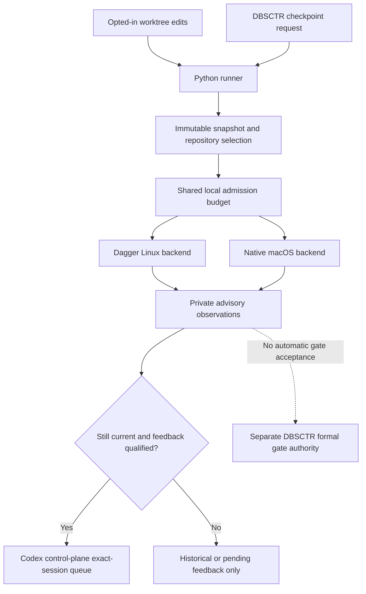

# Continuous Validation

**Status:** Discovery specification for an opt-in, local advisory shadow. No
runner implementation, activation, performance improvement, or end-to-end agent
feedback qualification is claimed.

## Overview

`continuous_validation` owns a portable Python runner that evaluates immutable
worktree snapshots during development. Cheap affected checks run after edits
settle; expensive checks run at explicit development checkpoints. One host-wide
admission budget coordinates all enrolled worktrees. Dagger executes Linux
checks; a native backend executes checks whose contract requires macOS.

The result is timely diagnostic evidence for the developer and the exact enrolled
agent session. A shadow observation cannot pass a formal DBSCTR gate, replace a
required forge check, authorize delivery, or alter a production environment.

The coordinating [shadow Initiative](../../initiatives/continuous-validation-shadow/README.md)
owns slice dependencies and launch readiness. This context owns the runner
contract; specification readiness is not source implementation or activation.

## Problem, Goals, and Non-goals

Parallel agents can repeat expensive checks, compete with foreground work, and
discover failures only after publishing a change. The experiment must determine
whether early affected execution and retained compute caches shorten the useful
feedback loop without making the host less responsive.

Goals are to author orchestration in Python, preserve repository-owned validation
semantics, avoid duplicate work for identical check inputs, cancel obsolete work,
return bounded failures to their originating session, and collect comparable
timing and resource evidence. The first slice is default-off and local only.

Non-goals are automatic gate acceptance, forge configuration changes, automatic
merges, releases or deployments, automatic dependency installation, remote
provisioning, distributed scheduling, automatic test splitting, universal
cross-platform equivalence, or replacing the repository's affected selector.
Remote engines and forge-triggered execution are later delivery slices.

## Engineering Profile and Current Slice

The stable defaults are in [PROFILE.md](PROFILE.md).

| Field | Current slice |
|---|---|
| Risk | Elevated: executes repository checks and can submit diagnostic input to an existing agent session |
| Scope | Standalone runner protocol, local shadow scheduling, snapshots, observations, caching, and telemetry |
| Modules | Python and Security; Cloud applies only to a later remote-compute slice |
| Delivery | Feature branch and draft pull request after registered implementation and required checks |
| Activation | Separate opt-in installation, runtime qualification, and explicit worktree enrollment |
| Product Intent | Internal validation infrastructure; no independent browser or product interface |

## Boundary and Ownership

| Owner | Responsibility |
|---|---|
| `continuous_validation` | Snapshot/check identity, local admission, execution protocol, advisory observation lifecycle, cancellation, and comparable telemetry |
| Repository check adapter | Python check definitions, affected selection, fixtures, coverage semantics, platform requirements, and faithful execution of configured authorities |
| `dbsctr_v3_lifecycle` | Checkpoint requests, Cycle Records, formal gates, evidence admission, applicability, approvals, and delivery authority |
| `codex_control_plane` | Supported CLI capability probing, exact session enrollment, safe-boundary feedback transport, acknowledgment semantics, and runtime qualification |
| `dotfiles_ai_distribution` | Installation, feature configuration projection, service lifecycle, version pins, rollout, rollback, and uninstall |

The protocol remains reusable, but initial enrollment requires an open DBSCTR
task and its exact Codex CLI primary session. Terminal callers can inspect or
request checks only for that enrollment. General non-DBSCTR development remains
a later extension. Integrations do not duplicate the scheduler or create a
second gate ledger.

## Language and Entities

| Term | Meaning |
|---|---|
| Enrollment | Private, explicit permission to observe one exact worktree, use its approved adapter, and optionally return feedback to one exact session |
| Generation | Monotonically increasing local worktree event sequence; it detects supersession, not source equivalence |
| Snapshot | Immutable captured file bytes and metadata with a content digest, including selected dirty and untracked inputs |
| Check manifest | Canonical descriptors emitted by a repository-owned Python adapter, bound to its source digest |
| Selection | Exact check and test identifiers with a reason and conservative fallback disposition |
| Lane | Backend, OS, architecture, interpreter, tools, dependency identities, and execution assumptions required by a check |
| Observation | Immutable diagnostic result for a specific snapshot, selection, check manifest, and lane |
| Feedback | A bounded reference to current failed or unavailable observations, routed to the enrolled session |
| Qualification | Recorded evidence that the selected deployed components satisfy the activation contract |

## Configuration and Admission

The logical feature flag `continuous_validation.enabled` defaults to `false`.
Distribution owns its concrete configuration and installation targets. Enabling
the feature permits explicit enrollment; it does not enroll every repository,
start watchers automatically, or grant feedback permission for every session.
Enrollment is local and per worktree, is revocable, and is never committed.

Enrollment identifies the real worktree root, Git repository identity, approved
adapter path and digest, input allowlist, selected local engines, open DBSCTR task,
and exact Codex CLI primary-session UUID. Paths, host identities, session identifiers, and credentials remain
private. Moving a worktree, changing its identity or adapter, or changing feedback
target invalidates enrollment until explicitly reconciled.

The proposed initial configuration is one expensive job at a time across the
host, at most two running checks in total, a one-second edit debounce, and a
five-second maximum debounce window. These are configurable experiment defaults,
not measured performance targets or hard OS resource guarantees. A continuous
stream of edits cannot indefinitely postpone a checkpoint request. Cheap work
takes priority over queued expensive work; worktrees receive fair admission.

One shared admission authority accounts for native and Dagger work across all
runner processes. An unavailable or uncertain lease state stops new admission;
it must not create a second independent budget. Host pressure or an explicit
foreground-priority request pauses new expensive admissions and cancels
interruptible shadow work where supported. Unsupported pressure measurement is
reported as unavailable and uses serialized admission rather than claiming a
resource cap. Check-level subprocess limits remain explicit backend capabilities.

## Behavior

| Given | When | Then |
|---|---|---|
| The feature is disabled, or a worktree is not enrolled | Source files change | No runner execution or agent message occurs |
| An enrolled worktree has stable edits | The debounce expires | The adapter selects cheap affected checks against one immutable snapshot |
| A selection cannot establish affected scope | A cheap check is considered | The adapter returns a conservative broader selection or an explicit checkpoint-required disposition; it never silently omits unknown scope |
| An enrolled worktree reaches a DBSCTR checkpoint | The lifecycle integration submits a request | Required heavy checks become eligible under the shared budget, without changing any gate result |
| Two worktrees request expensive work | Only one expensive lease is available | One runs and the other queues fairly; neither bypasses the common budget |
| A running request is superseded by edits | A new generation is observed | Obsolete work is canceled where supported and its result cannot produce current feedback |
| An identical fresh execution identity has a retained result | A new request selects it | The runner reports explicit result reuse and original execution time; it does not claim a new execution |
| A check needs a different OS, architecture, interpreter, or tool identity | A result exists for another lane | The result is not reused for the required lane |
| A macOS contract is selected | A Linux engine is available | The native macOS lane runs it, or the result is unavailable; Linux success is not substituted |
| A current check fails | Qualified feedback is enabled for its enrolled session | A bounded diagnostic is queued for that exact session at its supported safe boundary |
| Feedback transport accepts a message | Consumption cannot be observed | Delivery remains accepted or unconfirmed, never recorded as consumed |
| A runner or engine becomes unavailable | A request cannot finish | The observation records unavailable or interrupted; no pass, fallback execution, or automatic success retry is fabricated |
| The operator disables the shadow | Work is queued or running | New admission stops, owned work is canceled safely, and private observations remain inspectable under retention policy |

## Interfaces

The proposed standalone Python entry point is `continuous-validation`. This is a
specified interface, not an installed command. Distribution selects its managed
location without creating a new installer owner.

| Operation | Contract |
|---|---|
| `run --request FILE --json` | Evaluate one versioned request and return a terminal observation summary |
| `watch --enrollment FILE --json` | Observe only the enrolled worktree and emit structured lifecycle events |
| `checkpoint --request FILE --json` | Submit a checkpoint selection to the same admission authority |
| `status --json` | Inspect enrollment, capabilities, leases, queue, current generation, and latest observations without running checks |
| `stop --enrollment FILE --json` | Stop admissions and owned work for the exact enrollment; do not stop a shared engine |
| `compare --experiment FILE --json` | Produce matched comparisons from retained observations without executing checks |

Requests, results, and events use closed schema version `1`; unknown fields and
unsupported versions fail validation. JSON files and line-delimited event output
are private runtime artifacts. Diagnostic logs use a separate stream. Exit `0`
means the requested checks passed or valid prior results were reused; `1` means
at least one check failed; `2` means invalid input, unavailable capability, or
incomplete execution. Every valid request reports per-check dispositions, so an
aggregate code cannot conceal unavailable or canceled checks.

Repository adapters are Python programs selected by enrollment. They exchange
versioned JSON descriptors and observations with the runner and may wrap existing
commands or Python Dagger functions. The adapter owns `describe`, `select`, and
`execute`; its emitted manifest declares stable check IDs, cheap or expensive
class, backend and lane requirements, input scope, outputs, deadlines, external
input policy, and selection fallback. Pipeline logic remains Python. The runner
contains no client-specific selectors or embedded repository adapters.

Adapter execution is repository code execution and requires enrollment. The
controller does not import arbitrary discovered Python modules into its own
process or execute definitions from an unenrolled checkout. Arguments are arrays;
shell expansion is used only when explicitly declared by the approved check.

## Snapshot, Schema, and Cache Contracts

| Record | Required identity and contents | Relationship |
|---|---|---|
| Enrollment | Opaque enrollment ID, repository/worktree identity, approved adapter and input policy digests, optional exact session target, enabled capabilities | One enrollment has one current generation |
| Request | Schema, opaque request ID, enrollment, generation, trigger (`edit`, `checkpoint`, `manual`), selection policy and requested lane | One request resolves exactly one snapshot and selection |
| Snapshot | SHA-256 content digest, base and HEAD identities where available, canonical relative input inventory, content digests, file kinds and executable bits | Many requests may reference identical immutable content |
| Selection | Manifest digest, exact check/test IDs, selector identity, reason, fallback and completeness disposition | One selection belongs to one request |
| Observation | Request/snapshot/selection identities, full lane and cache identity, start/end times, status, test outcomes, bounded diagnostics references, reuse origin | One request has one terminal observation per selected check |
| Feedback | Observation IDs, exact target binding, freshness decision, deduplication key, transport acknowledgment and consumption disposition | Only current eligible observations can create feedback |

**Text Equivalent:** One enrollment has one current generation. Each request
resolves one immutable snapshot and selection, and has one terminal observation
per selected check. Requests can reuse identical snapshot content. Feedback
references only observations eligible for the exact bound target; no record
relationship grants formal gate authority.

Capture includes selected tracked modifications, staged and unstaged content,
deletions, and explicitly allowed untracked files. It excludes ignored data,
credentials, private runtime state, and unselected files by declared policy. An
excluded input required by a check makes that check unavailable. Referenced data
must be materialized by its existing owner; the runner never hydrates it
implicitly. Symlinks cannot escape declared roots, and submodules need an
explicit immutable identity or are unsupported.

Capture inventories, copies, and rechecks selected inputs. A changed inventory or
content causes bounded recapture; continued mutation leaves the request pending
or superseded rather than testing a live directory. Execution uses the retained
immutable bytes. `snapshot_id` identifies those exact tested bytes, not a claim
that a multi-file editor transaction was captured atomically. Before publishing
current feedback, the controller rechecks generation and snapshot applicability.
All displayed results retain their snapshot identity even if edits happen later.

The result-cache key binds snapshot input closure, selected checks and test IDs,
selector and check-manifest digests, adapter and runner versions, backend, OS,
architecture, interpreter, dependency lock digests, exact resolved tool and image
identities, environment policy, and declared external inputs or freshness epoch.
Different lanes cannot share a pass. Unspecified live inputs prohibit result
reuse. Credentials are not hashed or retained; secret-dependent identity uses an
explicit non-secret policy identity and required fresh execution when equivalence
cannot be established.

Dagger operation caches and runner observation reuse are separate. Cache hits
are reported at their actual layer, or unavailable if the backend cannot expose
them. A function cache bypass does not prove that commands inside it reexecuted.
Ordinary execution never prunes shared caches to manufacture a cold run.

Observations are advisory and immutable. Even a complete fresh observation does
not update a Gate Ledger, waive review, or create authenticated forge evidence.
A later evidence-admission slice must define its own source, environment,
integration-base, provenance, and forgery resistance contracts before reuse can
affect formal gates. Caller arguments and process identifiers are not actor
authentication.

## Cancellation, Recovery, and Feedback

| State | Event and guard | Result |
|---|---|---|
| Disabled | Feature enabled and exact enrollment admitted | Idle |
| Idle or Debouncing | Eligible change; latest generation retained | Debouncing, then Queued |
| Queued | Shared lease granted and snapshot valid | Running |
| Queued or Running | New generation, revoked enrollment, or stop | Superseded or Canceled; request cancellation |
| Running | Check finishes for its immutable snapshot | Passed, Failed, Unavailable, or Interrupted |
| Failed or Unavailable | Still current and feedback transport qualified | Feedback eligible |
| Any terminal result | No longer current | Historical only; suppress feedback |

**Text Equivalent:** Disabled work requires both feature enablement and exact
enrollment before becoming idle. Eligible changes debounce and queue; a lease and
valid snapshot permit running. Edits, revocation, or stop supersede or cancel
queued and running work. Execution can end passed, failed, unavailable, or
interrupted. Only still-current failed or unavailable results with qualified
transport become feedback eligible. Every stale result remains historical.

Cancellation targets only owned processes and Dagger sessions. It never kills a
shared engine, another worktree's check, or the foreground agent. A failed cancel
keeps its lease charged until termination is established. Restart recovery
reconciles leases and in-flight requests before admission; a stale PID is not
proof of ownership or completion. Unknown completion remains interrupted.

The Codex integration belongs to `codex_control_plane`. Its candidate supported
transport is `codex queue --thread <UUID> --message <TEXT>`. Current CLI help and
[official command documentation](https://learn.chatgpt.com/docs/developer-commands?surface=cli)
establish the queue surface. They do not establish this integration's end-to-end
active-session delivery, idle wake, acknowledgment, or restart behavior. These
capabilities remain unqualified until tested against the selected deployed CLI.
No private history database, synthetic terminal input, broad session-name lookup,
or steering fallback is permitted.

Feedback requires a separately enabled capability and an exact private session
binding. Payloads identify advisory status, snapshot, failed check/test IDs,
bounded sanitized excerpts, and local diagnostic references. Check output is
untrusted data, not instructions. Delivery deduplicates identical current
failures, coalesces bursts, suppresses superseded observations, and preserves
operator input and native approval rules. Accepted queue input is not evidence
that the agent consumed or acted on it. Unsupported idle wake retains feedback
for the next supported boundary and reports the capability gap.

## Telemetry and Validation

Record snapshot/selection/setup/execution/queue durations, first useful feedback,
terminal result time, superseded and canceled work, admitted concurrency, result
reuse, backend cache information when available, and host responsiveness/resource
signals with availability flags. Use monotonic durations and UTC wall timestamps.
Engine overhead and check workload resources are distinct accounting boundaries.
Raw command output, source bytes, session IDs, paths, credentials, and transcripts
remain private; public summaries contain only sanitized aggregate evidence.

Each experiment records the same snapshot, adapter/check identities, selected
tests, lane, input data, instrumentation, and concurrency policy. Compare cold and
warm runs using isolated experiment caches, one versus two worktrees, affected
versus full selection, and required native/Dagger platform lanes. Report sample
counts, failures, unavailable cases, contention, cache state, and timing
distributions. Full-suite comparison can expose affected-selection misses; a
small set of matching green results is not proof of universal correctness.

Cadence and latency targets are selected after representative measurement. There
is no measured speedup, supported maximum agent count, or demonstrated host
resource ceiling yet. The experiment may conclude that a workload should remain
manual or later move to other compute.

Required source evidence includes deterministic tests for opt-out, dirty snapshot
capture/races, selection fallback, shared admission across processes/worktrees,
supersession, process/session cancellation, identity mismatch, external-input
freshness, crash recovery, privacy, structured failures, and feedback deduplication.
Run the repository's affected pytest and Python compilation authorities and its
existing publication/instruction checks. Preserve configured vulnerability and
coverage authorities rather than introducing competitors.

Activation additionally requires pinned CLI/engine/Python compatibility, a real
Linux Dagger smoke, a required native macOS smoke, responsive foreground behavior
under two enrolled worktrees, disable/restart recovery, and exact-session active
delivery plus idle-wake qualification. A missing capability is unavailable and
cannot become a passing claim through a mock. GitHub-rendered visual validation
is required before publication readiness for the Mermaid source below.

## Gate Ledger and Delivery

No implementation cycle is registered by this specification. A Build primary
must bind the committed profile and exact approved slice to the existing DBSCTR
registration/preflight process before source work.

| Gate | Applicability | Result | Required evidence |
|---|---|---|---|
| Domain | required | pending | Boundary, entities, ownership, profile |
| Behavior | required | pending | Opt-in, freshness, budget, failure, recovery scenarios |
| Spec | required | pending | Runner/adapter protocol, record shapes, visual review |
| Contract | required | pending | Identity, privacy, cancellation, capability checks |
| Test | required | pending | Failing regression evidence and passing affected implementation |
| Refactor | required | pending | Stable interfaces, coherent docs, intended diff |
| Review/Integrate | required | pending | Cross-context adapters, publication checks, current-base validation |
| Release | not_applicable | not_run | Initial slice publishes no independently versioned package or image |
| Deploy | required | pending | Activation requires targeted managed installation, opt-in, pins, rollback and real backend/session smokes |
| Operate | required | pending | Activation requires ownership, resource/queue observations, recovery, disable and retention evidence |
| Maintain/Retire | required | pending | Version reprobe, support ownership, bounded retention, disable/uninstall and private-state preservation policy |

There are no approved Gate Exceptions. A source-only implementation slice may
reasonably separate activation, but its own approved applicability plan must
state that separation; it cannot claim an operating shadow. Draft-PR delivery
does not itself authorize publication, merge, installation, or remote compute.

## Facts, Assumptions, Risks, and Open Qualification

- Python Dagger modules and local/remote engine selection are supported concepts;
  the selected exact version remains a Build/activation pin. Beta-only and
  announced future scheduling features are not dependencies.
- Repository-owned affected selection is an explicit input, not a correctness
  guarantee supplied by the runner. Unknown mappings must broaden or defer.
- One expensive lease is a conservative admission default, not a CPU or memory
  ceiling. Native subprocesses and shared engines need real resource observation.
- Source changes can race execution and feedback; immutable observations remain
  useful only with explicit applicability checks and stale suppression.
- Codex queue availability is documented and locally observable; actual feedback
  consumption and idle wake remain end-to-end qualification work.
- Final gate reuse, remote topology, external forge evidence, retention parameters,
  and target cadence are explicitly deferred decisions. Retention limits must be
  chosen and enforced before activation; indefinite storage is not a default.

## Visual Evidence

| Concern | Classification | Canonical evidence and question |
|---|---|---|
| Boundary | required: ownership table and flowchart | Which owner can schedule, execute, deliver feedback, or accept formal evidence? |
| Interaction | required: ordered flowchart | Which operations happen before execution and before feedback? |
| State | required: transition table | When does supersession prevent current feedback? |
| Data/trust | required: directional flowchart and schema table | Where do immutable source, private diagnostics, and advisory observations cross boundaries? |
| Schema | required: relationship table | Which identities bind requests, observations, and session feedback? |
| Dependency/deployment | required: ownership and activation gate tables | Which adjacent integrations must qualify before activation? |
| Quantitative | not_applicable: no measured comparison exists | Telemetry defines future experiments; no performance chart or speed claim is justified |

**Text Equivalent:** Explicit enrollment is required for edit-triggered checks;
DBSCTR can also submit checkpoint requests. The Python runner captures immutable
inputs and asks the repository adapter for a selection. One shared local budget
admits both Dagger Linux and native macOS execution. Both produce private advisory
observations. Only current failures with qualified feedback can reach the exact
enrolled session through the Codex control plane. Other observations remain
historical or pending. No path automatically changes a formal DBSCTR gate.

Canonical source: this specification's ownership, behavior, schema, and
cancellation contracts. Owner: continuous-validation maintainer with the adjacent
context owners. Update the visual and Text Equivalent in the same change whenever
ownership, data flow, freshness, feedback authority, or activation topology changes.
