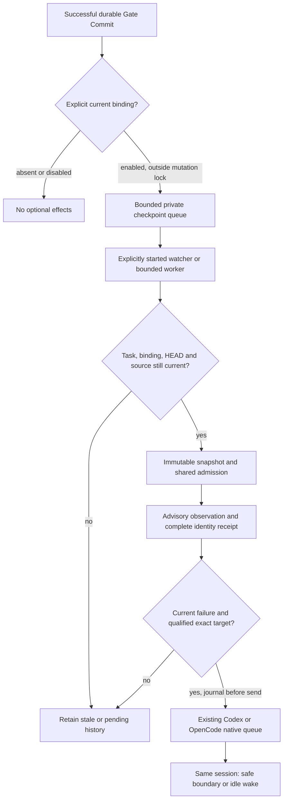

# Default-off checkpoints and CLI feedback

## Scope and ownership

This follow-up extends the existing advisory shadow rather than replacing its
executor or formal quality gates. The continuous-validation context owns bounded
requests, identity receipts, admission, freshness, feedback journals and telemetry.
The DBSCTR lifecycle owns the successful Gate Commit event. The Codex and
OpenCode control planes own their native existing-session transports. Repository
adapters own JUnit collection, selected-file mapping and runtime obligations.
Managed distribution owns installation; no login service is introduced.

Python, Security, ML/AI and the existing local-runtime Cloud profile apply. The
change is elevated risk because diagnostics can schedule work in an existing
agent session. No model, provider, permission, required-check, merge or production
authority changes. Remote compute and authoritative evidence reuse remain deferred.

## Domain and behavior

A checkpoint event identifies one successful durable Gate Commit, its exact
repository, worktree, cycle, committed HEAD, gate set and opt-in binding. It is a
request for advisory work, never a Gate Ledger result. A typed feedback target is
one existing Codex CLI thread or OpenCode CLI session. Its native location is
distinct from the explicitly selected task checkout; neither a shell directory
nor a supplied session identifier authenticates an actor.

1. Given no explicit checkpoint enrollment, a successful Gate Commit performs no
   optional import, state creation, adapter execution, worker start or message.
2. Given an enrolled open task, a verified Gate Commit creates at most one bounded
   private checkpoint event after the lifecycle mutation guard is released.
   Enqueue failure leaves the original commit, ledger result, stdout and exit
   status intact and records a fixed diagnostic when possible.
3. Given a running explicitly opted-in worker, pending current events are drained
   through the existing snapshot executor and host-wide budget. Read-only status,
   evidence recording, set-gate and final delivery never enqueue checkpoints.
4. Given a duplicate, changed enrollment, closed task, changed HEAD or stale
   checkpoint, no obsolete event causes current checks or session feedback.
5. Given completed pytest cases, every retained JUnit case has one bounded stable
   identity, including skips and long parameterized cases. Unknown mapping,
   duplicates, malformed artifacts or capacity overflow produce unavailable
   evidence rather than a partial list represented as complete.
6. Given a current failure and a qualified explicitly selected native transport,
   feedback targets exactly the existing enrolled CLI session. Active work
   receives queued input at its safe boundary; an idle open session can resume.
   Missing, archived or wrong sessions never cause creation, fork, fallback or a
   competing resume process.
7. Given an uncertain send or prior attempt, the durable journal prevents automatic
   replay. Queue acceptance remains `consumed: false`; actual consumption needs
   independent runtime evidence. Closed tasks and revoked opt-ins cannot wake.

## Interfaces and contracts

Enrollment remains default-off and private. An explicit checkpoint option binds
the enrollment path and digest to the exact repository/worktree/cycle using the
existing private lifecycle/state authority. The lifecycle performs a bounded
lookup, not a repository scan or environment-based target search. Missing binding
is a no-op. A bounded enqueue happens outside lifecycle locks; no checks run in
the lifecycle process, and no detached worker is launched there.

The explicit watcher/worker consumes checkpoint events as well as debounced edit
requests. It rechecks binding, cycle, HEAD and source freshness before execution.
The normal request-generation and cancellation rules remain authoritative.
Checkpoint event identity coalesces retries of the same durable commit. Queue
capacity is bounded; full or unsafe state is unavailable without deleting older
evidence. Stop disables enrollment before owned process shutdown; unknown
termination retains its lease and blocks further admission.

Each check declares either `pytest-junit-v1` or `not_applicable` test-identity
evidence. Pytest checks retain bounded JUnit and report all completed identities,
counts by outcome, zero omissions, encoded identity digest and separate failed
identities. Complete means every retained JUnit case is represented; it does not
prove complete selection, changed coverage or a final integrated-source pass.
Adapters preserve those independent authorities.

Map testcase file/class to exactly one selected module. A module-level skip whose
name exactly identifies a selected dotted module is recoverable. Unknown or
ambiguous mapping is unavailable. Stable logical identity uses a versioned
canonical tuple of case kind, selected file, class and name, excluding duration,
outcome, failure text and runtime paths. Ordinary bounded printable node IDs may
remain readable; otherwise use `pytest-junit-sha256:` plus a SHA-256 digest of that
tuple. Reserved-prefix ambiguity and duplicate logical or encoded identities are
unavailable. Never use `set` to hide duplicate execution records.

Keep the existing 4 MiB JUnit/log, 10,000-case, 512-character identity and 1 MiB
adapter-response bounds. A typed completion receipt validates count, unique-ID
digest, outcome sum, failed-ID subset, encoding and zero omissions. Partial or
malformed new receipts cannot qualify comparison. Legacy observations remain
readable but lack complete-identity qualification, including legacy empty lists.
Explicit non-test evidence stays comparable. Receipt outcome/measurement fields
do not become Python/tool identity; outcome differences remain visible separately.

Feedback enrollment selects a closed typed transport contract. Codex uses an
exact canonical UUID and the native queue command. OpenCode uses its bounded
native session ID and an explicitly validated owned loopback service, existing
session lookup and native queued prompt with a stable message ID. Reuse the
managed service-registration and credential owner; never auto-start or replace a
service during dispatch. Transport version and active/idle qualification must
match the installed binary. Retain compatibility for existing readable Codex
receipts without treating old-version qualification as current proof.

One shared journal persists intent before sending and binds transport, exact
session, cycle, snapshot, check and failure identity. Recheck open task, current
generation, unchanged enrollment and immutable source immediately before dispatch.
Use only fixed diagnostic codes, bounded opaque failure identity and the validated
private log locator; raw output and parameter payloads do not enter agent input.
The message permits repair only at the next safe boundary, inside the current
task scope and existing native permissions. It grants no formal gate or delivery
authority and selects no model/provider override.

## Validation and bounded pilot

Obtain red and green regression evidence for the measured identity omissions,
module skips, duplicates, mapping ambiguity, long/unprintable cases, capacity,
receipt mismatch, old partial comparison and failed-only feedback. Qualify public
pytest JUnit collection as well as consumer adapter extraction.

Exercise disabled/no-side-effect lifecycle behavior, unsuccessful and multi-gate
commits, enqueue failure isolation, duplicate coalescing, stale/closed binding,
budget sharing and uncertain termination. Use real disposable native Git and
lifecycle fixtures; do not replace their custody or permission tests with mocks.

Qualify installed Codex and OpenCode CLI transports independently using isolated
configuration/state, a local synthetic provider and exact nonces. Prove active
queue delivery and idle wake in the same existing session, plus negative cases
for missing/closed/wrong targets, drift, revoked enrollment and uncertain send.
No paid provider calls or messages to unrelated tasks are permitted.

Then run a separately bounded two-repository advisory pilot: at most ten minutes
of observed work, a shared two-total/one-expensive budget, explicit checkpoint
timeboxes and bounded cancellation grace. Retain failures, pending work and all
attempts. Record source/tool/runtime identities, selection, completed cases,
request/setup/queue/execution durations, checkpoint enqueue/drain, feedback
acceptance/consumption, and resource/cache availability. No speedup ratio follows
from different test closures or two samples. End with opt-ins disabled, confirmed
owned work termination and the dedicated worker stopped; preserve evidence/caches.

## Maintenance and recovery

Installation and activation are separate. Default installation starts nothing.
Pin or requalify native CLI capabilities after upgrades. Rollback disables
checkpoint/feedback enrollment first; existing required CI and gates continue.
Keep raw observations immutable, including previously incorrect comparison
claims with a separate audit disposition. Retention/disposal requires the existing
owner decision; no shared cache or worktree cleanup is implicit.

## Visual Evidence

| Concern | Classification |
|---|---|
| Boundary | required: ownership and request flow below |
| Interaction | required: ordered flow below |
| State | required: eligibility table below |
| Data/trust | required: private queue and bounded diagnostic flow below |
| Schema | not_applicable: the typed contracts above extend the canonical context records without a second storage model |
| Dependency/deployment | required: lifecycle enqueue and explicitly running worker topology below |
| Quantitative | not_applicable: timeboxes define experiment bounds, not measured performance claims |

**Text Equivalent:** A successful durable Gate Commit checks an explicit binding
after releasing its mutation lock. Missing/disabled binding has no optional
effects. Enabled binding permits a bounded private enqueue. Only an explicitly
running worker drains it, after rechecking task, binding, HEAD and source.
Current work uses immutable snapshots and shared admission, yielding advisory
observations and complete identity receipts. Stale or ineligible work remains
history. A current failure with a qualified exact target is journaled before
native queue delivery to the same Codex or OpenCode session at its safe boundary
or idle wake. No arrow represents gate acceptance.

| State | Execution | Feedback |
|---|---|---|
| Absent or disabled enrollment | No optional work | No send |
| Current queued checkpoint, worker absent | Pending | No send |
| Current open task, admitted worker | Advisory execution | Only current qualified failure |
| Changed binding, source, HEAD or closed task | Stale/cancelled, retain evidence | Suppressed |
| Unknown termination or send outcome | Preserve uncertainty; no lease reclamation | No automatic replay |

Canonical source: this contract and the existing context records. Owners are the
continuous-validation, lifecycle and native control-plane contexts named above.
Changes to trigger ordering, bindings, transports or evidence update this visual
and its text equivalent together.
