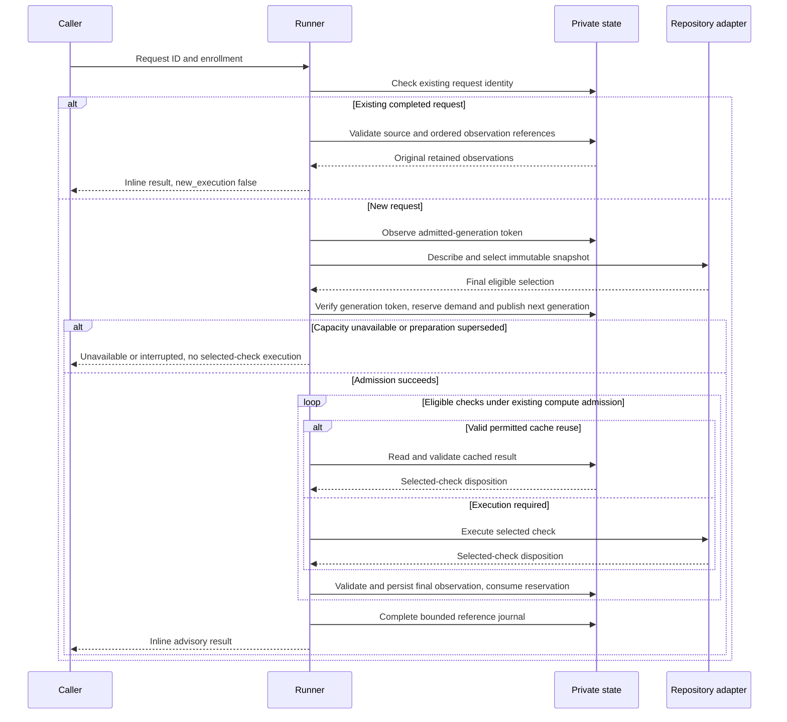

# Bounded Request Storage and Observation Admission

Status: source implementation for `CVS-STORAGE-005`; deployment and operational
qualification remain separately evidenced. This is a repair within
`continuous_validation`, not another Initiative or a new storage service.

## Problem and Outcomes

Python audit findings PY-03 and PY-04 expose two contradictions in the current
runner. A request journal embeds every observation and the full source inventory,
but the private reader rejects files above 8 MiB while the writer has no equivalent
bound. A completed request can therefore become unreadable on replay. Observation
retention is checked once before selection, allowing a multi-check request or
concurrent requests to exceed the 200-record limit.

Success means that accepted records are readable by their owner, completed request
IDs remain queries rather than executions, and selected work has observation
capacity before it starts. Existing evidence remains private and is never deleted
to make room. These are correctness contracts, not performance claims.

## Scope and Engineering Profile

The committed [Engineering Profile](PROFILE.md) remains authoritative. The owner
is the dotfiles maintainer; repository maintainers retain check definitions and
validation authority. Product Intent remains internal developer infrastructure;
no separate product artifact is introduced.

| Current-cycle override | Decision |
|---|---|
| Context and risk | `continuous_validation`; elevated because private persistent state, idempotency and concurrent execution admission change |
| Affected scope | Private record writes, request journal completion/replay, observation/cache validation, per-state capacity reservation, generation publication, and direct callers/tests |
| Modules | Python and Security; existing Cloud and ML/AI runtime boundaries are preserved but not changed or newly qualified |
| Runtime | Existing Python `>=3.12` controller; independently locked SDK environments remain unchanged |
| Delivery intent | Tested draft PR, targeted private local deployment, then merge when CI and all applicable lifecycle/protection checks pass |
| Local deployment target | An isolated private installation and synthetic qualification; preserve the newer shared managed controller and its coherent generation unchanged |
| Activation | Preserve default-off enrollment; no new watcher, engine, provider, credential or session activation |
| Compatibility | Public request/result schema and inline observation output stay at version 1; private journal format changes explicitly |
| Discovery authority | Approved specifications were imported through exact launch approval; implementation, installation and delivery retain their own gate evidence |

Non-goals are automatic garbage collection, evidence deletion, increased retention
limits, partial execution to fit capacity, oversized legacy-journal recovery tools,
an async rewrite, database adoption, package/runtime/checker migration, global
response-size redesign, and repairs to independent request/snapshot/event count
admission. Existing compute admission and unknown-termination ownership remain
authoritative.

## Decisions and Requirements

The operator selected whole-request capacity refusal, preservation of oversized
legacy journals with explicit recovery-required results, and eventual tested
private deployment plus merge after CI. The requirements below make those choices
concrete without granting implementation or lifecycle-registration approval.

| ID | Required outcome | Audit finding |
|---|---|---|
| STO-001 | A successful private write fits its owner's read and validation bounds; a refused replacement leaves prior bytes unchanged | PY-03 |
| STO-002 | New completed request journals use bounded observation references and a source-inventory digest; public results retain ordered inline observations | PY-03 |
| STO-003 | Completed-ID replay verifies request, enrollment, source and observation identities and never executes checks or feedback again | PY-03 |
| STO-004 | Readable legacy inline journals remain readable; oversized or invalid existing journals never become new work | PY-03 |
| STO-005 | Admission keeps retained observations plus unmaterialized reservations within 200; preexisting overfull stores preserve evidence and refuse new work | PY-04 |
| STO-006 | Reserve the whole eligible selection atomically before selected checks, cache-derived publication, review/provider activity or feedback | PY-04 |
| STO-007 | Capacity-refused work does not publish a new current generation or supersede admitted work | PY-04 |
| STO-008 | Unknown execution retains its reservation charge; normal release requires proof that a reservation is unused or materialized | PY-04 |
| STO-009 | Refusals remain structured advisory results for CLI, watcher and checkpoint consumers, without automatic replay | Both |
| STO-010 | Rollout stops old writers; rollback preserves new state and does not let old binaries consume the new journal format | Both |

## Boundary and Data Ownership

| Owner or record | Responsibility and invariant |
|---|---|
| Runner | Describes/selects existing checks, reserves storage, publishes generation, executes through existing compute admission, and returns advisory results |
| Private record boundary | Validates owner, path, mode, links, schema and exact serialized size before atomic replacement |
| Request journal | Owns completed-query reconstruction and original source bindings; it grants no execution or gate authority |
| Observation | Owns one selected-check disposition, including cache reuse, failure, interruption or admission deferral |
| Reservation | Owns one predetermined observation ID until materialized or proven unused; it does not grant compute capacity |
| Cache | Keeps its separate existing identity and reuse policy; it cannot substitute for a journal's referenced observation |
| Checkpoint worker | Owns its existing attempting/terminal lifecycle and never retries uncertain attempts automatically |
| Distribution/operator | Owns scoped installation, quiescence, rollout, disable and retained-state recovery decisions |

State remains outside Git. Existing no-alias checks, owned regular single-link
files, private directory/file permissions, sanitized errors, freshness checks and
atomic writes remain required. Names in references are identifiers from which the
runner derives fixed relative paths; stored arbitrary paths cannot redirect reads.

## Private Storage Contract

### Record budgets and publication

The generic private-record maximum remains 8 MiB. Compute the actual canonical
UTF-8 serialization, including its trailing newline, before creating a replacement.
Reject overflow before replacing an existing record. Record-specific validation
can impose a smaller bound: complete observations must satisfy the existing
1 MiB observation validator, including controller and optional feedback fields.

Validate the initial complete observation, any cache copy, and its final
feedback-enriched form independently. If enrichment cannot fit or validate,
preserve the already durable observation, report a bounded explicit failure and
never manufacture a pass. If the initial computed observation is too large or
invalid, produce a minimal validated unavailable observation with a bounded
diagnostic code and truthful execution/reuse disposition. Preserve existing
private log evidence; do not copy an oversized body into another unbounded field.
An unavailable fallback cannot claim successful cache reuse: keep
`cache_reused: false` and omit reuse-origin fields as required by the existing
version-1 validator; preserve whether actual check execution occurred.
Before admitting selected work, validate that each check's complete minimal
unavailable envelope can fit, using predetermined IDs, full lane/source identity
and bounded controller metadata. If mandatory identity alone cannot fit the
existing validator, refuse the whole selection before selected checks, cache
publication or generation publication. Never shrink lane/tool/dependency identity
to make a fallback fit. Preflight must account for the allowed serialized size of
controller fields that are filled after execution; a placeholder of arbitrary
small size is not a sufficient bound.
If a feedback update fails validation, retain the previous durable observation;
return that exact persisted form in the first response and subsequent replay.
Report the storage failure through bounded existing private event/feedback
diagnostics when possible. The original check result and feedback uncertainty
remain distinct; a rejected update cannot trigger another feedback attempt.
The completed journal must bind the final persisted observation bytes, including
the preserved version when an update was refused. Atomic replacement is not a
multi-file transaction; I/O failure
must remain visible and must not authorize another execution under the same ID.

Snapshot metadata and other private records also obey write/read size symmetry.
A source inventory can satisfy file-count/source-byte limits but exceed the
serialized metadata limit. Refuse that capture explicitly before selected checks;
do not write metadata that its reader cannot consume or silently drop paths.

### Completed request journal

Use an explicit private storage format version distinct from public schema version
1. The closed completed variant contains:

- request and enrollment digests;
- approved selection patterns, original HEAD where captured, and SHA-256 of the
  complete canonical content inventory, including executable bits;
- the original bounded result summary without inline observation bodies; and
- ordered observation references, each binding ID, canonical content digest and
  request/snapshot/generation/check identity.

The implementation uses `schema_version: 1`, `storage_version: 2` and a closed
`kind` discriminator. `intent` contains only request/enrollment digests and those
version fields. `terminal` adds a source-free unavailable/interrupted/pending
result. `completed` adds `patterns`, `head`, `files_digest`, result summary,
`observation_refs` and `observation_order_digest`. Each reference contains exactly
`id`, `sha256`, `request_id`, `snapshot_id`, `generation` and `check_id`.
`sha256` hashes the canonical final persisted observation value; the order digest
hashes its ordered ID list independently of the reference list. Hydration removes
no public result fields and restores only the original `observations` list.

The separate `retention.json` ledger stores closed reservation identities and
`reserved`/`started` state under a bounded `retention.lock`. Identity also binds
manifest, selection, cache key and lane digest. `started` is persisted before
check/cache processing; exact validated observation publication consumes that
identity. Normal failure releases only remaining `reserved` entries. A matching
materialized entry can be reconciled once; an unmatched `started` entry stays
charged. No reservation metadata is copied into public results.

Reference IDs and check identities are unique and ordered consistently with the
original result. New admitted work can produce at most 200 observations. Derive
each observation location under the existing observation directory; validate
identity, digest, private-file safety and complete observation schema on replay.
References are computed after final feedback-related observation updates. A
distinct cached copy is never the reference target.

Persist approved patterns and the inventory digest directly. Replay must not
derive them from a changed adapter or depend on mutable snapshot metadata. It
recomputes the complete current inventory with those patterns and checks original
HEAD before reconstructing the original ordered inline observations. Preserve
existing `request_identity_reused` and `request_source_changed` refusals.

Define separate closed variants for an interrupted execution intent and a
terminal refusal without captured source. These cannot masquerade as a completed
source-bound result. Unknown versions, malformed summaries, missing/swapped
references, duplicate identities, inconsistent ordering or changed digests are
explicit unavailable results, never reasons to create a fresh request.

The same ID remains a query. In-flight duplicates remain pending. Completed
duplicates retain original observation identities and `new_execution: false`;
they do not reserve more capacity, execute checks, send feedback or recreate cache
entries. Interrupted IDs remain unavailable without automatic execution.

### Legacy and recovery-required records

Keep a reader for valid legacy inline journals that fit existing bounds. Do not
rewrite them merely because they are queried. Existing stores above 200 records
retain their evidence and can still serve valid completed-ID queries; refuse new
work instead of pruning or raising limits.

For an existing oversized request journal, first establish path/file safety
without reading its entire body. A safe oversized journal returns `unavailable`,
`error_code: request_journal_recovery_required`, `new_execution: false` and no
observations. Leave bytes unchanged. This classification does not certify that
the unread body is valid. Unsafe owner, mode, link or path conditions retain their
unsafe-record classification. Unsupported/malformed readable journals return a
distinct bounded unavailable result. Never truncate, replace, delete, migrate or
re-execute an existing journal during replay. Recovery tooling is deferred.

## Observation Capacity and Concurrency

After validating the final selection, including opted-in review, calculate demand
for every check that will produce a new observation. Cache hits, failures,
interruptions and compute-admission deferrals consume a slot. Expensive checks
deferred from an edit produce only pending requirements and consume no slot.
Incomplete selection alone creates no synthetic observation. A feedback rewrite
updates the same ID and consumes no additional slot.

Use a short shared state-directory lock and durable reservation accounting outside
the observation directory. Reserve predetermined observation IDs for the whole
eligible selection in one decision. Under that lock maintain:

`retained observation count + unmaterialized reserved ID count <= 200`.

This is the invariant for admitted work in an in-bound store. A preexisting
overfull store stays preserved and blocked; this repair cannot restore its count
by deleting evidence or report it as within bounds.

A request that cannot fit returns `unavailable` with
`error_code: observation_retention_limit`, empty observations and no selected-check
execution. It does not run a prefix, publish cache-derived observations, resolve
review credentials, call a provider, deliver feedback or publish a new current
generation. Preserve the existing full-store refusal for all new enabled requests,
including selections that would require no observations. Completed-ID queries
still bypass new-work admission.

Adapter `describe`, snapshot preparation and adapter `select` may run before exact
demand is known. Capture the current admitted-generation token before preparation.
A preparatory freshness guard checks that token, enrollment, source and open task
without claiming a generation. Recheck source/enrollment/task immediately before
admission outside the short state locks. Under a fixed lock order, compare the
expected admitted-generation token, reserve the whole demand and publish the next
generation as one serialized admission decision. A changed token means superseded
preparation: return an interrupted disposition, release only proven-unused
reservations and do not rebase stale preparation onto the new generation. This
prevents a slow earlier preparation from overwriting a newer admitted generation.
After admission retain existing supersession and cancellation checks. Capacity
refusal must not cancel an older admitted request.

Never hold the shared retention lock over subprocesses, provider operations,
feedback, compute-admission waits or whole-request execution. Observation
publication and consumption of its reservation are coordinated under that lock.
If a crash occurs between file publication and accounting, reconcile the exact
reserved ID and bound identity without double-counting or freeing unknown work.

Normal completion/cancellation releases proven unused reservations. A controller
crash, malformed reservation, unknown execution completion or ambiguous state
retains charge and refuses unsafe admission. Time expiry, missing PIDs, process
restart or stop alone is not completion proof. This slice adds no automatic
reservation garbage collector. Count reservation control files separately;
unexpected/unsafe entries cannot silently create capacity. Use bounded traversal
and bounded lock acquisition.

The count reservation is not disk preallocation, a hard memory quota, or atomic
admission for every other store. Independent request, snapshot and event limits
remain; their count races and broader aggregate-output policy are separate work.

## Behavior and Recovery Scenarios

| Given | When | Then |
|---|---|---|
| Ten individually valid large observations and enough capacity | A request completes and its ID is queried | A bounded journal reconstructs the same ordered observations even when their aggregate exceeds 8 MiB; no check or feedback runs again |
| A readable valid legacy inline journal | Its completed ID is queried | Original observations remain available without automatic rewriting |
| A safe existing journal above 8 MiB | Its ID is queried | Recovery-required unavailable result; original file unchanged; no execution |
| A completed journal with a missing or modified reference | Its ID is queried | Bounded unavailable result; no fallback, repair, replacement or execution |
| 199 retained observations and two eligible selected checks | A new request seeks admission | Entire request is unavailable before selected checks; no generation supersession or evidence removal |
| 199 retained observations and one eligible check | Admission and publication finish | Count reaches 200 and its reservation is consumed exactly once |
| One remaining slot and two concurrent request IDs sharing state | Both request one slot | At most one is admitted; lock ordering cannot hide overcommit |
| An in-flight or completed duplicate ID at capacity | It is queried again | Existing coalescing/replay semantics; no new reservation or execution |
| A controller dies with reserved work of unknown completion | Another request arrives | Unknown capacity remains charged; no timeout/PID-based reclamation |
| A reserved ID was durably published before accounting update | Recovery observes exact matching identity | Count the observation once; do not replay execution |
| Preparation began against an older generation | Another request is admitted before its reservation/publication | Older preparation is superseded; it cannot publish a generation, execute or cancel newer admitted work |
| Checkpoint work is marked attempting | Storage refuses selected checks | Worker receives a coherent unavailable result, records terminal outcome and does not automatically replay |

## Rollout, Rollback and Maintenance

| Stage | Required behavior |
|---|---|
| Pre-deployment | Use a fresh isolated private destination with no old writers. Preserve the shared managed controller, its policy and generation; shared rollout is outside this cycle |
| Installation | Use existing distribution owner and targeted apply into the isolated destination; retain default-off settings without importing shared enrollments or starting watchers or engines |
| Qualification | Use synthetic private fixtures to verify aggregate replay, capacity races, failure recovery and direct CLI/watcher/checkpoint consumption; no live provider, credentials or native-session messages required |
| Merge | Green required CI plus applicable gates, reviews and native protections; failures never authorize force/admin bypass |
| Rollback | Disable affected enrollment and stop owned controllers; restore previous source/runtime only with feature disabled; preserve new-format state and prevent old binaries from consuming it |
| Maintenance | Requalify storage readers/writers together; preserve legacy readers, explicit unsupported-version handling and bounded retention; recovery/disposal remains an operator-owned future action |

Old binaries do not understand reference journals or reservations and may raise
an unhandled missing-field error. In-place downgrade with an enabled new-format
store and mixed old/new writers are unsupported. Public schema compatibility does
not imply private downgrade compatibility. Re-enabling requires a compatible
runner; no automatic state conversion, new enrollment or evidence deletion is a
rollback mechanism.

## Validation Strategy and Evidence Boundaries

Build begins with failing regressions, then changes implementation. Existing root
`pyproject.toml`, lock and CI own pytest and supported-runtime checks. No new test
library or checker is selected by this specification. Repository typing authority
is currently unconfigured: command/version/configuration and analysis coverage
are unavailable, not passing; checker setup and full typing migration are outside
this repair. No baseline suppressions or waived failures are introduced.

| Concern | Acceptance evidence |
|---|---|
| Byte symmetry | Accepted canonical records round-trip; exact bound includes newline; one-byte overflow cannot replace existing readable bytes; no truncation or NaN |
| Complete observation | Initial/controller/cache/feedback forms satisfy existing validator and size bound; minimal envelopes with near-limit lane metadata preflight before execution; unrepresentable identity refuses the whole selection; overflow leaves prior evidence and explicit failure |
| Aggregate replay | Several valid results exceed 8 MiB in aggregate; reference journal fits; original IDs/order/result fields replay without execution or feedback |
| Source and identity | HEAD-only, content, executable-bit, addition/deletion, enrollment, pattern and checkpoint identity changes retain existing refusals |
| Unsafe or malformed state | Wrong owner/mode/type, symlink, hardlink, missing/swapped/duplicate/reordered refs, unknown version and oversized legacy record fail closed with bytes preserved |
| Capacity | 198+2, 199+1, 199+2, full/overfull stores, >200 eligible selection, optional review, cache hit, expensive edit deferral and incomplete selection |
| Concurrency and crashes | Two processes sharing one remaining slot; same-ID coalescing; slow stale preparation cannot overwrite a newer admitted generation; crash before/after reservation, publication, accounting and completion; uncertain work never reclaimed by expiry |
| Consumers | Existing run/checkpoint/watch/status/compare paths; checkpoint refusal becomes terminal unavailable; CLI unavailable exit remains 2; status remains read-only |
| Rollout | Scoped installation identity, default-off behavior, stopped old writers, no mixed formats, disabled rollback and private-state preservation |

Use independent small state models and deterministic generated sizes/selections
for round-trip and capacity invariants. Keep real multiprocess lock tests and
existing permission/crash examples. Proposed properties are not executed evidence;
the earlier audit's narrow scratch surrogate is not an integration pass.

Configured publication/instruction authority:

```bash
uv run --group test pytest tests/test_portable_distribution.py::test_public_tree_has_no_maintainer_identifiers tests/test_opencode_control_plane.py tests/test_dbsctr_lifecycle.py -q
```

The publication check inventories Git-tracked files. Stage intended new documents
before running it; do not include private fixtures or evidence. For implementation,
run affected `tests/test_continuous_validation*.py`, existing activation contracts,
Python compilation for changed modules, and configured CI including weekly/manual
compatibility policy. Validate the exact candidate source on supported oldest and
current CI runtimes where practical. Do not install tools to manufacture a pass.
No new Dagger image, SDK, engine, native feedback or provider qualification is
implied by a storage-only smoke.

## Gate Applicability and Build Handoff

All Development Kernel gates and Review/Integrate are required. Release is
not applicable because no package or image is published. Deploy, Operate and
Maintain/Retire are required for selected private local deployment. All results
remain pending for Build; no Gate Exception is approved.

Build copies the applicability JSON under its ignored `.dbsctr/plans/` and binds
the committed profile through current lifecycle registration. The canonical [storage applicability plan](../../initiatives/continuous-validation-shadow/STORAGE.plan.json)
is the exact JSON payload to copy; this is not a registered plan or receipt.
The existing shadow Initiative owns the `bounded-storage` follow-up slice and
its INT-032 through INT-042 launch coverage. It reuses the approved single-context
ownership map; no new Initiative or bounded context is introduced.

The next DBSCTR task is `CVS-STORAGE-005`: characterize both contradictions,
implement bounded reference replay and atomic whole-selection reservation, then
qualify deployment and delivery. The current Build primary owns the combined
runner/state changes; they share one mutation boundary and must be serialized.
Helpers may independently review tests, private-format negative cases and docs;
they do not register independent slices or mutate shared state concurrently.

Affected artifacts are `runner.py`, focused continuous-validation tests and these
context specifications. Change `checkpoints.py`, feedback or distribution only
when required to preserve a traced existing contract; no adjacent authority is
redesigned. Review README and CHANGELOG on delivery; record a completed-cycle
CHANGELOG entry only after implementation evidence exists.

The approved Discovery remains the source of scope and launch authority. Current
registration, test results and delivery outcomes are private Cycle Record facts;
this public document does not assert live gate passes. A future new registration
must verify fresh source and launch requirements; specification readiness alone
never authorizes registration or deployment.

## Risks and Deferred Decisions

- Reference integrity and reservation recovery are security/reliability boundaries;
  missing evidence fails closed and can retain capacity until explicit recovery.
- The record-count invariant does not guarantee available disk bytes or successful
  I/O; failure cannot become success or automatic re-execution.
- Inline public result size and reconstruction memory still scale with admitted
  observations. This repair does not introduce a compact public response or prove
  a controller memory/latency improvement.
- Independent snapshot/request/event count admission remains unchanged. Snapshot
  serialization still refuses its byte bound before selected checks.
- Legacy oversized-journal recovery, destructive disposal and new-format downgrade
  conversion are explicitly deferred; retained files are not automatic migration
  inputs.
- No material behavior or delivery choice remains unresolved. Implementation may
  choose helper/module placement and closed storage encoding while satisfying
  these contracts; new evidence that changes them reopens Discovery.

## Visual Evidence

| Concern | Classification | Canonical evidence and review question |
|---|---|---|
| Boundary | required: ownership table | Who owns execution, retained evidence, reservation and rollout? |
| Interaction | required: sequence below | What precedes generation publication and selected-check execution? |
| State | required: behavior/recovery table | Which transitions preserve charge or refuse replay? |
| Data/trust | required: sequence and storage contract | Which private identities bind references and rehydrated results? |
| Schema | required: private-storage contract | What belongs to the journal, observation and reservation, and which public schema stays stable? |
| Dependency/deployment | required: rollout table | Why must old writers stop, and what can safely roll back? |
| Quantitative | not_applicable: byte/count bounds are contracts in tables, with no measured performance comparison or chart |



**Text Equivalent:** Existing completed IDs validate original source bindings and
retained observations, returning the same inline result without execution. New
requests may describe/select after snapshot preparation, then reserve their whole
observation demand under short state locks only if the generation observed before
preparation remains current. Admission serializes reservation and next-generation
publication. Capacity refusal leaves admitted work current; stale preparation
cannot overwrite a newer admitted generation. Selected checks use the separate
compute budget, with permitted cache reuse avoiding execution. Final validated observations consume
reserved slots before the bounded reference journal completes. All artifacts stay
private and confer no gate authority. Unknown completion retains its charge.

Canonical source: this specification's storage, capacity, behavior and rollout
contracts. Owner: continuous-validation maintainer. Update trigger: changes to
identity, admission ordering, record shape, recovery or deployment compatibility.
GitHub rendering remains a Review/Integrate check on the implementation PR.
