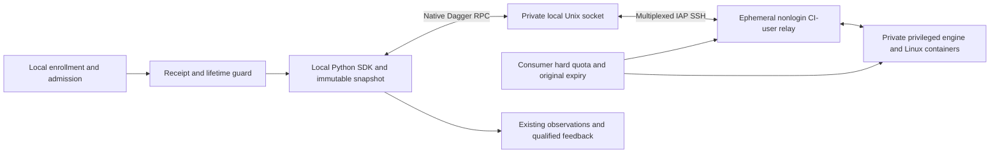
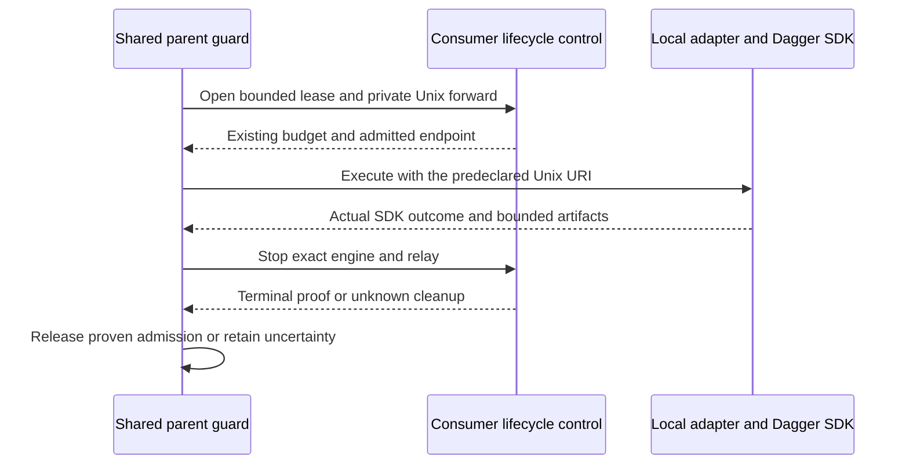

# Native Dagger remote-engine bridge

Status: elevated-risk Discovery contract for source delivery only. Consumer
installation, runtime qualification and activation require separate approval;
this document enables nothing. It extends the [existing profile](../PROFILE.md).

## Selected boundary and ownership

Reuse pinned Dagger `0.21.10` directory synchronization, execution, logs, status
and export RPC. Python orchestration, snapshots, repository adapters, observations
and qualified session feedback remain local; Linux containers execute remotely.
There is no new job wire, source archive, result schema, broker or scheduler.

The initial operator explicitly permits temporary full engine API capability
for their trusted, opted-in client and local agents. This is not fixed-check RBAC
or isolation from malicious pipeline code. The administrator-managed privileged
engine remains inside the shared host's trust boundary. A dedicated account does
not contain a compromised privileged engine; rootless operation is not assumed
for this pin. Other users and untrusted jobs require a new trust decision.

| Owner | Responsibility |
|---|---|
| Continuous validation | Existing enrollment, capture, selection, local admission, freshness, observations and the thin native-engine permission/lifetime guard |
| Consumer adapter | Local describe/select/execute, Python Dagger graph, actual lane/partition obligations, receipts and unchanged result semantics |
| Consumer platform | Existing VM, typed IAP SSH route, prepared identities, installed controls, engine/relay, hard resource quota, pilot budget, cleanup and idle-stop |
| Lifecycle and native control planes | Existing checkpoint/gate authority and separately qualified exact-session feedback |
| Managed distribution | Default-off client configuration and compatible source installation; no implicit activation |

The human authenticates through the consumer's prepared IAP SSH/OS Login route.
A dedicated nonlogin CI account owns the ephemeral Unix relay to the private
engine socket. It does not run a remote Python SDK client. The human receives
access to their exact per-pilot relay, not engine-group membership, a general
Podman command, a root shell or an engine TCP listener. Ordinary execution never
enrolls SSH keys, rewrites configuration, forwards credentials or starts the VM.

## Transport and local invocation

Use OpenSSH's multiplexed local-Unix-socket to remote-Unix-socket forwarding over
the existing consumer IAP connection. A single raw stdio pipe cannot replace
that endpoint: Dagger opens multiple control/session connections. The local
socket lives beneath an exclusively owned private directory; the relay accepts
only the approved operator and connects only to the installed engine socket.
No shared permanent daemon, public listener or general forwarding endpoint is
introduced. A fresh open refuses a pre-existing socket; subsequent reads use the
retained exact handle/inode rather than adopting a pathname after replacement.

Use the existing `dagger` backend and check/result fields. `describe` and `select`
remain local and perform no engine connection or relay action. After selection,
open-task checks and admission, one outer shared-runner guard obtains the host
lease and opens the forward, then invokes the unchanged local adapter execute
process tree. The child simple helper or consumer full-graph SDK entry point uses
the predeclared URI; it never opens a second guard or lease. The parent waits for
child/SDK termination and artifacts, then owns exact host stop and tunnel cleanup.

The SDK imports the existing immutable snapshot with native directory sync and
exports declared artifacts through its native API. Preserve capture inclusion,
source/hash checks, Git-fidelity limitations, bounded safe export paths and the
existing isolated CLI/credential environment. Do not sync the live worktree,
developer Git configuration, credentials or unrelated host files. Native RPC
does not supply missing original-history fidelity or independently prove source
freshness. Missing required fidelity remains unavailable.
Preserve `dagger_backend._cli_environment` sanitation of Dagger, telemetry,
registry and agent credentials and its empty registry configuration. Select the
pinned prepared CLI and exact Unix engine before SDK construction; failure never
falls back to automatic engine provisioning or an implicit CLI download.

## Exact private configuration and guard

Reuse `adapter_config.dagger.engine` as the selected local `unix:///absolute/path`
URI. Add only `adapter_config.remote_engine`, a closed object with these fields:
`schema_version`, `endpoint_id`, `endpoint_digest`, `activation_receipt`,
`activation_sha256`, `control_helper`, `control_helper_sha256`.
Version is integer `1`; ID and digests use existing runner
validators. Receipt is an absolute private regular-file reference, read with the
existing bounded no-alias/ownership checks. Total adapter configuration remains
within its existing 64-KiB limit. Control helper is one separately reviewed,
prepared installed executable with exact SHA-256, ownership, regular-file and
no-alias checks, not a repository executable or arbitrary command array. No shell,
proxy text, plugin import or credentials are allowed. The consumer owns typed
endpoint pins and the installed control schema, not a second policy service.

The immutable activation receipt has exactly `schema_version`, `kind`,
`repository_id`, `endpoint_id`, `endpoint_digest`, `owner_digest`,
`installation_digest`, `runtime_digest`, `resource_profile_digest`, `budget_id`,
`budget_permission_digest`, `engine_uri`, `max_execution_seconds`. Kind is
`cv-native-remote-engine-v1`; maximum execution is a positive integer at most
7,500 seconds. Receipt SHA-256 is over retained raw bytes. It binds the permitted
repository, route, prepared runtime and original resource/budget authority, not
each changing source/check digest or a check allowlist. Its producer is the
separately approved consumer activation owner; metadata alone is not live proof.
The endpoint digest covers stable route, prepared-owner and socket-policy pins,
excluding per-pilot paths, budget/lease identifiers and deadlines. The receipt's
own byte digest separately binds its exact per-pilot URI and budget permission.

Before describing checks, the consumer adapter projects only execution Dagger
settings and its stable per-pilot Unix URI into final descriptor configuration.
Exclude the `remote_engine` control carrier, receipt/hash, permission data and
ephemeral lease/container IDs from that projection. The descriptor URI equals
both `adapter_config.dagger.engine` and receipt `engine_uri`; never rewrite it or
recompute a different check digest after selection. The whole enrollment binds
the private control metadata. Existing result, snapshot, manifest, selection and
check identities remain authoritative without requiring activation on every edit.
The URI is known before describe; rebind that same private path only after the
previous forward and engine have positive terminal proof. Old clients reject
unsupported long timeouts rather than treating them as qualified local execution.

The planned outer context-manager interface is
`remote_engine_session(config, check, *, execution, owner, cancel, remaining_seconds)`.
The shared runner supplies its existing request/observation, source, selection,
check and receipt identities in process, without new adapter request fields,
environment sidebands or control metadata injected into the descriptor. The guard
validates endpoint/repository/URI/receipt and deadlines, enters the fixed consumer
owner's bounded relay context, and permits adapter execution using that same URI.
The shared parent constructs owner control from that one verified helper and its
receipt-bound `owner_digest` dependency identity. Invoke only fixed `status`,
`open` and `stop` operation arguments with bounded metadata JSON; no source bytes
or arbitrary argv are sent. Open stays foreground while its SSH forward is in
use; the parent owns that process group and retained lease handle. Status/stop
use the original binding. Repository code is never imported into a long-lived
controller. The child receives the normal adapter execute request, no new context
environment API, guard or lease. Parent validates the result and enriches only
its existing runtime metadata with verified owner/cleanup evidence.

The consumer owner checks fresh installed identity, original budget, hard quota
and resource enforcement, and obtains one host execution lease before opening
the relay. It binds the local execution context and activation receipt to that
lease; native RPC does not independently attest source identity or check deadlines.
It retains SSH/relay handles, socket identities and cleanup evidence in existing
private state. On check exit or interruption it closes its exact local tunnel,
stops the exact owned engine/relay and confirms native unit/container/cgroup
termination before releasing that lease or admitting another. Unknown completion raises the existing
uncertain-termination disposition and retains admission. Killing SSH alone is
not engine cleanup. Small consumer control/status/stop JSON is bounded to 64 KiB
over existing SSH arguments/stdin; it carries no bulk data and creates no new
per-job service. Quota-bounded cache may survive engine stops for warm samples;
report engine startup cost. An unavailable endpoint never silently falls back locally;
an explicit paired local comparison has its own descriptor, lane and evidence.

## Resources, deadline and complete graph

Consumer activation establishes one finite host budget before setup or sync.
Its permission binds endpoint/profile/budget identity, boot and qualified host
monotonic clock identity, original start, phase ends and final cleanup end.
Every trial, queue wait and transfer consumes that original window. SDK session
creation, status, reconnect and duplicate requests cannot create or extend it.
Changed boot identity or unknown clock refuses new work; expired state remains
inspectable without reopening execution.

Aggregate hard CPU, memory and existing-disk quota cover the engine, relay,
all containers/descendants, caches, scratch, logs and exports. Verify quota before
any CI allocation; free-space checks alone are insufficient. Missing enforcement
or incompatible adjacent service configuration means unavailable, not automatic
quota enablement, new disks, remounts or restarts. The consumer profile selects
numeric bounds and shared-service reserve; this generic contract does not.
One admitted job is allowed initially. Trusted client access to full engine API
is not claimed as hostile-client-resistant per-operation admission enforcement.

The host's independent lifetime owner clamps execution and cleanup to the
original budget even if every SSH/SDK client disappears. Idle-stop honors the
original setup/work/cleanup windows; unknown completion retains admission and
evidence but cannot extend liveness past them. No unlimited keep-awake lease is
allowed. Cleanup and explicit status/stop of previously owned
work remain permitted after opt-out or expiry, through the retained identity.
Missed deadlines and unknown cleanup cannot be erased by deleting a lease.

Legacy checks retain their existing 3,600-second timeout. A Dagger descriptor
may exceed it only with eligible validated remote-engine configuration and a
current host execution lease for the selected URI/runtime/profile. Its total
limit is 7,500 seconds, including
at most 7,200 work seconds and 300 cleanup seconds, further bounded by consumer
policy, receipt maximum and the original caller/host window. Manifest validation
uses only local receipt data; execute requires fresh remote authority and a
qualified host lease before launching the long adapter child. No per-dirty-check
activation receipt is needed. Partial qualification or mismatched permission
cannot unlock a longer ordinary local job. This guard is controller policy,
not a claim that full native engine API capability enforces check-level ACLs.

Full CI is one consumer-owned Dagger graph preserving every lane/partition edge,
not a new shared scheduler or one renewed timeout per partition. Its result uses
the existing seven fields, `test_identity: not_applicable` and `test_ids: []`;
that empty array is not full-test evidence. Declared artifacts retain every
lane/partition result and test-ID receipt plus the hash-bound graph manifest and
complete union reconciliation. Missing, failed or stale obligations prevent a
full pass. Never truncate a larger identity population into the 10,000-ID array.
Native exports use bounded owned destinations; the consumer graph may declare
up to 256 files, 8 MiB each and 256 MiB aggregate. The existing simple Dagger
helper's 32-export limit remains unchanged unless separately selected for change.

## Runtime identity and cadence capabilities

The parent adds stable `runtime.remote_engine` with exactly `endpoint_digest`,
`installation_digest`, `runtime_digest`, `resource_profile_digest`, `owner_digest`.
These pins remain comparison inputs. Per-execution lease/container/cgroup IDs,
ephemeral URI and budget identities, timings, cleanup and private proof references
belong in `runtime.remote_execution`, not that stable record. Add only
`remote_execution` to the existing `RUNTIME_MEASUREMENTS` comparison projection;
exclude no other input identity and add no top-level result fields. Keep the
existing artifact-list type unchanged. Validate these reserved namespaces from
the pinned consumer owner and retain hash-bound private evidence; reject child
repository output that attempts to supply either owner-proof namespace. Tests
must show differing lease IDs remain comparable while a stable pin change does not.

The canonical lifecycle exposes the purpose-aware `validation-checkpoint` CLI,
but its managed continuous-validation owner is not present in the canonical
runner package. Do not claim fine-grained purpose handling is qualified. Reuse
legacy Gate Commit/manual events first. A separate consumer checks slice may
review and qualify narrow purpose projection before activation; missing support
is unavailable, not simulated intent or a dependency on the larger worker stack.
This bridge source slice changes no lifecycle kernel or cadence owner.

## Behavior, validation and activation

| Given / event | Required outcome |
|---|---|
| Disabled or unenrolled; an edit/checkpoint arrives | No new connection, relay, allocation or feedback |
| Valid enrollment, captured source, selected check and runtime permission | Admit once, open exact relay, then use native Dagger RPC |
| Existing socket, changed owner/pin, quota or clock unavailable | Refuse before SDK connection; never adopt or auto-repair |
| SSH loss, cancellation or SDK interruption | Independent host expiry continues; retain unknown until exact cleanup proof |
| Opt-out, closed task or expired budget | Stop new work/feedback; allow original status and exact bounded cleanup |
| Current unexpected failure with qualified feedback | Existing session receives bounded evidence at its safe boundary |

Reuse existing checkpoint events, debounce, affected selection and qualified
Codex/OpenCode CLI delivery; do not create another session or infer identity from
a UUID. Compute and feedback activation remain separately evidenced. Intentional
bound red, stale work and closed tasks cannot cause repair loops. Native queue
acceptance is not consumption. No gate pass, required-check replacement, forge
trigger, inference, automatic VM startup or other-host routing is introduced.

Source acceptance covers disabled absence of effects, configuration/digest/URI
matching, old-client and local-backend compatibility, guarded timeouts, native
sync/export preservation, multiple connections, cancellation and unknown
retention, reserved owner-proof fields and stable-versus-measured comparison
identity. Use existing affected pytest and publication/instruction authorities.
Separate activation must prove actual IAP/socket/CI identity, hard caps/quota,
original deadline and disconnect cleanup, useful affected/full execution,
idle-stop, disablement and any promised exact-session feedback. Deploy/Operate
are not passed by source delivery; Maintain/Retire applies to compatibility and
safe revocation. Compare matched snapshots and cold/warm timings with hosted CI
before claiming speedup; setup, queue, sync, work, export and cleanup stay distinct.

## Visual Evidence

| Concern | Decision |
|---|---|
| Boundary | required: native transport flow below |
| Interaction | required: outer-guard sequence below |
| State | required: guard/event outcome table above, with consumer-owned lease states retained |
| Data/trust | required: native transport flow and explicit API capability boundary |
| Schema | not_applicable: the closed configuration/receipt field lists suffice for this singleton permission; existing adapter and Dagger schemas are not duplicated |
| Dependency/deployment | required: native transport flow separates local SDK, relay and remote engine |
| Quantitative | not_applicable: no measured performance or concrete host sizing claimed |

**Text Equivalent:** Enrollment and admission precede the local receipt/lifetime
guard, which permits the Python SDK to use only its selected private Unix URI.
Native Dagger RPC carries immutable inputs and results across multiplexed IAP SSH
to an ephemeral relay owned by the nonlogin CI account, then to its private
privileged engine. Consumer quota and original expiry govern relay and engine
independently of the local connection. Existing local observations and qualified
feedback consume results. Source: this contract; owner: continuous validation
with consumer platform ownership above. Change trigger: identity, ordering,
authority, topology or lifetime changes; update diagram/text together.

**Text Equivalent:** The shared parent obtains the host lease and private forward,
then invokes the ordinary local adapter. The child uses the predeclared URI and
returns actual SDK results and artifacts without opening a second guard. The
parent stops the exact host engine/relay and releases admission only with
terminal proof; unknown cleanup stays charged. Source/owner: this guard contract,
continuous validation with consumer lifecycle ownership. Update with process,
lease or cleanup ordering changes and verify rendering on the exact draft PR.

Pinned evidence: [Dagger connection drivers](https://github.com/dagger/dagger/blob/v0.21.10/engine/client/drivers/dial.go),
[native file sync](https://github.com/dagger/dagger/blob/v0.21.10/engine/client/filesync.go)
and [OpenSSH Unix forwarding](https://man.openbsd.org/ssh#L). The pinned
[`ssh://` helper](https://github.com/dagger/dagger/blob/v0.21.10/internal/buildkit/client/connhelper/ssh/ssh.go)
invokes remote `buildctl dial-stdio`; it is not selected without qualification.
No `cmd://` driver is assumed. This source evidence is not a live transport smoke.
