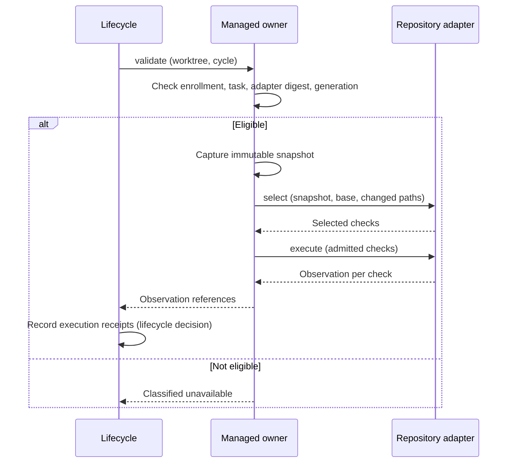
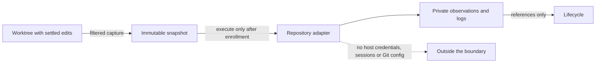
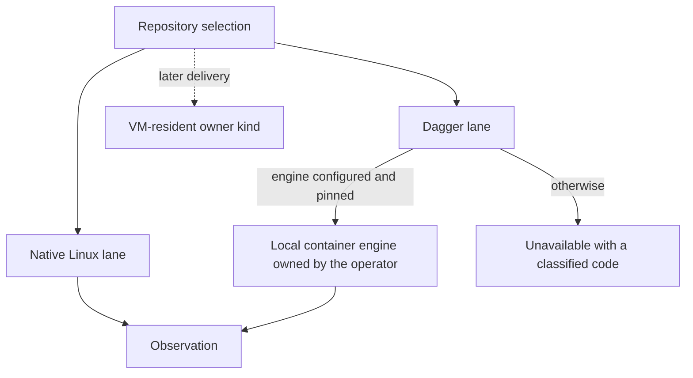

# Shift-left affected validation

Status: specification ready; implementation, activation and measurements are
pending. Slice `shift-left-affected-validation` in the
[shift-left-validation Initiative](../../../initiatives/shift-left-validation/README.md).
Owner: continuous_validation owns the runner, the managed owner and the
repository-adapter protocol; each repository owns its adapter and selection.
Engineering Profile: [existing profile](../PROFILE.md); its defaults are
unchanged. Risk: elevated because repository code executes and diagnostics can
reach an agent session. Modules: Python and Security. Delivery: source-only
feature branch and draft pull request. This document does not assert
installation, activation or a speed improvement.

## Outcome and boundary

Validation should begin when edits settle, not when a gate is due or a pull
request opens. Today the repository adapter receives the changed-path set but
selects by trigger only, four of its five checks refuse every non-macOS host,
and no cheap edit check is eligible on the Linux workstation. The hosted matrix
moved to Linux, so the adapter no longer describes where this repository is
actually validated.

This slice makes the repository's affected selection real and reachable from
three places: an enrolled worktree, the lifecycle's `validate` command and a
plain checkout on a hosted runner. All three call one repository-owned
function. Dagger stays an optional executor behind the existing pinned
backend; it is never required for the loop to work.

The boundary is unchanged from the [context](../README.md):

- The repository owns its commands, ownership table, coverage and lanes. The
  runner adds no selection logic and infers no test dependencies.
- Observations stay advisory. Formal gate admission, execution receipts and
  cross-gate references belong to
  [the lifecycle feature](../../dbsctr_v3_lifecycle/features/execution-evidence-reuse.md).
- Nothing is installed as a watcher, service or login item. Execution still
  requires an enabled enrollment for the exact worktree and task.
- The required hosted workflow, its jobs, permissions and verifier are not
  edited by this slice. The [hosted shadow](../../dotfiles_ai_distribution/features/hosted-validation-shadow.md)
  is a separate workflow.

## Behavior and contracts

### Selection follows changed paths

- Given a snapshot, its pinned base and the changed-path set derived from the
  mapped-base diff
- When the adapter selects checks for trigger `edit` or `affected`
- Then it returns the checks whose owned path patterns match a changed path and
  every check that depends on them
- And reports `basis: affected` with `complete: false`.

- Given trigger `affected`
- When the adapter selects checks
- Then expensive affected checks are included.

- Given trigger `edit`
- When the adapter selects checks
- Then expensive checks are left out and stay deferred to a checkpoint.

- Given a changed path that no component owns, a workflow or action definition
  under `.github/`, or a change to the ownership table, a dependency lockfile,
  the project manifest or shared test infrastructure
- When the adapter selects checks for trigger `edit` or `affected`
- Then it selects the broad check set and reports `basis: broad`.

- Given trigger `checkpoint` or `manual`
- When the adapter selects checks
- Then it selects the complete repository obligation and reports
  `basis: full` with `complete: true`.

- Given an `edit` request that selects an expensive check
- When the adapter executes it
- Then the existing `checkpoint_required` refusal is unchanged.

### One selection function

- Given `select`, `execute`, the `plan` command and the `run` command
- When any of them needs the selection
- Then each derives it from one function of the snapshot, the pinned base and
  the ownership table
- And execution refuses `selection_mismatch` when the requested check is not in
  the selection that function derives for the executed snapshot.

- Given this repository, which declares no lifecycle CI mapping
- When the ownership table is read
- Then the adapter's component table is its only instance
- And a repository test requires any later CI mapping to repeat its component
  identifiers and path patterns exactly.

- Given the first ownership table
- When it is delivered
- Then it maps the validation adapter and its two test modules to one check
  that runs exactly those test modules, and every other path is unmapped. A
  path under `.github/` that a component owns is affected, not broad.

- Given a path that no component owns
- When it changes
- Then the broad obligation applies until a delivery maps that path together
  with the tests that own it and a selection fixture.

### Lanes follow the hosted matrix

- Given a check that the repository's hosted matrix executes on Linux
- When the adapter describes its checks
- Then the check is eligible on the Linux native lane.

- Given `dotfiles.instructions` and `dotfiles.full`
- When they are described
- Then both are Linux-native pytest checks.

- Given the macOS-only Swift compilation check, which the hosted matrix no
  longer runs
- When the adapter describes its checks
- Then that check is absent.

- Given a host that cannot provide a check's declared lane
- When the check executes
- Then the result is `unavailable` with the existing classified code; no
  substitution, emulation or pass is inferred.

### Dagger is an optional executor

The Dagger backend already refuses an absent, unreachable or mismatched engine
with classified codes. This slice adds no executor behavior. It pins each
outcome with a regression so that optional Dagger cannot regress into a retry,
a substitution or a pass.

- Given a Dagger-lane check and an enrollment whose adapter configuration names
  a reachable engine whose CLI, SDK and engine identity equal the pins
- When the check executes
- Then it executes on Dagger under the existing frozen dependency and image
  rules.

- Given no configured engine
- When the check executes
- Then the result is the existing `unavailable` outcome with
  `dagger_runtime_unconfigured` or `dagger_engine_unconfigured`.

- Given a configured engine that is unreachable or whose identity differs from
  the pin
- When the check executes
- Then the result is `unavailable` with the backend's existing classified code,
  such as `dagger_engine_unavailable`, `dagger_engine_version_mismatch`,
  `dagger_cli_identity_mismatch` or `dagger_native_platform_unavailable`
- And nothing retries in a loop, substitutes a native lane or passes.

- The runner never installs, starts, stops or configures a container engine.
  The operator owns the engine and its socket.

### Managed owner actions

The lifecycle reaches this context only through the existing managed-owner
selection, which requires `continuous_validation/cli.py`. This slice adds that
module with two actions; the actions that the current source cannot perform
return a bounded unavailable result and never change a formal lifecycle result.

- Given a lifecycle `validate` request for a worktree and cycle that has an
  enabled enrollment, an open task, a matching adapter digest and a current
  generation
- When the owner handles it
- Then it captures a fresh immutable snapshot of the settled worktree, runs the
  repository selection for trigger `affected` (or only the named checks) under
  the existing host admission, and returns one reference per observation.

- Given no enabled enrollment, a closed task, a changed adapter digest or a
  stale generation
- When a `validate` or `applicability` request arrives
- Then the owner returns the existing classified unavailable result, creates no
  state and starts nothing.

- Given a snapshot identity previously returned for the task
- When the owner handles `applicability`
- Then it reports whether that snapshot still matches the worktree under the
  runner's existing source-freshness rule for the enrollment's capture
  patterns, with the changed paths
- And a head that advanced without a content change inside those patterns
  leaves the snapshot current, which the response states separately. This
  differs from request replay, which also requires the same head: a receipt is
  evidence about content, not about a request.

- Given a managed action this owner does not implement
- When the lifecycle delegates it
- Then the owner returns `owner_action_unsupported` and the lifecycle command
  keeps its own result.

Feedback to an agent session is unchanged: it requires the separate existing
[opt-in](../SESSION-HOOKS.md). A `validate` run sends nothing on its own.

### Plan and run without DBSCTR

- Given a clean checkout, the pinned base revision, Python `>=3.12` and uv
- When `python .github/continuous_validation.py plan --base REV --json` runs
- Then it prints the selection basis, the selected check identifiers and each
  check's command without executing anything.

- Given the same checkout
- When `python .github/continuous_validation.py run --base REV --output FILE`
  runs
- Then it executes the selected Linux-native checks in that checkout and writes
  one JSON result with the base, head, selection and per-check outcomes
- And exits `0` when every selected check passed, `1` when one failed and `2`
  when a result is unavailable.

- Given a dirty checkout, or a base revision that is not in the checkout's
  history
- When `plan` or `run` executes
- Then it refuses with a classified error before running a check.

## Interfaces

| Interface | Contract |
|---|---|
| Protocol triggers | The closed trigger set gains `affected`: an explicit request for the affected selection, including expensive affected checks. `edit`, `checkpoint` and `manual` keep their meaning |
| `select` response | The closed response set gains optional `basis`, one of `affected`, `broad`, `full`. An absent value means `full` for adapters that predate this contract. `checks`, `reason` and `complete` keep their meaning |
| Ownership table | Adapter-owned: components with an identifier, owned path patterns and check identifiers; dependency edges from dependency to consumer; the broad rules above. Pattern syntax and matching follow the lifecycle's existing CI-mapping semantics, so one table can serve both later |
| `managed_action("validate")` | Input: worktree, cycle, policy path, optional check identifiers. Output: `status` (`completed`, `pending`, `unavailable`), `observations` (reference, check identifier, status, snapshot identity, failed test identities) and an optional error code |
| `managed_action("applicability")` | Input: worktree, cycle, snapshot identity. Output: `applicable`, `reason` (`current`, `source_changed`, `generation_changed`, `snapshot_unknown`, `enrollment_inactive`) and bounded `changed_paths` |
| Adapter CLI | `plan` and `run` as defined above, both for trigger `affected` unless `--trigger` names another; thin wrappers over the protocol functions |
| New diagnostic codes | `selection_mismatch` and `owner_action_unsupported`. Existing codes, including the Dagger engine and identity codes, are unchanged |

Writable source: `private_dot_config/dotfiles-ai/continuous_validation/runner.py`
(the `affected` trigger and the accepted `select` response),
`private_dot_config/dotfiles-ai/continuous_validation/cli.py` (new: the two
managed actions), `.github/continuous_validation.py`,
`tests/test_continuous_validation_dotfiles_adapter.py`,
`tests/test_dotfiles_validation_adapter.py`, new focused tests for the managed
actions and the Dagger refusals, and this document with the context README and
CHANGELOG.

## Visual Evidence

| Concern | Decision and review question |
|---|---|
| Boundary | required: the context boundary list above answers who owns selection, execution and admission |
| Interaction | required: sequence diagram below; who starts a `validate` run and what returns? |
| State | required: disposition table below; what can a selected check become? |
| Data/trust | required: flowchart below; which data crosses the enrollment boundary? |
| Schema | not_applicable: existing closed request, observation and test-identity records are reused unchanged |
| Dependency/deployment | required: deployment diagram below; which executors are optional? |
| Quantitative | not_applicable: no measurement exists for this selection yet |

**Text Equivalent:** The lifecycle sends one `validate` request to the managed
owner. The owner checks enrollment, task, adapter digest and generation before
doing anything. An ineligible request returns a classified unavailable result
with no state. An eligible request captures an immutable snapshot, asks the
repository adapter to select and then execute checks, and returns observation
references. Only the lifecycle turns observations into execution receipts; this
context never does. Canonical source: the managed owner actions above. Owner:
continuous_validation. Update trigger: a change to the delegation boundary or
the actions.

| Selected check state | Condition | Result |
|---|---|---|
| Not eligible | No enrollment, closed task, stale adapter digest or generation | `unavailable`; nothing starts |
| Lane unavailable | The host cannot provide the declared lane | `unavailable` with the lane code |
| Engine unavailable | A Dagger check has no configured or reachable pinned engine | `unavailable` with the existing engine code |
| Deferred | An expensive check requested at `edit` | `unavailable`, `checkpoint_required` |
| Executed | Admitted and run to a terminal outcome | `passed`, `failed` or `unavailable`; one observation |

**Text Equivalent:** A selected check is either not eligible to start, cannot
run on this host, is deferred to a checkpoint, or executes to one observation.
Only an executed check produces an observation, and an observation is the sole
input this context hands to the lifecycle. Canonical source: the table above
and the existing observation status set. Owner: continuous_validation. Update
trigger: a new check disposition or status.

**Text Equivalent:** The settled worktree is captured into an immutable
snapshot. Repository code executes against that snapshot only after enrollment.
It produces private observations and logs, and only their references leave for
the lifecycle. Host credentials, coding sessions and Git configuration are
never available to the check. Canonical source: the context README's snapshot
and trust contract. Owner: continuous_validation. Update trigger: a change to
snapshot capture or the trust boundary.

**Text Equivalent:** The repository selection feeds a native Linux lane and a
Dagger lane. The native lane needs no engine. The Dagger lane runs only when
the operator has configured a reachable engine with the pinned identity;
otherwise it reports unavailable with a classified code. A VM-resident owner
kind is a later, separate delivery and is not required here. Canonical source:
the Dagger executor behavior above. Owner: continuous_validation. Update
trigger: a new executor kind or a change to engine selection.

## Gates and delivery

All Development Kernel gates and Review/Integrate and Maintain/Retire are
required. Release is not applicable: no independently published package or
image is created. Deploy and Operate are required for activation: a targeted
private installation of the runner generation and one explicitly enrolled
worktree, then one bounded early-validation run with retained observations and
a disable check. Source delivery alone is not an operating shadow. No Gate
Exception is selected; required results start pending.

Rollback removes the managed module and restores the previous adapter; it
changes no required check and deletes no retained observation.

## Implementation and validation

Build first adds a failing regression for each contract, then implements:

- Selection: affected, broad and full selections over synthetic changed-path
  sets, including an unmapped path, a workflow path and a lockfile.
- One function: `plan`, `run` and the protocol agree on the same snapshot, and
  an out-of-selection check refuses with `selection_mismatch`.
- Lanes: the described checks match the hosted matrix and the Swift check is
  absent.
- Dagger: an unconfigured, unreachable and mismatched engine each return the
  existing classified code without a retry or a native substitution.
- Managed actions: eligible `validate` returns observation references; each
  ineligibility returns the existing classified result; `applicability` reports
  `source_changed` after an edit; unsupported actions return
  `owner_action_unsupported`.
- Default-off: no enrollment means no snapshot, no execution and no state.

Use the existing affected pytest modules, Python compilation and the
configured publication and instruction checks. The first real sample is one
change to the validation adapter and its two test modules: record the selected
checks, the time to the first result and the observation identities. Compare
that with one retained hosted pull request before making any claim about
saved time. Full-suite CI remains the integration authority.
