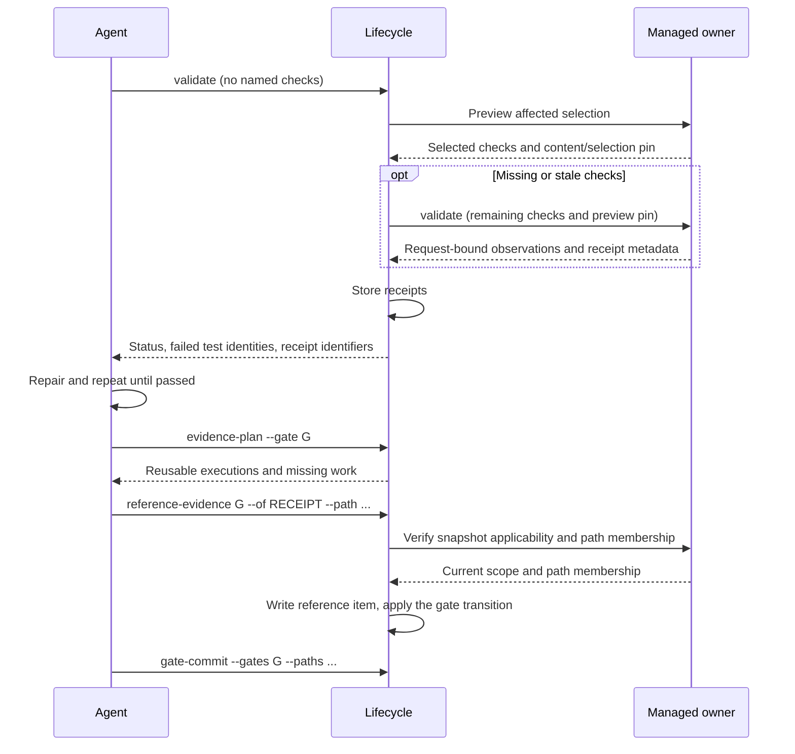
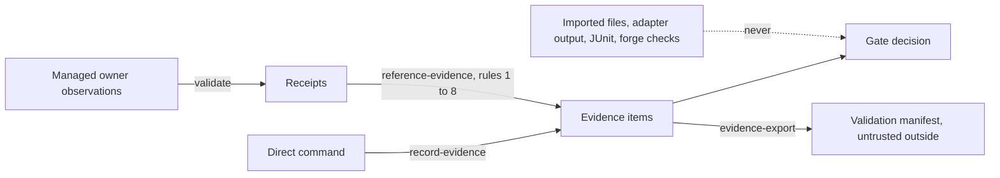
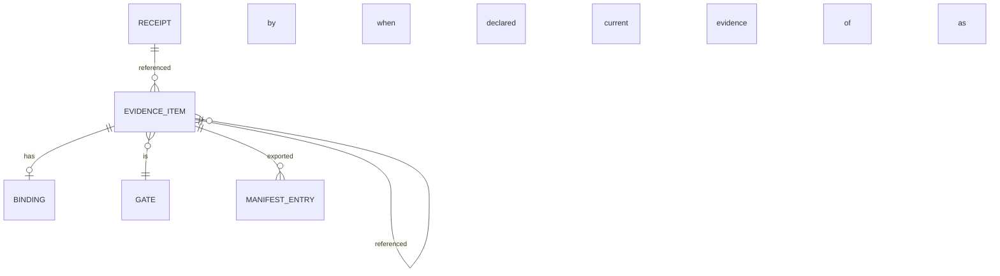

# Execution Evidence Reuse

Status: specification ready; implementation is pending. Slice
`execution-evidence-reuse` in the
[shift-left-validation Initiative](../../../initiatives/shift-left-validation/README.md).
It delivers first the outcome that `dbsctr-cycle-speed` captured as
`validation-evidence-reuse`. Owner: lifecycle maintainer,
`dbsctr_v3_lifecycle`. Engineering Profile: [existing profile](../PROFILE.md);
its defaults are unchanged. Applicable module: Python. Risk override:
**elevated**, because this change touches shared gate-disposal decisions.
Delivery: source-only feature branch and draft pull request into `main`.
Managed installation and use in a live cycle are separate owner steps.
Discovery does not authorize them.

## Problem and desired outcome

Every kernel gate currently records its own execution. In one recent cycle
record, 43 pytest evidence executions were stored across 13 heads, and four
distinct commits each recorded both an affected run and a full-suite run, with
four full-suite commands totalling 1,002 seconds. Those are recorded command
intervals, not proof that identical work ran twice. They show where repetition
gathers: the same command re-executed for each gate, and the first test run of
a change made outside the recorder and then repeated for the record.

Success means three things:

- One executed validation is stored once and referenced by every gate that
  needs it, while each gate keeps its own decision.
- Validation can start inside the open cycle when edits settle, before any
  commit, without touching a gate.
- Before a gate is accepted, the lifecycle reports which work is reusable and
  which is missing or stale, so only that work is requested.

## Scope and boundaries

This extends the existing evidence model; it replaces none of it.

| Existing owner | What stays unchanged |
|---|---|
| [Trusted evidence bindings](workflow-evidence-bindings.md) | Same-gate retention across a HEAD change under an approved policy, gate-local policy digests and helper-owned capture |
| [Completion reconciliation](workflow-completion-reconciliation.md) | Reuse only when command, authority, toolchain, environment, normalized input scope and all relevant source identities match; the original envelope is never altered |
| [Evidence rerun invalidation](gate-evidence-invalidation.md) | `apply_gate_result`, downstream reopening and counters |
| `record-evidence`, `set-gate`, `gate-commit` | Signatures, output, error strings and the rule that passing a gate requires disposed predecessors |

The change adds one storage kind, one command that admits a reference, one
read-only plan and one export. Gate order, record schemas 1 through 6, Gate
Commit checks and completion validation keep their meaning. Nothing here is
forge evidence: no required hosted check, merge, delivery or branch protection
is affected. Local evidence remains exactly as trustworthy as the account that
records it; this contract neither strengthens nor weakens that property.

The work rides the shift-left-validation Initiative because the operator
reprioritized it ahead of the cycle-speed serial sequence. The earlier captured
slice keeps its statement; its own owner reconciles that manifest when this
lands.

### Terms

- **Execution:** one run of a repository check or authority command that the
  lifecycle started and classified, directly or through the managed owner.
- **Receipt:** a stored execution that belongs to no gate.
- **Evidence item:** the existing per-gate envelope, produced by
  `record-evidence` or, as a **reference item**, by `reference-evidence`.
- **Scope of an execution:** for an evidence item, its recorded path and blob
  set; for a receipt, the immutable snapshot it ran against.
- **Reference:** a gate's own evidence item that points to an earlier execution
  and records that gate's separate decision.

## Behavior and contracts

### Early validation

- Given an active cycle in a worktree with an enabled validation enrollment
- When `dbsctrctl validate [--check ID ...] [--json]` runs
- Then the lifecycle uses the managed owner's affected preview when no checks
  are named and delegates at most one `validate` request for the remaining
  affected checks, or only for the named checks
- And stores one receipt per observation that executed to `passed` or `failed`
- And prints the status, the failed test identities and the receipt identifiers
- And exits `0` when every executed check passed, `1` when one failed and `2`
  when a result is unavailable or pending.

- Given `validate` without `--check`
- When a selected check already has an admissible passing receipt
- Then that check is not executed again and is reported as `reused`.

- Given no changed path between the worktree and its base
- When `validate` runs
- Then it reports that nothing was selected, stores nothing and exits `0`.

- Given any `validate` run
- When it finishes
- Then no gate result, evidence reference, exception, failure counter,
  remediation counter or Gate Commit has changed. An exploratory failing run is
  not a gate failure.

- Given an observation that was reused from a prior result or that ended
  `unavailable`, `interrupted` or `pending`
- When receipts are stored
- Then no receipt is created for it.

Receipts are stored under the existing per-cycle evidence lock after execution.
If the record changed so that the cycle is no longer active, the outcome is
still printed, no receipt is stored and the exit status is `2`. At most 64
receipts that no evidence item references are retained per cycle; recording
beyond that drops the oldest unreferenced receipt. A receipt that any evidence
item references is retained like any other historical evidence.

### Gate reference

- Given a gate and an execution in the same cycle
- When `dbsctrctl reference-evidence GATE --of ID [--path FILE ...] [--json]`
  runs
- Then the lifecycle writes a new reference item for GATE and applies the
  existing gate transition with it
- And prints the new evidence identifier.

Every rule below must hold. The first failing rule refuses with its code and
changes nothing.

| Order | Rule | Refusal code |
|---|---|---|
| 1 | The execution exists in this cycle and its result is `passed` | `evidence_not_found`, `evidence_not_passed` |
| 2 | No later execution of the same check on the same content ended with a non-passing result | `evidence_superseded` |
| 3 | The execution's scope is unchanged: for an evidence item every recorded path has its recorded blob in the worktree, the comparison Gate Commit performs; for a receipt the managed owner reports the snapshot `current` | `evidence_scope_changed` |
| 4 | Every `--path` lies inside the execution's scope | `path_outside_scope` |
| 5 | The execution was recorded under the current effective Initiative authority | `evidence_predates_authority` |
| 6 | When GATE has an evidence-policy declaration, the execution has a retained binding whose declaration is identical to GATE's declaration | `declaration_mismatch`, `binding_unavailable` |
| 7 | An evidence item recorded at another head is referenceable only when rule 6 holds and the inherited binding is retained now. A receipt is referenceable at any head | `evidence_head_advanced` |
| 8 | Every earlier required gate is disposed | existing `gate predecessors are incomplete` |

The two kinds of execution earn cross-head reuse differently. A directly
recorded evidence item binds the paths named at recording, which are Gate
Commit outputs and not a complete input declaration, so it acquires no
cross-head credit by inference. That is the existing
[binding rule](workflow-evidence-bindings.md), and rule 7 keeps it. A receipt
binds the complete captured inventory of an immutable snapshot, so it is
evidence about content: a head that advanced without a content change inside
the capture patterns does not make it stale.

`--path` defaults to the referenced evidence item's paths and is required for a
receipt. The reference item is a normal evidence item for GATE. Its gate,
result and head are GATE, `passed` and the current HEAD. Its paths are the
`--path` blobs captured at reference time, which by rules 3 and 4 equal the
blobs the execution tested. Its authority, sanitized command,
raw-output facts and start and finish times are copied from the execution. Its
content is withheld with reason `referenced_execution`, and it carries
`references` (the execution's identifier) and `execution_head` (the head the
execution ran at).

Gate Commit, `set-gate`, completion and delivery validation treat a reference
item exactly like any other evidence item. A reference therefore passes the
Gate Commit checks at the head where it was recorded, because it carries that
head as its own; whether the execution may be reused across an earlier head
change is decided by rule 7 and never by the reference item alone.
`set-gate --evidence` with another gate's identifier stays refused. A rerun
that reopens GATE clears its current reference as it clears any evidence; the
execution is not altered.

When rule 6 holds, the helper stores a binding for the reference item. The
binding names GATE, computes coverage and the gate policy digest for GATE, and
carries the command digest and the captured inputs, toolchain and environment
unchanged from the execution's binding. The reference inherits no other credit:
applicability across later HEAD changes is decided by the existing comparison,
and the helper never accepts a caller-authored binding.

### Plan

- Given `dbsctrctl evidence-plan [--gate GATE ...] [--path FILE ...] [--check ID ...] [--json]`
- When it runs
- Then it reads state only and reports for each gate its current result, whether
  its obligation is `declared` or `undeclared`, and the executions that are
  `reusable` now under rules 1 through 7
- And for the repository's selected checks, those that are `missing` or `stale`,
  with the rule that failed
- And exits `0` whether or not work is missing.

Rule 8 is not applied by the plan: a gate whose predecessors are incomplete
still shows what will be reusable. When the managed owner is unavailable, the
plan still reports evidence items and marks the selected checks `unavailable`.

### Export

- Given `dbsctrctl evidence-export --head REV --output FILE [--check ID ...]`
- When it runs
- Then it requires a clean worktree at REV
- And writes a validation manifest holding every execution admissible at REV
  under rules 1 through 7
- And creates FILE as a new private regular file outside the tracked tree
- And performs no Git or network operation.

Publishing the file is a separate, explicit operator action. The
[hosted shadow](../../dotfiles_ai_distribution/features/hosted-validation-shadow.md)
names the transport.

### Amendments and integration

- An amendment that reopens a gate makes executions recorded before its
  effective authority non-referenceable for that gate.
- Review/Integrate union validation on an advanced base and final-source
  validation are unchanged. An execution whose scope changed is stale and the
  plan reports it as stale.

## Interfaces

| Command | Effect |
|---|---|
| `validate [--check ID ...] [--json]` | Runs the affected selection now and stores receipts. Changes no gate state |
| `reference-evidence GATE --of ID [--path FILE ...] [--json]` | Writes GATE's reference item to an execution when every rule holds |
| `evidence-plan [--gate ...] [--path ...] [--check ...] [--json]` | Read-only reconciliation of reusable, missing and stale work |
| `evidence-export --head REV --output FILE [--check ...]` | Writes the validation manifest for one committed head |

The lifecycle uses only the [managed-owner boundary](../../continuous_validation/features/shift-left-affected-validation.md#managed-owner-extension-for-evidence-reuse)
for preview, execution and snapshot applicability. Preview does not run checks
or persist runner state. When `validate` uses preview to omit reusable checks,
the owner must verify the preview's content and selection pin before executing
the remainder. If the pin changed, return a classified unavailable result;
never count omitted checks as reused against different content. An empty
remainder executes nothing. Explicitly named checks still use the existing
affected request semantics.

The lifecycle admits only complete receipt metadata returned for an observation
from its own request. It never fills missing fields from the current worktree or
reads the runner's private store. For receipt references it asks applicability
to verify the requested paths' membership in the captured inventory. An older
owner that cannot provide the new information does not grant reuse credit;
existing enrollment and checkpoint actions remain unchanged.

| Record location | Addition | Compatibility |
|---|---|---|
| `evidence.receipts` | Optional map from identifier to receipt | Absent in existing records; readers treat absence as none |
| Evidence item | Optional `references` and `execution_head` on reference items | Existing items have neither |
| `evidence.bindings` | One entry per bound reference item | Existing payload shape unchanged |

A receipt holds its identifier, authority, check identifier, result and status,
snapshot identity, generation, request and observation references, adapter
manifest and selection digests, lane, complete test-identity receipt, bounded
failed test identities, head, start and finish times and elapsed seconds.

The validation manifest is version 1:

```json
{
  "schema_version": 1,
  "kind": "dbsctr-validation-manifest",
  "head": "<commit>",
  "base": "<commit>",
  "exported_at": "<UTC timestamp>",
  "adapter": {"id": "<adapter identifier>", "digest": "<sha256>"},
  "selection": {"basis": "affected", "checks": [{"id": "<check>", "test_identity": {}}]},
  "executions": [{"id": "<receipt>", "check_id": "<check>", "result": "passed",
                  "snapshot_id": "<snapshot>", "head": "<commit>", "lane": {},
                  "test_identity": {}, "elapsed_seconds": 0, "referenced_by": []}]
}
```

It contains repository-relative identifiers, digest values, test identities and
times only: no environment values, absolute paths, session identifiers, cycle
identity or command arguments.

## Visual Evidence

| Concern | Decision and review question |
|---|---|
| Boundary | required: the scope table above; which existing owners are untouched? |
| Interaction | required: sequence diagram below; when does validation start and how does a gate reference it? |
| State | required: transition table below; when is an execution referenceable? |
| Data/trust | required: flowchart below; what may become gate evidence? |
| Schema | required: entity diagram below; how do receipts, reference items, bindings and the manifest relate? |
| Dependency/deployment | required: dependency table below; what still works when the managed owner is absent? |
| Quantitative | not_applicable: no saving is measured for this contract yet |



**Text Equivalent:** The agent asks the lifecycle to validate without naming
checks. The owner previews selection and pins its content and selection. The
lifecycle requests only missing or stale checks, with that pin, and stores
receipts from the request-bound observations. It returns the status with failed
test identities. The agent repairs and repeats until the checks pass.
Before a gate the agent asks for the plan, sees which executions are reusable
and which work is missing, references the passing receipt for that gate, and
then commits the gate. The owner verifies snapshot applicability and path
membership before the lifecycle admits the reference. Canonical source: the
behavior sections above. Owner: lifecycle maintainer. Update trigger: a change
to command order or to who stores receipts.

| Execution state | Condition | What the lifecycle does |
|---|---|---|
| Admissible | Rules 1 through 7 hold | The plan lists it; a gate may reference it |
| Stale | Its scope changed | The plan reports `evidence_scope_changed`; not referenceable |
| Superseded | A later execution of the same check on the same content did not pass | The plan reports `evidence_superseded`; not referenceable |
| Head advanced | An evidence item recorded at another head without a retained binding | The plan reports `evidence_head_advanced`; not referenceable |
| Predates authority | Recorded before a reopening amendment | Not referenceable for the reopened gate |
| Referenced | An evidence item points to it | Retained for the cycle's history |

**Text Equivalent:** An execution is referenceable only while it passed, was
not superseded, still matches the worktree and was recorded under the current
authority. An evidence item from another head additionally needs a retained
binding. The plan names the first rule that fails for the others. Once an
evidence item references an execution, that execution is kept as history.
Canonical source: the rule table above. Owner: lifecycle maintainer. Update
trigger: a new admissibility rule or refusal code.



**Text Equivalent:** Observations from the managed owner become receipts only
through `validate`. A direct command becomes an evidence item only through
`record-evidence`. A receipt reaches a gate only through `reference-evidence`
and its seven rules. Imported files, adapter output, JUnit and forge checks
never become gate evidence. The export produces a manifest that is untrusted
outside the lifecycle. Canonical source: the terms and the rule table. Owner:
lifecycle maintainer. Update trigger: a new evidence source.



**Text Equivalent:** A receipt may be referenced by many evidence items and an
evidence item by many later reference items. A reference item has one binding
only when its gate declares one. Each gate has at most one current evidence
item. Executions that pass the rules are exported into manifest entries.
Canonical source: the record additions table. Owner: lifecycle maintainer.
Update trigger: a new record kind or field.

| Dependency | Direction | Behavior when absent |
|---|---|---|
| Managed owner | lifecycle to continuous_validation | `validate` and the plan's selection return the existing `continuous_validation_owner_unavailable`; referencing a receipt is unavailable because its scope check needs the owner; references to evidence items and the rest of the plan still work |
| Repository adapter | managed owner to repository | Existing classified unavailable result |
| Evidence policy | lifecycle | A gate without a declaration uses the scope rule only; no new policy is required |

**Text Equivalent:** The lifecycle depends on the managed owner for early
validation, for selection and for the scope check of a receipt. Without it,
referencing an evidence item at the same head and the rest of the plan still
work. The managed owner depends on the repository adapter. No evidence policy
is required to use references. Canonical source: this table.
Owner: lifecycle maintainer. Update trigger: a new dependency.

## Gate Ledger and delivery

| Gate | Applicability | Candidate result | Reason or required evidence |
|---|---|---|---|
| Domain | required | pending | Terms, scope table and unchanged owners |
| Behavior | required | pending | `validate`, reference, plan and export scenarios |
| Spec | required | pending | Command, record and manifest contracts with visual evidence |
| Contract | required | pending | Every refusal rule, binding inheritance and compatibility |
| Test-driven implementation | required | pending | A failing regression per contract, then the implementation |
| Refactor | required | pending | Shared admission logic between plan and reference |
| Review/Integrate | required | pending | Current-base scope, downstream guidance and native CI |
| Release | not_applicable | not_run | Source-only draft delivery publishes no standalone release artifact |
| Deploy | not_applicable | not_run | No managed helper installation in this slice; first live use follows merge and managed installation |
| Operate | not_applicable | not_run | No live cycle operation is authorized by this slice |
| Maintain/Retire | required | pending | Compatibility of existing records and retirement of the optional section |

No Gate Exception is selected. Actual results belong to the Build Cycle Record.
[The applicability plan](../../../initiatives/shift-left-validation/EVIDENCE-REUSE.plan.json)
names the committed Engineering Profile and every gate.

## Implementation and validation

Build first adds a failing regression for each row, then implements.

| Case | Acceptance evidence |
|---|---|
| `validate` on an enrolled task | One receipt per executed observation; no gate, counter or commit changes |
| `validate` with an admissible receipt | The check is not executed again and is reported `reused` |
| Source changes after preview | A differing pin refuses the partial request; omitted checks are not reported as reused for the changed content |
| Older or incomplete managed owner | No receipt or reuse credit is inferred from missing facts; direct evidence keeps working |
| One execution, several gates | One reference item per gate and one execution; each gate decision is separate |
| Reference after an earlier Gate Commit | A receipt whose content is unchanged stays referenceable and passes Gate Commit at the new head; an evidence item from another head is refused with `evidence_head_advanced` unless a retained binding is inherited |
| Each refusal rule | The classified code; the record is unchanged |
| Policy declarations | Identical declarations inherit the binding; a differing declaration refuses |
| Rerun invalidation | Reopening a referencing gate clears only that gate's reference |
| Completion | A reference item satisfies completion exactly as a recorded execution would |
| Amendment | Executions recorded before the amendment are not referenceable for reopened gates |
| Export | The manifest holds only admissible executions; a dirty worktree or a tracked output path refuses |
| Existing behavior | `set-gate` still refuses another gate's identifier; existing evidence tests pass unchanged |

Writable source: `dot_local/bin/executable_dbsctrctl` (the four commands, the
receipt store, reference items, binding inheritance and validation of the new
optional section and fields), `dot_agents/skills/dbsctr/SKILL.md` (plan, then
reference, then record only missing work), `tests/test_dbsctrctl.py`, a new
`tests/test_evidence_reuse.py`, this document, the lifecycle README and
CHANGELOG. The delivery also adds the repository ownership-table entry for the
lifecycle helper and the tests that own it, with a selection fixture, so that a
helper change selects those tests instead of the broad obligation. The managed
boundary extension is limited to `private_dot_config/dotfiles-ai/continuous_validation/cli.py`,
its shared selection and execution support in `runner.py`,
`tests/test_continuous_validation_managed_owner.py`, and the affected-validation
feature specification. It changes no installation, enrollment, or hosted CI.

Use the existing affected pytest modules, Python compilation of the helper and
the configured publication and instruction checks. Full-suite CI remains the
integration authority. The first live sample is one real cycle that validates
before its first Gate Commit and references one receipt from at least two
gates; record the number of executions saved and any refusal encountered before
claiming a saving.
