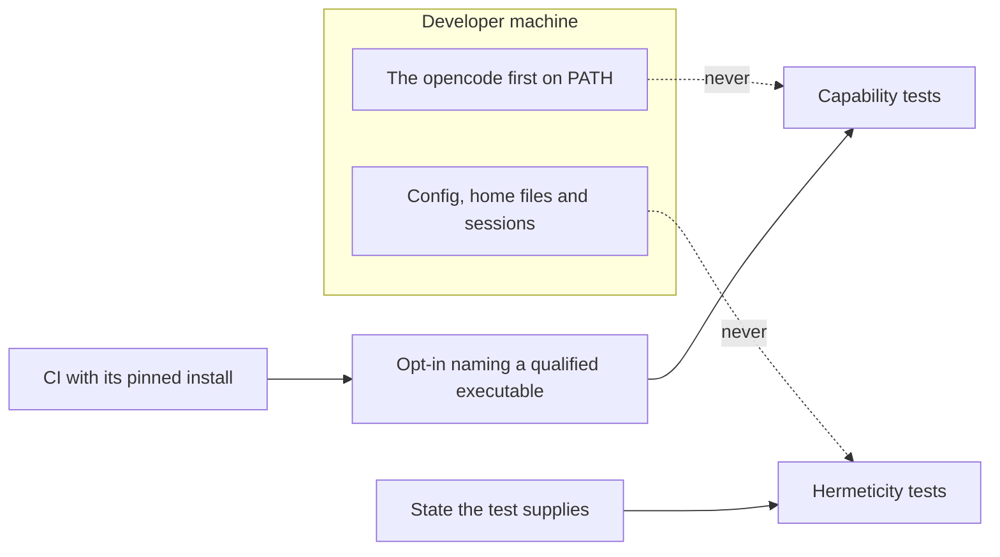

# Host-independent tests

Owner: lifecycle maintainer. [Engineering Profile](../PROFILE.md). Routine risk;
Python. This is the source contract for the `host-independent-tests` slice of
[host-independent validation](../../../initiatives/host-independent-validation/README.md)
and covers its INT-001 to INT-008 and INT-010 to INT-014. The interface below is
implemented in source. The lifecycle helper does not change.

## Problem

Four tests pass in configured CI and fail on a developer machine that holds
ordinary local state. Observed 2026-11-24:

| Test | Reads from the developer machine | Kind of defect |
|---|---|---|
| `test_draft_pr_reuses_only_same_repository_branch` | The application policy file in the configuration directory. Its presence alone makes the helper call Git, which the test mocks. | Hermeticity |
| `test_local_data_renders_complete_configs` | The real OpenCode configuration. The rendering `modify_` script is designed to preserve unrelated local keys, and the test hands it the real file. | Hermeticity |
| `test_isolated_render_resolves_writing_commands` | The installed `opencode`, through `debug config --pure`. | Version-dependent capability |
| `test_installed_opencode_supports_pure_session_json` | The installed `opencode`, through `session list --pure --format json`. | Version-dependent capability |

Each cause was confirmed by changing one input. The first test passes with an
isolated configuration root. The second renders no `theme` with an isolated
home. Both commands succeed with OpenCode 1.19.4 and are rejected by every 2.x
version tried (2.3.0 to 2.4.1), which does not know `--pure`.

The first two are test defects: the behaviour under test is correct. The last
two are not noise. The R&D worker calls `session list --pure` on its reserve,
launch and cleanup paths, and the session-list test is its only check against a
real executable. CI is green because the full-suite job installs 1.19.4. The
repository's native installer asserts a `v2` binary on every platform it
supports, and its managed V1 installer runs on x86_64 only. The distribution
profile names an aarch64 Linux machine as the sole workstation target, so that
target can only run the line without the flag. See
[The recorded V2 gap](#the-recorded-v2-gap).

A search of the suite found no other test that executes the installed OpenCode
executable; the others use fakes.

## The rule

**Hermeticity.** A test does not read operator-private state from the real home
directory: no configuration, state or data file under the developer's actual
home or XDG directories. A test that depends on such state supplies it through
a disposable fixture.

**Opt-in for capabilities.** A test that asserts a version-sensitive
command-line capability of an installed tool runs only under an explicit opt-in
naming an already-qualified executable. It is never selected from `PATH`.

**CI always opts in.** Every CI job that must enforce the capability sets the
opt-in to the executable it installed from its single pinned version.

Running a tool that is present on `PATH`, such as Git or chezmoi, is unchanged.
The rule concerns operator-private state and version-sensitive capability
assertions.

## Interface

One variable, `DBSCTR_OPENCODE_NATIVE_TEST_EXECUTABLE`, serves both
installed-OpenCode capability tests. It follows the existing
`DBSCTR_GRAPHIFY_NATIVE_TEST_EXECUTABLE` precedent. It is a test input only: it
overrides nothing at runtime and installs nothing.

| Variable state | Capability tests |
|---|---|
| Unset or empty | Skip. The reason names the variable and the qualified version. |
| Set, but not an existing absolute file path | Fail. |
| Set to an executable that reports another version | Fail, naming the version found. |
| Set to the qualified version | Run and assert the capability. |

The qualified version is `1.19.4`, the version CI installs. The full-suite
partition step sets the variable to the absolute path of that install.

## Behavior

### Draft-PR reuse

- Given a configuration directory that holds the application policy file, when
  the reuse test runs, then its result equals the result on a machine without
  that file, and the helper under test reads nothing under the developer's
  configuration root.
- Given an open draft pull request for the same repository and branch, when
  delivery is requested, then that pull request is reused and no create command
  runs.
- Given only merged, closed, fork or ready pull requests, when delivery is
  requested, then none is reused.

### Rendering with existing local state

- Given an existing target file the test supplies in a disposable home, when
  the managed targets are rendered, then the managed configuration is complete
  and the OpenCode configuration carries no `theme`.
- Given the supplied file holds an unrelated local key, when it is rendered,
  then that key is preserved, as the `modify_` script documents.
- Given any content in the developer's real home, when the test runs, then
  nothing under that home is read and the result is identical.

### Installed-OpenCode capabilities

- Given the variable is unset, when either capability test runs, then it skips
  with the reason `set DBSCTR_OPENCODE_NATIVE_TEST_EXECUTABLE to an
  already-qualified OpenCode 1.19.4 executable`.
- Given the variable names the qualified executable, when the writing test
  runs, then `debug config --pure` resolves in the isolated rendered
  environment and the writing commands are present.
- Given the same variable, when the session test runs, then `session list
  --pure --format json` returns JSON from a disposable home and working
  directory, so no developer session is read.
- Given the variable names a 2.x executable, when either test runs, then it
  fails at the version check and names the version found.
- Given the variable is set to any value, when either test runs, then it never
  skips. A test with a synthetic executable holds each row of the interface
  table without a real OpenCode.

The writing test reads the resolved configuration from a file rather than a
pipe. The 1.19.4 arm64 builds delivered only the first 16 KiB of `debug config`
output through a pipe, and the resolved configuration is about 16.6 kB. A file
received all of it. Build observed this on 2026-11-24. CI's x86_64 partitions
passed with the pipe before this change.

## The recorded V2 gap

The [V2 migration](../../../initiatives/opencode-rolling-stable/V2-MIGRATION.md)
asks that every concrete functional gap record its impact, safe behaviour,
owner, disposition and review condition.

| Field | Record |
|---|---|
| Gap | The R&D worker identifies its sessions with the V1-only `--pure` flag of `opencode session list`. |
| Evidence | CI passes with 1.19.4. Versions 2.3.0, 2.3.1, 2.3.2, 2.4.0 and 2.4.1 reject the flag. |
| Impact | On a native-V2 host the worker cannot reserve, launch or clean up, because all three need the session list. |
| Safe behaviour today | The worker is default-disabled in repository data, so nothing calls the flag where it is not enabled. Enabling it on a native-V2 host is unsupported until INT-009 is delivered. Its real-executable check fails on such a host, which is correct. |
| Owner | The [OpenCode V2 migration](../../../initiatives/opencode-rolling-stable/README.md), whose approved scope already includes CI profiles. |
| Disposition | Deferred to that migration (INT-009 of this Initiative). This slice changes neither the worker nor the pin. |
| Review condition | The migration records a disposition before any native-V2 host is expected to run the worker, and before the CI pin leaves V1. |

Under the opt-in, the session test skips on a native-V2 developer machine. The
alarm is kept in this record instead of in a red test. The lifecycle already
has a V2-native authority route in
[specification](opencode-v2-native-authority.md); the worker does not.

## Acceptance and gates

Acceptance:

- On a machine with all three conditions present, a policy file in the
  configuration directory, an unrelated key in the real OpenCode configuration
  and a 2.x `opencode` first on `PATH`, the four tests report no failure: two
  pass and two skip with the named reason.
- With the variable naming a 1.19.4 executable, both capability tests pass.
  With it naming a 2.x executable or a path that does not exist, both fail.
  Setting the variable never produces a skip.
- Each repaired test is shown failing for its original cause before its
  repair. The red run is retained as private evidence.
- The pull request's own full-suite partitions run the changed workflow and
  report both capability tests as passed. This is observed with the push
  result; it is not a gate result.
- The lifecycle helper is unchanged, so the CLI benchmark digest is unchanged.

| Gate | Status | Reason |
|---|---|---|
| Domain, Behavior, Spec, Contract, Test-Driven Implementation, Refactor, Review/Integrate | required | Kernel gates. |
| Maintain/Retire | required | The variable is a public test interface, and its retirement is bound to the V2 disposition. |
| Release | not_applicable | No release artifact. |
| Deploy | not_applicable | No managed host is deployed; the workflow is exercised by the pull request before any merge. |
| Operate | not_applicable | No operating check applies to tests and documents. |

Risk rises to elevated if Build finds it must change any non-test code beyond
the one workflow environment entry.

## Non-goals

- No suite-wide `HOME` or XDG isolation fixture.
- No census of every test for host-state reads.
- No change to the rendering `modify_` script.
- No change to the lifecycle helper, the R&D worker, either OpenCode installer,
  or the worker's enablement.

## Visual Evidence

| Concern | Canonical evidence and review question |
|---|---|
| Boundary | Not applicable: no actor or ownership boundary is new. The context map in the Initiative names the three contexts and the V2 migration's ownership. |
| Interaction | Not applicable: nothing is ordered, retried or asynchronous. |
| State | Required: the table under **Interface** is the transition table. Given each variable state, does a capability test skip, pass or fail? |
| Data/trust | Required: the diagram below. Which developer-machine inputs may reach these tests? |
| Schema | Not applicable: nothing persistent is introduced. |
| Dependency/deployment | Not applicable: the single coupling, that the full-suite partition step sets the variable, is stated under **Interface** and observed on the pull request. |
| Quantitative | Not applicable: no measurement is compared. |

**Text Equivalent:** Config, home files and sessions on the developer machine
never reach the hermeticity tests, which use state they supply. The `opencode`
first on `PATH` never reaches the capability tests. They run only the
executable the opt-in names, and CI always sets the opt-in to its pinned
install. Canonical source: this contract. Owner: lifecycle maintainer. Change
trigger: a new host input to a test, or a change to the opt-in.

Check the diagram in the rendered pull request. This document does not claim
that it renders.
