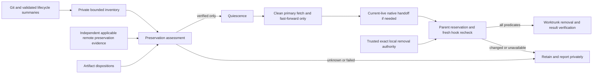

# Workflow preservation and immediate retirement

**SPECIFICATION READY; IMPLEMENTATION/ROLLOUT UNQUALIFIED.** Owner: lifecycle maintainers; Discovery
primary integrates this contract. Profile: [../PROFILE.md](../PROFILE.md).
Risk: critical (irreversible data loss). Covers workflow-convergence
INT-009–INT-023 and storage-safety dependencies; not generic CI/merge-policy
implementation. The selected interfaces below are not yet implemented CLI flags
or qualified runtime behavior. Current operation remains report-only; specification
readiness grants no publication, launch, upload, removal or deployment authority.

## Authority and source distinction

Approved intent and source limits are in the Initiative
[README](../../../initiatives/dbsctr-workflow-convergence/README.md),
[decisions](../../../initiatives/dbsctr-workflow-convergence/DECISIONS.md) and
[source reconciliation](../../../initiatives/dbsctr-workflow-convergence/SOURCE-RECONCILIATION.md).
Reuse [worktrunk-native-workspaces](worktrunk-native-workspaces.md),
[automatic-delivery](automatic-delivery.md) and the selected distribution
[storage policy](../../dotfiles_ai_distribution/features/workflow-storage-policy.md).
The primary must reconcile changes explicitly; this specification supersedes no active
cycle authority and changes no historical record or failed evidence.

Observed source at the reconciliation baseline: native registration writes
`created_by_dbsctr=false`, older inventory filters true; global roots come from
legacy registry discovery; size accounting invokes expensive per-worktree work;
the pre-remove checker has a 24-hour completed-cycle hold. Candidate feature refs
can preserve Git without proving ultimate-default merge. Local DVC status does
not independently verify uploaded remote objects. These are gaps, not measured
host results. Retain current managed-user hook, ignored-data and process safeguards.

## Domain and report-only inventory

**Ultimate default** is the freshly verified default branch of the exact approved
remote repository, distinct from a temporary delivery/integration target.
**Completed** means every correlated lifecycle cycle is known completed under
its original authority; session exit, PID disappearance and clean Git do not prove
completion. **Preserved** means every artifact has verified durable disposition,
not merely an upstream ref or an ignore rule. **Eligible** is a fresh conditional
assessment, never authorization or an atomic deletion guarantee.

Inventory starts from operator-selected canonical repository roots plus configured
new/retained root discovery, then native Git/Worktrunk membership. Native CLI
validated record summaries correlate cycles by exact repository/common-directory
and registered checkout identity. Include native and legacy records regardless
of `created_by_dbsctr`; that field is historical provenance. Do not infer ownership
from branch/session names, reconstruct private raw ledgers or create a parallel
task registry. Native records that cannot be read/validated stay unavailable.

Inventory uses the selected addition to the existing CLI:
`dbsctrctl worktree-list --json --metadata-only`, preserving existing `--all`.
Add repeatable `--repository ABSOLUTE_PRIMARY_PATH` seeds for operator-selected
canonical repositories, usable before the new storage renderer is installed.
Trusted configured roots and native Git membership supplement retained roots;
there is no all-disk scan or new registry. Bounds are 5 seconds per repository,
1 second per item, 100 items per page and at most 256 repositories per invocation;
timeouts/limits yield resumable partial coverage, not absence. Metadata is the
default fast path.
Size is optional, separately bounded and cannot block classification; report
logical/allocated sizes distinctly from unknown unique physical extents. No `du`
requirement, dataset traversal or unbounded all-disk scan on the critical path.
Cursor binds schema, source-set digest and repository identity; drift invalidates
the observation and requires fresh discovery, not blind replay. Reports are
private/local, bounded and sanitized before any public export.

Selected inventory result schema 1, added through existing CLI machinery:

| Field | Required contract |
|---|---|
| `schema_version`, `observed_at`, `scope_digest` | Version 1, UTC observation, digest of selected roots and policy/source identities |
| `coverage` | Object with `status` (`complete`, `partial`, `unavailable`), `reasons` array, `repositories_seen`, `repositories_completed`, `items_seen`; unavailable is never zero |
| `items`, `continuation` | Bounded item array and optional opaque scoped cursor; no allocation authority |
| item `repository_id`, `common_dir`, `worktree_id`, `path`, `branch`, `head`, `membership` | Canonical common-directory identity, admin identity and native membership status; detached branch is null, unresolved values null with reasons; paths private only |
| item `cycles` | Object with `status` and `records` array of validated `id`, `state`; unknown/unavailable explicit, not an empty-completed inference |
| item `evidence` | Named `git_default`, `dvc`, `artifacts`, `processes`, `handoff`, `policy` objects: each has `status`, `identity`, `digest`, `observed_at`, `reasons`; unknown fields null, not invented |
| item `disposition`, `reasons` | `retained_unknown`, `retained_active`, `retained_unmerged`, `retained_unpreserved`, `retained_busy`, `eligible` or `removed_verified`; reasons may coexist |
| item `size` | Optional object with `status`, nullable `value`, `unit`, `method`; unknown/timed out is not zero and does not itself determine preservation |

The schema is strict version 1 with unknown versions rejected; timestamps are UTC,
digests full lowercase SHA-256 where applicable, reasons stable code arrays.
Evidence `status` is `verified`, `failed`, `unknown`, `unavailable` or
`not_applicable`; cycle `status` is `known`, `unknown` or `unavailable`, and native
`membership` is `registered`, `absent` or `unknown`. Empty cycle records with
unknown/unavailable status never mean known completed. A metadata observation
alone never manufactures verified preservation or `removed_verified`.
`continuation` is null at completion and binds schema, scope/source-set digest,
repository identity and position. Metadata-only omits size traversal and records
unperformed preservation checks as unknown: optional expensive size never blocks
classification, but incomplete preservation checks always block eligibility.

This complete schema belongs to a private report in existing private evidence
storage. Agent-facing stdout returns its bounded path-free projection: opaque
repository/worktree/report IDs, state/reason codes and counts, with path/branch
fields null or omitted according to the versioned projection. Never forward
private inventories, source paths or branch names as a hosted review payload.
The native operator may inspect the private artifact; it is not a task registry
or authority to delete. Publication exports use only approved aggregate fields.

Initial inventory never commits, uploads, merges, changes config, adopts, moves a
session, deletes or abandons anything. Unmerged completed work becomes a bounded
delegated-reconciliation report; a reviewer may recommend later action but cannot
silently resolve uncertainty or expand an existing cycle.

## Declared-output preservation interface

Select a version-1 durable **output manifest**, retained under existing private
cycle evidence facilities and referenced by digest from the validated cycle
summary. It is immutable evidence, not a second task database. Its required data:

| Entity | Required binding |
|---|---|
| Manifest header | Version, exact repository identity, Git commit, DVC metadata paths and content digests, DVC version/object-format semantics, manifest digest |
| Declared output | Exact metadata target and normalized repository-relative output path, checksum algorithm/object ID, file or directory type, full directory-object/member closure |
| Destination | Named approved DVC remote plus canonical endpoint/storage identity and config digest; secret-bearing values stay private and are never public evidence |
| Scope | Explicit declared-output set and closure; exclusion reasons and absent code-only outputs distinguished from generated/modified outputs |
| Verification | Exact object list/digest, native remote query result per object or verifiably complete set, observation time, errors and completeness |
| Consent | Trusted exact-repository standing policy snapshot/digest for this output scope and destination, or separately recorded explicit approval |

The manifest is strict version 1; reject unknown schema/version, ambiguous target
normalization, metadata mismatch or incomplete closure. Bind canonical targets and
metadata bytes to the exact Git commit, never just a mutable path or cached index.
Destination normalization excludes credentials, conservatively preserves backend
identity distinctions, and is enabled only for an explicit backend support
allowlist selected and fixture-qualified at deployment; unsupported backends refuse
automation. No credential values enter hashes intended as nonsecret identities.

### Frozen DVC capability and first-release limit

Public source research selects DVC **3.67.1**, whose dependency is
`dvc-data>=3.18.2,<3.19.0`; inspected status semantics are **dvc-data 3.18.2**.
This is source evidence, not installed-runtime or backend qualification:

- [DVC dependency declaration](https://github.com/treeverse/dvc/blob/3.67.1/pyproject.toml),
  [cloud status](https://github.com/treeverse/dvc/blob/3.67.1/dvc/repo/status.py),
  [push](https://github.com/treeverse/dvc/blob/3.67.1/dvc/repo/push.py),
  [output collection](https://github.com/treeverse/dvc/blob/3.67.1/dvc/output.py).
- [dvc-data status](https://github.com/treeverse/dvc-data/blob/3.18.2/src/dvc_data/hashfile/status.py).
- [DVC list interface](https://dvc.org/doc/command-reference/list),
  [status interface](https://dvc.org/doc/command-reference/status),
  [push interface](https://dvc.org/doc/command-reference/push).

Native commands are `dvc status --cloud --json -r REMOTE TARGETS` and
`dvc push -r REMOTE TARGETS`. Dependencies are not automatic: use `--with-deps`
or the manifest's explicit output closure. Cloud JSON maps paths to `new`,
`deleted` or `missing`; exit 0 also permits differences and `{}` describes only
collected objects. `dvc/output.py` force collection can omit missing directory
manifests; dvc-data status can assume remote directory members exist when `.dir`
exists. Thus even clean `{}` is **never sufficient independent remote directory
closure evidence**. `dvc list -R --dvc-only --json --show-hash` is supported
metadata enumeration, not remote-existence verification.

No inspected supported CLI independently verifies every remote directory member.
Do not add private DVC Python internals, guessed blob paths, index manipulation
or a custom backend verifier. The frozen capability contract requires independent
complete preservation evidence. First release retains work/cache for unqualified
directory backend/version combinations and reports
`remote_directory_closure_unverified`, even after successful targeted push. Record
that push accurately, never as a stronger attestation. This conservative limit is
explicit supported behavior, not a Discovery blocker or a blocker to the whole
Build launch. Non-DVC clean code and fixture-qualified file-output cases may
retire when every other predicate holds. A future supported directory capability
requires separate qualification; this specification does not promise one exists.

Native verified remote file existence proves presence, **not remote payload
checksum integrity**. No payload-integrity guarantee is claimed for files or
directories. Missing, inaccessible, incomplete, stale, unparseable or unsupported
evidence retains work. Local status/cache presence and command success alone
never substitute for independent applicable preservation evidence.

Standing upload consent is selected, disabled by default and exact-repository
only. It authorizes targeted upload of the declared scope to its approved
destination, not all cache contents, external reports or arbitrary network writes.
Trust comes from owned local policy, never repository content. Changed endpoint,
remote identity or scope beyond the approved declaration
requires renewed approval before external write. A policy may approve a bounded
declaration rule for future outputs, but each resolved object set is still bound
and verified. Credentials/authentication remain independently authoritative.
No push is authorized by preparing this specification. Source-committed
declarations never grant consent. Within unchanged approved declaration bytes,
exact targets and destination, new object versions need no repeat prompt; each
resolved manifest is still recorded and verified. Existing policy cannot silently
escalate old cycles.

### Exact-repository consent schema 1

Bind consent to the distribution schema's trusted local
`repositories[].preservation` table, never a global switch or repository-committed
file. This is selected local TOML data, not implemented parsing. Absence disables
all automation. A present table requires integer `schema_version = 1`; invalid
types, unknown keys/versions, wildcard repositories, duplicate scopes or ambiguous
destinations refuse automation without changing existing records.

| Field | Type/default and binding |
|---|---|
| `automatic_remove` | Boolean, false; permits immediate eligible Worktrunk removal only, not predicate waiver |
| `delete_local_branch` | Boolean, false; permits separate safe final-default/preservation-verified local deletion |
| `uploads` | Array, empty; each entry authorizes one exact declared scope/destination |
| `uploads[].declaration_path` | Exact repository-relative committed output-declaration path, no glob/traversal; must resolve at bound Git commit |
| `uploads[].declaration_sha256` | Full SHA-256 of the approved declaration bytes; declaration lists exact DVC targets and their transitive output closure, not arbitrary cache contents |
| `uploads[].remote` | Exact DVC remote name, no implicit default selection |
| `uploads[].destination_sha256` | Full SHA-256 of canonical resolved endpoint/storage identity and relevant nonsecret config; credentials excluded; ambiguous canonicalization blocks qualification |

Scope consent covers new object versions only for those exact declared targets
under unchanged approved declaration bytes; every resolved object manifest still
binds its exact Git/DVC metadata and complete closure. Additional targets or
changed declaration bytes/destination require renewed approval. Policy snapshot
digest accompanies the evidence. Disabling current consent blocks new uploads
and automatic removal, while retaining prior observed outcomes; enabling policy
does not retroactively authorize old-cycle mutations without an explicit
state-bound adoption/approval under the primary's reconciled contract.
Remote branch deletion is intentionally not a field: separately approved policy
and its own contract are required. Administrator/check policy stays in existing
delivery authority, never this table. Trusted local file ownership/regular-file
validation and native permissions are necessary; a digest does not authenticate
operator identity. Canonical destination serialization must be qualified for each
supported remote backend before schema activation.

No DVC outputs/metadata means reasoned `not_applicable`, not fabricated upload
success. Absent code-only outputs can be classified without hydration when their
exact metadata/object obligations are known. Missing local unique objects, dirty
outputs or uncommitted metadata remain blockers. Targeted checkout/pull remains
reflink-only; immutable repository cache objects alone may be shared, never mutable
locks/state. No full pull, shared GC or blind cache migration.

## Artifact disposition

| Class | Required preservation before removal |
|---|---|
| Tracked Git work and all recorded commits | Clean state; every recorded commit and current recorded HEAD is ancestor of verified ultimate remote default merge |
| DVC-declared outputs | Exact manifest and independent applicable remote preservation evidence; unqualified directory closure retains work/cache |
| Unique ignored/untracked data, secrets, unknown files | Retain and report private disposition needed; no bulk add/commit, whitelist or blanket copy |
| Lifecycle plans, approval/evidence, recovery preimages | Verify complete durable copies in existing private common-Git evidence authority with integrity/provenance; `.dbsctr` filename does not make them disposable |
| Narrow known regenerable tool state | Classify by producer/version, exact location/type and proven regeneration; preserve referenced evidence/unique contents first; unexpected contents retain |
| Private caches/experiments/dirty metadata | Inventory all retained references and unique objects; separately approved staged migration with metadata/content verification before any disposal |

A clean checkout can contain irreplaceable ignored data. Every discovered artifact
must have a disposition; bounded scan failure or inaccessible directories produce
unknown, not an implicit ignored-file allowance. No process termination or
emergency virtual-environment deletion is authorized here.

Known regenerable virtual environments require conservative producer/version and
path provenance, no unique/evidence contents, no primary checkout and no current
consumers; a conventional directory name or ignore rule is not provenance.
Ignored plans and evidence are never classified as disposable tool state.
Initial remediation needs separate bounded scope approval against fresh inventory,
not mass commits or retrospective inference from this report.

## Retirement predicates and interfaces

Reuse `dbsctrctl workspace-remove-check --json` as the read-only blocking managed
**user** pre-remove hook. Select versioned additive evidence fields for state
digest, repository/worktree membership, policy snapshot, separate predicate
statuses and bounded reasons; preserve existing readers or version them explicitly.
The hook never removes, pushes, signals processes or changes branches.

All predicates must hold together for automatic retirement:

1. Exact registered native Git/Worktrunk membership; non-primary, non-current
   checkout; clean tracked state and every correlated cycle known completed.
   No associated/unknown cycle remains manual report/reconciliation, not automatic
   completion. Existing unmanaged read-only inspection remains available.
2. Fresh query/fetch verifies approved remote repository identity, ultimate default
   identity and exact default HEAD. Verify recorded PR identity, expected head and
   merge commit and ancestry of **all recorded commits**, including Gate Commits
   and current checkout HEAD, into that ultimate default. Cached tracking refs,
   feature upstreams, branch-name resemblance or temporary-target merge do not
    suffice. Squash/rebase without recorded ancestry does not satisfy this contract.
3. Every artifact is classified/preserved and all applicable declared DVC objects
   are verified at the exact approved remote. Intermediate targets and their
   retained task branches remain until final default integration/preservation.
4. Qualified open-file/process inventory finds no relevant consumers, writers,
   cwd references or native launch holders. Failed/partial inventory blocks. A
   launch-only busy lock is not universal process ownership; never kill consumers.
5. If a live/current native conversation still targets the checkout, same-identity
   handoff to the stable primary is qualified and acknowledged **before** removal,
   and only after the fresh primary synchronization in predicate 6.
   Verify attachments/history and actual native location; changing shell cwd is
   not a session move. No forged identity or new-session workaround. Do not create
   or revive a conversation solely to remove a completed idle checkout. Preserve
   historical session/evidence references through existing source-independent
   readers. Use only the existing native `session_move` tool for the current live
   conversation. Uncertain live ownership or an unavailable required handoff blocks.
6. Unique stable primary is clean, on the approved default with matching tracking
   destination, freshly fetched and synchronized **fast-forward only**. Dirty,
   diverged, ambiguous or changed destination retains and reports; no reset,
   force, checkout swap or semantic-conflict concealment. Perform fresh primary
   fetch/fast-forward **before** any live handoff, following
   [workflow-native-handoff](../../opencode_control_plane/features/workflow-native-handoff.md).
   Material conflict returns
   to the primary's intent interview outside this feature's scope.
7. Trusted exact-repository policy explicitly opts into immediate eligible
   Worktrunk removal, or operator separately authorizes this exact removal.
   Global automatic removal is off. Opt-in is not a waiver of predicates,
   administrator privilege or branch-protection checks. No arbitrary 24-hour hold
   once eligible under the reconciled contract; age alone never grants eligibility.
8. Fresh state recheck under the qualified removal coordination lock verifies
   Git membership, branch/HEAD, cycles, policy, default/DVC/artifact evidence and
   process/handoff state immediately at the native hook/removal boundary. Any
   change invalidates preview and retains. Native Worktrunk alone performs removal
   with hooks enabled. Never `--force`, `--no-hooks`, clobber or raw deletion.

### Cooperative removal boundary and branch retention

Pinned Worktrunk `v0.80.0` (`b49ca7eea9b03145791a5b94eccaf9c59412ed37`)
[source](https://github.com/max-sixty/worktrunk/tree/b49ca7eea9b03145791a5b94eccaf9c59412ed37/src)
supports blocking pre-remove hooks, followed by ownership/Git-worktree-lock/
cleanliness checks and rename before registry removal under its in-process lock.
These are source observations, not a runtime race qualification. A hook-held
`flock` **cannot span post-hook removal**. Do not transfer hook locks or treat an
environment variable as actor proof.

Extend the existing foreground supervisor with the selected narrow interface
`agent-worktree --remove ABSOLUTE_WORKTREE_PATH`; do not add another allocator or
generic command-execution route. This mode accepts no caller-supplied Worktrunk
options and rejects primary/current/unregistered targets. The parent holds a cooperative
removal reservation keyed by canonical common directory and worktree identity
through native `wt remove --foreground --no-delete-branch` and result observation.
Managed launches honor that same removal intent. The safety hook executes inside
the parent reservation and verifies fresh state; a direct native invocation with
the hook requires one-shot explicit operator mode or blocks automatic removal
without a reservation. A local reservation coordinates, never grants permission
or proves operator identity. No long-lived sidecar or general allocator registry.

Reuse the existing private launch-reservation file/lock, with the canonical
worktree-admin identity. Pass its open descriptor through the supervised native
process; the hook verifies descriptor ownership/type/inode and the exact target
against the parent attempt. Environment text can locate a descriptor but is not
proof of actor identity or consent. Descriptor propagation through the pinned
native hook process is a required Build fixture; if unavailable, automatic removal
stays blocked rather than adding a lock sidecar or alternate identity route.
The parent holds the same reservation through branch-outcome observation/CAS.
Automatic mode requires trusted exact-repository opt-in. Manual one-shot removal
without that opt-in requires an exact state-bound operator confirmation through
native permissions/terminal flow; agents never synthesize terminal input.

Before-hook process inventory and Worktrunk's post-hook checks supplement artifact
preservation; they do not fence arbitrary editors. Any known consumer or unknown/
partial process visibility blocks; never kill. Evidence is attempt-scoped, not a
timeout token. A crash releases the process lock; retain the attempt observation
in existing private evidence and resume by observing actual Git membership/path
state, never by replaying deletion. Unsupported coordination blocks automatic
activation, not specification readiness.

Always select `--no-delete-branch` explicitly: global user preferences and native
patch-equivalence/branch-`-D` fallback must not bypass preservation. After verified
membership removal only, separately authorized local cleanup validates exact tip,
ultimate-default ancestry and that the branch is not checked out anywhere, then
uses Git compare-and-swap:
`git update-ref -d refs/heads/BRANCH EXPECTED_TIP`. This is guarded native ref
deletion, not force-history cleanup. Changed tip/membership or refusal retains
the branch. Keep the common-directory cooperative reservation through the fresh
not-checked-out check and CAS; do not claim it fences unrelated native writers.
If an owner requires Worktrunk-only branch deletion, native deletion
lacks this strong guarantee: report and retain rather than force. Branches remain
until ultimate-default and applicable DVC/artifact preservation, including when
an earlier user permission phase authorized only worktree removal.

Remote merged-branch deletion is default-off, with exact-repository
`delivery.delete_remote_branch` opt-in. First release uses only GitHub's already
configured `delete_branch_on_merge`, and only for ultimate-default promotion when
applicable data/artifacts are already preserved before merge. Never change that
repository setting automatically. If it is unavailable/off, report and retain;
do not fall back to an unguarded ref DELETE or a force push. Historical orphan refs
remain in the reconciliation report for separately approved action.

Before any automatic merge, query native after-merge deletion behavior. If it could
delete a branch before ultimate-default/data preservation, block automatic merge
and report the incompatible repository policy—even if administrator merging is
enabled. Intermediate integration must not silently discard its retained refs.
Native GitHub ref DELETE has no exact-tip CAS and is not an automated fallback.
No remote deletion follows merely from successful worktree removal.

## Ordered recovery/state contract

| State / interruption | Allowed next action | Durable outcome |
|---|---|---|
| Unknown, active, dirty, busy, unmerged or unpreserved | Report/reconcile only | Retain files, branches, caches and failed evidence |
| Completed, merged only into temporary target | Report final integration needed | Retain task and target refs; no abandonment |
| Git/data/artifacts preserved | Qualify quiescence, synchronize primary, then current-live native handoff if needed | Still retained until all predicates/recheck hold |
| Upload, handoff or primary sync fails | Record bounded failure; fresh retry | No removal, no partial success claim; never falsify prior successful upload/merge |
| Eligible under exact authority | Recheck at native removal boundary, then Worktrunk removal | Verify Git membership/path result separately |
| Removal interrupted/result unavailable | Observe current native membership and preserved evidence before retry | Do not report removed or delete branches on unknown result |
| Removal verified, branch remains | Independently retry safe authorized branch deletion | No repeated worktree removal or force |
| Repeated reconciliation after verified completion | Return recorded result and current observation | Idempotent, no second upload/merge/delete solely from replay |

**Text Equivalent:** Unsafe/uncertain and temporary-target states retain work.
Preservation precedes quiescence, safe primary sync and any current-live native handoff. Failed
upload/handoff/sync retains the checkout. Eligibility still requires a fresh hook
recheck. Interrupted removal is observed before retry and cannot be called
successful until verified. Branch deletion is separate and retry-safe. Source:
predicates/recovery contract; owner: lifecycle maintainers; update on state or
ordering changes. Scope: retirement, not lifecycle gate completion.

## Acceptance/failure table

| ID | Given / when | Required evidence and failure behavior |
|---|---|---|
| P-01 | Mixed native/legacy and unmapped worktrees inventoried | Native membership plus validated record correlation; no true-only filter; unknown retained, coverage explicit |
| P-02 | Size command slow/unavailable or inventory interrupted | Metadata still bounded; optional size unknown; scoped resumable cursor, no eligibility from incomplete sources |
| P-03 | Session exits but cycle active/unknown | Retain; completion never inferred |
| P-04 | Feature upstream/temporary target contains work | Retain until fresh ultimate-default merge and all recorded ancestry proven |
| P-05 | Default branch/repository changes or remote query fails | Invalidate evidence; retain and require renewed target reconciliation |
| P-06 | Local/cloud status clean but directory member missing, including present remote `.dir` | Retain work/cache with `remote_directory_closure_unverified`; targeted push/clean JSON never sufficient |
| P-07 | Upload succeeds but verification unknown, stale or wrong destination | Block removal; retain successful upload evidence without durability claim |
| P-08 | Standing approved scope resolves exact objects | Targeted approved upload only; changed scope/destination requires renewal; no full cache push |
| P-09 | Unknown ignored data or `.dbsctr` evidence exists | Classify/preserve individually or retain; no filename-based disposal/bulk commit |
| P-10 | Busy process, denied process inventory or unqualified move | Retain without signaling; native identity unavailability explicit |
| P-11 | Clean primary can fast-forward / dirty or divergent primary | Fresh fetch/ff-only before conditional current-live native handoff; failure retains former checkout and retries idempotently |
| P-12 | Opted-in repository fully eligible just after completion | No age hold; native hook/recheck still mandatory; default-off repository needs explicit removal authority |
| P-13 | HEAD, membership, artifact, policy or consumer changes after preview | Recheck refuses; no stale digest replay or branch deletion |
| P-14 | Hook/lock cannot safely coordinate selected native version | Mark qualification blocked; never claim OS atomicity or bypass hook |
| P-15 | Worktrunk removal fails or loses acknowledgement | Verify actual state; retain/retry report, no false terminal success or forced cleanup |
| P-16 | Final default merged and worktree removed; branch deletion refused | Keep branch, report separate incomplete step; remote deletion still separately authorized |
| P-17 | Directory `.dir` present but remote member absent with cold/warm local caches | Tiny disposable fixtures prove refusal in both cases; no invented remote verifier or payload claim |
| P-18 | Non-DVC code or supported file case meets all predicates | May retire independently of unqualified directory capability; file evidence establishes presence, not payload integrity |
| P-19 | Supervisor crash, concurrent managed launch or direct native removal lacks reservation | Lock releases on crash; observe membership before retry; launch respects intent; direct auto path blocks, operator mode explicit |
| P-20 | Global native branch-delete preference true or branch tip changes | Explicit `--no-delete-branch`; separate CAS refuses changed tip; no native force fallback |

## Validation closure, gates and readiness

Existing source candidates: `dot_local/bin/executable_dbsctrctl`,
`dot_local/bin/executable_worktree-dvc-setup`,
`dot_local/bin/executable_agent-worktree`,
`private_dot_config/worktrunk/config.toml`. Existing test candidates:
`tests/test_workspace_remove_check.py`, `tests/test_native_dvc_removal.py`,
`tests/test_worktree_dvc_setup.py`, `tests/test_agent_worktree.py`,
`tests/test_native_workspace_records.py`, `tests/test_workspace_adoption.py`.
In particular, current clean/no-cycle removal fixtures establish existing behavior,
not automatic known-completed retirement under this selected policy. Preserve
manual inspection compatibility while separately testing the stricter auto path.
Primary/Build must trace exact affected delivery consumers before approving edits.

No material design question remains in this owned artifact. Build acceptance,
not further Discovery interview, must exercise the strict inventory/checker/
manifest schemas, targeted DVC version/backend capability fixtures, canonical
destination allowlist, evidence retention, current-live native handoff and the
parent-supervised hook/removal boundary. Include tiny present-`.dir`/absent-member
fixtures with both cold and warm caches and assert refusal; no installation,
production cache movement, GC, private DVC internals or custom backend verifier.
Test supported file and non-DVC success separately, plus interruptions, branch
CAS races and unique ignored data. Reuse the listed tests; add only the narrow
supervisor-extension fixture needed by the existing launcher/CLI path.

Primary owns publication authority over the full candidate set, legacy/Initiative
reconciliation and source/profile applicability plans. No private host inventory
is requested or published. Source-only delivery and future current-host activation
are separate; no guest/remote operations. Existing bootstrap requires `HEAD == base`
and an existing authority source checkout: where necessary permit two temporary
code-only native checkouts and existing native import, never premature docs PR,
reset, environment/data copies or duplicate independent writers. Exact sequence
belongs to the linked native-handoff specification. No tests/checks ran here.

| Gate | Proposed applicability | Result / owner |
|---|---|---|
| Domain, Behavior, Spec, Contract | required | not_run / primary verification; specification ready is not a gate pass |
| Test-driven implementation, Refactor | required | not_run / Build primary |
| Review/Integrate | required; affected QA and safety review | not_run / primary |
| Release | not_applicable for source-only delivery under the profile; revisit if packaging changes | not_run / primary |
| Deploy, Operate | not_applicable to source-only delivery; required in separately approved live activation plan | not_run / rollout primary |
| Maintain/Retire | required; retention, retries, rollback and compatibility | not_run / primary |

No Gate Exception, readiness receipt, registration or successful preservation is
established. Source delivery cannot substitute for filesystem/version/live
qualification. New tasks use freshly verified ultimate default and native task
allocation; Discovery-to-Build reuse is permitted only with clean committed
authority and matching registration constraints, never duplicate writers or a
second checkout solely for aesthetics.

## Visual Evidence

| Concern | Decision / review question |
|---|---|
| Boundary | required: flow below; which authority owns observation, handoff and removal? |
| Interaction | required: recovery table and flow; what must precede irreversible deletion? |
| State | required: recovery table; what survives failure/retry? |
| Data/trust | required: flow below; what proves durable objects and what stays private? |
| Schema | not_applicable: canonical evidence tables define records/optionality; no independent relational model |
| Dependency/deployment | required: flow below; native/DVC qualification precedes activation |
| Quantitative | not_applicable: no measured storage, performance or coverage gains |

**Text Equivalent:** Git membership and validated lifecycle summaries feed a
private bounded inventory. Independent applicable remote preservation evidence and
artifact dispositions feed preservation assessment. Verified preservation precedes
quiescence, clean-primary fetch/fast-forward, then current-live native handoff if
needed. Unqualified directory closure retains work/cache. Trusted exact local
removal authority, parent-held reservation and a fresh hook/coordination recheck are
all needed before Worktrunk removes and its result is verified. Unknown/failed
preservation or changed/unavailable recheck retains work and reports privately.
Scope: preservation/retirement only; canonical sources: inventory, manifest,
predicates and recovery sections; owner: lifecycle maintainers; update with
authority, evidence, privacy or ordering changes. Native/DVC version and live
qualification remain prerequisites, not claims made by this diagram.
