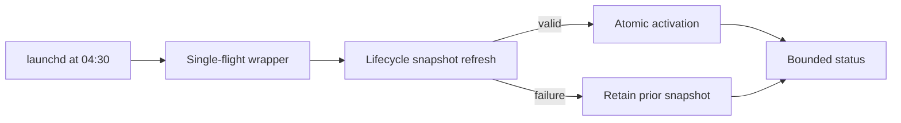

# History Projection Refresh Schedule

## Ownership

`dotfiles_ai_distribution` owns host enablement, the daily launchd schedule,
single-flight execution, resource policy, logs, disablement, and rollback. The
lifecycle context owns `history-source-index-refresh`, snapshot correctness,
privacy, sidecar schema, activation, and status semantics.

## Behavior

**Scenario: Refresh without operator prompting**

- Given host-local history projection refresh is enabled
- When local time reaches 04:30 each day
- Then launchd starts one low-priority refresh without a model or agent
- And an already-running refresh makes the new invocation exit successfully

**Scenario: Preserve the prior snapshot on failure**

- Given one ready projection exists
- When refresh times out, loses source authority, exceeds storage bounds, or fails
- Then the process exits nonzero with bounded diagnostics
- And the prior ready snapshot and its captures remain unchanged

**Scenario: Recover after sleep or restart**

- Given the machine is asleep at 04:30 or restarts later
- When launchd next evaluates the calendar job
- Then at most one refresh runs
- And status remains truthful if no run occurs

**Scenario: Disable safely**

- Given the owner disables refresh
- When managed configuration applies
- Then launchd unloads and removes only the owned job
- And the active projection remains readable until separately retired

**Scenario: Surface silent refresh failure**

- Given one or more scheduled runs failed while the prior snapshot still serves reads
- When the owner requests scheduler status
- Then the wrapper prints bounded machine-safe run state including the last
  result class, consecutive-failure count, and run timestamps
- And lifecycle snapshot status remains unchanged by scheduler failures

**Scenario: Report whole elapsed seconds**

- Given a refresh owns the single-flight lock and its measured elapsed time is
  1.5 seconds
- When the wrapper records its terminal summary
- Then `duration_seconds` is the integer `1`
- And an elapsed time below one second is represented by the integer `0`
- And the same unit and rounding rule applies to success and failure

**Scenario: Keep elapsed duration independent of wall time**

- Given a refresh has started and the system wall clock moves backward or forward
- When the wrapper records its terminal summary
- Then elapsed duration reflects a monotonic interval
- And `started_at` and `finished_at` retain their separately observed Unix
  millisecond values, even if their ordering changes

**Scenario: Include failed execution and cleanup time**

- Given a refresh exits nonzero, cannot start, or reaches its timeout
- When the wrapper records the failed or timed-out summary
- Then duration includes the accepted execution interval and any termination grace
  and cleanup
- And failure class, consecutive-failure accounting and exit status follow the
  existing contract

**Scenario: Preserve an existing summary during upgrade**

- Given a readable version-1 summary exists from before the duration correction
- When the updated wrapper is installed or its `status` mode is invoked
- Then the saved summary is neither converted nor rewritten
- And the next acquired refresh replaces it through the normal running and
  terminal-summary transitions
- And the new terminal summary uses elapsed whole seconds

## Interface

Public configuration adds:

```toml
[history_projection]
enabled = false
refresh_hour = 4
refresh_minute = 30
refresh_timeout_seconds = 3600
```

Bounds are hour `0..23`, minute `0..59`, and timeout `900..3600`. The managed
host enables the feature explicitly; public defaults remain safe for machines
without an OpenCode source. The installed artifacts are:

- `~/Library/LaunchAgents/dev.dotfiles-ai.history-projection-refresh.plist`
- one managed wrapper script providing a launchd `run` mode and a `status` mode

The job invokes only `dbsctrctl history-source-index-refresh`, uses an owner-private
single-flight lock, has no network or provider dependency, and runs with background
process type and low I/O priority. The wrapper starts the refresh in its own
process group and enforces the configured timeout itself: at the bound it sends
SIGTERM to that group, records a `timeout` result, and exits nonzero. It records
bounded timestamps, duration, state, captured age, final size, machine-safe
failure class, and a consecutive-failure counter in one owner-private run-state
file, and prints that state as bounded JSON for `status`. Logs and run state
contain no source path, IDs, bodies, commands, credentials, or raw database
errors. Lifecycle `history-source-index-status` semantics remain unchanged.

The original scheduler rollout selects enablement through machine-local
configuration during its Deploy and Operate validation. PY-06 preserves existing
enablement and does not opt in another host. An enabled always-on host fires daily
at 04:30, and launchd's run-once-at-wake default stays the documented catch-up
behavior for machines that sleep.

The installed `history-projection-refresh status` command prints exactly one
latest-summary object and exits zero:

```json
{"schema_version":1,"state":"never_run","failure_class":null,"consecutive_failures":0,"started_at":null,"finished_at":null,"duration_seconds":null,"snapshot_age_seconds":null,"snapshot_size_bytes":null}
```

Every field is required. `state` is one of `never_run`, `running`, `succeeded`,
`failed`, or `timed_out`. `failure_class` is null except for failed terminal
states and is then one of `timeout`, `source_unavailable`, `refresh_failed`, or
`status_invalid`. Timestamps are nonnegative Unix milliseconds; duration, age,
and size are nonnegative integers or null. The wrapper persists only this latest
summary, atomically and owner-private, at
`$DOTFILES_AI_STATE_ROOT/dotfiles-ai/history-projection-refresh/status.json` when
the centralized root is configured, otherwise at
`~/.local/state/dotfiles-ai/history-projection-refresh/status.json`. It never
persists a run list. Launchd logs retain bounded event lines.

An overlapping invocation exits zero without replacing the running summary.
Successful completion resets `consecutive_failures`; failed or timed-out
completion increments it. Missing state returns `never_run`. Unsafe, malformed,
oversized, or unsupported state fails closed with exit 75, empty stdout, and
stderr exactly `scheduler_state_invalid\n`; it is never converted to `never_run`.

### Duration Units And Measurement

`duration_seconds` is a nonnegative integer number of completed elapsed seconds,
rounded down. It is not a timestamp or the subtraction of wall-clock timestamps.
An accepted run measures one monotonic interval after acquiring the single-flight
lock and reading the prior summary, beginning before the running summary is
written and ending after child wait or termination cleanup. The interval includes
running-summary persistence, process launch, execution, timeout grace and cleanup;
it excludes lock contention, prior-summary reading and final-summary persistence.
Consequently a timed-out run may report more seconds than the configured child
timeout. Subsecond precision is intentionally not exposed by this schema.

| Observation | Source and unit | Stored value |
|---|---|---|
| Start and finish timestamps | Independently sampled system wall time | Unix milliseconds |
| Accepted run still in progress | No completed elapsed interval | `duration_seconds: null` |
| Accepted run has terminated | Monotonic elapsed interval | Whole seconds rounded down |
| Overlapping invocation | No accepted run or replacement summary | Existing summary remains unchanged |
| Status-only invocation | Existing owner-private summary | Existing values remain unchanged |

**Text Equivalent:** Wall time supplies the two Unix-millisecond timestamps;
monotonic time supplies elapsed duration. Running duration is null, terminal
duration is a whole-second integer, and overlap or status reads do not replace
state. Source: the duration contract above. Owner: distribution maintainers.
Update trigger: clock, rounding, interval or summary-compatibility changes.

Deterministic boundary examples are zero elapsed nanoseconds becoming `0`,
999,999,999 becoming `0`, 1,000,000,000 becoming `1`, and 1,500,000,000 becoming
`1`. These are unit-conversion examples, not measured refresh performance.

### Version-1 Compatibility

The duration correction retains schema version 1, required fields and their
existing emitted order, integer-or-null values, CLI modes, exit codes, status
privacy and failure semantics. It introduces no dependency, runtime-floor change,
configuration switch, production test hook or projection-schema change.

Older wrapper revisions stored a millisecond delta in `duration_seconds`.
Version-1 summaries contain no provenance that can reliably distinguish those
values from corrected seconds. Existing readable summaries therefore remain
verbatim until the next acquired run replaces them. A deployment or status read
must not guess units from magnitude, divide historical values, reset counters,
delete state or trigger a refresh solely to replace the summary. Immediate repair
of historical summaries would require a separately selected migration contract.
The correction guarantees units for newly completed runs; it cannot establish
the units of a pre-correction retained summary.

04:30 local avoids the existing 03:00 maintenance window, Sunday 03:15 database
backup, and 09:15 review work. The 15-minute DKS reconciler remains independent;
low-priority execution and single-flight locking prevent this schedule from
changing DKS authority or cadence.

## Recovery And Maintenance

- The wrapper watchdog terminates only the refresh process group at the configured
  bound; lifecycle cleanup removes preparation on the next run.
- Three consecutive failures remain visible in scheduler status and logs but do
  not disable the job or remove the prior snapshot.
- A prior integrity- and privacy-valid snapshot remains readable with explicit
  age even after missed daily refreshes. Age alone does not expire it or trigger
  synchronous rebuilding; privacy invalidation remains immediate.
- Rollback unloads the LaunchAgent and restores prior managed configuration; it
  does not delete projection or OpenCode data.
- Vulnerability and runtime intake follow the distribution Engineering Profile;
  no new dependency or service is added.

## PY-06 Delivery Slice

PY-06 belongs only to `dotfiles_ai_distribution`. It uses the existing
[Engineering Profile](../PROFILE.md) and
[Product Intent](../PRODUCT.md); neither needs a new owner or parallel artifact.
The intended outcome is truthful elapsed duration for newly completed scheduler
runs while retaining the existing status and snapshot boundaries.

- **Affected implementation:** the managed refresh wrapper and its existing
  `tests/test_history_projection_refresh.py` fixtures. The context README and this
  feature are the specification closure. Review the context CHANGELOG and add its
  completed-cycle entry only when the implementation cycle completes.
- **Applicable modules:** Python and Security, plus the existing local deployment
  and operations obligations. No new cloud integration or typing migration is
  selected. No Python checker is configured; this remains a capability gap, not a
  typing pass or a reason to install one during Discovery.
- **Risk:** elevated because an installed machine-readable status field is being
  corrected and the existing loader can reload the enabled host job.
- **Delivery intent:** draft pull request followed by scoped managed local
  deployment and operation checks after the applicable gates. Discovery itself
  changes documentation only and does not establish cycle launch, merge,
  deployment or operational success.
- **Applicability:** [PY-06.plan.json](../PY-06.plan.json) names the committed
  Engineering Profile and all eleven existing gates. Build copies the reviewed
  plan into its ignored `.dbsctr/plans/` directory before registration; this
  specification does not invent a profile identity or register a cycle.
- **Deployment coupling:** the existing loader includes a checksum of the wrapper.
  Applying the correction can therefore execute its owned bootout/bootstrap path
  when enabled. Preview the wrapper and loader together; preserve enablement,
  schedule, timeout, job identity and private state. An active refresh must not be
  interrupted merely to obtain corrected duration units; defer activation until
  the owned run has completed.
- **Operation:** inspect installed artifact identity and read-only status, using
  the deterministic private fixture for the new timing behavior. Do not launch a
  real projection refresh just to demonstrate unit conversion. The next ordinary
  authorized refresh replaces the retained summary.
- **Recovery:** restore the prior managed wrapper/loader identity without deleting
  summaries, captures or projections. The old wrapper accepts the same summary
  shape, but a subsequent run under that revision resumes the incorrect units;
  rollback is therefore not evidence that the duration correction is active.
- **Parallel ownership:** this slice owns only its wrapper, focused tests and
  specification closure. Other audit findings, lifecycle policy, snapshot
  generation, status-validator hardening and broader clock/helper refactors are
  separate work. Serialize edits to the distribution README and CHANGELOG.

No unresolved decision remains within this bounded scope. The retained-summary
limitation above is an explicit compatibility decision, not immediate migration
acceptance. Build must reobserve source freshness, registration feasibility and
required check evidence; no implementation or launch check has run in Discovery.

## Visual Evidence

| Concern | Decision | Review question | Canonical source | Owner/change trigger |
|---|---|---|---|---|
| Boundary | required: owner flow | Does distribution schedule without owning snapshot semantics? | Ownership | Context change |
| Interaction | required: refresh flow and timing table | Can failure replace the snapshot, and which interval is measured? | Behavior; Duration Units And Measurement | Refresh or clock change |
| State | required: timing table | Which invocations replace a summary? | Duration Units And Measurement; Recovery | Scheduler change |
| Data/trust | required: ownership flow and text equivalents | Can private source data enter logs or configuration? | Interface; Version-1 Compatibility | Evidence change |
| Schema | not_applicable: existing flat TOML and version-1 summary are specified directly; no entity relationship changes | Are fields, units and bounds explicit? | Interface | Config or status change |
| Dependency/deployment | required: owned artifact list and loader coupling | Can a wrapper correction reload an enabled job? | Interface; PY-06 Delivery Slice | Target or loader change |
| Quantitative | not_applicable: deterministic unit examples and schedule bounds require no measured comparison chart | Are units and rounding explicit without claiming performance evidence? | Duration Units And Measurement | Timing change |



**Text Equivalent:** At 04:30 launchd starts one low-priority single-flight
wrapper. The lifecycle refresh either validates and atomically activates a new
snapshot or fails while retaining the prior one. Distribution exposes bounded
status and can unload only the owned schedule.

## Validation

- Rendered plist and TOML fixtures prove default-off behavior and exact 04:30
  calendar scheduling when enabled.
- Process fixtures prove single-flight skip, wrapper watchdog termination, bounded
  run state and status output, prior-snapshot retention, restart, disablement,
  and rollback.
- Status fixtures prove exact fields and types, latest-summary replacement,
  consecutive-failure transitions, missing-state output, owner-only atomic state,
  and fail-closed malformed, oversized, and unsafe state handling.
- PY-06 implementation must extend those fixtures with deterministic clocks and local
  process doubles: zero, subsecond, exact-second and fractional-second durations;
  success, nonzero exit, spawn failure and timeout cleanup; forward and backward
  wall-clock adjustments; a null running duration; legacy-summary preservation
  followed by replacement; and unchanged overlap behavior. Load the rendered
  wrapper without invoking its CLI main, and use private temporary state. No real
  sleep, lifecycle refresh, model, host job or production test hook is needed.
- The focused authority is `uv run --group test pytest
  tests/test_history_projection_refresh.py -q`. CI's existing publication and
  instruction checks cover the exact candidate documentation and source set;
  the normal full native suite remains the integration authority. Discovery
  baseline results do not establish that PY-06 has been implemented or accepted.
- A controlled live run proves load identity, low-priority execution, successful
  status, and no overlapping process.
  For this unit-only correction, read-only installed status and the controlled
  private timing fixture suffice for operation evidence; a real refresh is not
  required solely to demonstrate elapsed units.

## Gate Ledger

| Gate | Applicability | Result | Authority |
|---|---|---|---|
| Domain | required | pending | Distribution Profile and this feature contract |
| Behavior | required | pending | Schedule, overlap, failure, restart, and disablement scenarios |
| Spec | required | pending | TOML, plist, logging, timeout, and visual contracts |
| Contract | required | pending | Lifecycle refresh and status boundary |
| Test-driven implementation | required | pending | Render and process fixtures |
| Refactor | required | pending | Existing launchd helper reuse review |
| Review/Integrate | required | pending | Diff, privacy, downstreams, and affected QA |
| Release | not applicable: no versioned artifact is published | not_run | Engineering Profile |
| Deploy | required | pending | Wrapper/loader preview, installed artifact and loaded-job identity; enablement preserved |
| Operate | required | pending | Installed-artifact identity, read-only status and deterministic private timing fixtures |
| Maintain/Retire | required | pending | Disablement, rollback, logs, and retained snapshot |

## Non-Goals

- Owning projection schema, source parsing, privacy, activation, or query output.
- Running an agent, hosted provider, DKS query, backup, or source mutation.
- Deleting a usable projection when refresh or scheduling fails.
