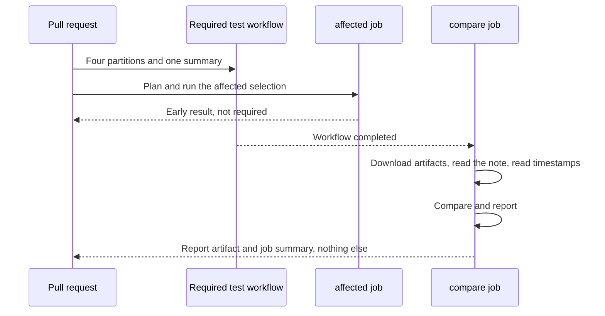
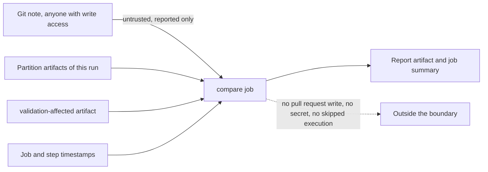
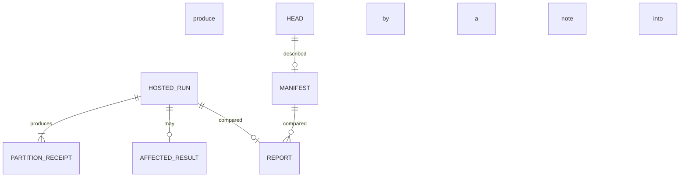
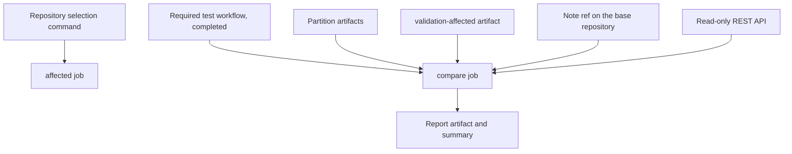

# Hosted validation shadow

Status: specification ready; implementation and measurements are pending.
Slice `hosted-validation-shadow` in the
[shift-left-validation Initiative](../../../initiatives/shift-left-validation/README.md).
Owner: distribution maintainers own the workflow and the comparison script;
continuous_validation owns the repository selection the workflow calls.
Engineering Profile:
[existing profile](../PROFILE.md); its defaults are unchanged. Risk: elevated.
Modules: Python and Security. Delivery: source-only feature branch and draft
pull request. This document does not change a required check, assert a hosted
saving or report a measurement.

## Outcome and boundary

The required test workflow is the authority and stays as it is. It gives no
early signal: the publication and instruction selections run inside each
full-suite worker, so a pull request waits for a partition to learn about a
failure in a few files. It also retains no timing and no lane identity beyond
the Python and Worktrunk versions.

This slice adds one separate, report-only workflow with two jobs:

- `affected` runs the repository's affected selection on a hosted Linux runner
  for the pull request, so the cloud path gives a result in minutes when local
  compute is unavailable.
- `compare` runs after the required test workflow completes. It joins what the
  hosted run executed with the local validation manifest and reports what a
  trusted producer could have reused, what it must run, and why.

Unchanged: the required `test` workflow, its job names, conclusions,
permissions, artifacts and verifier; branch protections; merge rules. No job
skips execution because of a manifest. The workflow reads a read-only token,
uses no secret and writes nothing to the pull request.

The within-job duplicate execution in the required workflow belongs to the
existing `validation-execution-performance` slice. This workflow measures that
duplication; it does not remove it.

## Behavior and contracts

### The affected job

- Given a pull request, or a manual dispatch
- When the workflow runs
- Then the `affected` job starts on the hosted Linux runner the required
  workflow uses, checks out the pull request merge revision with full history
  and prepares the same pinned Python and uv.

- Given the pull request's base revision
- When `python .github/continuous_validation.py plan --base REV --json` runs
- Then the selection is retained as an artifact before anything executes.

- Given that selection
- When `python .github/continuous_validation.py run --base REV --output FILE`
  runs
- Then the result, with the runner's operating system, architecture and tool
  versions, is retained as the `validation-affected` artifact for seven days.

- Given every selected check passed
- When the job concludes
- Then it succeeds.

- Given a selected check failed
- When the job concludes
- Then the job fails; it is not a required check, so the failure is early
  information and the required workflow still decides.

### The compare job

- Given completion of the required test workflow for a pull request, or a
  manual dispatch
- When the `compare` job runs
- Then it downloads that run's partition artifacts, the `validation-affected`
  artifact of the same head when present, and the run's job and step timestamps
  through the read-only REST API
- And reads the validation manifest from a Git note
- And runs `python .github/validation_shadow.py compare`.

- Given a run that was not opened by a pull request
- When the job starts
- Then it ends without a report.

- Given hosted test identities, the local manifest and both artifacts
- When the comparison runs
- Then it reports per check and per test group one of `would_reuse`,
  `would_reuse_if_lane_equivalent` or `must_run`, with a reason for each
  `must_run` group.

| Disposition | Condition |
|---|---|
| `would_reuse` | Head and base match the manifest, the test identity was selected locally, a passing local receipt covers it and the lane identity matches on retained values |
| `would_reuse_if_lane_equivalent` | As above except lane identity, which differs or is not retained |
| `must_run` | Any other case, with exactly one reason |

| Reason for `must_run` | Meaning |
|---|---|
| `not_selected_locally` | The local selection did not include this test identity |
| `no_receipt` | Selected locally, but no local execution exists |
| `receipt_failed` | The only local execution of the check did not pass |
| `source_changed` | The manifest head or the receipt's snapshot differs from the head under review |
| `base_advanced` | The pull request base moved after the local validation |
| `head_mismatch` | The note names another head |
| `lane_mismatch` | Both lanes are retained and differ |
| `lane_unverified` | A lane value is not retained |
| `manifest_unavailable`, `manifest_malformed` | No note for the head, or a note that fails bounded parsing |

- Given the job and step timestamps
- When timing is reported
- Then queue seconds, worker wall seconds, the repeated early-selection step,
  the summary tail and verification seconds are reported separately
- And each value the API does not supply is `null` and named under
  `unavailable`; nothing is estimated.

- Given the early selection that each worker runs and the partition that
  contains each of its test identities
- When repetition is counted
- Then the report states how many identical test identities executed more than
  once on the same source and runtime, and how many executions that added.

- Given a missing note, a malformed note, a missing artifact or an API error
- When the job concludes
- Then the report names what was unavailable and the job succeeds.

- Given any input
- When the job concludes
- Then it uploads a `validation-shadow` artifact (JSON and Markdown, fourteen
  days) and writes a job summary, and nothing else.

### The manifest is untrusted

- Given a note whose body exceeds 4 MiB, is not UTF-8 JSON, or fails the
  bounded schema check
- When it is read
- Then it is reported as `manifest_malformed` and none of its claims are used.

- Given a well-formed note
- When it is compared
- Then its claims are reported and never acted on. A note is an index of
  evidence, not proof, and anyone with write access can replace it.

### Transport

- Given a manifest written by `dbsctrctl evidence-export`
- When the operator publishes it
- Then they attach it with
  `git notes --ref dbsctr-validation add -f -F FILE HEAD` and
  `git push origin refs/notes/dbsctr-validation`.

- Given the pull request head revision
- When the `compare` job needs the manifest
- Then it fetches only that note ref and reads the note for that revision.

A Git note was selected because it changes neither the tree nor the commit
under review, needs no repository setting, API token scope or comment, and
works on any Git hosting service. Its availability on a given hosting service
is verified by the first real run; where it is unavailable the shadow reports
`manifest_unavailable` and keeps working.

## Interfaces

| Interface | Contract |
|---|---|
| Workflow file | `.github/workflows/validation-shadow.yml`; triggers `pull_request`, `workflow_run` on completion of `test`, and `workflow_dispatch`; `permissions: contents: read, actions: read`; no `secrets.` reference; third-party actions pinned by full commit SHA |
| `affected` job | `ubuntu-24.04`, 15-minute timeout, one concurrency group per pull request with cancellation; artifacts `validation-plan` and `validation-affected` |
| `compare` job | Runs `python .github/validation_shadow.py compare`; artifact `validation-shadow`; succeeds on every handled outcome |
| Comparison script | `.github/validation_shadow.py`, owned by distribution; reads the partition manifests and JUnit files, the affected result, the note and the API timestamps |
| Report | Version 1 JSON as specified below, with a Markdown rendering |
| Dispositions and reasons | The closed vocabularies above; an unknown case is `must_run` with `lane_unverified` or is named under `unavailable`, never a reuse claim |

The report is version 1:

```json
{
  "schema_version": 1,
  "kind": "validation-shadow-report",
  "head": "<commit>",
  "base": "<commit or null>",
  "tested_oid": "<merge commit>",
  "manifest": {"status": "present", "digest": "<sha256>"},
  "lane": {"local": {}, "hosted": {}, "retained": true},
  "checks": [{"id": "<check>", "selected_locally": true, "would_reuse": 0,
              "would_reuse_if_lane_equivalent": 0,
              "must_run": [{"reason": "not_selected_locally", "count": 0}]}],
  "repeated_early_selection": {"identities": 0, "extra_executions": 0},
  "timing": {"queue_seconds": null, "worker_seconds": {"min": null, "max": null},
             "early_step_seconds": {"min": null, "max": null},
             "summary_tail_seconds": null, "verification_seconds": null},
  "unavailable": ["<value>"]
}
```

It holds commit identifiers, check and test identities, counts and durations
only. No path outside the repository, credential, environment value or account
identity appears in it.

Writable source: `.github/workflows/validation-shadow.yml`,
`.github/validation_shadow.py`, `tests/test_validation_shadow.py`, and this
document with the distribution README and CHANGELOG.

## Visual Evidence

| Concern | Decision and review question |
|---|---|
| Boundary | required: the boundary list above; what does this workflow never touch? |
| Interaction | required: sequence diagram below; when do the required run, the affected job and the compare job run? |
| State | required: disposition tables above; when is a test identity reusable? |
| Data/trust | required: flowchart below; which inputs are untrusted? |
| Schema | required: entity diagram below; how do manifest, artifacts and report relate? |
| Dependency/deployment | required: deployment diagram below; what does the compare job depend on? |
| Quantitative | not_applicable: the report will carry measurements; this specification has none |



**Text Equivalent:** Opening or updating a pull request starts the required
test workflow and, in parallel, the affected job. The affected job runs the
affected selection and returns an early result that is not a required check.
When the required workflow completes, the compare job downloads that run's
artifacts, reads the manifest note and the timestamps, and writes a report. It
adds nothing to the pull request. Canonical source: the behavior above. Owner:
distribution maintainers. Update trigger: a change to triggers or job order.



**Text Equivalent:** The compare job reads four inputs. The Git note is
untrusted: anyone with write access can replace it, so its claims are reported
and never acted on. The partition artifacts and timestamps come from the run
itself. The job produces a report and nothing else: it writes no pull request
comment, reads no secret and causes no skipped execution. Canonical source: the
manifest and boundary sections. Owner: distribution maintainers. Update
trigger: a new input or output.



**Text Equivalent:** A hosted run produces four partition receipts and may
produce one affected result. A pull request head has at most one manifest note.
The compare report projects the hosted run and the manifest, or records that
the manifest is unavailable. Canonical source: the interface table. Owner:
distribution maintainers. Update trigger: a new artifact or input.



**Text Equivalent:** The affected job depends on the repository selection
command only. The compare job depends on the completed required run, its
partition artifacts, the affected artifact, the note ref and the read-only API.
A missing dependency becomes an entry under `unavailable` in the report; it
does not fail the job. Canonical source: the behavior above. Owner:
distribution maintainers. Update trigger: a new dependency.

## Gates and delivery

All Development Kernel gates and Review/Integrate and Maintain/Retire are
required. Release is not applicable: no independently published package or
image is created. Deploy and Operate are not applicable to the source-only
draft: no installed runtime, repository protection or permission setting
changes, and the workflow's own run on the delivery pull request is its
integration evidence. No Gate Exception is selected; required results start
pending.

Rollback deletes the workflow and script. It changes no required check and
deletes no retained artifact.

## Implementation and validation

Build first adds a failing regression for each contract, then implements.

| Case | Acceptance evidence |
|---|---|
| Workflow shape | Triggers, permissions, absence of secret references, pinned actions and the read-only token are asserted by a workflow contract test |
| Reuse dispositions | Synthetic partition receipts, affected result and note produce each disposition and each reason |
| Untrusted note | Oversized, non-JSON and schema-invalid notes are reported as `manifest_malformed`; no claim from the note is used |
| Missing inputs | No note, no affected artifact and an API error each add an `unavailable` entry; the job succeeds |
| Timing | Queue, workers, early step, summary tail and verification are separate; an absent timestamp is `null` |
| Repetition | Identities executed by every worker and again in a partition are counted with their extra executions |
| Not a pull request | No report is produced |
| Nothing written | The workflow has no write permission and no comment or check-run step |

Use the existing affected pytest modules, Python compilation and the
configured publication and instruction checks. The first real sample is the
delivery pull request of this slice: attach a manifest for its head with
`dbsctrctl evidence-export`, let both workflows run, and retain the report
before drawing any conclusion about hosted savings. Full-suite CI remains the
integration authority.
