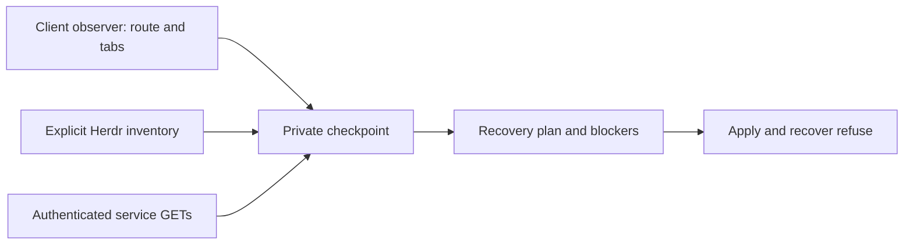

# Guarded OpenCode maintenance preparation

Status: implemented source contract; deployment held. Risk: critical.
Owner: distribution maintainer with shell/startup recovery ownership. Method: DBSCTR
V3.29. Modules: Python, Security, Cloud. Delivery: source-only draft pull request.

## Outcome and authority

Provide an explicit `opencode-maintenance` command that preserves exact client
selection evidence, creates durable recovery checkpoints and reports actionable
safety blockers. Native update and service commands retain their current behavior.
The native installer remains the sole executable owner. This source delivery does
not install, activate, restart or operate live OpenCode or Herdr.

The operator selected refusal whenever safety cannot be proved. Current native
capabilities do not establish atomic drain, draft preservation or passive detach/
attach. Consequently `apply` and `recover` must return blocked without invoking an
installer, service command or pane input. A successful preparation is not approval
or proof that activation is safe. There is no force flag or user-provided capability
boolean that can bypass this boundary. Actual activation and client replacement
require a later qualified native contract and separate scope approval.

This extends native-platform-updates.md and opencode-v2-session-recovery.md rather
than replacing native installer ownership or existing startup recovery authority.
The distribution Product Intent remains selected. Shell/startup owns the existing
capture helper and its compatibility contract.

## Domain and trust boundaries

- **Backend identity:** explicit Herdr socket plus observed backend/protocol identity;
  multiple frontends of one backend represent one inventory.
- **Pane observation:** backend/pane/terminal identity, foreground PID, shell cwd,
  owning session, initial launch session, current viewed session and observer
  incarnation. Ownership, launch and viewed IDs are different facts.
- **Observer:** a separate managed V2 CLI plugin that reads the current route, tabs
  and cached session metadata; it does not send input, navigate, synchronize server
  state, change permissions or read prompt/message bodies.
- **Checkpoint generation:** an immutable private snapshot and recovery assessment.
  The most recent observation and last verified selection are both retained; absence
  or a home route does not establish intentional closure.
- **Uncertain mapping:** last known evidence whose current occupant or view cannot
  be proven. It must be preserved but cannot authorize restoration.
- **Recovery plan:** per-pane verified/blocked/uncertain decisions, with reason codes
  and previous-generation references; never executable shell commands.
- **Capability gap:** unsupported/unknown preservation or admission behavior. Empty
  busy lists cannot convert a capability gap into support.

Public source contains synthetic examples only. Private state contains session and
pane identifiers, directories and layout metadata. Credentials stay in memory;
outputs omit credentials, prompt bodies, form questions, permission arguments and
raw exceptions. Filesystem metadata is untrusted input, not authentication of a
native actor. One primary owns integration; no independent implementation slices.

## Behavior

1. Given an OpenCode client viewing a child session, when the observer samples it,
   then it records the exact child separately from its owning root and shell cwd.
2. Given duplicate views of one session, when capture runs, then both pane entries
   remain represented rather than rejecting the inventory.
3. Given a transient home screen, missing metadata or unavailable backend, when
   capture/prepare runs, then last known evidence remains available and the affected
   mappings become uncertain; no empty observation erases recovery intent.
4. Given a replaced pane occupant or stale observer, when preparation reconciles
   evidence, then it reports the mismatch and never copies selection authority to
   the new occupant.
5. Given active sessions, queued work, forms, permissions, background work or unknown
   draft state, when maintenance is requested, then it reports blockers without
   touching those interactions or attempting installation/restart/reconnection.
6. Given no visible active work but missing native drain/passive-attach support,
   when apply/recover runs, then it still refuses. Repeated idle polling is not a
   substitute for admission control.
7. Given valid read-only service access, when preparation runs, then credentials are
   sent only to the validated loopback endpoint, session directories come from native
   records, and readiness is checked using bounded requests. Unknown IDs stay blocked.
8. Given partial API failure, unsafe state, concurrent preparation or interruption,
   when preparation fails, then existing generations remain intact and status reports
   incomplete/blocked state. Retrying never replays a mutation.
9. Given local plugin configuration, when managed configuration renders, then the
   observer directory is included once while unrelated plugin declarations survive.
   Source rendering does not load or reload any live plugin.
10. Given legacy startup recovery data, when the new capture format is introduced,
    then legacy reads remain supported, unknown mappings are retained, and uncertain
    entries cannot be changed to pending automatically or launched by startup restore.
11. Given native update/restart commands or ordinary OpenCode launch, when invoked
    through the managed wrapper, then existing native behavior remains unchanged.
    Only the explicit maintenance command selects this new workflow.

## Interfaces and persistent contracts

CLI: `opencode-maintenance prepare --herdr-socket PATH`,
`opencode-maintenance status [--generation ID]`,
`opencode-maintenance recover [--generation ID]`, and
`opencode-maintenance apply [--generation ID]`. All emit bounded JSON summaries.
Exit 0 means a complete preparation/status read, not permission to activate; exit
75 means safety-blocked or unavailable, and malformed arguments return 2.
`apply` and `recover` in this version always refuse with explicit capability reasons.
They must not create an execution journal claiming installer/client work occurred.

The command uses configured central state and XDG paths. Missing configured state
or its sentinel refuses without creating fallback state. Private maintenance state
lives beneath the existing Herdr state root. No full database copies, database
writes, location reloads, provider calls or transcript enumeration are permitted.

Preparation uses an explicit Herdr socket and the read-only protocol-22
`session.snapshot` and `pane.process_info` requests. Direct UNIX-socket connections
cannot start a server; missing or replaced sockets produce incomplete evidence. It
captures selected layout/focus/label fields and structured process identity, not
screen text or terminal titles. Bind every observation to its socket scope and
terminal/PID; incomplete identity stays uncertain. Use bounded inventories and
strict schema/size checks, rejecting duplicate object keys and malformed IDs.

Authenticated native reads use the existing private service registration and
explicit loopback HTTP endpoint. Validate file ownership, regular-file status,
private mode, URL, service PID/version and before/after registration identity.
Disable redirects and ambient proxy handling. Bound response bytes, deadlines and
request counts. GET-only allowlisted paths include info, active sessions, exact
session metadata, pending forms/permissions and location models. Do not print raw
responses. Missing global pending/background inventory remains a capability gap.

Checkpoint schema version 1 includes generation ID/time, parent generation,
backend scope, sanitized service identity, completeness, capabilities, blockers,
layout/focus, and per-pane observations/decisions. Each observation distinguishes
`owner_session_id`, `launch_session_id`, `viewed_session_id`,
`last_viewed_session_id`, `session_directory`, `pane_cwd`, client version, PID,
observer incarnation and evidence provenance. Null/unknown is meaningful and never
converted to idle or empty. Multiple entries may share a session ID. Checkpoint
field/count/size bounds are enforced on both write and read.

| Group | Recorded authority | Unknown handling |
|---|---|---|
| Generation and parent | Private immutable checkpoint identity and time | Reject invalid/missing references |
| Backend and service | Explicit socket and sanitized registration identity | Mark inventory incomplete |
| Pane and process | Pane/terminal/PID and observer incarnation | Retain prior evidence as uncertain |
| Sessions | Owning, launch, viewed and last-viewed IDs separately | Never substitute root for child |
| Directories | Native session directory separate from process cwd | Refuse inferred relocation |
| Capabilities and assessment | Supported, unsupported or unknown with blockers | Never authorize apply/recover |

**Text Equivalent:** Generation links preserve evidence history. Backend/process
fields bind observations to their scope. Session and directory fields preserve
separate meanings. Unknown values remain uncertain and capabilities cannot grant
execution in this delivery. Canonical owner: maintenance schema; update with any
serialized-field or validation change.

Use an exclusive maintenance lock for preparation. The existing capture helper
retains its restore lock for bounded legacy-manifest reads/transitions; the new
maintenance command never imports an unscoped legacy mapping as verified evidence. Write immutable generations atomically
with fsync and owner-only permissions, then atomically advance the latest pointer.
Never overwrite a generation or erase the previous pointer on failure. A committed
generation whose pointer update was interrupted remains inspectable by exact ID.
Status/apply/recover perform no capture or network access. No automatic generation
pruning in this delivery; document explicit later retirement and storage visibility.

Existing restore manifests gain a documented version-3 uncertain state with pane
rather than session uniqueness. Read v1/v2 without rewriting during check. Capture
must preserve previously observed-but-now-absent entries as uncertain; conflicting
occupant observations must not overwrite prior identity. Existing pending v1/v2
startup intent remains compatible. Version-3 uncertainty blocks restoration and
cannot be bulk-converted to pending. Add short `-s` argument recognition. The
maintenance command never invokes the legacy mutating restore path or its `--auto`
launch; changing its separately qualified launch policy is outside this delivery.

## Observer contract

Install source as a plugin directory with `tui.ts`, using the V2 Plugin.define
setup/cleanup lifecycle. Read documented `context.ui.router.current()`,
`context.ui.tabs.enabled()/list()`, cached session lookup/root and app version.
A bounded interval observes changes and a slower heartbeat signals freshness.
Cleanup stops its own timer; errors disable observation without disrupting the UI.
Do not edit the Herdr-generated integration or use private renderer internals.

Store one private bounded record per socket/pane/client incarnation, recording PID,
version, capture time, current route/session, last observed session, tabs and
canonical directory when available from cache. Only plain validated fields enter
storage. Do not store model prompts, attachment contents, titles, form content or
permission arguments. Draft/attachment safety stays unknown. No observer record
alone authorizes mutation; freshness and process correlation are evidence limits,
not an atomic handoff or proof against all PID-reuse races.

The supported plugin API documents route/tab inspection and cleanup but does not
establish draft export or passive detach. Live plugin registration can rebuild
other registrations; deployment is therefore held, not a harmless hot-load action.

## Implemented command and storage details

After a separately authorized installation, use the explicit command:

```sh
opencode-maintenance prepare --herdr-socket "$HERDR_SOCKET_PATH"
opencode-maintenance status
opencode-maintenance status --generation GENERATION_ID
```

The rendered command defaults to the configured central state root. An explicit
`DOTFILES_AI_STATE_ROOT` and configured `XDG_STATE_HOME` can select isolated state;
every selected root still requires its sentinel and safe ownership. There is no
fallback tree. Preparation does not run either executable, update an installer,
probe a database, or trigger a service start. Native update commands remain outside
this explicit command's control. `apply` and `recover` return 75 even for a complete,
idle checkpoint. Status reports the checkpoint's capture time, not a new live scan.

State is private metadata under the existing central Herdr root:

- `herdr/opencode-maintenance/GENERATION_ID.json`: immutable checkpoint and per-pane
  assessments, with parent generation and prior selection evidence when uncertain.
- `herdr/opencode-maintenance/latest.json`: atomic pointer to the latest committed
  checkpoint. A complete orphan remains accessible by generation ID.
- `herdr/opencode-observers/HASH-INCARNATION.json`: bounded record per socket, pane,
  PID and observer incarnation. Heartbeats replace only that incarnation's record.
  Plugin reloads retain old incarnations. Multiple fresh candidates are uncertain.
- `herdr/opencode-sessions.json`: existing capture owner's schema-3 manifest;
  it is separate from the maintenance checkpoint history.

Private files use mode 0600; newly created metadata directories use 0700. Reads
reject symlinks, unsafe ownership/modes, duplicate JSON keys, unknown schemas and
invalid references. Registration identity includes device/inode, size, modification
time, ownership and mode, plus unchanged bytes; reading-induced access-time changes
do not invalidate it. Credentials are sent only to a literal loopback HTTP endpoint
with redirects and ambient proxies absent from the transport.

Bounds are 512 panes, 2 MiB per JSON document, 4,096 service requests, two seconds per
socket operation, a 90-second service-read budget and a hard 120-second CLI deadline.
Checkpoint ancestry is limited to 256 generations and 32 MiB of aggregate validated
history. The prospective child counts toward those limits before publication, so
capacity refusal leaves the previous pointer readable. Observer discovery scans at
most 4,096 directory entries and accepts one fresh matching incarnation within 15
seconds; at most 32 fresh candidates are considered. Observation polls every 500 ms,
with five-second heartbeats and a 64 KiB record ceiling. These are evidence bounds,
not permission to activate or a claim of instantaneous UI capture.

Native session directories come from `SessionInfo.location.directory`, separate
from the pane cwd. Client/service version disagreement is an explicit blocker.
A nonempty model list reports current availability, not complete plugin settlement.
Missing global pending, background-work, draft, drain and passive-attach guarantees
remain hard capability gaps even when sampled lists are empty.

There is no automatic pruning. Operators can inspect the two metadata directories
with ordinary disk-usage tools. Keep old incarnations and incomplete generations
until a separately approved retention/archive procedure accounts for their recovery
value. Hitting a bound refuses new preparation; it never silently deletes history,
resets the chain, copies a database or grants activation authority.

## Ownership and implementation scope

- Add the explicit Python maintenance executable and focused fake-service tests.
- Add the separate V2 observer directory, pure observer/storage tests and a preserving
  CLI configuration merge. JavaScript/TypeScript behavior is tested with existing
  Bun tooling; no additional dependency or package installation is required.
- Extend the existing capture helper and recovery tests for uncertain-state retention,
  duplicate views, legacy compatibility and short session arguments.
- Update existing context README/CHANGELOG, native-update/recovery features and the
  distribution Product Intent only where stable truth changes.
- Preserve live installations, active watchers, unrelated dirty worktrees, service
  credentials, recovery databases and existing generated Herdr integration.

## Validation and gate ledger

Required: Domain, Behavior, Spec, Contract, Test-driven implementation, Refactor,
Review/Integrate and Maintain/Retire. Results and exact validated blobs are retained in the private Cycle Record.
Release is not applicable because no independent package is published. Deploy and
Operate are not applicable because only source and disposable fixtures change;
future activation retains its own required gates. No exception is accepted.

Run publication/instruction contracts before runtime suites. Extend pytest fixtures
for capture, native wrapper compatibility and maintenance preparation. Use temporary
HOME/XDG/state, a fake Herdr executable, synthetic service registration and a local
fixture transport. Deny unlisted commands and requests; assert zero installer,
restart, pane-input, prompt, permission/form response or live-database operations.

Required regressions: large pane inventory, duplicate frontend attachment, duplicate
session views, current child versus owning root, changed navigation since launch,
transient home/disconnect, stale/missing observers, changed occupant, missing native
ID, wrong directory, pending interactions, active/unmapped work, malformed JSON,
symlinks, foreign/writable state, redirect/proxy leakage, oversized/slow responses,
credential redaction, concurrent preparation, crash between generation and pointer,
and repeated apply/recover refusal without side effects. Test actual rendered CLI
plugin merge and native wrapper behavior. Do not count fake support as native
qualification. Independently review critical-risk boundaries before draft delivery.

## Maintain and retirement

Maintain one native executable owner and one existing capture owner. No new daemon,
background scheduler or automatic idle restart is introduced. Future native support
must reopen this contract, provide isolated preservation evidence and obtain explicit
activation approval. Do not automatically downgrade an unknown migrated database or
restore an old database over newer data. Preserve failed and incomplete generations;
retirement needs an explicit retention contract rather than opportunistic cleanup.

## Visual Evidence

Boundary and data/trust: required, flow below. Interaction and state: required,
transition table below. Schema: required, persistent-contract field grouping above
is the canonical schema mapping. Dependency/deployment: required, ownership and
source-only boundary above. Quantitative: not_applicable; no performance claim.
Owner: distribution maintainer with recovery owner. Refresh with interfaces, schema,
capabilities or deployment boundaries.



**Text Equivalent:** An observer and read-only Herdr/service inventory supply private
checkpoints. Reports preserve exact evidence and blockers. Apply and recover refuse;
no path in this delivery mutates a service or pane. This diagram describes source
behavior after later authorized deployment, not deployment performed by this cycle.

| Input/state | Result | Mutation allowed |
|---|---|---|
| Complete readable inventory | Durable checkpoint and plan | Private metadata only |
| Partial/unknown evidence | Blocked or uncertain plan | Preserve earlier checkpoints |
| Missing drain/draft/passive-attach capability | Apply/recover blocked | None |
| Busy turn/form/permission/background work | Apply/recover blocked | None |
| Interrupted checkpoint write | Retain old pointer; inspect complete orphan generation | No service/pane action |

**Text Equivalent:** Successful inventory creates metadata, not activation authority.
Incomplete evidence stays blocked. Busy or unsupported operations cannot mutate
services or panes. Atomic publication preserves the previous pointer on interruption.
