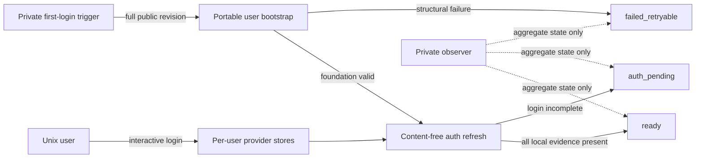

# Remote User Rollout Runtime

## Outcome

RWUE-005A supplies the public user-owned runtime required before private
infrastructure can converge two remote users. It bootstraps one immutable
reviewed `dotfiles-ai` revision, refreshes content-free authentication state, and
rejects an unusable local remote-workspace client before any cloud or SSH action.

The stable Engineering Profile is
[`../PROFILE.md`](../PROFILE.md). Product Intent remains
[`../PRODUCT.md`](../PRODUCT.md).

## PY-01 First-Clone Repair

### Problem And Scope

Audit finding `PY-01` identified a first-install failure in
`remote-user-bootstrap`: a new `git clone --no-checkout` reported tracked files as
deleted, and the dirty-source guard rejected it before the requested checkout.
The previous bootstrap unit fixture and CentOS smoke workflow both prepared an
already checked-out source, leaving first-clone success untested.

This is a single-context repair owned by `dotfiles_ai_distribution`. Reuse the
Engineering Profile and Product Intent linked above, especially the remote-user
journey. No Initiative, PM ticket, new state schema, installer migration, Python
floor increase, or new test dependency is required.

| Current-cycle field | PY-01 decision |
|---|---|
| Deliverable | Corrected portable bootstrap source, regression tests, and updated existing specifications |
| Risk | Elevated: source admission and recovery precede user-owned executable installation/apply |
| Delivery intent | Feature branch and draft pull request; source/CI qualification only |
| Applicable modules | Python and Security; no cloud resource or remote-access change |
| Supported targets | Existing Python `>=3.12`; CentOS Stream 10 x86_64 bootstrap; unchanged macOS/Fedora renders |
| Writable implementation scope | `dot_local/bin/executable_remote-user-bootstrap`, `tests/test_remote_user_environment.py`; extend existing smoke/workflow only when needed to prove the absent-source path |
| Adjacent ownership | Foundation apply/state, readiness, native installers, private first-login triggers and live rollout retain their existing owners |

### Decisions And Non-Goals

- Distinguish a source absent at admission from every pre-existing source. A new
  clone must become a clean checkout of the exact requested commit before config,
  installer or foundation apply can run. Do not treat its deliberate initial
  checkout state as evidence of user changes.
- Preserve the fixed approved origin, full lowercase commit identity, commit
  object verification, ownership and non-symlink checks. A fresh-clone exception
  must never exempt a later invocation or an arbitrary existing directory.
- Preserve rejection of tracked, staged and untracked changes in existing source.
  Never reset, force-checkout, clean, delete or overwrite it to make bootstrap pass.
- A pre-existing no-checkout directory left by the old failure follows that same
  refusal. Its appearance cannot distinguish an incomplete clone from intentional
  user deletions. Preserve it for explicit operator inspection/repair.
- Failed new preparation must permit a later same-revision attempt: leave either
  no final source or a clean reusable checkout. A normal checked-out clone or
  disposable preparation can satisfy this; Discovery does not mandate staging.
  If staging is selected, cleanup is limited to that attempt's proven-owned
  temporary artifacts, and a concurrently appearing final source must be retained.
- Preserve the CLI, config location/mode, pinned chezmoi identity, foundation
  invocation, content-free failure output and existing state schema/counters.
  No provider login/request, service start, cloud/SSH access or live apply belongs
  to this source-only repair.
- Automatic repair of legacy dirty sources, general bootstrap concurrency,
  updater changes and the other Python audit findings remain out of scope.

### Implementation Interface And Ownership

Keep `prepare_source(revision: str) -> None` and the public bootstrap CLI unchanged.
For a source absent at admission, reserve the destination with exclusive directory
creation and retain its device/inode identity. Use Git's normal checked-out clone
before the existing origin, cleanliness, object and exact detached-checkout checks.
If preparation fails, cleanup may remove only that invocation's newly reserved
directory after safe-path, ownership and identity rechecks. Never claim cleanup
ownership when reservation fails or the final path has been replaced. Existing
sources bypass this acquisition/cleanup branch entirely. Hard termination and
general concurrent bootstrap coordination remain outside this bounded guarantee.

### Acceptance Behaviors

1. **Given** an owned safe home, absent source and valid full requested commit,
   **when** bootstrap prepares the source, **then** it reaches that exact detached
   commit with a clean worktree before any downstream action, creates the existing
   private non-secret config, and invokes foundation as `apply REVISION`.
2. **Given** an existing safe clean source with the approved origin, **when** the
   same revision is requested again, **then** no new clone is needed and existing
   bootstrap behavior remains compatible.
3. **Given** an existing dirty source, including a legacy no-checkout directory,
   **when** bootstrap runs, **then** it refuses without checkout or downstream
   apply and preserves tracked/staged/untracked bytes and Git index/HEAD state.
4. **Given** wrong origin, noncommit/missing revision, unsafe ownership or a
   symlinked source/ancestor, **when** source preparation runs, **then** it fails
   closed before config, installer or foundation apply; diagnostics remain safe.
5. **Given** clone, required fetch or checkout fails during new preparation,
   **when** the caller retries the same requested revision, **then** the failure
   has not stranded a dirty final source and the retry can finish after the cause
   is removed. Failure exits nonzero and records only the existing safe failure
   state; repeated same-revision failure preserves existing counter semantics.
6. **Given** source preparation succeeds but later preparation/apply fails,
   **when** the same revision is retried, **then** the clean source is reused and
   foundation's existing retry, managed-target and rollback contracts still apply.

### Source Admission Transitions

This table is canonical for PY-01 interaction ordering and source state. It does
not add persistent foundation states.

| Source at admission | Guard or event | Result before config/install/apply |
|---|---|---|
| Absent | Approved clone and exact commit verification/checkout succeed | Clean detached requested commit; continue existing bootstrap |
| Absent | Clone/fetch/verification/checkout fails | Nonzero safe failure; no poisoned final source; same-revision retry remains possible |
| Existing clean | Ownership, origin and commit checks succeed | Preserve existing clean-source checks; select exact requested commit and continue |
| Existing dirty or legacy no-checkout | Dirty-source guard fails | Preserve source/index/HEAD; stop before downstream work |
| Any | Unsafe source/ancestor, wrong origin or invalid requested object | Fail closed; no downstream work |

**Text Equivalent:** Only a source absent at admission receives first-clone
handling. Its exact commit and clean checkout must be established before config,
installation or apply. New preparation failure must remain retryable. Every
pre-existing source retains its original safety and cleanliness guards, including
legacy no-checkout directories. Source admission never creates a new foundation
state or authorizes destructive recovery. Canonical sources are the decisions
and behaviors above and the existing bootstrap/foundation contracts. Owner:
distribution maintainer. Update trigger: source admission, failure ordering or
recovery behavior changes.

### Validation And Evidence Contract

- Add a red-first absent-source regression using a real local Git seed and real
  status/revision/checkout operations. Shim only public clone/fetch transport to
  that seed; retain the approved origin value. Do not mock the dirty-status result
  that exposes the defect, add a runtime source-URL override or change global Git
  configuration. Isolate fixture signing/hooks locally as necessary.
- Preinstall a fake correctly versioned chezmoi and stub foundation apply. Assert
  exact requested HEAD, detached/clean state, private config mode and exact apply
  arguments. Unexpected download, provider or downstream calls fail the fixture.
- Exercise the six acceptance behaviors, including actual legacy no-checkout
  state, dirty tracked/staged/untracked inputs, unavailable/noncommit revisions,
  clone/fetch/checkout failures and successful same-revision retry. Preserve source
  bytes, index and HEAD on existing-source refusal; retain old negative tests.
- Run `uv run --group test pytest tests/test_remote_user_environment.py -q`, then
  configured publication/instruction checks and the configured full pytest suite.
  Existing CI selects Python 3.14 on PRs and Python 3.12/3.13/3.14 on weekly/manual
  compatibility runs; obtain matching compatibility evidence before claiming those
  targets qualified. No checker is selected in root metadata; typing analysis is
  a recorded capability gap, not a fabricated pass or a tooling migration.
- The current CentOS smoke starts with a prepared checkout. Run the new offline
  absent-source regression in disposable CentOS as well; extend its existing
  workflow/smoke only as needed while retaining install/reapply/rollback coverage.
  Reuse supported-platform render and publication checks. Fixture success does
  not establish a real remote first-login rollout or online authentication.

### Deferred Adjacent Risk

Bootstrap failure recording can replace `desired_revision` after a
*different*-revision attempt, while foundation's retry-revision guard runs later.
That is an adjacent pre-existing gap in the broader retry promise. PY-01 tests
and acceptance cover unchanged-revision recovery; they do not establish
cross-revision pin enforcement. A separate scoped follow-up must decide and test
rejection before source mutation and failure-state replacement. This Discovery
neither fixes that behavior nor claims the whole rollout is qualified.

### DBSCTR Applicability Plan

The cycle uses this plan under the selected checkout's ignored `.dbsctr/plans/`
directory, bound to the committed Engineering Profile. This declaration records
applicability; actual gate results and delivery evidence remain in the Cycle Record.

```json
{
  "profile": "docs/specs/dotfiles_ai_distribution/PROFILE.md",
  "gates": {
    "domain": {"applicability": "required"},
    "behavior": {"applicability": "required"},
    "spec": {"applicability": "required"},
    "contract": {"applicability": "required"},
    "test_driven_implementation": {"applicability": "required"},
    "refactor": {"applicability": "required"},
    "review_integrate": {"applicability": "required"},
    "release": {"applicability": "not_applicable", "reason": "No published package or versioned release artifact; delivery is a source repair and draft pull request."},
    "deploy": {"applicability": "not_applicable", "reason": "No managed host, guest or remote installation/apply; disposable CI validation only."},
    "operate": {"applicability": "not_applicable", "reason": "No live service, enrollment, scheduler or production rollout is operated in this source-only slice."},
    "maintain_retire": {"applicability": "required"}
  }
}
```

## Scope And Boundaries

### Native-update CI compatibility follow-up

`OPENCODE-READINESS-CI` is a source-only compatibility repair on the existing
feature PR, not a live rollout. Foundation integrity accepts strict legacy bare
semantic versions and native `opencode v2.MINOR.PATCH` without a fixed OpenCode
release pin. Malformed managed JSON configuration, unsafe files and unusable
executables remain structural failures (`failed_retryable`).

Default authentication readiness is **local evidence, not online validity**:

- OpenCode uses only connection metadata from an already running, authenticated,
  matching-PID/version loopback service. Missing service or connections means
  `auth_pending`. No automatic service discovery/start, standalone server,
  model-default request, provider request, login or token refresh is allowed.
- Codex checks local configuration and owned authentication-file or API-key
  environment presence; Vertex checks local ADC-file presence; 1Password checks
  token-environment or local account-metadata presence. Credential file contents
  are not read. Existing state keys and content-free success/failure output remain.
- `ready` means all local evidence is present, not that credentials work online.
  Missing evidence is `auth_pending`, distinct from structural damage.
- Native service registration must be bounded, owned, private and non-symlinked;
  API requests target its explicit loopback endpoint. Authentication stays in the
  child environment, never command arguments or diagnostic output.

Writable implementation scope: `dot_local/bin/executable_remote-user-foundation`,
`dot_local/bin/executable_remote-agent-readiness.tmpl`,
`tests/test_remote_user_environment.py`, and `tests/remote_user_environment_smoke.sh`.
Synthetic tests cover missing/invalid evidence, V2 versions and no online probes;
disposable CentOS CI covers native installation and preservation across reapply.
No host deployment/restart, guest/remote access, schedules or updater changes.
Kernel, Review/Integrate and Maintain/Retire apply; Release, Deploy and Operate
are not applicable to this follow-up. Historical rollout obligations below remain.

- `remote-user-bootstrap bootstrap REVISION` runs as the invoking user, validates
  an owned non-symlinked home, clones or verifies the public source, verifies the
  full commit, installs pinned chezmoi user-locally, creates only non-secret local
  configuration, and invokes the existing foundation apply.
- `remote-user-foundation refresh-auth` first validates the recorded foundation,
  managed targets, expected binaries, and owned configuration. Structural or
  integrity failure records `failed_retryable`.
- After structural validation, refresh invokes the content-free agent readiness
  probe. Incomplete OpenAI, Vertex, Codex, or 1Password login records
  `auth_pending`; complete probes record `ready`.
- `remote-workspace doctor` requires executable `mise`, gcloud, SSH, Herdr, an
  existing configured repository, and a usable root `mise.toml` before success.
- `remote-workspace remote-dev -- iap` changes to the configured repository and
  forwards `remote-dev -- iap` to `mise run` regardless of caller directory.
- No operation starts interactive authentication, accepts a credential argument,
  prints provider output, or includes private identity in public source.

Private first-login trigger installation, aggregate observation, cloud preview,
shared-VM deployment, user participation, and personal overlay apply belong to
RWUE-005 in the private coordinator repository. Personal Yazi targets belong to
RWUE-003 in the separately owned personal source.

## Domain

- `PortableBootstrap`: user-owned source and chezmoi preparation for one full
  `FoundationRevision`.
- `FoundationIntegrity`: recorded revision, owned source/configuration,
  managed-target manifest, and expected executable/configuration checks.
- `AuthStateRefresh`: content-free transition from `foundation_ready` to
  `auth_pending`, `ready`, or `failed_retryable`.
- `PortableClientDoctor`: local fail-closed prerequisite check before remote
  mutation.
- `CallerDirectory`: arbitrary directory that must not control mise task
  discovery.

## Behavior

### User-Owned Immutable Bootstrap

- **Given** an owned mounted home and a full reviewed public revision
- **When** `remote-user-bootstrap bootstrap REVISION` runs
- **Then** source clone or verification, pinned chezmoi installation, render, and
  apply run without root ownership
- **And** retry uses exactly the recorded revision
- **And** failure records only a safe state and exits nonzero.

### Authentication Remains Interactive And User-Owned

- **Given** the foundation is valid and one provider is not authenticated
- **When** `remote-user-foundation refresh-auth` runs
- **Then** state becomes `auth_pending`
- **And** no login starts and no provider output is retained.

- **Given** the foundation is valid and every content-free probe succeeds
- **When** authentication state refresh runs
- **Then** state becomes `ready`.

### Runtime Damage Is Retryable, Not Authentication Pending

- **Given** a recorded foundation has a missing, wrong-version, unowned, or
  symlinked required target
- **When** authentication state refresh runs
- **Then** state becomes `failed_retryable`
- **And** no provider probe or interactive command starts.

### Client Preflight Fails Before Mutation

- **Given** `mise` is missing or the configured repository lacks root
  `mise.toml`
- **When** `remote-workspace doctor` runs
- **Then** it exits nonzero before gcloud mutation, SSH, or Herdr
- **And** its diagnostic names only the missing prerequisite class.

### Task Discovery Is Repository-Bound

- **Given** the configured repository contains root `mise.toml`
- **When** `remote-workspace remote-dev -- iap` runs outside that repository
- **Then** it executes `mise run remote-dev -- iap` from the configured repository
- **And** preserves `iap` as the first task argument.

## Trust And Compatibility

- Public defaults contain no employer, client, project, user, machine, tailnet,
  endpoint, repository path, account, or credential identity.
- Revision must be a full 40-character commit and must resolve in the configured
  public source before apply.
- Home, source, configuration, state, and lock ancestors must be owned and must
  not cross a symlink boundary.
- Credential stores, provider output, prompts, responses, sessions, and history
  are never copied, parsed into state, or printed.
- Existing macOS and Fedora aarch64 renders remain unchanged.
- Rollback preserves authentication, sessions, history, personal overlays, and
  unrelated files.

## Visual Evidence

| Concern | Decision | Review question | Canonical source |
|---|---|---|---|
| Boundary | `required: ownership flow` | Which side owns portable versus private rollout behavior? | Diagram below |
| Interaction | `required: source-admission transition table and rollout flow` | Which source checks precede downstream work, and what remains interactive? | PY-01 Source Admission Transitions and diagram below |
| State | `required: source-admission transition table and rollout flow` | Which sources retry, refuse, or wait for the user? | PY-01 Source Admission Transitions, Behavior and diagram |
| Data/trust | `required: ownership flow` | Where can credentials and private identity exist? | Trust And Compatibility |
| Schema | `not_applicable` | Existing versioned foundation state is extended without a new shared schema | Foundation state contract |
| Dependency/deployment | `required: ownership flow` | Why must this slice precede private rollout? | Diagram below |
| Quantitative | `not_applicable` | No decision relies on comparative measurements | Validation |



**Text Equivalent:** Private infrastructure supplies one immutable public
revision to a user-owned bootstrap. Structural failure is retryable. A valid
foundation runs content-free authentication checks: incomplete login waits in
`auth_pending`, while complete local checks reach `ready`, without proving online
credential validity. No provider request, token refresh or service start occurs
during the compatibility follow-up. Each Unix user performs
interactive login directly into private stores. The private observer receives
only aggregate state.

## Gate Ledger And Validation

RWUE-005A is elevated risk. Domain, Behavior, Specification, Contract,
Test-Driven Implementation, Refactor, Review/Integrate, Deploy, Operate, and
Maintain/Retire are required. Release is not applicable because no versioned
artifact is published. DVC is not applicable unless metadata changes
unexpectedly.

Validation must include:

- red-first bootstrap, state-transition, ownership, symlink, version, doctor,
  caller-directory, and rollback tests;
- full affected pytest and Python 3.12, 3.13, and 3.14 CI;
- rendered macOS, Fedora aarch64, and CentOS x86_64 compatibility;
- shell syntax, exact release checksums, and public identity scans;
- disposable CentOS x86_64 first bootstrap, retry, empty second apply,
  `auth_pending`, `ready`, failure, update, and rollback proof; and
- no shared VM, live provider login, or private endpoint access in this slice.

## Readiness

### Historical RWUE-005A

The scope, repository ownership, interfaces, state transitions, safety boundary,
and validation are ready. Implementation requires the reconciled cross-repository
Begin behavior in protected source plus a fresh Initiative receipt and exact
digest-bound approval.

### PY-01 Implementation And Delivery

The source correction uses exclusive new-directory admission, an ordinary Git
clone and identity-checked cleanup on preparation failure. Existing sources
retain their safety and cleanliness checks. Commit verification compares the
peeled commit identity with the requested full hash before checkout, rejecting
annotated-tag objects as well as blobs and unavailable objects.

Regression coverage uses real Git with local-only transport substitution. It
covers absent-source success/reuse; partial clone, fetch and checkout failure;
same-revision retry; downstream apply failure; tracked/staged/untracked and legacy
source refusal; wrong origin; replaced and symlinked cleanup targets; and invalid
object identities. The CentOS workflow now runs the offline bootstrap tests using
the existing uv/pytest toolchain before its original install/reapply smoke.

The bounded implementation belongs to this single context. The broader
RWUE-005A Initiative is not launched by this correction. Live bootstrap,
deployment, authentication and remote rollout remain separate. The adjacent
cross-revision retry-pin gap above remains unresolved and is not covered by a
claim of broader rollout readiness.

Engineering Profile and Product Intent are reused. The context CHANGELOG records
the source outcome and intended draft delivery; the private Cycle Record and
final response own actual validation and push outcomes. No Gate Exception is
implicitly granted by this specification.
