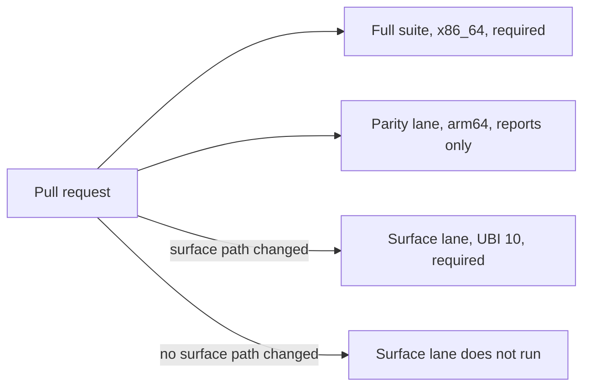

# RHEL-Family Surface Lane and aarch64 Parity Lane

## Authority and behavior

`linux-ci-cutover` INT-007, INT-008 and INT-016 to INT-018, slice
`rhel-surface-lanes`, after the delivered matrix cutover (PR #331,
`0824bbe1`). Risk is elevated: the change touches CI that gates every merge.
Delivery intent is merge. The shared remote workspace stays a read-only
reference (INT-011); nothing here changes it.

Three surfaces are RHEL-critical:

- quadlet generation, sourced under `private_dot_config/containers/systemd/`;
- systemd user-unit rendering, sourced under
  `private_dot_config/systemd/user/`;
- install-script behavior: the `run_*` chezmoi scripts and the installers they
  call.

**Selection.** A pytest marker `rhel_surface`, registered in `pyproject.toml`,
names the tests that render or execute one of the three surfaces. The full
suite keeps running them unchanged; the marker only selects the subset for the
surface lane, so there is one list to maintain.

**Surface lane** (`.github/workflows/rhel-surface.yml`):

- Given a pull request that changes a surface path, a marked test, the marker
  registration or the lane's own file, the lane runs on the exact head.
- Given a pull request that changes none of those, the lane does not run, so a
  change elsewhere cannot be blocked by it.
- It runs on `ubuntu-24.04` inside `registry.access.redhat.com/ubi10/ubi`,
  installs the locked toolchain the way the existing remote-user smoke job
  does, and runs the marked tests. It blocks the merge. UBI 10 is the only
  image (INT-016).
- A test that needs a package outside the UBI repositories is not marked. The
  container is userland evidence: it proves rendering and script behavior,
  not SELinux, rootless Podman, a running systemd, or network access.

**Parity lane** (`.github/workflows/arm64-parity.yml`):

- Given any pull request, it runs the full suite on `ubuntu-24.04-arm` with
  the same shard map and receipt verifier as the x86_64 workflow.
- It reports its result on the pull request and does not fail it (INT-017),
  until the owner adds its contexts to the required set in one edit.
- It uses GitHub's standard arm64 runner, which is free for public
  repositories. No paid or larger runner is used.

The full-suite workflow and its five required contexts stay exactly as the
cutover left them (INT-018).

## Validation and maintenance

- Register the marker and mark the qualifying tests; the list of marked tests
  is recorded in the Cycle Record.
- Show both trigger outcomes on real pull requests: the surface lane runs for
  a change under a surface path and is absent for a change elsewhere. Check
  GitHub's actual runs, not only the workflow text, because path filters are
  anchored and `*` does not cross `/`.
- Prove by inspection that no job in either file names a `macos-` runner and
  that the runners are `ubuntu-24.04` and `ubuntu-24.04-arm`.
- The workflow prediction used for operator-approved merges is derived from
  path filters; extend it for the two new files before the first merge that
  relies on it.
- When a surface path moves, move it in the lane's path filter in the same
  change.

## Visual Evidence

| Concern | Decision evidence |
|---|---|
| Boundary | required: lane responsibility table below |
| Interaction | not_applicable: the two lanes are independent jobs with no ordering |
| State | not_applicable: nothing persistent is introduced |
| Data/trust | not_applicable: no data crosses an ownership boundary; public source only |
| Schema | not_applicable: no persistent schema |
| Dependency/deployment | required: deployment view below |
| Quantitative | not_applicable: no measured comparison supports a decision |

| Question | Surface lane | Parity lane |
|---|---|---|
| What runs | marked RHEL-surface tests | the full suite |
| Where | UBI 10 container on x86_64 | arm64 Linux runner |
| When | a change touches a surface path | every pull request |
| Blocks the merge | yes | no, until the owner promotes it |
| Proves | rendering and script behavior on RHEL userland | the suite on the workstation's architecture |

**Text Equivalent:** Every pull request runs the full suite on x86_64, whose
five contexts are required, and the parity lane on arm64, which reports
without blocking. The surface lane in UBI 10 runs only when a surface path
changes and is required when it runs.

Canonical sources: this contract and the two workflow files. Owner: the
distribution maintainers. Change trigger: a surface path, a runner label, the
lane image, or the promotion of the parity lane.
