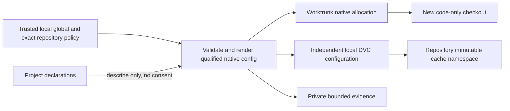

# Workflow storage policy

**SPECIFICATION READY; IMPLEMENTATION/ROLLOUT UNQUALIFIED.** Owner: distribution maintainers; Discovery
primary owns reconciliation. Profile: [../PROFILE.md](../PROFILE.md); Product
Intent: [../PRODUCT.md](../PRODUCT.md). Risk: critical (retained work and data).
This freezes contracts for workflow-convergence INT-005–INT-011 and configuration
boundaries supporting INT-012–INT-023. It grants no migration, removal or push.

## Authority and observed baseline

Read the Initiative [README](../../../initiatives/dbsctr-workflow-convergence/README.md),
[decisions](../../../initiatives/dbsctr-workflow-convergence/DECISIONS.md) and
[source reconciliation](../../../initiatives/dbsctr-workflow-convergence/SOURCE-RECONCILIATION.md).
Existing [native-workspaces](native-workspaces.md) remains current authority until
the primary reconciles the intentional sibling-to-central-root change. Existing
cycles, manifests and approvals are not amended by this specification. Readiness
here is specification readiness only, not Initiative launch or publication approval.

Source observations at the reconciliation baseline, not host qualification:

| Existing source | Reuse / boundary |
|---|---|
| `config.example.toml`, `.chezmoidata.toml` | Existing private `data.dotfiles_ai` configuration and public `dotfiles_ai` defaults convention; no workspace-root keys currently present |
| `.chezmoitemplates/opencode.json.tmpl` | `dotfiles_ai.state.root` selects the retained legacy-worktrees reference, not new allocation |
| `private_dot_config/worktrunk/config.toml` | Native sibling template, no automatic branch deletion, blocking managed user preservation hook |
| `dot_local/bin/executable_worktree-dvc-setup` | Explicit external cache, independent local config, reflink-only, no hydration; rejects conflicting config or populated old cache |

Do not repurpose `state.root`, `remote_workspace`, `sandbox.workspaces` or
knowledge-store project keys: they have different owners and migration semantics.
The following is the selected **new policy schema**, not an existing parser.

## Trusted policy schema 1

Private chezmoi TOML uses `[data.dotfiles_ai.workspaces]`; source defaults would
use `[dotfiles_ai.workspaces]`. These are one logical schema after chezmoi data
resolution, not two independent policy files. All examples are synthetic.

Render the resolved table as one private mode-0600 user-owned regular file at
`$XDG_CONFIG_HOME/dotfiles-ai/workflow-policy.json` (default configuration home
`~/.config`). Its JSON schema is version 1 and uses the same selected field names
and types as the TOML tables, plus generated `source_commit` (full Git OID of the
clean managed source generation) and `policy_digest` (canonical JSON SHA-256,
excluding its own field). These two fields are not user-supplied TOML settings.
Reject activation from dirty managed source or an unavailable release identity;
do not label arbitrary working bytes as that release. Lifecycle reads that generated policy; it does not
independently reimplement chezmoi precedence or consult another enable file.
The source template belongs at
`private_dot_config/dotfiles-ai/workflow-policy.json.tmpl`. Native Worktrunk config
becomes `private_dot_config/worktrunk/config.toml.tmpl`; the old static source is
replaced coherently, preserving unrelated user settings and required hooks.
Neither generated file nor resolved paths/values enter public Git.

```toml
[data.dotfiles_ai.workspaces]
schema_version = 1
root = "~/Worktrees"
cache_root = "~/.cache/dotfiles-ai/dvc"

[[data.dotfiles_ai.workspaces.repositories]]
repository = "~/Projects/example"
root = "/Volumes/ExampleStorage/worktrees"
cache_root = "/Volumes/ExampleStorage/dvc"
```

| Field | Type, default and invariant |
|---|---|
| `schema_version` | Integer exactly `1`; absent whole table selects defaults; present table without version or unknown version refuses new allocation/bootstrap |
| `root` | Nonempty path string; default `~/Worktrees`; parent for **new** task checkouts, outside every checkout |
| `cache_root` | Nonempty path string; default `~/.cache/dotfiles-ai/dvc`; parent for repository-scoped caches, outside every checkout and task root |
| `repositories` | Array of exact-repository overrides, default empty; no glob, prefix or remote-only matching |
| `repositories[].repository` | Required local canonical primary-checkout path resolving to one Git common directory; aliases/duplicates refuse rather than choose last entry |
| override `root`, `cache_root` | Optional; same validation as global fields; absence inherits the global value, empty does not clear it |
| `repositories[].preservation` | Optional exact-repository table defined by the lifecycle preservation specification; absent means automation off; forbidden globally |
| `repositories[].delivery` | Optional exact-repository table owned by [integration/CI](../../dbsctr_v3_lifecycle/features/workflow-integration-ci.md); absent means automatic delivery off; forbidden globally |
| `repositories[].feedback` | Optional exact-repository table owned by [regression feedback](../../dbsctr_v3_lifecycle/features/workflow-regression-feedback.md); absent means local-only feedback; external reporting forbidden globally |
| `naming` | Optional table with `task`, `discovery`, `integration` prefix strings; defaults `dbsctr`, `discovery`, `integration`; each matches `[a-z][a-z0-9-]{0,31}` |
| `repositories[].naming` | Optional field-by-field override of the same prefix table; not a merge-target permission |

Paths expand only a leading `~/` using the selected native user's home; otherwise
require absolute paths. Reject environment/shell interpolation, traversal and
ambiguous symlinks/ownership. Canonicalization must detect aliases and nested
checkout/cache relationships. No credential or remote access token is a field.
Unknown fields in this new table refuse to catch misspelled safety settings;
unrelated existing tables remain valid. Duplicate canonical repository entries
are invalid even if values match. There is no automatic policy migration from
legacy roots or global delivery JSON.

New task branches use `TASK_PREFIX/context/cycle-id`, Discovery uses
`DISCOVERY_PREFIX/initiative`, and optional temporary integration branches use
`INTEGRATION_PREFIX/outcome`. Validate the complete ref with native Git. Reuse the
same cycle branch for remediation; a failed gate is not a reason to spawn repair
branches/cycles. Existing branches stay unchanged. Naming never expands approved
delivery targets or grants permission to merge into a default branch.

Precedence is built-in defaults < trusted local global values < trusted local
exact-repository values. Repository-committed declarations can describe outputs,
checks and desired behavior, but cannot override these roots, enable removal,
grant administrator privilege or supply user consent. Runtime arguments and
environment cannot silently bypass policy. Existing delivery configuration retains
its authority; any later shared policy adapter must version and reconcile it,
not create a second administrator or consent switch here.

## Identity, native rendering and root availability

Selected global native Worktrunk path:
`ROOT/{{ repo }}-{{ repo_path | hash }}/{{ branch | sanitize }}`.
`ROOT` is the validated effective root rendered by chezmoi, not a new Worktrunk
variable. Worktrunk owns allocation, sanitization, listing and removal. Its native
three-character base-36 hash has only 46,656 values and is **not collision-proof**.
Occupied paths, sanitization/case-fold collisions, wrong-repository membership
and unregistered directories refuse visibly; never clobber, adopt, suffix or
introduce an allocator wrapper. This replaces the prior full-SHA Worktrunk
namespace proposal; no custom digest configuration preparation is needed.

Render overrides into native user `projects` entries using Worktrunk's existing
remote/path-derived exact project identifier, not an invented per-clone key or
basename. Local policy resolution still binds the exact canonical primary path
and Git common directory. If multiple clones map to the same native project
identifier but require conflicting root policies, refuse rendering atomically:
native forge-key entries cannot express arbitrary per-clone overrides. Detect
this across the trusted configured repository set before activation. Do not
silently choose one clone's policy or add a mutable allocator registry.

The DVC cache separately reuses the existing CLI canonical Git-common-directory
identity: SHA-256 of its canonical absolute UTF-8 path, full lowercase hexadecimal,
under `cache_root/repository_id`. Linked checkouts share it; separate clones do
not. It need not match Worktrunk's human-readable namespace. This is private local
identity, not a portable public ID or consent. Primary paths remain stable;
moving a primary/common directory requires separately approved inventory/migration.

Pinned Worktrunk `v0.80.0`, commit
`b49ca7eea9b03145791a5b94eccaf9c59412ed37`, is **source-verified, not runtime-qualified**:
[native project/path accessors](https://github.com/max-sixty/worktrunk/blob/b49ca7eea9b03145791a5b94eccaf9c59412ed37/src/config/user/accessors.rs),
[native expansion/hash](https://github.com/max-sixty/worktrunk/blob/b49ca7eea9b03145791a5b94eccaf9c59412ed37/src/config/expansion.rs).
Build fixtures must exercise exact project selection, short-hash collisions,
sanitization, occupied paths and case-folding on each claimed filesystem.
Website examples do not qualify another version or an installed rendering.

An absent table selects defaults; explicit setup may provision owned default home
roots. Configured external roots must already exist, be owned/usable and pass
separation checks **before any writes**. Missing/replaced mounts never fall back
to home, sibling paths or an underlying internal mountpoint.

Activation records private `{schema_version: 1, policy_digest, roots:
[{canonical_path, kind, filesystem_uuid, mountpoint}], worktrunk_version}` in the
existing private configuration/state owner, not a task registry. `kind` is
`owned_home` or `external`; UUID/mountpoint are nullable only for the owned home
default without an external-identity claim. macOS uses native `diskutil` plist
filesystem volume UUID plus mountpoint; Linux uses native `findmnt` JSON UUID
plus mountpoint. Configured external activation refuses unsupported/missing UUID
or unresolved root identity. At use, every available bound identity must match;
replacement disk, missing root or changed mountpoint refuses pending renewed
activation. No daemon or device-name-only assertion. Default owned-home behavior
claims no external-disk identity guarantee. Native identity parsing and replacement
fixtures are Build/deployment acceptance, not unresolved design.

Schema, policy digest, native version and feature activation are one coherent
configuration generation. Unknown/mismatched versions or partial render/apply
fail closed, retain last compatible generation and report the failure; a flag
must never activate half of the safety contract.

## DVC and compatibility

Each new checkout starts code-only. Reuse
`worktree-dvc-setup --cache PATH` and `--check`; the resolved cache is the exact
repository namespace. Local DVC config/state/locks remain checkout-specific;
only immutable cache objects are shared. No sharing `.dvc/tmp`, lock files or
whole `.dvc` directories. Registration checks effective configuration without
dataset hydration. Bootstrap sets reflink-only before cache selection and never
pulls, copies data or removes old objects. Unsupported reflinks, cross-filesystem
limits or unexpected effective overrides refuse materialization, not copy,
hardlink or symlink fallback. Cache and materialized targets must be on the same
qualified filesystem. Native targeted `dvc checkout` / `dvc pull` uses an explicit
target closure; no full pull and no overwrite of dirty/unique outputs.

Cache identity, object integrity, link capability and remote durability are
different claims. Exact remote-object preservation belongs to
[workflow-preservation-retirement](../../dbsctr_v3_lifecycle/features/workflow-preservation-retirement.md).
Cache presence does not authorize deleting an output or cache. Public reports
cannot contain effective machine paths, repository identities or credentials.

Changing root policy affects only later allocations. Active and existing retained
checkouts remain at their paths through completion; native inventory must include
both old and new roots. Populated private caches and conflicting local config are
retained and reported, not automatically redirected. Initial work is inventory
only. A later separately approved migration must stage unique objects, cover all
retained refs/worktrees/experiments and dirty metadata, verify object content and
metadata against the destination, record recoverable evidence, then seek disposal
authority. No blind cache move, shared GC, blanket ignored copy, bulk commit or
emergency environment deletion is part of this feature.

Rollback disables new policy activation and restores the last compatible native
configuration generation. It never moves active paths back, deletes newly created
work, rewrites historical cycle authority or loses access to old/new inventory.
Disabling automation does not undo an upload or a completed removal.

## Acceptance and failure contract

| ID | Given / when | Required result; failure behavior |
|---|---|---|
| S-01 | No local workspace table; setup/new task | Explicit home defaults rendered after qualification; native creation only, no hydration |
| S-02 | Global external roots and one exact override | Only that canonical repository receives override; others inherit global; aliases/duplicates refuse |
| S-03 | Same repository names, short native hash or sanitized branches collide | Native distinct paths where available; any actual occupied/case-folded collision refuses visibly, never claims collision-proof identity or overwrites |
| S-04 | Disk absent, replaced mount, permissions denied or root missing | Refuse before allocation/bootstrap; bounded local reason, no fallback/internal duplicate |
| S-05 | Unknown schema, invalid type, unknown key or interpolation | Refuse new policy use; retain prior paths/config/data; no partial activation |
| S-06 | Existing native checkout is active under older layout | Leave it in place; discover via native Git/Worktrunk; do not create duplicate for aesthetics |
| S-07 | New data checkout with qualified reflinks | Code-only until targeted request; edits do not modify cached objects or another checkout |
| S-08 | Unsupported links or effective config mismatch | Targeted hydration/registration refuses as applicable; no copy/hardlink fallback |
| S-09 | Populated old cache, dirty output or shared mutable state | Preserve and report migration/blocker; no config overwrite, deletion or GC |
| S-10 | New default task requested | Freshly verified remote default is source; native checkout and current registration constraints apply |
| S-11 | Discovery continues into Build in same checkout | Reuse only clean committed authority, matching registration/base and no independent writer; otherwise explicit handoff, no duplicate solely for phase name |
| S-12 | Template capability/version is unavailable | Mark unavailable and block activation, not specification readiness; no invented syntax or allocator |
| S-13 | Policy rollback or interrupted render | Last coherent config remains recoverable; old/new work and cache namespaces survive; report partial activation, never success |
| S-14 | Two canonical clones share native project identity but require conflicting root policies | Refuse whole render; do not pretend native project keys are per-clone selectors |
| S-15 | External root UUID unavailable or replacement/mountpoint mismatch | Refuse activation/use before writes; no device-name assertion or fallback |

## Source/test closure and readiness

Candidate source closure (existing files, not permission to edit):
`config.example.toml`, `.chezmoidata.toml`,
`private_dot_config/worktrunk/config.toml`,
`.chezmoitemplates/opencode.json.tmpl`,
`dot_local/bin/executable_worktree-dvc-setup`,
`dot_local/bin/executable_agent-worktree`, `dot_local/bin/executable_dbsctrctl`.
Candidate existing tests: `tests/test_portable_distribution.py`,
`tests/test_worktree_dvc_setup.py`, `tests/test_native_dvc_removal.py`,
`tests/test_agent_worktree.py`, `tests/test_native_workspace_execution.py`,
`tests/test_native_workspace_records.py`. Build must trace downstream render and
provisioning consumers and expand only the affected closure with primary approval.

The selectors, collision refusal, schema, identity mechanisms and failure behavior
above are frozen. No material design question remains in this owned artifact.
Build acceptance must qualify native project rendering/collision refusal at the
pinned version, schema precedence, coherent rollback, mount UUID parsing and
replacement, and reflink/independent-edit behavior on each claimed platform and
filesystem. Unsupported capability blocks its activation, not the whole Build
launch. Primary owns legacy-spec/Initiative reconciliation, committed profile and
source-only applicability plan, reference/visual review and existing publication
authority over the complete candidate set. These documents establish no check or
gate result. Source delivery targets the current host's future activation only;
no guest or remote operations are authorized.

| Gate | Proposed applicability | Result / owner |
|---|---|---|
| Domain, Behavior, Spec, Contract | required | not_run / primary verification; specification ready is not a gate pass |
| Test-driven implementation, Refactor | required | not_run / Build primary |
| Review/Integrate | required | not_run / primary; affected QA |
| Release | not_applicable for source-only delivery under the profile; revisit if packaged artifact changes | not_run / primary |
| Deploy, Operate | not_applicable to source-only delivery; required in separate live activation plan | not_run / rollout primary |
| Maintain/Retire | required; rollback, retention and compatibility | not_run / primary |

No exception, receipt, preflight or registration is established here.

## Visual Evidence

The managed-runtime qualification below extends the existing boundary and
interaction evidence. It does not change root selection or preservation policy.

| Concern | Decision / review question |
|---|---|
| Boundary | required: flow below; who selects roots and allocates? |
| Interaction | required: ordered table below; what precedes creation/hydration? |
| State | required: acceptance rows S-04–S-09, S-13; when must state remain retained? |
| Data/trust | required: flow below; can project declarations grant consent? |
| Schema | not_applicable: schema table is canonical; no relational entities need a second representation |
| Dependency/deployment | required: flow and ordered table; activation follows native/filesystem qualification |
| Quantitative | not_applicable: no savings, timing or physical-extent claim |



**Text Equivalent:** Trusted local global policy and exact-repository overrides
are validated and rendered only through qualified native configuration. Worktrunk
allocates new code-only checkouts. Independent local DVC configuration selects
the repository's immutable cache namespace. Project declarations describe scope
but grant no consent. Validation evidence stays private. Scope: new storage
configuration, not active-path migration. Canonical source: schema/identity/DVC
sections; owner: distribution maintainers; update on trust, path or cache changes.

| Order | Guard | Action |
|---|---|---|
| 1 | Trusted schema, exact repository and root identity validated | Resolve defaults/overrides; reject ambiguous paths |
| 2 | Native version/template/project rendering qualified | Activate coherent config; leave existing paths unchanged |
| 3 | Fresh default source and path reservation valid | Native Worktrunk creates code-only checkout |
| 4 | Independent effective DVC config verified | Register under current native lifecycle constraints |
| 5 | Explicit targets, safe output state and qualified reflinks | Targeted hydration only; otherwise retain/refuse |

**Text Equivalent:** Validate policy/repository/root first, qualify native
rendering second, create a code-only native checkout from fresh default third,
verify independent DVC config before registration fourth, and hydrate only
explicit safe targets fifth. Any failed guard retains current work and blocks
its dependent action. Scope/source: this feature's acceptance contract; owner:
distribution maintainers; update when guard ordering changes.

**State Text Equivalent:** S-04–S-09 retain unavailable, invalid, existing active,
unsupported or unique-data states without fallback/migration. S-13 retains work
and restores compatible configuration after interrupted activation. Only validated
new work proceeds. Canonical source: acceptance table; owner: distribution
maintainers; update on failure or rollback changes.

## Managed DVC runtime qualification

Owner: distribution maintainers. Scope: the managed DVC executable used by
bootstrap, registration and preservation checks. Risk: elevated for this runtime
repair; the surrounding retained-data policy remains critical. Product journey
19 and its code-only/reflink and retention outcomes remain unchanged.

The **managed runtime** is one isolated Python environment owned by the
distribution installer. Its **runtime generation** is the SHA-256 of the deployed
resolved requirements lock. A **backend qualification** imports the GCS backend
without contacting a remote. A successful import proves package availability,
not credentials, connectivity or remote object completeness.

`managed-dvc` is the explicit entry point at `~/.local/bin/managed-dvc`.
It selects only `~/.config/dotfiles-ai/runtime/dvc/venvs/LOCK_SHA256` using
`~/.config/dotfiles-ai/runtime/dvc/requirements.txt`. This managed location is
independent of project `PATH`, `VIRTUAL_ENV`, Python import overrides and
`XDG_CONFIG_HOME`; it matches chezmoi's managed home targets. It never substitutes
a project/global `dvc` or installs dependencies during a check. Source helpers
use the sibling source entry point; installed helpers use the installed entry
point. Both resolve the same managed runtime. Existing bare-DVC installations
and project dependency declarations retain their owners.

The source requirements input selects `dvc[gs]==3.67.1`, `dvc-gs==3.1.0`, and
`dvc-data==3.18.3`. The last pin preserves the existing qualified preservation
object format. The dedicated resolved hash lock owns transitive versions; direct
pins alone do not lock them. The installer uses existing Python 3.12–3.14 and uv,
requires hashes, and never upgrades or downloads a Python interpreter. Python
environment creation and dependency installation belong only to the installer.
This repair qualifies the automatic installer on macOS only. Non-macOS rendering
excludes it; an explicit unsupported invocation refuses before dependency writes.
Guest/remote DVC consumers retain work if their required managed runtime has not
been separately qualified and activated. There is no fallback to PATH DVC.

### Behavior and failures

| ID | Given / When | Then |
|---|---|---|
| DVC-01 | A project prepends another DVC to PATH | All managed DVC consumers still select the explicit managed runtime |
| DVC-02 | The runtime or lock is missing, unsafe or incomplete | Refuse with a bounded runtime category before cache configuration writes; no fallback |
| DVC-03 | The selected environment lacks the GCS backend or qualified versions | Refuse with a bounded backend/runtime category before configuration writes |
| DVC-04 | DVC exits unsuccessfully or times out | Report command unavailable/failure, separately from unsafe output state; never emit arbitrary stderr |
| DVC-05 | Outputs and their cache objects are absent and valid status classifies them as absent | Bootstrap remains code-only and does not create cache data or materialize outputs |
| DVC-06 | Outputs are modified, unclassifiable, or present without preserved cache | Retain them and refuse redirection/removal under existing guards |
| DVC-07 | Registration or removal runs with the lifecycle inspection environment | Use the same entry point, preserve analytics suppression and all existing remote-preservation guards |
| DVC-08 | An installer fails or a runtime generation is unqualified | Do not mark it complete or silently use a previous/other runtime; preserve prior generations for explicitly reviewed rollback |

`managed-dvc --check-runtime` returns only the qualified DVC, dvc-data and GCS
plugin versions plus backend name. Other arguments are forwarded without a shell
to the isolated interpreter. Runtime validation precedes forwarded operations.
Failures expose fixed categories, never dependency exception text, paths, command
arguments, remote addresses or credentials. Bootstrap checks runtime availability
before its existing cache validation/configuration sequence. Unknown status JSON
remains unsafe; a native command failure is not evidence that outputs are dirty.

### Delivery, compatibility and validation

The managed entry point is a deliberate prerequisite migration for all three
consumers. Deploy installer, lock and paired helpers coherently after preview;
existing callers cannot silently retain PATH selection. Source delivery grants
no live apply, guest/remote activation, cache migration, hydration, push, removal
or garbage collection. Retain previous runtime generations and helper/lock
preimages for a separately reviewed coherent rollback. Do not restore data or
weaken preservation checks as runtime recovery.

Build order: specification/contracts; failing regressions; managed runtime and
installer; caller integration; affected QA; exact activation preview. Required
gates are Domain through Refactor, Review/Integrate, Deploy, Operate and
Maintain/Retire. Release is not applicable because no independent package is
published. Deploy and Operate stay pending until exact host-plan approval and
real installed-version/backend/helper smokes; they are not source-test passes.
The private Cycle Record owns results and Gate Commit identities.

Authorities: affected pytest (including real disposable native DVC fixtures),
the existing publication/instruction checks, rendered chezmoi output and shell
syntax. Cover DVC-01–DVC-08, sanitized errors, unchanged cache/config bytes on
failure, the registration subprocess and removal/preservation subprocess. Real
GCS authentication/connectivity is separate from offline backend qualification.

| Order | Guard | Outcome |
|---|---|---|
| 1 | Explicit entry point, trusted lock and complete matching generation | Select only the managed isolated interpreter |
| 2 | Qualified versions and importable GCS backend | Permit DVC commands; no remote qualification is inferred |
| 3 | Successful native command and typed safe output classification | Continue the existing bootstrap or preservation contract |
| 4 | Existing cache, reflink, retention and remote guards pass | Perform only the already authorized bounded action |

**Text Equivalent:** The explicit managed entry point validates the lock and
matching complete runtime generation, then checks exact versions and GCS import
before running DVC. Native command failures remain distinct from unsafe outputs.
Existing cache and preservation guards still decide whether an authorized action
can proceed. Canonical source: this managed-runtime contract; owner: distribution
maintainers; update when entry-point ownership, dependency identity, qualification
ordering or error semantics change. This ordered table supplies interaction,
runtime dependency and trust-boundary evidence without implying remote access.
