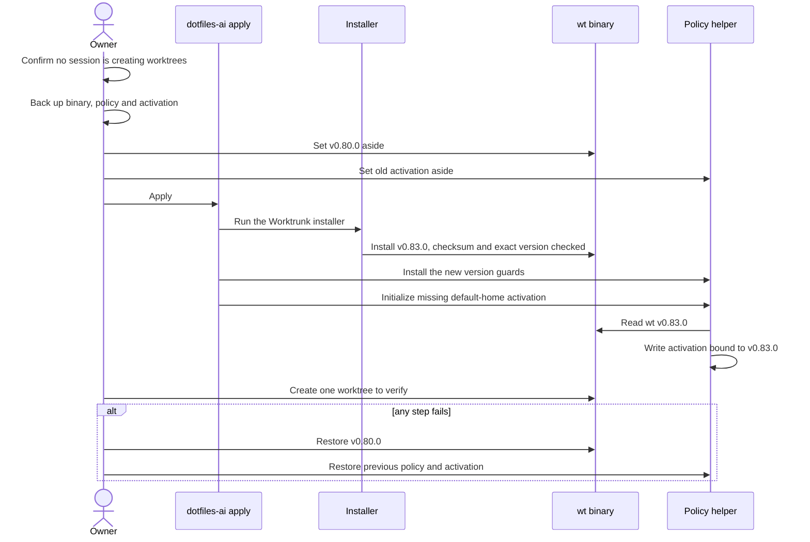

# Worktrunk Upgrade on the Linux Workstation

## Authority and behavior

Initiative `worktrunk-upgrade`, slice `workstation-upgrade`, statements INT-001
to INT-015 and INT-019 to INT-021
([ledger](../../../initiatives/worktrunk-upgrade/MANIFEST.json)). Risk is
elevated: it changes installer ownership, activation identity and the CI
matrix. Delivery intent is merge, followed by an owner-run deployment on the
workstation. The shared remote workspace is a read-only reference: its
Worktrunk pin and activation do not change here (INT-011, INT-018).

### What changes in source

- **Installer.** `run_onchange_after_install-00-workstation-tools.sh.tmpl`
  pins v0.83.0 for both architectures.
- **Version guards.** `executable_workflow-policy` and `executable_agent-worktree`
  accept exactly `wt v0.83.0`, `wt v0.81.0` and `wt v0.80.0` (INT-004).
- **CI axis.** The Worktrunk axis of `.github/workflows/test.yml` moves from
  0.81.0 to 0.83.0. There is still one axis.
- **Gating.** See below.
- **README.** The platform statement is corrected to what v0.83.0 does.

The remote-user foundation keeps its pin: `executable_remote-user-foundation`
still requires `wt v0.80.0`, and
`run_onchange_after_install-guest-development-tools.sh.tmpl` still installs it.

Upstream checksums for the v0.83.0 Linux musl assets, read from the release's
own `.sha256` files on 2026-11-24. Build reads them again before pinning.

| Asset | SHA-256 |
|---|---|
| `worktrunk-x86_64-unknown-linux-musl.tar.xz` | `e0dd5e5eb365890ddc7b255183c227e441fbb7da04cab5b72e54fa80fd21818b` |
| `worktrunk-aarch64-unknown-linux-musl.tar.xz` | `92c68827a18b037c608b7728bcf7ce1d594771ac814bec7412a35129f276d4ae` |

### Why the guards keep the older versions

The same guards run on every host that uses the worktree policy. The
remote-user foundation requires `wt v0.80.0`. The Mac runs `wt v0.81.0` with a
live activation and keeps applying this source without CI (INT-020). Dropping
either version would refuse worktrees there at the next apply.

### Upgrade procedure

The installer's ownership rule refuses to replace a `wt` whose version differs
from the pin, and it is right to: an unknown binary is not this source's to
overwrite. The upgrade is therefore an owner-run procedure on the workstation
(INT-005), in a window when no other session is registering a cycle or
creating a worktree (INT-007):

1. Verify the starting binary and its activation both identify v0.80.0.
   Review the configured root and repository overrides.
2. Preserve and verify the rollback set before switching: the exact binary,
   private activation and policy document (including modes). Identify the
   previous managed source revision; retain any locally owned settings.
3. Set the old binary and activation aside. Do not substitute a different
   provider on PATH. New allocations pause; existing checkouts remain.
4. Apply the reviewed source in a terminal. The installer verifies the
   v0.83.0 archive and executable. On an eligible default-home workstation
   the activation step now sees no old activation and binds the new version
   once. A hand-made policy document needs its owner's reviewed replacement.
5. Verify as listed below. If a step refuses, stop. Restore the three
   preimages and the previous managed configuration as applicable; verify
   the original version, activation and working allocation before resuming.

### Worktree policy on a Linux workstation

Today, with `linux_workstation.enabled` set and `remote_user_environment.enabled`
unset, three things disagree: the Worktrunk configuration renders with the
built-in root, the worktree policy document is ignored, and the activation
script exits. The result is a Worktrunk setup that can never allocate.

- Given a Linux workstation with `linux_workstation.enabled`, an explicit
  apply renders the worktree policy document (INT-008). `.chezmoiignore`
  un-ignores it for either flag; no configuration key is added.
- On a fresh workstation the explicit setup provisions only missing
  `HOME/.local/state/worktrees` and `HOME/.cache/dotfiles-ai/dvc` for the
  shipped default before applying. Preserve existing directories; refuse
  unsafe ownership or link traversal rather than writing through it.
  Do not provision a custom root. Route the first apply through setup
  (INT-021).
- Given the same workstation with the exact default-home root and no
  repository override outside it, apply runs default-home initialization,
  as the remote user environment does (INT-008).
- Given the default-home conditions, a missing activation is created once:
  Linux, the configured root resolves to `HOME/.local/state/worktrees`, that
  path is on the home filesystem, and no activation exists. These conditions
  are not changed (INT-009).
- Given a custom root or an outside override, render the policy and leave
  activation entirely to its owner. Applying must succeed without reading
  or changing that activation. A default-home path on an unexpected mount
  still refuses initialization. Malformed policy remains an error.
- Given an existing default-home activation, it is verified and never replaced or
  refreshed, whatever its version.
- The workstation example configurations declare the worktree root so that it
  resolves to `HOME/.local/state/worktrees` (INT-010).

### Not in scope

No macOS qualification. No second CI Worktrunk axis. No change to the
worktree layout, naming policy or repository overrides. No step for the
`worktrunk-markers` plugin: this source installs no Worktrunk agent plugin
(INT-014).

## Validation and maintenance

- Full suite green on the exact head in one attempt, with the CI Worktrunk
  axis at v0.83.0. This is the evidence that the policy tests still hold on
  the version the workstation will run (INT-012).
- On the workstation after the procedure: `wt --version` is `wt v0.83.0`; the
  activation binds `wt v0.83.0`; `wt switch --create` lands in the policy
  root with the `<repository>-<path-hash>/<branch>` layout; the pre-switch
  check passes; `wt remove` still runs the kernel's removal check.
- Gating, on a disposable home: with the shipped workstation configuration,
  apply renders the policy document and creates one activation, and a second
  apply changes neither. With another root, apply succeeds without changing
  an existing activation or creating one. With the default on another mount,
  the refusal preserves all existing state.
- Restore all three preimages on the same disposable home and verify the
  original tool and policy can allocate again.
- Record the quiet-window check, both verification lists and the rollback set
  locations in the Cycle Record. The Cycle Record is private; this contract
  names no machine path.
- When a new Worktrunk version is pinned later, repeat this procedure; the
  guards change in the same change as the pin.

## Visual Evidence

| Concern | Decision / review question |
|---|---|
| Boundary | not_applicable: the host table below states which host pins which version |
| Interaction | required: the upgrade sequence below; what may pause, and what restores? |
| State | required: activation table below; when is allocation refused? |
| Data/trust | not_applicable: no data crosses an ownership boundary; the installer already verifies checksums |
| Schema | not_applicable: the activation snapshot format is unchanged |
| Dependency/deployment | required: host table below; which host changes, and which does not? |
| Quantitative | not_applicable: no measured comparison supports a decision |

| Host | Worktrunk | Policy activation | Changed by this slice |
|---|---|---|---|
| Linux workstation | v0.83.0 | default-home, re-bound once by the owner | yes |
| Mac | v0.81.0, already installed | exists, kept | no; guards keep accepting it |
| Shared remote workspace | v0.80.0 | exists, kept | no; a separate Initiative slice |

| Situation | Owner and effect | New worktrees |
|---|---|---|
| Activation binds the installed version | Policy helper verifies and preserves the file | allowed |
| Installed version differs from the activation | Policy helper refuses and preserves the file | refused until reviewed |
| Quiet window, old binary and activation set aside | Owner applies; installer installs v0.83.0 | refused until re-activation |
| Default-home apply step | Policy helper writes the missing snapshot for v0.83.0 once | allowed |
| Any step failed | Owner restores binary, policy and activation, then verifies allocation | as before the upgrade |

**Text Equivalent:** The owner verifies the binary, policy and activation
backup in a quiet window, then sets aside the old binary and activation.
The installer checks v0.83.0 and the apply hook activates it once. Existing
worktrees stay reachable. The owner verifies allocation, or restores the
three preimages and verifies the original tool and policy.

Canonical sources: this contract, the installer template, both guards and the
activation script. Owner: the distribution maintainers. Change trigger: a
Worktrunk pin, a version guard, the activation rule or the gating flags.
