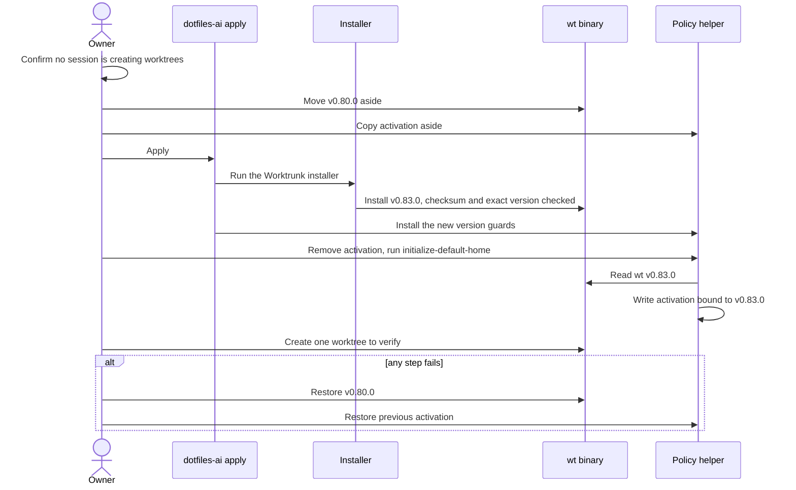

# Worktrunk Upgrade on the Linux Workstation

## Authority and behavior

Initiative `worktrunk-upgrade`, slice `workstation-upgrade`, statements INT-001
to INT-015, INT-019 and INT-020
([ledger](../../../initiatives/worktrunk-upgrade/MANIFEST.json)). Risk is
elevated: it changes installer ownership, activation identity and the CI
matrix. Delivery intent is merge, followed by an owner-run deployment on the
workstation. The shared remote workspace is a read-only reference: its
Worktrunk pin and activation do not change here (INT-011, INT-018).

### What changes in source

- **Installer.** `run_onchange_after_install-00-workstation-tools.sh.tmpl`
  pins v0.83.0 for both architectures.
- **Version guards.** `executable_workflow-policy` and `executable_agent-worktree`
  accept exactly `wt v0.83.0`, `wt v0.81.0` and `wt v0.80.0` (INT-004).
- **CI axis.** The Worktrunk axis of `.github/workflows/test.yml` moves from
  0.81.0 to 0.83.0. There is still one axis.
- **Gating.** See below.
- **README.** The platform statement is corrected to what v0.83.0 does.

The remote-user foundation keeps its pin: `executable_remote-user-foundation`
still requires `wt v0.80.0`, and
`run_onchange_after_install-guest-development-tools.sh.tmpl` still installs it.

Upstream checksums for the v0.83.0 Linux musl assets, read from the release's
own `.sha256` files on 2026-11-24. Build reads them again before pinning.

| Asset | SHA-256 |
|---|---|
| `worktrunk-x86_64-unknown-linux-musl.tar.xz` | `e0dd5e5eb365890ddc7b255183c227e441fbb7da04cab5b72e54fa80fd21818b` |
| `worktrunk-aarch64-unknown-linux-musl.tar.xz` | `92c68827a18b037c608b7728bcf7ce1d594771ac814bec7412a35129f276d4ae` |

### Why the guards keep the older versions

The same guards run on every host that uses the worktree policy. The
remote-user foundation requires `wt v0.80.0`. The Mac runs `wt v0.81.0` with a
live activation and keeps applying this source without CI (INT-020). Dropping
either version would refuse worktrees there at the next apply.

### Upgrade procedure

The installer's ownership rule refuses to replace a `wt` whose version differs
from the pin, and it is right to: an unknown binary is not this source's to
overwrite. The upgrade is therefore an owner-run procedure on the workstation
(INT-005), in a window when no other session is registering a cycle or
creating a worktree (INT-007):

1. Record the starting state: `wt --version` prints `wt v0.80.0`, and the
   private activation file exists and binds that version.
2. Move the installed `wt` aside without deleting it. This is the rollback
   binary.
3. Copy the activation file aside. This is the rollback activation.
4. Apply dotfiles-ai. The installer downloads, checks the checksum, asserts
   `wt v0.83.0` exactly, and the guards change in the same apply.
5. Remove the private activation file and run
   `workflow-policy initialize-default-home`. The new snapshot binds
   `wt v0.83.0` (INT-006).
6. Verify as listed under Validation.

Given any failed step, restore the rollback binary and the rollback
activation. The workstation is then exactly as before.

Between steps 4 and 5 new worktrees are refused, because the activation
records `wt v0.80.0` (INT-013). Existing worktrees stay reachable throughout;
only allocation pauses.

### Worktree policy on a Linux workstation

Today, with `linux_workstation.enabled` set and `remote_user_environment.enabled`
unset, three things disagree: the Worktrunk configuration renders with the
built-in root, the worktree policy document is ignored, and the activation
script exits. The result is a Worktrunk setup that can never allocate.

- Given a Linux workstation with `linux_workstation.enabled`, an explicit
  apply renders the worktree policy document (INT-008). `.chezmoiignore`
  un-ignores it for either flag; no configuration key is added.
- Given the same workstation, the apply runs
  `workflow-policy initialize-default-home`, exactly as a remote user
  environment does (INT-008).
- Given the default-home conditions, a missing activation is created once:
  Linux, the configured root resolves to `HOME/.local/state/worktrees`, that
  path is on the home filesystem, and no activation exists. These conditions
  are not changed (INT-009).
- Given any other root, or that path on another mount, the document renders
  and nothing is activated. Such a workstation activates separately as today.
- Given an existing activation, it is verified and never replaced or
  refreshed, whatever its version.
- The workstation example configurations declare the worktree root so that it
  resolves to `HOME/.local/state/worktrees` (INT-010).

### Not in scope

No macOS qualification. No second CI Worktrunk axis. No change to the
worktree layout, naming policy or repository overrides. No step for the
`worktrunk-markers` plugin: this source installs no Worktrunk agent plugin
(INT-014).

## Validation and maintenance

- Full suite green on the exact head in one attempt, with the CI Worktrunk
  axis at v0.83.0. This is the evidence that the policy tests still hold on
  the version the workstation will run (INT-012).
- On the workstation after the procedure: `wt --version` is `wt v0.83.0`; the
  activation binds `wt v0.83.0`; `wt switch --create` lands in the policy
  root with the `<repository>-<path-hash>/<branch>` layout; the pre-switch
  check passes; `wt remove` still runs the kernel's removal check.
- Gating, on a disposable home: with the shipped workstation configuration,
  apply renders the policy document and creates one activation, and a second
  apply changes neither. With another root the document renders and no
  activation appears.
- Rollback, on the same disposable home: restoring the two moved files returns
  to the starting state.
- Record the quiet-window check, both verification lists and the rollback set
  locations in the Cycle Record. The Cycle Record is private; this contract
  names no machine path.
- When a new Worktrunk version is pinned later, repeat this procedure; the
  guards change in the same change as the pin.

## Visual Evidence

| Concern | Decision / review question |
|---|---|
| Boundary | not_applicable: the host table below states which host pins which version |
| Interaction | required: the upgrade sequence below; what may pause, and what restores? |
| State | required: activation table below; when is allocation refused? |
| Data/trust | not_applicable: no data crosses an ownership boundary; the installer already verifies checksums |
| Schema | not_applicable: the activation snapshot format is unchanged |
| Dependency/deployment | required: host table below; which host changes, and which does not? |
| Quantitative | not_applicable: no measured comparison supports a decision |

| Host | Worktrunk | Policy activation | Changed by this slice |
|---|---|---|---|
| Linux workstation | v0.83.0 | default-home, re-bound once by the owner | yes |
| Mac | v0.81.0, already installed | exists, kept | no; guards keep accepting it |
| Shared remote workspace | v0.80.0 | exists, kept | no; a separate Initiative slice |

| Situation | Owner and effect | New worktrees |
|---|---|---|
| Activation binds the installed version | Policy helper verifies and preserves the file | allowed |
| Installed version differs from the activation | Policy helper refuses and preserves the file | refused until reviewed |
| Quiet window, old binary moved aside | Owner applies; installer installs v0.83.0 | refused until re-activation |
| Old activation removed, `initialize-default-home` run | Policy helper writes a snapshot for v0.83.0 | allowed |
| Any step failed | Owner restores the rollback binary and activation | as before the upgrade |

**Text Equivalent:** The owner confirms a quiet window, moves the v0.80.0
binary and the activation file aside, and applies dotfiles-ai. The installer
installs v0.83.0 after its checksum and exact version pass, and the new
version guards are installed in the same apply. Until the owner removes the
old activation and runs `initialize-default-home`, new worktrees are refused
and existing ones stay reachable. The helper then writes an activation bound
to v0.83.0 and the owner creates one worktree to verify. If any step fails,
restoring the two moved files returns the workstation to its starting state.

Canonical sources: this contract, the installer template, both guards and the
activation script. Owner: the distribution maintainers. Change trigger: a
Worktrunk pin, a version guard, the activation rule or the gating flags.
