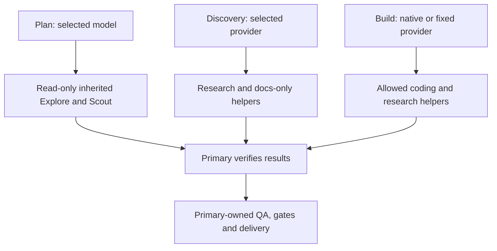

# Native helper delegation

Owner: dotfiles owner. Profile: `../PROFILE.md`. Risk: elevated.
Supersedes ordinary-session blanket delegation denial, not cycle ownership or
the native-workspace, consent, privacy and publication boundaries.

## Domain and scope

A primary owns the conversation, integration, validation and lifecycle gates.
A helper is a native OpenCode child session with its own tool permissions.
Delegating bounded work does not delegate an independent DBSCTR slice or grant
registration, commit, push, deployment or lifecycle-state authority.
Restore autonomous and user-requested helpers without a custom dispatcher,
plugin, session launcher, provider fallback or new concurrency scheduler.
Existing independent-review requirements and the retained reviewer profile remain.

## Behavior and contracts

- Given Build-Claude with its configured primary model, when it delegates,
  only Vertex Claude helpers are eligible. Primary defaults to Opus 5.5 high;
  coding, exploration, scouting and docs helpers use Sonnet 5.5 medium.
- Given Build-GPT, primary defaults to GPT-6.1 Sol Fast medium. Coding, scouting
  and docs helpers use GPT-6.1 Sol medium; exploration uses GPT-5.6 Terra low.
  The retained OpenAI reviewer remains Astra medium. An explicit same-provider
  primary model change does not change helper assignments.
- Given native Build or Build-R&D, General, Explore, Scout and Discovery Writer
  inherit the session-selected model. No fixed-model helpers are automatically
  selected. General remains a native coding helper with child recursion and
  lifecycle/Git mutation commands denied.
- Given native Plan, default to GPT-6.1 Sol Fast medium; only model-inheriting
  Explore and Scout may run. Child tools remain read-only even if parent grants
  a request. General, builders and docs writers are not eligible.
- Given Discovery-Coordinator, Explore, Scout and Discovery Writer inherit the
  selected model/provider. Writer edits only `docs/**`, has no shell, cannot
  access external directories or spawn children. Plan never invokes that writer.
- Given Discovery in Build-Claude or Build-GPT, retain the primary's provider
  restrictions and use the corresponding docs writer, not a coding builder.
  Discovery does not acquire authority to implement source changes.
- Given an unavailable assigned provider/model/helper, report the blocker;
  never automatically cross providers or silently substitute a flagship.
- Given independent or overlapping work, give helpers explicit writable and
  forbidden paths; serialize overlap. Primary reconciles and runs affected QA.
  Existing execution-DAG/benchmark gates still govern lifecycle concurrency.
- Given independent DBSCTR slices, do not launch them through helper delegation.
  Slice scheduling, worktree ownership and registration orchestration are deferred.

## Native configuration and trust limits

Retain compatible legacy `agent`/`permission`/`task` configuration where already
used. V2 normalizes these to `agents`/`permissions`/`subagent`; this is not a
framework migration. Use canonical `google-vertex` IDs in updated agent models.
Task maps deny `*` first, then allow exact role-appropriate helper IDs. Managed
maps replace obsolete grants, including machine-local grants, on projection.
Native General and Explore carry no managed model override. Generic Scout and
Discovery Writer also omit models. Provider-specific children pin exact models.

Agent default models do not override a manually selected session model. Operator
confirmed fixed Build-Claude/Build-GPT primary models are configured, not manually
switched across providers. Helper allowlists enforce eligible IDs; they are not
a per-agent provider sandbox. Native provider policies are global, so hard client
isolation through a separate environment remains outside this change. Never
claim instructions, defaults or a tab label authenticate a provider boundary.
Private client/session evidence remains local under existing privacy rules.

## Validation, deployment and maintenance

Authorities: focused pytest rendering/preservation/permission/instruction tests,
native resolved agent inspection, and isolated synthetic native child/permission checks.
Check positive helper visibility and negative provider/role/recursion cases, plus
exact model assignments and inheritance after a parent model change. Synthetic
fixtures use no client prompts, credentials, production session history or paid
inference. Missing executable/tool capabilities are unavailable, never passing.
Fresh native session smoke is required after deployment; an already-running
conversation may retain its old tool catalog. Do not forge a child launch through
an API/shell substitute when the current agent's native capability is denied.
The isolated 2.0.30 fixture creates fresh native parent/child sessions against a
loopback-only provider. It proves inherited-model General/Explore launches,
Plan writing-helper denial, wrong-provider helper denial, and docs-only child
writes. Live metadata inspection after reload confirms the deployed allowlists;
no real-provider child inference is claimed.

Project only affected configuration, agents, commands and shared skills after
passing checks and explicit deployment approval. Preserve unrelated local values,
native model selections and live sessions. Keep a private pre-apply backup;
rollback restores only changed managed files. Do not restart a shared service
with active sessions without approval. Owner rechecks routing and negative
permissions after OpenCode/model upgrades; no reviewer removal or slice launch
is implied by helper restoration.

## Visual Evidence

Boundary, interaction and data/trust: required ownership flow below. State,
schema, deployment and quantitative: not applicable; no new persistent protocol,
runtime topology or measured performance claim.

**Text Equivalent:** Plan delegates only read-only work. Discovery may delegate
research and docs-only changes. Build delegates to its eligible inherited or
provider-pinned helpers. Every result returns to its primary for verification,
integration, QA and delivery. Helpers never own independent slices.
Source: contracts above. Owner: dotfiles owner. Update when routing or ownership changes.
