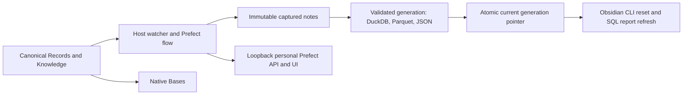
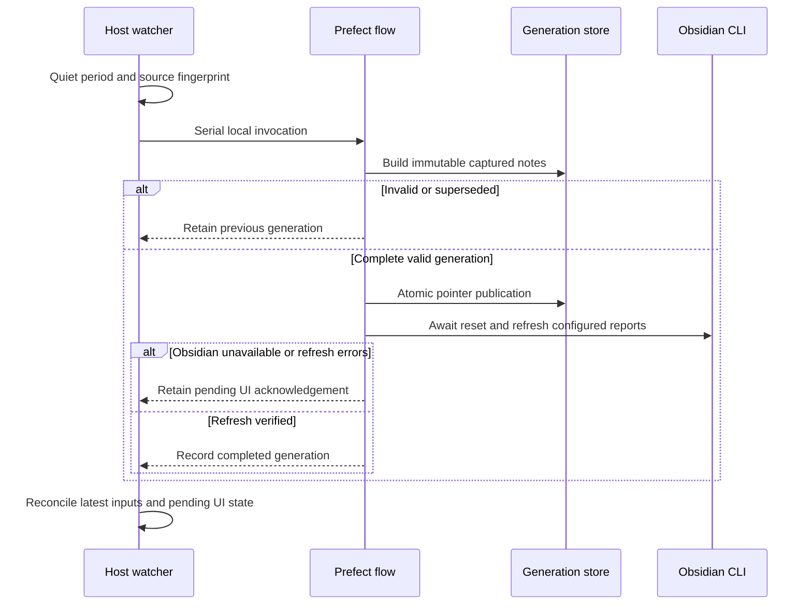

# Obsidian projection automation

## Domain

This optional adapter extends local personal work management without changing pmctl ticket authority. Obsidian Markdown/YAML in Records and Knowledge remains canonical; the lab exporter is the trusted schema and transformation implementation. The adapter owns source fingerprints, immutable captured inputs, projection generations, refresh acknowledgements, and host supervision. Bases consumes canonical metadata. DuckDB, Parquet, JSON, and frozen SQL report results are derived.

The operator owns this personal macOS service. A dedicated loopback Prefect server records orchestration metadata; existing Work infrastructure, Linear, other vaults, AI APIs, and remote services are outside its write boundary. The source tree contains no real vault records or machine configuration. Runtime configuration, captured bytes, state, and diagnostics are private local files. User agents operate only while the user is logged in and the host is awake.

## Visual Evidence

| Concern | Decision |
| --- | --- |
| Boundary | required: topology below |
| Interaction | required: sequence below |
| State | required: transition table in Contract |
| Data/trust | required: topology below |
| Schema | not_applicable: existing exporter owns all table schemas; this adapter adds a local checkpoint only |
| Dependency/deployment | required: topology below |
| Quantitative | not_applicable: no analytical comparison is required |

**Text Equivalent:** Only Records and Knowledge trigger the host watcher. A Prefect flow validates an immutable capture and publishes a complete derived generation through one pointer, then resets the plugin and refreshes configured SQL reports using Obsidian CLI. Native Bases reads notes directly. The loopback personal Prefect server receives operational metadata; no source content leaves this Mac. Canonical source: this adapter contract and exporter; owner: operator; update when ordering, boundaries, or topology changes.

## Behavior

1. Given valid canonical notes, when edits settle for two seconds, one serial Prefect flow rebuilds a complete projection and refreshes both configured SQL reports after resetting plugin connections.
2. Given malformed notes, missing canonical roots, or an export failure, the current generation remains available and the service retries after correction. No invalid source is published.
3. Given repeated or atomic-save edits, only the final stable source state needs publication. An edit during a build supersedes that build and is reconciled next. Returning from A through B to A creates a new occurrence.
4. Given Obsidian is closed or unavailable, the generation can publish while its UI acknowledgement stays pending. Reopening Obsidian completes reset and refresh without another source edit or another rebuild.
5. Given a process restart or API outage, the private checkpoint and current generation recover unfinished work. Generated reports, Data, templates, .obsidian, and journal writes never trigger another build.
6. Given concurrent adapter invocations, only one publisher/refresh process operates. Manual builds use the same safe adapter once enabled; the old in-place exporter is not a supported concurrent writer.
7. Given a query refresh resolves with nonzero errors or unexpected block count, the refresh remains pending. Source notes remain byte-identical throughout publication and refresh.
8. Given a newly introduced symlink in canonical roots, an unexpected vault path, or a non-loopback Prefect endpoint, the adapter rejects the boundary without executing note text or publishing data.

**Text Equivalent:** The watcher waits for quiet inputs, then invokes one flow. The flow builds captured notes. Invalid or superseded builds leave current outputs untouched. Valid complete builds publish atomically before awaiting plugin reset and refresh. Unavailable Obsidian or refresh errors retain pending UI state; success records completion. The watcher then checks newer inputs and pending work. Canonical source: Behavior and Contract; owner: operator; update when ordering or recovery changes.
