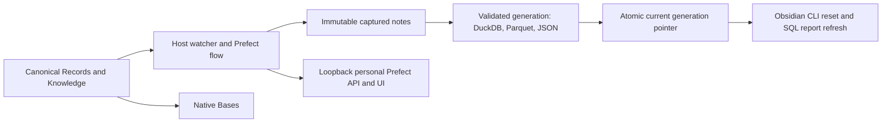

# Obsidian projection automation

## Domain

This optional adapter extends local personal work management without changing pmctl ticket authority. Obsidian Markdown/YAML in Records and Knowledge remains canonical; the lab exporter is the trusted schema and transformation implementation. The adapter owns source fingerprints, immutable captured inputs, projection generations, refresh acknowledgements, and host supervision. Bases consumes canonical metadata. DuckDB, Parquet, JSON, and frozen SQL report results are derived.

The operator owns this personal macOS service. A dedicated loopback Prefect server records orchestration metadata; existing Work infrastructure, Linear, other vaults, AI APIs, and remote services are outside its write boundary. The source tree contains no real vault records or machine configuration. Runtime configuration, captured bytes, state, and diagnostics are private local files. User agents operate only while the user is logged in and the host is awake.

## Visual Evidence

| Concern | Decision |
| --- | --- |
| Boundary | required: topology below |
| Interaction | required: sequence below |
| State | required: transition table in Contract |
| Data/trust | required: topology below |
| Schema | not_applicable: existing exporter owns all table schemas; this adapter adds a local checkpoint only |
| Dependency/deployment | required: topology below |
| Quantitative | not_applicable: no analytical comparison is required |

**Text Equivalent:** Only Records and Knowledge trigger the host watcher. A Prefect flow validates an immutable capture and publishes a complete derived generation through one pointer, then resets the plugin and refreshes configured SQL reports using Obsidian CLI. Native Bases reads notes directly. The loopback personal Prefect server receives operational metadata; no source content leaves this Mac. Canonical source: this adapter contract and exporter; owner: operator; update when ordering, boundaries, or topology changes.
