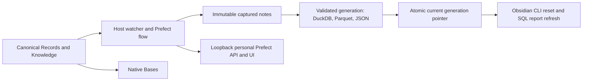
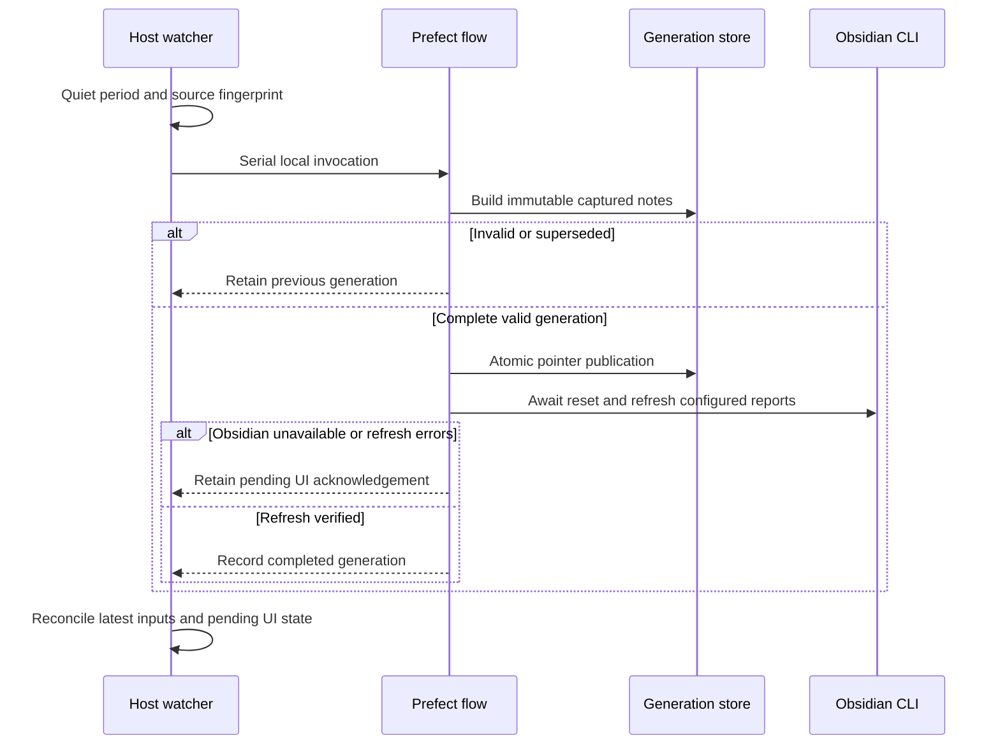

# Obsidian projection automation

## Domain

This optional adapter extends local personal work management without changing pmctl ticket authority. Obsidian Markdown/YAML in Records and Knowledge remains canonical; the lab exporter is the trusted schema and transformation implementation. The adapter owns source fingerprints, immutable captured inputs, projection generations, refresh acknowledgements, and host supervision. Bases consumes canonical metadata. DuckDB, Parquet, JSON, and frozen SQL report results are derived.

The operator owns this personal macOS service. A dedicated loopback Prefect server records orchestration metadata; existing Work infrastructure, Linear, other vaults, AI APIs, and remote services are outside its write boundary. The source tree contains no real vault records or machine configuration. Runtime configuration, captured bytes, state, and diagnostics are private local files. User agents operate only while the user is logged in and the host is awake.

## Visual Evidence

| Concern | Decision |
| --- | --- |
| Boundary | required: topology below |
| Interaction | required: sequence below |
| State | required: transition table in Contract |
| Data/trust | required: topology below |
| Schema | not_applicable: existing exporter owns all table schemas; this adapter adds a local checkpoint only |
| Dependency/deployment | required: topology below |
| Quantitative | not_applicable: no analytical comparison is required |

**Text Equivalent:** Only Records and Knowledge trigger the host watcher. A Prefect flow validates an immutable capture and publishes a complete derived generation through one pointer, then resets the plugin and refreshes configured SQL reports using Obsidian CLI. Native Bases reads notes directly. The loopback personal Prefect server receives operational metadata; no source content leaves this Mac. Canonical source: this adapter contract and exporter; owner: operator; update when ordering, boundaries, or topology changes.

## Behavior

1. Given valid canonical notes, when edits settle for two seconds, one serial Prefect flow rebuilds a complete projection and refreshes both configured SQL reports after resetting plugin connections.
2. Given malformed notes, missing canonical roots, or an export failure, the current generation remains available and the service retries after correction. No invalid source is published.
3. Given repeated or atomic-save edits, only the final stable source state needs publication. An edit during a build supersedes that build and is reconciled next. Returning from A through B to A creates a new occurrence.
4. Given Obsidian is closed or unavailable, the generation can publish while its UI acknowledgement stays pending. Reopening Obsidian completes reset and refresh without another source edit or another rebuild.
5. Given a process restart or API outage, the private checkpoint and current generation recover unfinished work. Generated reports, Data, templates, .obsidian, and journal writes never trigger another build.
6. Given concurrent adapter invocations, only one publisher/refresh process operates. Manual builds use the same safe adapter once enabled; the old in-place exporter is not a supported concurrent writer.
7. Given a query refresh resolves with nonzero errors or unexpected block count, the refresh remains pending. Source notes remain byte-identical throughout publication and refresh.
8. Given a newly introduced symlink in canonical roots, an unexpected vault path, or a non-loopback Prefect endpoint, the adapter rejects the boundary without executing note text or publishing data.

**Text Equivalent:** The watcher waits for quiet inputs, then invokes one flow. The flow builds captured notes. Invalid or superseded builds leave current outputs untouched. Valid complete builds publish atomically before awaiting plugin reset and refresh. Unavailable Obsidian or refresh errors retain pending UI state; success records completion. The watcher then checks newer inputs and pending work. Canonical source: Behavior and Contract; owner: operator; update when ordering or recovery changes.

## Spec

Source: `dot_local/share/pm-kernel/obsidian_workbench.py`, deployed into the selected lab as `scripts/auto_refresh.py`. Python 3.12+; runtime dependencies come from the lab's exact uv metadata and lock (Prefect 3.7.7 plus existing exporter dependencies). CLI: `--config PATH run|watch|status|install|uninstall` (internal `server` runs the isolated API foreground process). `run` and `watch` invoke the same decorated Prefect flow synchronously; no remote queue, worker, deployment runner, AI task, or paid service is needed. The watcher holds an advisory process lock and the flow holds a separate publisher lock.

Machine-local JSON configuration fields: absolute `lab_root`, `vault_path`, `state_root`, `python`, `obsidian_cli`; `vault_name`; loopback HTTP `api_url`; `reports` mapping vault-relative Markdown paths to expected SQL block counts; positive `poll_seconds` (default 1), `quiet_seconds` (default 2), `retry_seconds` (default 15). Reject symlinks in source roots, invalid report paths, root overlap, non-loopback network targets, and unexpected vault identity.

Interfaces: `capture(config) -> Snapshot(digest, files)` captures canonical bytes; `build_generation(config, snapshot, occurrence) -> manifest` stages and validates the trusted exporter against immutable copies; `publish_generation(config, manifest)` atomically switches `data/current`; `refresh(config)` awaits targeted Obsidian CLI reset then verifies report refresh results; `reconcile(config) -> status` resumes pending publication/refresh; `watch(config)` coalesces changes and recovers after restart. Internal exceptions expose only safe error categories to Prefect.

Generation layout: `lab/data/generations/<occurrence>/{knowledge.duckdb,Data/{parquet,json},manifest.json}`. `lab/data/current` points to one complete generation. `sample-vault/Data` and `lab/data/knowledge.duckdb` become stable symlinks through that pointer. Initial migration preserves old files as private recovery backups. A valid current target is installed before serving links migrate; interrupted migration is repaired before UI acknowledgement, even when newer source input is invalid. Publication uses a temporary symlink plus atomic replacement of current. Old open readers can finish on the previous generation; separate user queries may naturally straddle a generation boundary. Retain current and one previous generation. The adapter does not claim one transaction across separate queries.

The original exporter is preserved as `workbench_source.py`; a compatible `workbench.py` facade retains read/query APIs and routes persistent manual builds through this serialized adapter. Its output and vault arguments must match the configured lab. The captured builder imports only the preserved trusted exporter, preventing recursion.

`install` prepares private state and two user LaunchAgents with unique labels: loopback Prefect server and host watcher. They run in the user's GUI session with explicit runtime/configuration and private logs, clear inherited Prefect credentials, execute in a clean private runtime directory so lab dotenv/TOML cannot redirect settings, force a private SQLite URL, disable telemetry/ephemeral startup, and restart on failure. `uninstall` unloads only those two agents; generation files remain recoverable. No general chezmoi apply or other service change is required.

## Contract

| State | Guard and transition | Recovery |
| --- | --- | --- |
| idle | A stable changed source/configuration fingerprint creates a fresh occurrence UUID | Startup always rechecks inputs and current manifest |
| building | Build from immutable copied bytes; validate all tables; recheck live fingerprint before publication | Invalid/missing/superseded inputs leave current pointer untouched |
| published | Complete manifest and all outputs exist before pointer replacement | Current manifest is authoritative even if checkpoint write was interrupted |
| refresh_pending | Published generation differs from last UI acknowledgement | Retry UI step without rebuilding; a newer valid source can supersede it |
| current | Reset completed and every configured report reports expected blocks and zero errors | No generated output can trigger another occurrence |

Source fingerprints include sorted relative paths and bytes, exporter code, adapter code and projection-relevant configuration. Both canonical roots must exist; no symlink is traversed. Snapshot reads and final fingerprint checks detect concurrent writes. All rows in one generation derive from one immutable capture. No source notes are mutated. Stage failures and invalid input cannot change the current pointer. A generation UUID distinguishes A/B/A edits. Unfinished work is reconstructed from the current manifest plus a mode-0600 checkpoint; corrupt state is an explicit safe failure, never acknowledged success.

The local server binds only loopback and uses a private isolated Prefect home/database. Clear inherited PREFECT settings and force the explicit local endpoint before importing the SDK. Source paths/content, YAML, SQL, CLI output, credentials, and raw exceptions do not enter Prefect logs or persisted results. Prefect parameters contain only opaque occurrence identity; result persistence is disabled. Private diagnostics are local and access restricted. No shell interpolation is used for subprocesses. Trusted exporter and plugin code are installed dependencies, not input from notes.

Obsidian readiness checks the existing macOS process without launching it. CLI evaluation checks the resolved vault base path before reset. Both report paths must be configured relative Markdown paths within the vault. Reset callback must be awaited. Resolved refresh messages must match exact expected block count and zero errors. Frozen report writes are excluded from source hashing. CLI timeout and process failures remain pending and retry every fifteen seconds; invalid input retries after its fingerprint changes. The watcher retries transient build failures with bounded delay and reconciles edits after every flow.

Owner: personal operator. Health: loopback `/api/health`, Prefect UI, CLI `status`, checkpoint timestamp, bounded local JSON event log and LaunchAgent status. Rollback: unload both jobs, point `data/current` at the retained prior complete generation, reset/refresh via CLI, or restore preserved initial Data/database/exporter backups. Never delete canonical notes. Stop before retirement; retain private backups until operator chooses disposal. Retain only two completed generations; rotate service logs and bound diagnostic content. No operation is promised during sleep, logout, unavailable mounts, or a closed Obsidian app; reconciliation resumes afterward.

Validation: synthetic pytest cases cover stable hashes, burst coalescing, atomic save/deletion, exclusions, symlinks/missing roots, source mutation during capture/build, failed staging, atomic publication/restart, A/B/A, pending UI retry without rebuild, refresh false success, locking, config/secret boundaries, and installer scope. Host smoke creates, changes, invalidates, corrects, and deletes one disposable issue through Obsidian CLI, observes automatic Prefect runs and SQL/Bases parity, then restores baseline and verifies canonical source hashes. Existing PM Kernel and portability checks cover direct neighbors. Mermaid source and rendered notebook are checked for text-equivalent parity.
