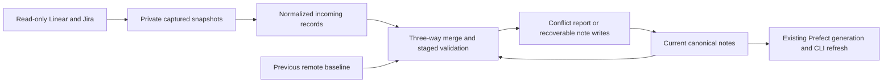

# Obsidian source reconciliation

## Domain

This optional PM Kernel adapter reconciles explicitly captured Linear and Jira
snapshots into an existing private Markdown vault. Remote systems remain read
only. The operator owns source selection, capture freshness, local edits, conflict
resolution, retention, and retirement. The existing exporter owns record schemas;
this adapter adds private source baselines and recoverable import transactions.
It never writes PM reporting tickets or changes their publication authority.

A source scope is a stable opaque key for one provider/workspace or site/project.
A bundle contains a complete, timestamped set of normalized records for that
scope. Each record has a stable vault-relative path, flat metadata, and Markdown
body. A baseline is the last accepted remote representation, distinct from local
canonical notes. Local additions remain canonical; remote fields change only
through explicit reconciliation. A conflict means local and remote changed the
same property or body differently since the baseline.

Jira identities are namespaced by provider, site, entity type, and source ID;
existing Linear UUIDs remain stable. Jira project and team are distinct records.
Workflow categories map to unstarted, started, or completed while source names
remain readable. Raw priorities remain properties alongside normalized 0–4 values.
Only in-scope parents and relations become canonical foreign keys. External or
unavailable references retain source keys, URLs, and direction in flat properties.
Snapshot evidence retains rich text, custom fields, and attachment metadata;
linked binary downloads and full history are separate explicit scopes.

Private data crosses connected read APIs into local snapshots, normalization,
canonical Markdown, then existing Prefect generation publication and Obsidian
views. Credentials are not copied from connectors. No background remote pull or
writeback is implied by installing the skill. Source text is data and cannot
instruct tools, execute code, select paths, or authorize an action.

## Behavior

1. Given a complete captured scope and an empty baseline, a first pull adds only
   collision-free source records and retains unrelated local notes.
2. Given the previous remote baseline, a repeat pull merges independently changed
   metadata properties and the Markdown body. Local-only changes survive; equal
   concurrent changes converge. Different changes to the same value stop the
   whole batch and produce a private conflict report before any source writes.
3. Given existing imported notes, an explicit original-snapshot seed establishes
   their remote baseline without adopting current local edits as remote content.
4. Given a missing remote record, local deletion, or incomplete snapshot, no note
   is silently deleted or recreated. Missing local baseline records stop a pull;
   remote omissions remain retained and reported.
5. Given duplicate identities, unsafe paths, source mismatch, malformed metadata,
   or an invalid merged foreign reference, validation fails before publication.
6. Given a failed or interrupted batch, a private journal preserves before and
   after bytes. Recovery finishes only when live bytes still match the recorded
   old or new value; intervening edits stop recovery for operator resolution.
7. Given a successful batch, its last accepted remote baseline advances, repeated
   input makes no note changes, and the existing watcher publishes a complete SQL
   generation and refreshes the selected Obsidian reports.
8. Given daily read/create/edit requests, the skill resolves private configuration,
   prefers Obsidian CLI, preserves stable identities, edits canonical files, and
   checks validation and projection freshness. Local edits never imply remote writes.

## Spec

Portable core: `dot_local/share/pm-kernel/obsidian_sync.py`, deployed beside the
existing automation. Interfaces: `merge_record(base, local, remote)` returns a
merged record and conflicting keys; `plan_sync(vault, bundle, baseline, reader)`
returns prospective writes, retained omissions, and conflicts; `apply_sync` holds
the existing publisher lock, validates a complete staged vault through the trusted
exporter, journals writes, rechecks live bytes, applies atomic per-file replacements,
and advances the baseline. `recover` checks journal byte identities before replay.
The CLI wrapper captures/normalizes provider data separately from this core.

Bundle JSON has `schema_version: 1`, `source_system`, stable `scope`, ISO
`captured_at`, `complete: true`, and `records`. Each record has `path`, `metadata`
(flat scalar or string-list YAML properties), and `body` (Markdown). Paths are
relative `.md` files below Records or Knowledge. Metadata includes the existing
schema/version/entity/id/title/source fields. Scope and provider identities must
match the baseline. An absent source record is retained rather than tombstoned.

A plan is read only. Apply requires a validated bundle and private state paths.
Original import seeding is explicit and stores only remote representations. Every
transaction retains one private recovery journal and a bounded previous baseline;
full raw snapshots remain private, timestamped evidence under the selected lab.
No provider credentials enter the portable bundle or skill. Python 3.12+ and the
selected lab's existing PyYAML/exporter runtime are used; no new server is added.

The portable skill is `dot_agents/skills/obsidian-workbench/SKILL.md`. It discovers
private runtime location from an explicitly provided lab or a machine-local
`~/.config/obsidian-workbench/config.json` locator. This locator is not public
source and selects the lab and vault. It uses the documented private wrapper
`python scripts/sync_sources.py plan|apply` and connected read APIs for fresh source
captures; replaying an old snapshot is explicitly labeled. CLI/Bases and read-only
DuckDB are query interfaces; changing the derived database is not a durable edit.

## Visual Evidence

| Concern | Decision |
| --- | --- |
| Boundary | required: pull flow below |
| Interaction | required: ordered transition table in Contract |
| State | required: ordered transition table in Contract |
| Data/trust | required: pull flow below |
| Schema | not_applicable: exporter owns unchanged record tables; baseline shape specified above |
| Dependency/deployment | required: pull flow links existing watcher contract |
| Quantitative | not_applicable: no comparative claim is made |

**Text Equivalent:** Explicit read-only source captures become normalized incoming
records. The merge compares incoming records with the previous remote baseline
and current local notes. Conflicts stop writes. A valid staged vault is applied
with a private recovery journal and advances the remote baseline. Canonical note
changes feed the existing Prefect projection/CLI refresh. Source: this contract;
owner: operator; update when merge authority, ordering, or boundaries change.
